# 零基础也能上手的小型变现玩法

## 纯新手友好型小项目实操拆解

作者：bink

日期：2024-02-27

嗨，我是 bin，今天继续给社群里的萌新们带一份可以直接开干的低门槛案例，希望大家都能跟着做一遍，拿到人生第一笔正反馈。

**这个玩法对小白特别友好，完全不需要任何专业背景，也没有任何前期投入，只要你愿意动起来就能跑起来。**

就在 1 月 25 号那天，我注意到一个好朋友用自己的账号在发台球相关的内容，第一天数据就挺漂亮。就是从那个瞬间，我意识到这条路可以做起来。当时他自己都没想到这背后能变现。

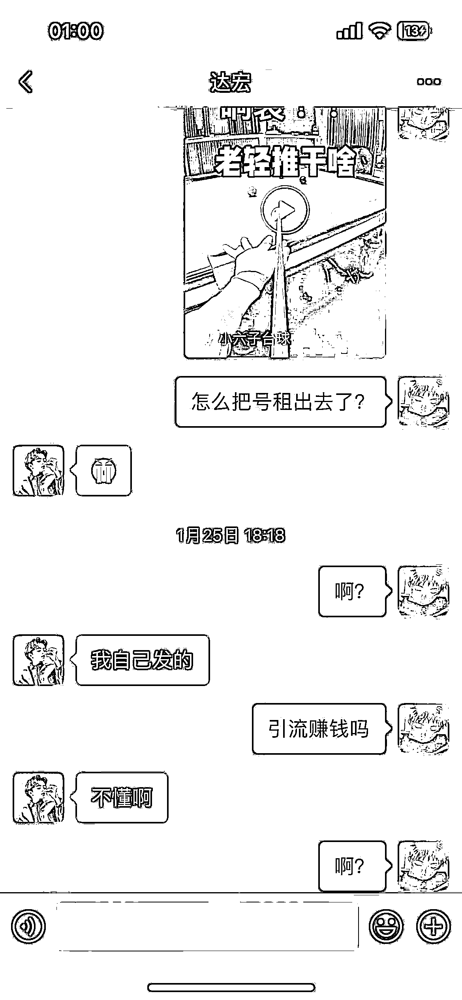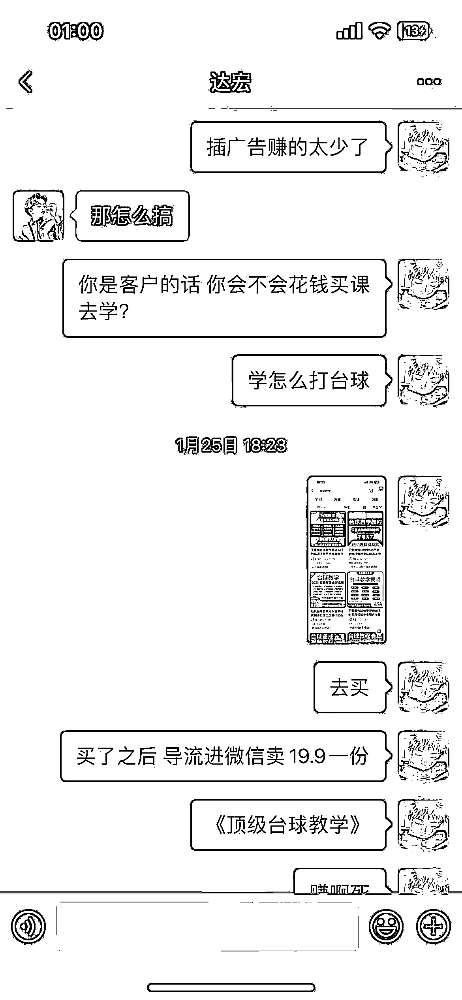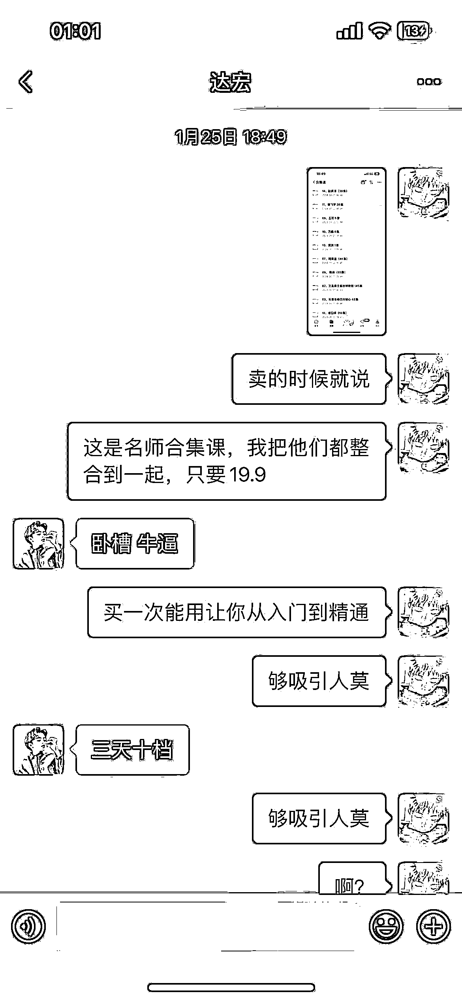

作为一直在一线摸爬滚打的人，我一眼就看出了普通人能从这里分一杯羹的机会。钱不算大，但积少成多。当天我就帮他把变现闭环搭好了，结果当天就产生成交。

## 直接进入干货

**玩法逻辑**：把抖音上的台球教学素材搬到视频号，通过售卖配套教程资料来转化潜在用户。

**优点**：零成本，卖出去一份就是一份纯赚。素材永远用不完，台球教学内容量大到惊人。
只要这个运动还在，需求就一直会存在。

**风险点**：存在侵权问题。不过在搬运时做二次处理，加上账号定位不要绑定某个 IP，风险基本可控。

课程本身加起来成本没超过 5 块，我对外售价定的是 19.9 元一份。

除了卖课，我还顺带做了卖货。因为加过来的用户对器材也有需求，而私域里的需求就是钱。事实证明，球杆真的卖出去了。

所以整体的收入来源有四块：视频原创广告分成、课程销售、器材带货、网盘拉新分成，拉新还在测试阶段。

在视频号跑起来的同时，我又同步上了小红书，收益意外地也不错，下面是部分收益截图。

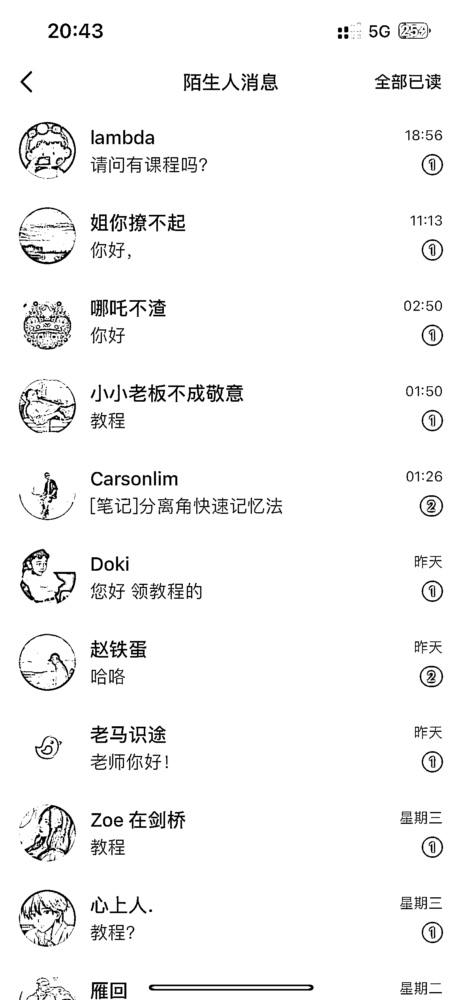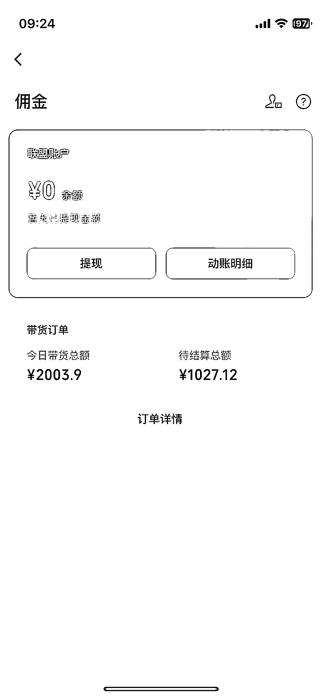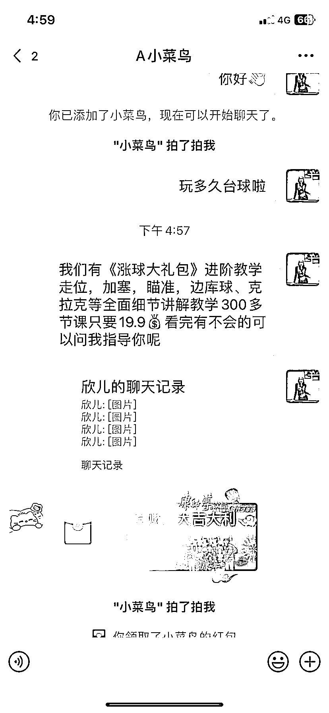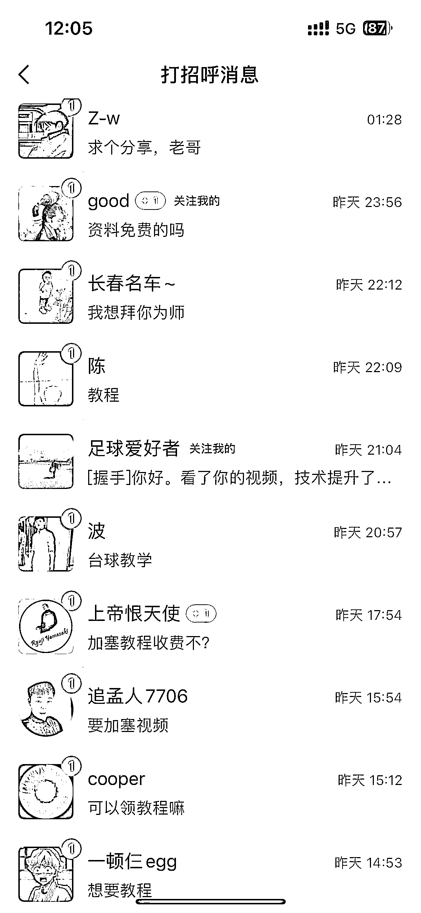

**截止现在累计收益已经破 5000 元，课程单独就卖出了 200 份。整体效果挺满意的，也算是沉淀了一批垂直私域用户。**

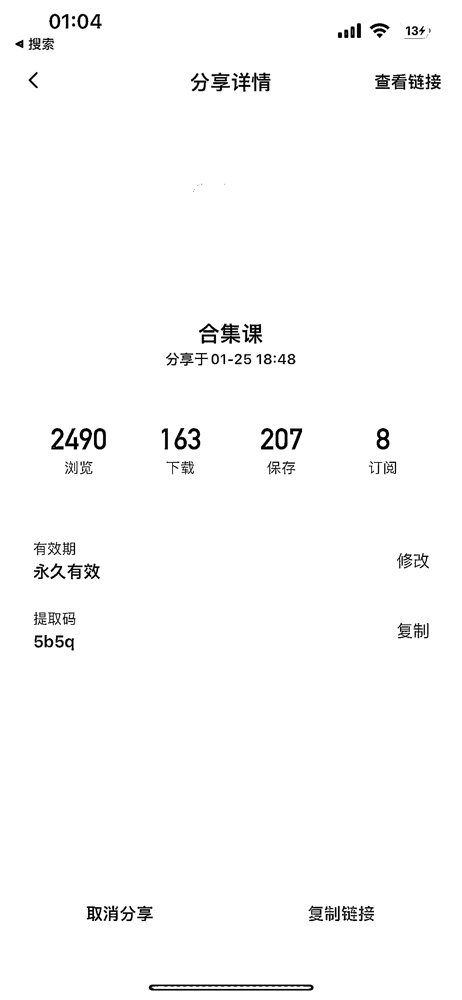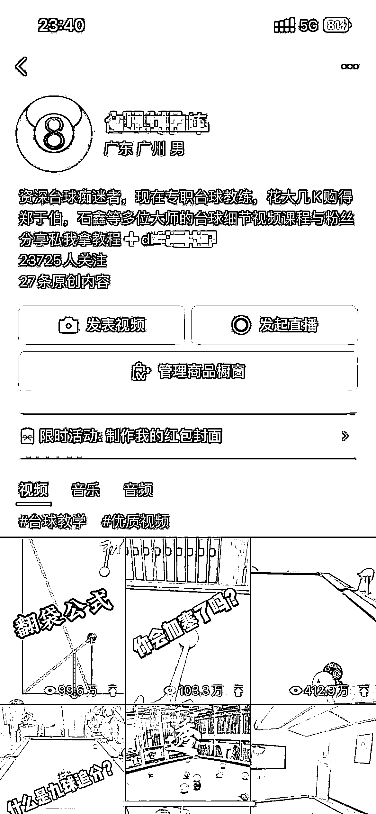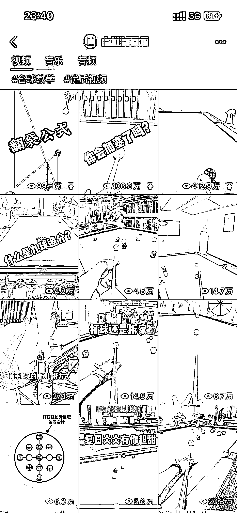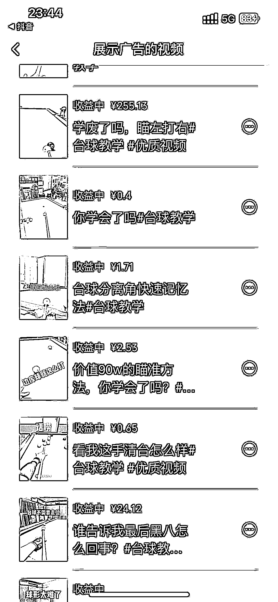

## 具体操作拆解

**1. 账号包装**

视频号的包装很简单。头像就用台球相关的元素，别用抖音博主的真人照。昵称直接定位成台球教练的身份即可。

营造出一个综合型台球爱好者的感觉，不要只搬运某一个人的作品，多源混剪发布就行。

关键点：视频发完后必须在评论区置顶引导语，比如 “想提升准度的主页联系我” 或者引导私信。随后在后台私信里再推微信。
这句话决定了你的转化效率，直接关系到课程销量。

这里还能叠加网盘拉新的玩法，把白嫖流量也变现。文案可以参考网盘拉新的教程，比如 “打开头条极速版，搜索 xxx 台球，领取xxxx教程”。人头单价大概在 8 块左右，也算一笔额外收入。

小红书的操作思路一样。

**2. 微信私域人设**

微信端需要更用心。考虑到受众大部分是男性，我设置了一个美女助教的人设。朋友圈日常就是一日三餐 + 卖课反馈，组合形式是早上性感照、下午成交反馈、晚上高档场景照。朋友圈素材直接搬小红书即可。

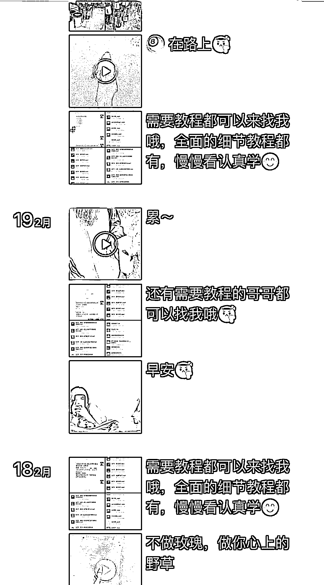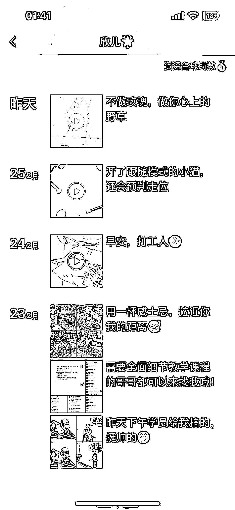

**多发男生感兴趣的内容，提升点开率和互动率。**

**3. 课程资源准备**

课程是最简单的一步，直接去淘宝搜合集，几块钱就能买到，下载后转发就行。

也可以直接用我整理好的资源

【尊敬的超级会员 V5】通过百度网盘分享的文件：合集课

链接：https://pan.baidu.com/s/1nablduEXeT_yEK4dez035w

提取码：5b5q

复制这段内容打开「百度网盘 APP 即可获取」

把以上都准备好后，就去抖音找素材，加个滤镜做点简单二创，发到视频号和小红书即可。然后坐等私信，线上完成卖课。

视频开启原创还能获得广告激励，又多一个收入口，而且台球这个赛道长期都有刚需。

## 收益的进一步延伸

当微信里积累到约 1000 个客户后，高客单需求就开始显现了。

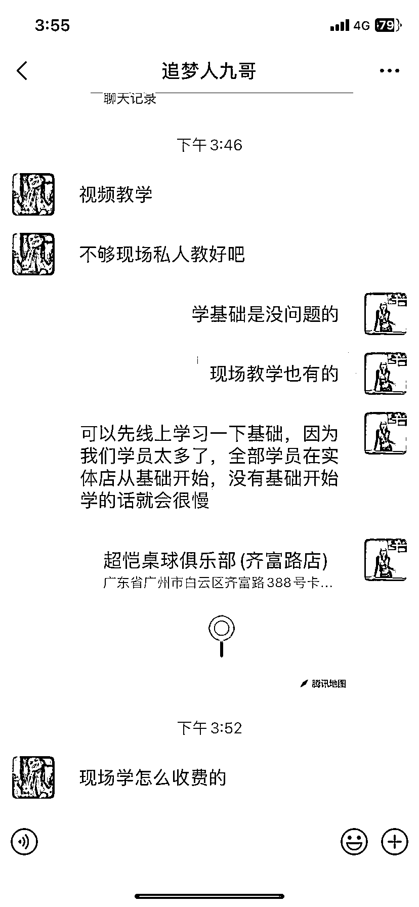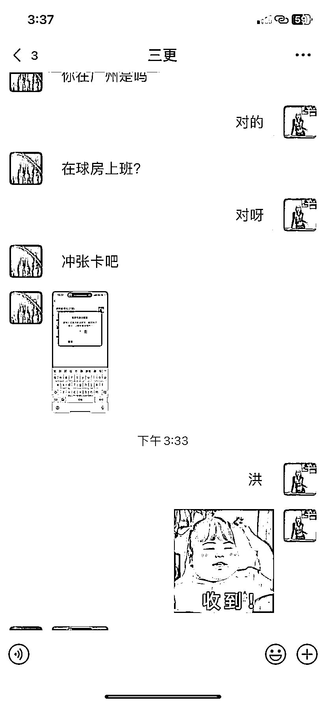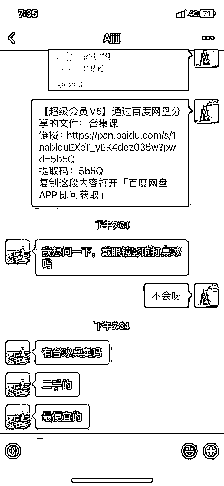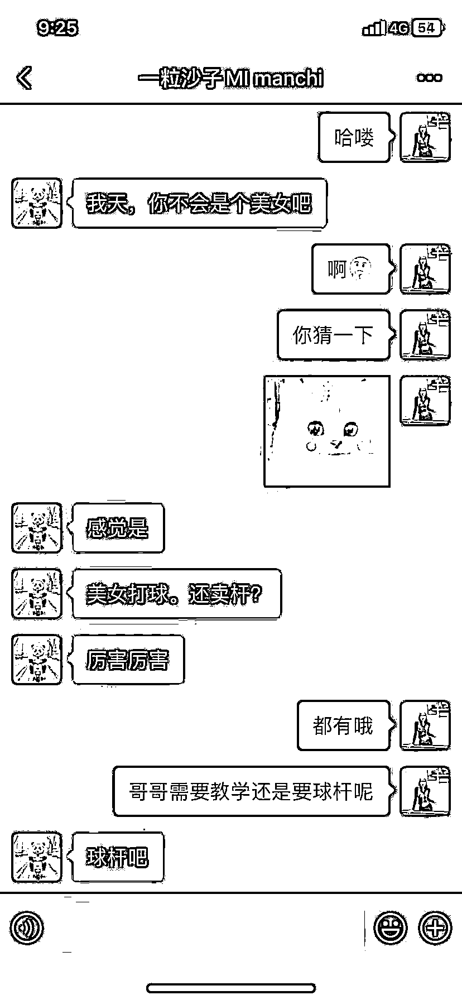

**1. 线下教学**
**2. 球房充值**

这两项都可以和本地球房合作分成。我有个朋友就是助教，时薪大概 98 元。同城客户甚至愿意直接预充 2000 元，当时因为合作还没谈妥钱就没收下。

这对同城球房老板是个思路，现在很多球房靠美女助教来引流的手段是有效的，正反馈已经验证了引流的可行性。

**3. 二手球桌交易**
对于重度爱好者，二手球桌也有需求，可以通过同城闲鱼交付。只是当时在过年期间，没怎么重点推。

**4. 球杆销售**

球杆是进阶玩家的核心刚需，很多客户上来就问杆子，甚至直接在橱窗下单。我不是台球发烧友但我是乒乓球爱好者，非常清楚核心玩家对器材的执念。乒乓球拍一块木板都能卖一千多，只有真爱粉才会买单，比如我已经买了四五块。这种用户通常是高质量用户。

END

看完应该对整个运转逻辑和启动方式已经很清晰了，有兴趣就直接开干吧。手里有台球器材资源的厂家也可以联系我。

* * *

评论区：

发发 : 这么好的项目我可得尽快执行了[旺柴]

烽火 : 非常好的一套 sop 流程

秋闯 : 真强

浪久 : 很棒

微光磊 : 感谢，非常细的分享[呲牙]

菜菜 : 龙哥刚买了一根 3w 的杆子

cm : 非常详细的 SOP[强]

bink : 实力啊

* * *