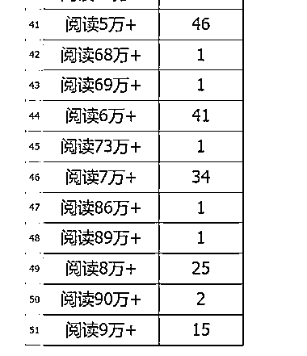
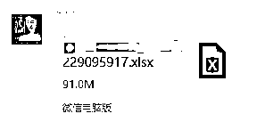
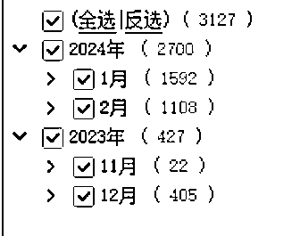
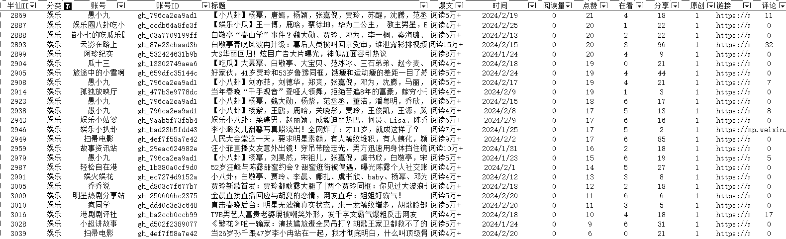

# 👸号爆文还有多少机会？我翻了30万条数据，得出5个反常识判断
作者：龙哥

大家好，我是龙哥，圈里朋友也叫我“素材魔法师”赵天应。

前阵子，我从2024年2月抓取的🛰️推荐数据里，整理出一批样本：合计近30万条👸号内容，总体积91M。数据源大多来自🛰️生态内的推荐位，比如文末的“相关文章”、“看一看”，以及其他入口。

每条样本的信息都很完整：分类、标题、是否爆文、发布时间、阅读量、点赞量、在看数、分享数、是否原创、原文链接、评论数、文章简介、高赞评论等都有。

数据多，噪音也多。我用RPA做了几轮清洗，规则很粗暴——阅读量在3万以下的直接扔掉。几十万条最终只留下10%，剩下3127条有效样本。

看日期，样本几乎都集中在近3个月。这说明🛰️推荐明显偏爱新内容，尤其会主推1到2个月内的文章。我这里显示跨度有4个月，是因为采集横跨了1月和2月。

看行业，排在前十的依然很“传统”：娱乐、时事、职场、军事、教育、情感、电视剧、生活、社会、科技。
所以，你以为最卷的领域，恰恰是最容易出爆文的领域；流量多的地方，赚到钱的人也多。

基于这些数据，我整理了几个观点，不一定对，但也许能给你一点新视角。

### 1. 👸号“捡流量”的黄金期过去了
以前抓推荐数据，动不动就是10万+、100万+。现在这个景象少了。有一种可能是腾讯调整了推荐算法，把总量分散给更多文章；另一种可能是抖音、微头条、📕这些平台抢走了大量注意力。无论如何，靠“随便发发”就想流量爆发的时代，基本结束了。

### 2. 大众赛道卷归卷，小众领域依然有肉吃
做内容的人容易觉得自己已经挤进红海，实际上，我们只是在森林入口的一片小树林里转悠。整个大森林还大得很，至少80%、甚至99%的人根本不知道这片天地。

最卷的赛道里，有人撑不住离开，有人没方法做不出成绩；但那些活下来的人，多半是靠持续做、持续等，等到了属于自己的时机。而小众赛道更舒服——结合方法论，借助AI，再玩点跨界打劫、降维打击，反而活得很好。

### 3. AI不是可选项，效率优化是必答题
有个经验说法是：一个动作重复超过三次，就可以考虑自动化了。
《唯有偏执狂才能生存》里也有一种感觉：我总觉得有朵乌云在向我飘来，但可能要几年后才能看清楚它是什么，所以只能诚惶诚恐、小心翼翼地做事。

在我看来，2024年的这朵乌云就是AI。所有行业都值得用AI重做一遍：文生文、文生图、文生视频，每一个环节都能和自己的业务结合，找到优化空间。

放到👸号上，问题可以列一长串：账号数量够不够多？有没有自动化的管理流程？能不能批量生成文章？能不能用AI辅助配图？能不能自动检测内容质量？能不能对文章和数据进行分词、拆解与二次拓展？这件事有太多可以做的。

### 4. 爆文不完全是靠实力拼出来的
👸号算法改版后，越来越像搜索引擎：去中心化，把流量慢慢释放出来。
在这个过程中，虽然很多人尝试拆解规则，但算法核心一定是不透明的暗箱/灰盒，没人知道完整逻辑。我搭素材库，本质上只是用真实案例说话，帮大家判断哪一类文章爆的概率更大。

所以，爆文不是一门纯技术活。技能到底占多少，得看具体场景：可能低到两成，也可能高到八成。
在小众领域里，你稍微用心，也许只需要30%的技能，剩下交给运气，就能拿到不错的流量；
在大众最卷的领域，可能需要80%的技能，外加20%的运气。
不过，大众领域也有解法：先选对题，再解好题——把大赛道继续细分，找到更垂直的空位。这样能降低技能权重，提高运气权重。

### 5. 能赚的时候，就赶紧赚
目前👸号还能做。如果你手上没有更好的项目，不如抓紧入场：先干起来，先赚到小钱，再想办法多赚，最后稳赚。如果一直站在场外，那么风口再大，也和你没什么关系。

更详细的数据和资料，我放在飞书文档里了：

