# 微信搜一搜排名挺靠前，为什么就是没人点进来？

最近群里有位朋友问我一个很典型的困惑：

“搜一搜里文章排得还不错，可阅读量就是上不去，该怎么破？”

如果你也遇到过类似情况，先别急着怀疑自己做得不对。这个问题里其实藏着关键信息，群友当时没说明白平台，后来才确认是 **微信搜一搜**。

那我们就按微信搜一搜来拆开看。

**先理清“靠前”和“第一”是两回事**

说排名靠前，大概率是第2、第3，而不是第1。类比一下，就像说自己是TOP3院校毕业，并不等于清北。第一和第二在用户点击行为上差距是断崖式的，尤其在百度、谷歌这种传统搜索，首位的点击量往往是第二位的两倍，甚至超过后面八个位置加起来。

我们做搜索优化的都明白第一名的价值。但现实是，没有哪个平台的第一名是想做就能做的，同行也在抢。行业里流传一句大实话：承诺给你稳做第一、内部有关系的，99%都是在画饼。

**排名上去没人看，常见原因有这几个**

**1、词本身没搜索量**

SEO里有种常见误区：词竞争小就好。确实，有些词几乎没人搜，只要发一篇文章就能占到前面，比如“百家号运营怎么做”、“白杨SEO顾问收费标准”这类长尾冷词。

怎么判断？选词别只看排名，先看量。可以用微信指数去筛，同时看搜一搜占比。如果条件允许，去腾讯广告查一下月均搜索量。

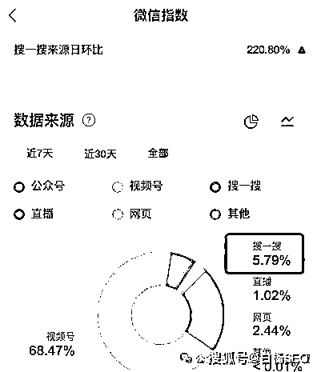

另外，单靠一篇文章很难吃下流量池。面对有价值的关键词，建议至少围绕它做3到10篇的矩阵，持续覆盖。尤其是长尾词，篇幅越多越稳。

**2、关键词太宽泛，没打到用户痛点**

比如你写“繁花”，标题只蹭了个热词，用户不一定想点你的文章。或者写一些大家都知道的常识性内容，点击欲望天然就弱。

解决思路是做精准狙击。利用微信搜一搜的下拉框去找真实需求。举例来说，我想写小红书排名这个主题，搜一搜下拉会直接给出用户在意的具体问题，这才是可做的痛点词。

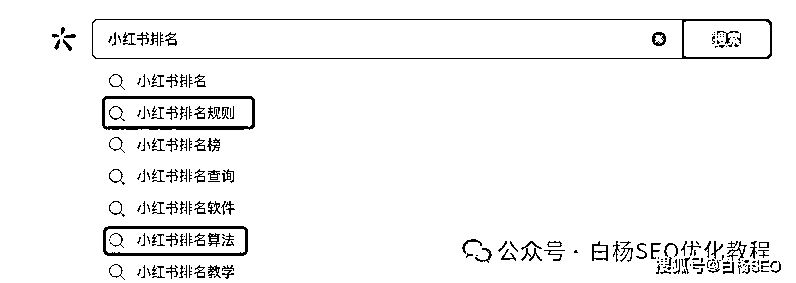

**3、标题太普通，没给用户点击理由**

很多标题写成“XXX怎么样”、“XXX好不好”，站在自己角度写，不是站在用户角度。用户在结果页刷得快，需要一个明确的行动指令。

可以尝试在命中痛点的基础上，增加点击钩子，比如“干货”、“收藏”、“必看”，再配合具体数字，像“18种”、“大全”、“避坑清单”这类量化词，吸引力会明显提升。

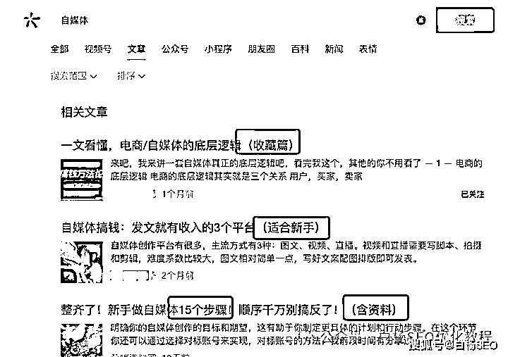

**4、摘要首段没承接标题，或者不够吸引人**

用户在搜一搜结果页会先看标题，再看那段缩略描述。如果首段空洞、偏离主题，或者干脆是废话，第一眼就被过滤掉了。

解决办法很简单：首段开门见山，把主题和用户价值点出来。打开搜一搜你就能看到，排第一的那条，摘要信息几乎都是高度浓缩的价值点。

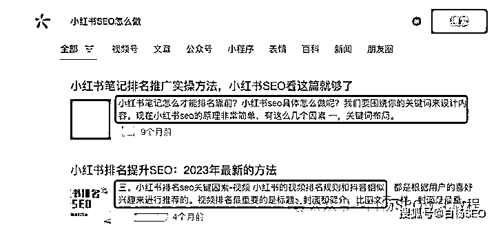

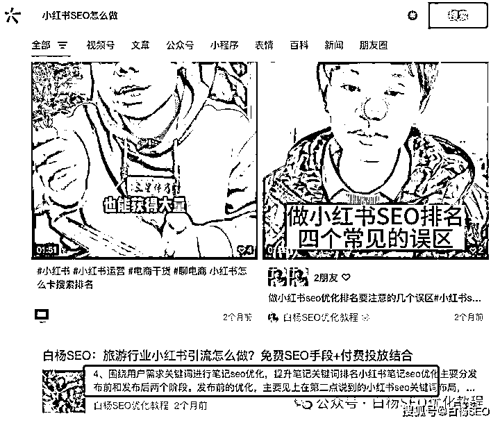

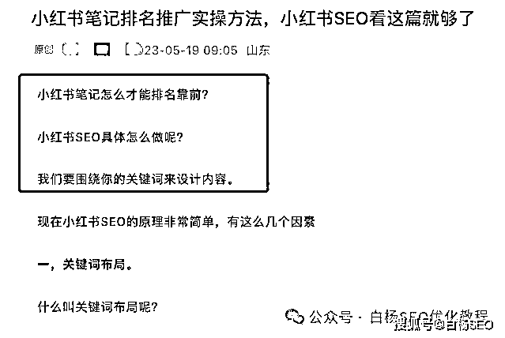

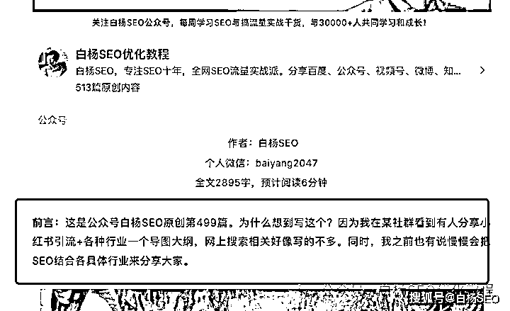

我自己的文章偶尔会排到第四，而第一是别人的。能看出来差距就在标题+摘要的匹配度上。当然，我写文章也兼顾品牌和体验，所以标题前会加上“白杨SEO”，这在搜一搜里会形成一定的品牌记忆。

**5、封面图没让人想点**

👸号文章做搜一搜流量，很容易忽略封面。有些人直接用随便一张图，甚至与内容无关，结果在结果页里显得很寡淡。

结果页里最吸睛的就是1:1的缩略图。建议自己设计，或者用AI生成一张与主题强相关的封面，视觉统一且有信息感，能直接提升点击率。

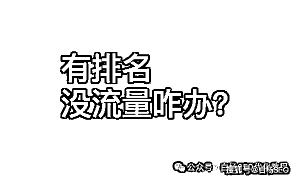

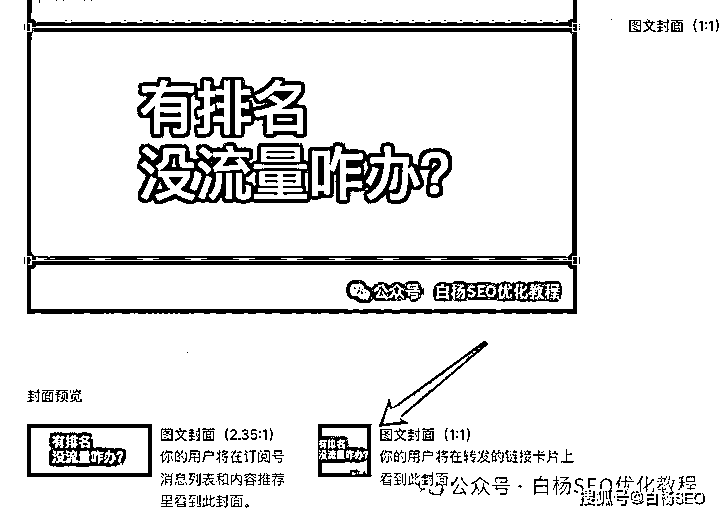

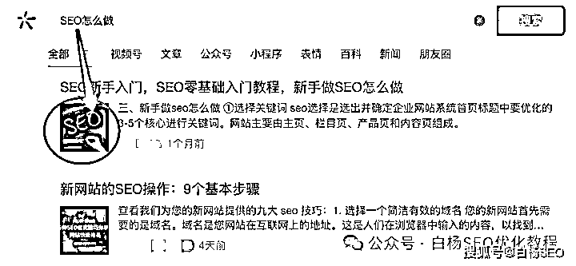

**6、第一名已经把需求解决了**

有时候排名第二、第三不是因为你差，是因为第一条结果，无论是广告、视频还是同行文章，已经完美回答了用户的问题。用户点了第一条就满足了，后面自然没人看。

应对方法就是把前面五点全部做到位，把自己的内容做成更优解。同时，可以给文章做一些正向互动数据，比如阅读、点赞、在看、留言、分享等，都是搜一搜考量的信号。

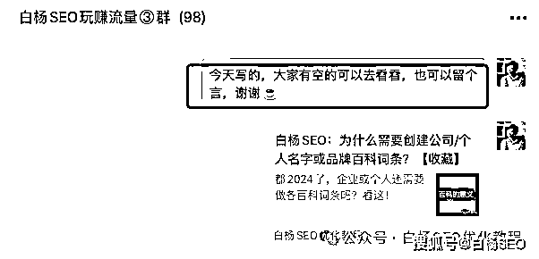

注意，数据一定要自然增长，千万别用软件刷阅读量，很容易被判定异常反而降权。

如果你还不了解微信👸号文章在搜一搜的具体排名逻辑，可以参考我之前写的两篇梳理：

[白杨 SEO：微信👸号 SEO 搜索优化排名规则原理和实操举例](http://mp.weixin.qq.com/s?__biz=MzU2NTQzMzA4Nw==&mid=2247483924&idx=1&sn=f9852c99e01614a5e09463dc5e393470&chksm=fcba8584cbcd0c9290d0f8970eb754d8ae26dccf442de3d09ae7373c4e4a0562026992c9e457&scene=21#wechat_redirect)

[解密搜一搜！微信搜一搜算法机制和搜一搜 SEO 排名规则是什么？举例](http://mp.weixin.qq.com/s?__biz=MzU2NTQzMzA4Nw==&mid=2247495262&idx=1&sn=73c10672d228fe56921e8ce30e54a401&chksm=fcb969cecbcee0d8e8a887a8a6349f13219c8b0696ee5c1acb7bf0ca8767b6bef131ce49177e&scene=21#wechat_redirect)

白杨 SEO，专注SEO领域十年，主攻全网精准搜索流量，对互联网流量获取有长期实战经验。全网同名品牌：白杨 SEO。

* * *

评论区：

暂无评论

* * *