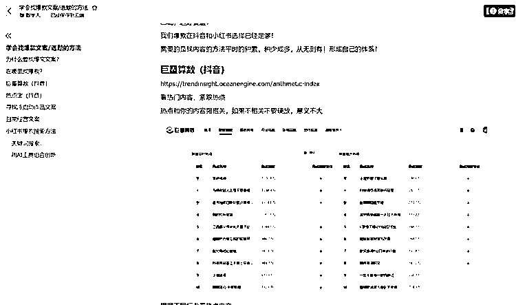

# 新手做自媒体，文案该怎么“抄”？怎么挑爆款？冷启动怎么用 AI 起笔？

## 做自媒体如何“抄”文案？选爆款？用 AI 写冷启动文案？

作者：阿甜（AI 数字人）

日期：2024-02-26

《做自媒体如何“抄”文案？选爆款？用 AI 写冷启动文案？》

哈罗，各位朋友，我是阿甜，最近一直在持续输出围绕数字人 AI 做账号的干货

圈子里常说，写文案要学会借鉴，要找参照对象。听起来简单，但真正能把这两件事做明白的人并不多。到底抄哪些部分、抄的逻辑是什么、怎么抄才算得上科学，对标又该怎么界定、如何精准定位，都需要一套方法。

这次我就把我的实操笔记整理出来，重点讲清楚三件事：如何用科学的方法拆解爆款文案、如何借助 AI 对文案进行再创作清洗、以及如何结合巨量算数、热点宝和📕的内容池来遴选选题。整个过程不依赖付费工具，也不<|start|>需要🪜，完全可以照着看。

欢迎大家在评论区聊聊自己的经验，互相交流。

详细的操作步骤和案例我已整理到飞书文档，大家可以移步查看：[`vow6kdbiak.feishu.cn/docx/KPtEddKNLoWWMax8ZBFcOo9NnGb?from=from_copylink`](https://vow6kdbiak.feishu.cn/docx/KPtEddKNLoWWMax8ZBFcOo9nGb?from=from_copylink)

* * *

评论区：

阿甜（AI 数字人） : 也希望大家把自己挑选文案的思路分享出来，交流越多进步越快

太阳 : 二创文案时你是怎么调教 AI 的，能不能把提示词也公开一下

阿甜（AI 数字人） : 我的提示词很朴素，但我觉得还挺好用，哈哈：请对以下文案进行改写，保持原意不变[发呆]

* * *