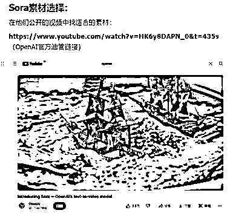

# Sora视频+数字人，我搞出了一条新片子

最近Sora太火了，我也忍不住试了个“混搭”玩法：把Sora生成的视频跟数字人放在一起，做出一条新视频。整个过程挺顺的，从找工具到最终合成，我分步说一下。

工具倒是先解决的。本来想用Heygen，但价格不美丽，就找了个替代网站，功能差不多，花费少了很多，适合我这种尝鲜的。

有了工具，开始挑素材。从Sora样片里选了几段，重点是画面干净、构图合理，方便把数字人放进去。这一步很关键，选不好后面合成会很别扭。

素材选完写文案。我根据画面内容编了段口播，字数不多，让数字人讲起来更自然。

文案定了，再挑音色。试了好多声音，最终选了一个跟画面气质接近的，把文案朗读出来，然后和视频合成。

最后效果让我挺惊喜。Sora负责天马行空的画面，数字人负责把故事讲出来，这种组合感觉潜力无限。不过要真正“随便做内容”，还有一道坎：人物一致性。后续可能要靠固化角色设定，类似Midjourney的办法，或者用换脸来兜底。

* * *

有朋友在评论里说“无限可能”，也有人觉得只要让同一个数字人出现在不同视频里还能保持一致，就真的无敌了。有人提议先“抽”一个固定人物，再基于这个生成；或者直接换脸。总之，玩法很多。

* * *