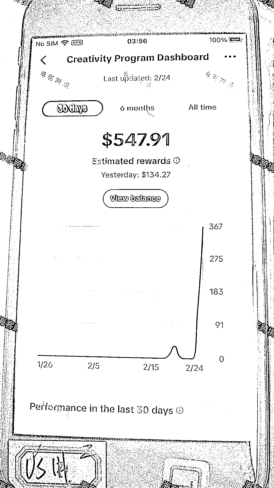
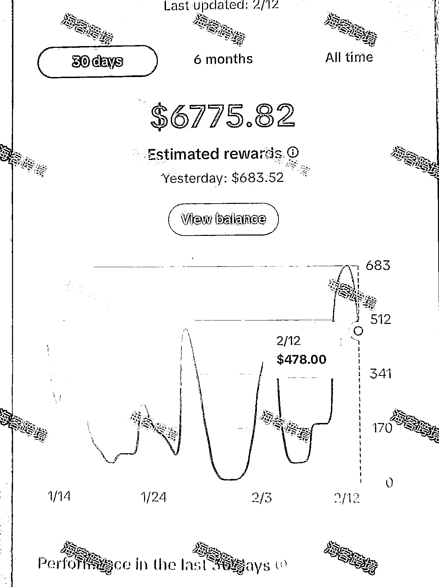
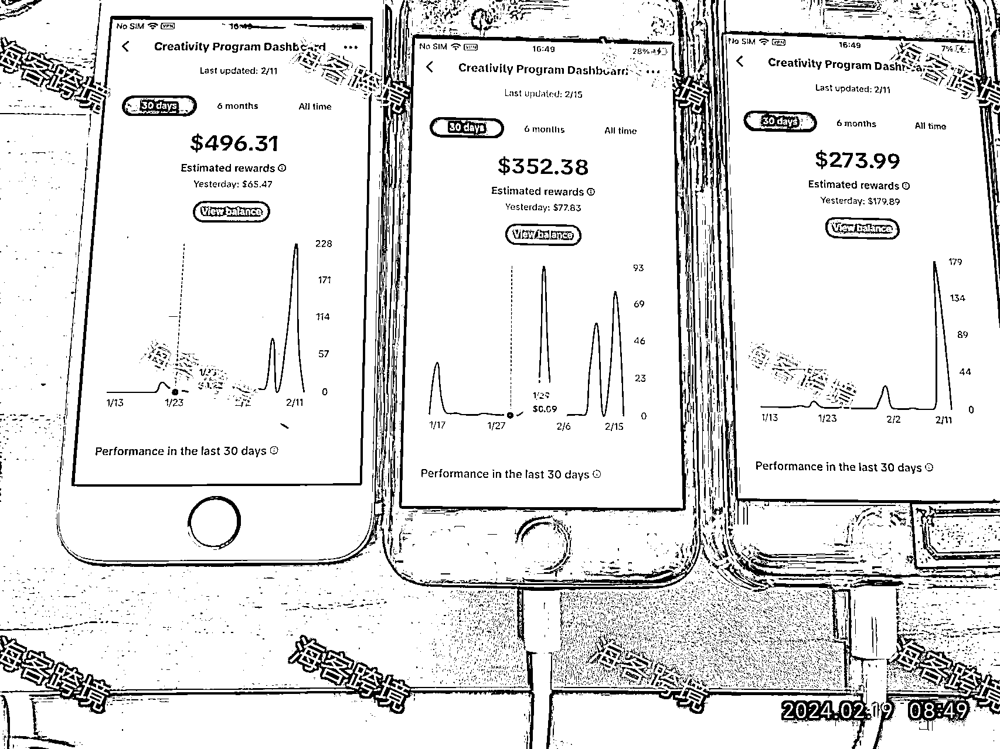
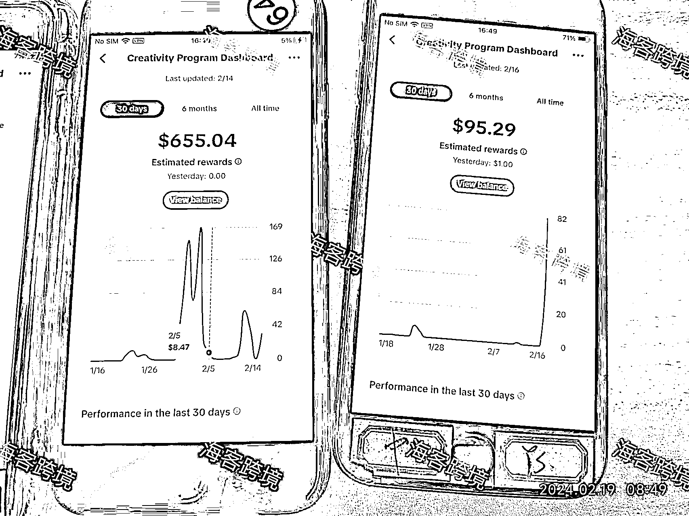
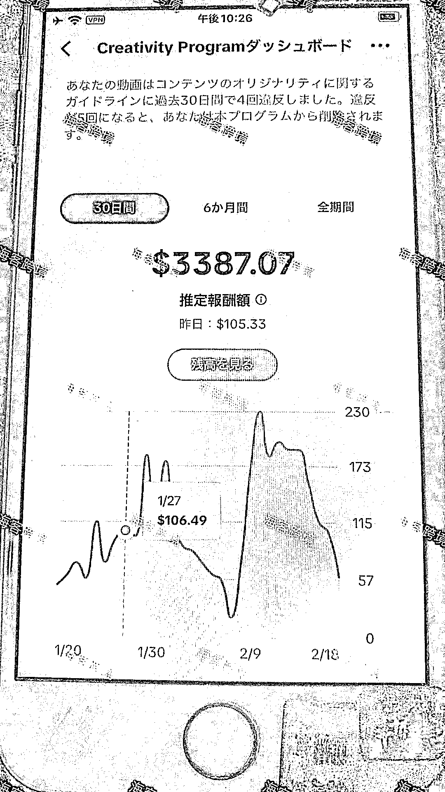

# TikTok 中视频变现实操复盘

原文链接：[`www.yuque.com/for_lazy/thfiu8/ri4e8x1x6evqzzqc`](https://www.yuque.com/for_lazy/thfiu8/ri4e8x1x6evqzzqc)

## 52 赞 TikTok 中视频计划

作者：子白
发布日期：2024-02-26

【TikTok 中视频计划】

哈喽大家好，我是子白，又来分享一波干货了，今天重点聊 TikTok 上的中视频项目。

要说中视频计划，对做抖音的老玩家来说早就不是新概念。早在 2021 年 6 月，西瓜视频、抖音和今日头条就联合推出过中视频计划，当时官方砸了 20 亿来扶持创作者。规则很简单，只要在平台发布时长超过 1 分钟的作品，就能根据播放量拿到对应的分成。

我们团队平时主打的是 TikTok 投放带货和自然流直播带货，脑子里全是变现。TikTok 早就开启了中视频项目，我们之前压根没放在心上。直到去年 11 月中旬，看着圈子里一堆人晒流水、晒收益，实在按捺不住才开始上手试水。

结果挺倒霉的，入场时机正好撞上平台大调整，各种老玩法被封，走了不少弯路才拿到一份还算说的过去的数据。

今天就把我这段踩坑经历整理成一份可直接上手的操作笔记，希望能帮大家少走弯路。这个项目说白了门槛不高，真正需要的是时间精力，核心壁垒在于内容选题和素材挑选，运气成分也有那么一点。硬要算启动成本的话，入门只需要一台电脑配上 3 到 5 台 iPhone 就能开干。特别提醒一下，机器一定要是 iPhone 8 及以上机型，现在 iPhone 7 基本已被系统判定为工作室设备，很难正常起号。

为了阅读更顺畅，详细流程我整理到了飞书：[`spg0xsnzv2.feishu.cn/wiki/C3OcwL6Nhik3JDkNiR5cilqHneh?from=from_copylink`](https://spg0xsnzv2.feishu.cn/wiki/C3OcwL6Nhik3JDkNiR5cilqHneh?from=from_copylink)

* * *

评论区：

子白 : 如果你连 TikTok 都还没装好，直接看本教程的第四章就行。

* * *