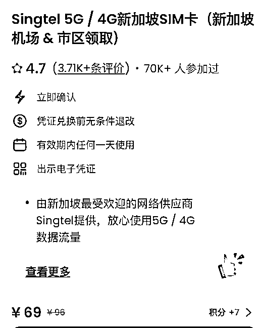
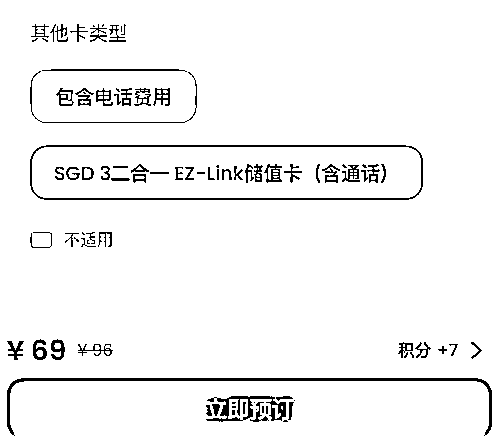
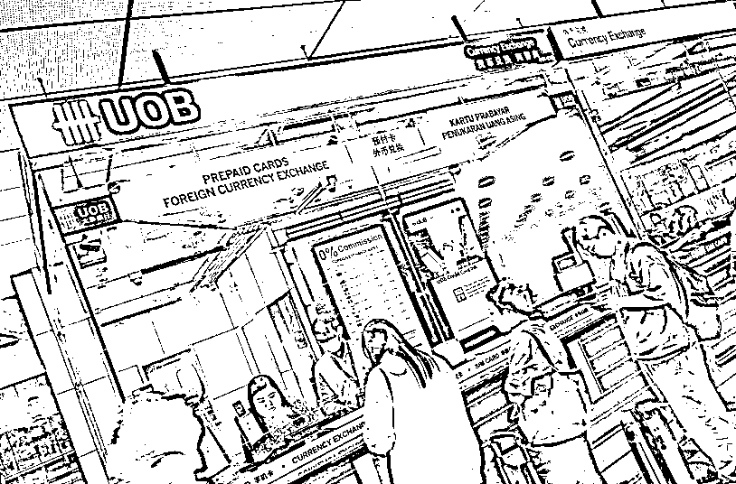

# 新加坡的商机与真相：2024免签入境全攻略，从商业思考到落地准备一篇讲透

提到新加坡，很多人第一反应是“花园城市”“金融中心”。但真正深入逛一圈后你会发现，这里与其说是一个人人平等的创业乐园，不如说更像一个“富人俱乐部”和“企业出海的中转站”。最近，我跟随赚钱航海家比浪组织的新加坡游学团实走了一趟，收获颇多，来和你聊聊我的观察。

## 为什么这么多人往新加坡跑？

最常见的有四类诉求：

1. **教育**：新加坡的教育水平全球名列前茅，不少家长把孩子送来读书，也有一部分成年人专程来提升学历。
2. **资产配置**：对高净值人群来说，这里是做海外资产配置的热门地。
3. **全球总部**：做出海生意的人，特别喜欢把全球总部放在新加坡。尤其是中美贸易摩擦持续，不少产业向东南亚转移，很多老板先在这里设立分部，再逐步把业务扩展到周边国家。
4. **高端医疗**：一些经济条件不错的人会来新加坡做体检，因为这里的新药基本和欧美同步，能更快接触到最新的治疗方案。

## 但新加坡本地生意，真的那么好做吗？

如果你以为来到这里就能轻松赚钱，可能要先冷静一下。

新加坡地方很小，面积只有深圳的三分之一，人口大约五百多万，本地市场容量相当有限。举个例子，在这里做共享充电宝，很可能连成本都覆盖不了，因为盘子实在太“迷你”。

电商在本地也不算发达，快递速度甚至让人着急。新加坡每个居住聚集区几乎都有大型商场，买东西太方便，所以大家对网购的依赖度并不高。疫情三年虽然让电商份额有了一些增长，但整体占比依然不高。加上快递丢包率高、配送慢，本地商家发货有时一拖就是一周，这些都在限制电商的发展。

另外，新加坡的人口组成非常多元，有华人、印度人、马来人、印尼人，也有欧美人。宗教信仰和文化差异不容忽视，做生意的每一步都要考虑这些因素。

还有一点很现实：注册公司的成本不低，维护成本也高，要求还多，比如至少需要一名本地董事。人力方面更是堪称“反内卷先锋”，员工到点就下班，拒绝加班，周末想找人都难。

## 那机会到底在哪？

新加坡更适合做富人的生意，也更适合做B端商家的生意。

比如，当地一位做财税规划的朋友分享了一个很不错的商机：帮新加坡本地的商家做线上营销推广。因为很多本地商家还停留在传统的线下获客方式，几乎不做线上推广。如果你能帮他们做网站SEO优化、社交媒体引流，这就算一个很精准的切入点。

## 2024新加坡免签入境指南：行前准备

接下来是实操干货，想省心省力地入境，这些东西要提前弄好。

**1. 护照**  
有效期最好超过六个月。

**2. 机票和酒店**  
建议提前两三周预订，价格更划算。最好把往返机票和酒店订单各打印两份，入境时可能会抽查——虽然我们最后没用到，但有备无患。我对比了一下，去哪儿网比携程便宜一些。

**3. 电话卡**  
可以在淘宝买，也可以用“Klook”App买Singtel 5G套餐。有一种电话卡和交通卡二合一的卡：把电话卡取下来之后，整张卡片还能直接在地铁站充值当交通卡用。

如果要买这个二合一套餐，记得选对：

注意，这个卡需要下了飞机、出闸机之后，到机场柜台现场领取。而且必须提前一天买，当天买是不行的。购买订单页面的二维码一定提前截图，不然到现场没网就真的傻眼了。

机场柜台位置在这里：

**4. 国际信用卡**  
带Visa或万事达标志的基本都行，最好选择不带银联标志的。不同银行的卡最好多带几张，有些卡偶尔会失灵——我们同行有人用招商银行卡刷地铁，进站没问题，出站却提示错误，场面很尴尬。

**5. 现金**  
可以提前在中国银行预约兑换1000新币左右，面值尽量小一些。机场也有兑换点，但汇率不太友好。玩一周的话，1000新币其实完全够用，我们最后现金只花了三百多，因为90%的场景都能刷信用卡，小部分甚至能用支付宝和微信。

**6. 衣物**  
短衣短裤是标配，新加坡天气非常闷热。

**7. 手机App**  
最好提前装好：谷歌地图、谷歌翻译、Grab（叫车和叫外卖）。华为手机用户可以用“出境易”App或“Petal地图”替代谷歌地图。高德和百度地图也能用，多个地图软件交叉着看路线，会更靠谱。

**8. 插座转接头**  
这个别忘了，新加坡的插座制式和我们不一样。

## 落地之后的注意事项

入境前三天需要填写电子入境卡，官方网址是：https://eservices.ica.gov.sg/sgarrivalcard  
具体操作可以参考这篇教程：《免签入境新加坡该做哪些准备工作？》

只要提前填好，入境时就非常方便，直接走电子闸机，验证护照和右手大拇指指纹即可，全程无需人工接触。

关于交通：如果你没买刚才提到的二合一卡，常规做法是办一张交通卡。不过，有些国际信用卡也能直接刷进站，但并不是所有卡都灵。如果刷不了，还是老老实实办交通卡吧。

新加坡被大家调侃有很多“奇怪规定”，比如地铁上不能喝水吃东西，公共场所不能吸烟。但实际体验下来，除了地铁上最好守点规矩，其他地方并没有那么多警察盯着，角落里抽烟的人照样不少。

住宿方面，我订的是Funan附近的Lyf公寓，大约1000人民币一晚。房间很小，但挺干净。没有拖鞋，也没有牙刷牙膏，需要自备。

打车非常贵，出行尽量选择地铁或公交。尤其要注意地铁换乘：从机场过来的线路，有时两边车门都会打开，两个方向是不同换乘方向，千万别搞错。

新加坡华人非常多，只要看到华人面孔，基本都可以直接用中文沟通，完全不用担心语言问题。

物价偏贵，但还在可以接受的范围。不过在商场里吃饭，一般要收取9%的消费税和10%的服务费。如果去小店或者食阁（需要自己收拾餐具的那种），这两笔费用通常是免掉的。

最后回答一个小问题：有人问这个游学项目是不是官方组织的？作者回复：不是，是私人组织的。

希望这份新加坡商业观察和入境攻略，能给你带去一点参考和帮助。