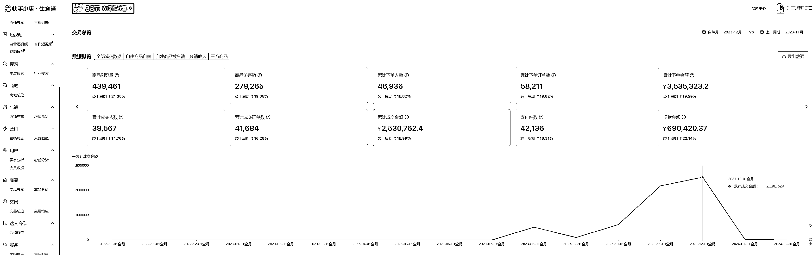
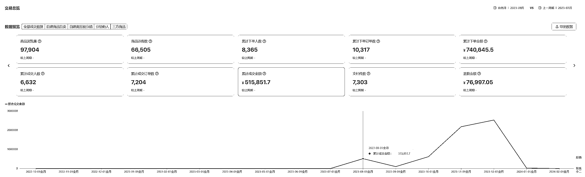
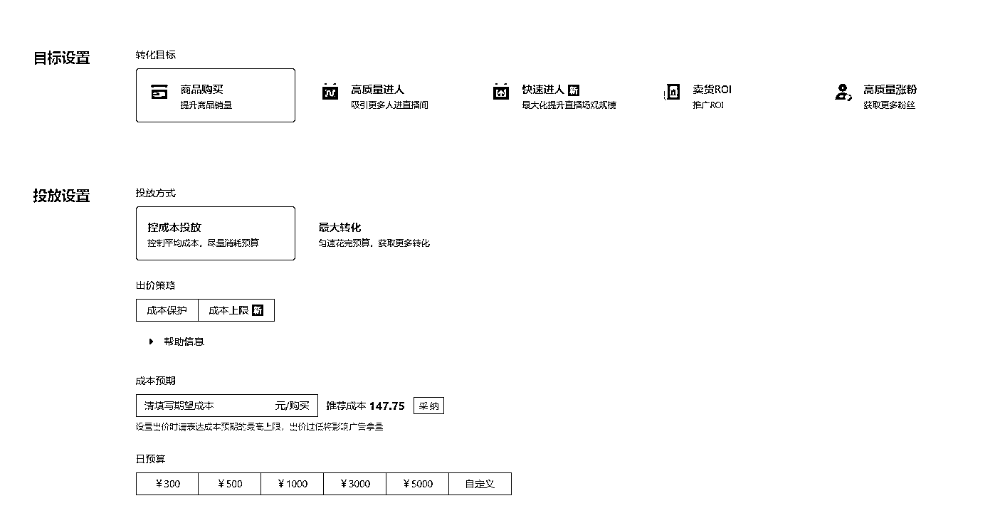
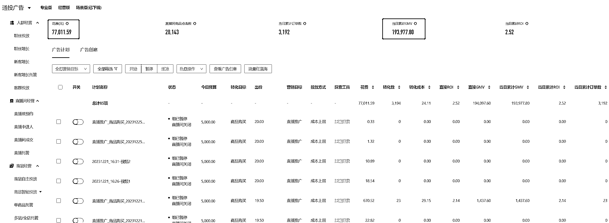
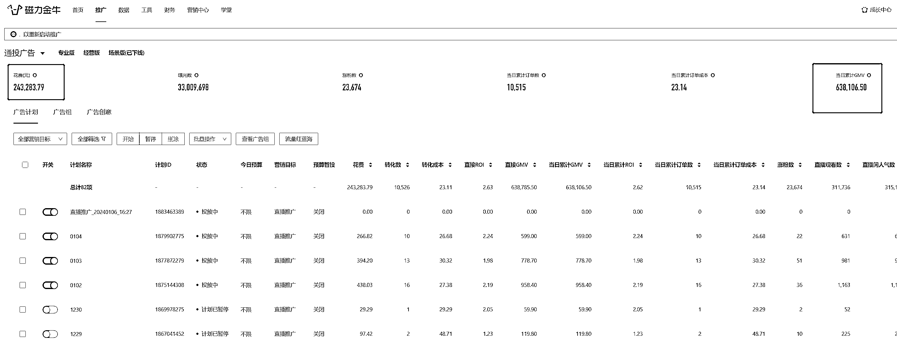

# 四个月把快手应季单品做成净利润 120 万，付费投流实操复盘全拆解

> 原文：[`www.yuque.com/for_lazy/thfiu8/bneftnn2wsotf10y`](https://www.yuque.com/for_lazy/thfiu8/bneftnn2wsotf10y)

## 快手应季爆品 4 个月拿到 120 万净利，付费投放打法万字复盘

作者：书豪
日期：2024-03-01

大家好，我是书豪，一直在琢磨如何把利润再往上提的龙珠圈友，也是小红书店铺和航海直播教练。

2024 年的电商环境会变得更残酷，内容电商的淘汰潮会越来越猛，直到大量玩家被彻底洗出去。

不管是小红书、快手、视频号还是抖音，留给我们电商小团队的生存方向其实就两个：要么拼低价内卷，要么拼内容升级。

别期盼流量回暖，流量只会越来越贵。做短视频直播的团队都懂，内容电商平台的盈利空间正被不断压缩，对测品团队和白牌玩家尤其不友好。

**小红书+快手联动测品，多平台分食利润，是当下打品团队增厚利润的一种典型路径。**

短视频直播还是电商风口吗？不是了，已经不是躺着就能赚钱的 Easymoney。

如果你亲自操盘过短视频直播带品，体感一定很真实：赚钱真的变难了。

现在自然流+微付费，能稳定获利的几乎只剩头部达人，连大牌都未必敢打包票。

最近和圈内人吃饭，聊到最后有人总结了一句：“想赚钱想活得稳，打品团队好像就剩付费这一条路了！”

直播本质上是一门渠道生意，渠道之下打法百变，平台之间可以切换。当一个平台太卷，就果断换赛道；当一种打法失效，就去找护城河更深的玩法。

*电商归根结底是生意，我们都是普通人，做生意的终点就是赚钱。*

不管是做付费投放还是无人直播，核心都是降本增效。

前段时间操盘的一个品，起量非常凶猛，GMV 从一天 2 万直接飙到 50 万，利润跟着翻倍。很多人不知道，这个品我们已经打了三个月，人工成本基本可以忽略。

接下来我会把选品、测品、内容、投放的整体思路和落地方法完整拆开，希望对还在做电商直播的同行有所启发。

**-----目录-----**

1. **短视频直播电商的现状思考**
2. **选品测品的核心原则**
3. **内容制作的底层逻辑**
4. **投放实操的链路拆解**

回头看自己入门电商的经历，弯路绕了不少。

以自然流项目为例，虽然前期投入低，但流量和模式完全受制于平台，团队作战不稳定，利润波动大，每天都活在焦虑里。如果月收入只能在几千到几万之间波动，对老板来说性价比太低。

**一个健康的团队和模式，要同时满足三点：**

1. **能够持续盈利，且有利润和规模双增长的可能，从而拉高收入天花板；**
2. **变现模式相对稳定，从按天算账过渡到按月规划，更利于项目排期；**
3. **团队成员有成长空间，人效能被持续提升；**

思考一个问题：如果项目做不到提效增利，就意味着成本在涨、利润原地踏步，想赚更多只能招更多人，人力成本上升却换不来利润的同比例放大。

我认为快手无人直播目前就是能承载这种商业模式的有效工具。

# 一、选品测品的核心原则

选品决定项目方向，这是最关键的商业决策，没有之一。选对了，事半功倍，体感最扎实。

不同平台的选品逻辑不一样，根本原因是核心人群不一样。比如小红书卖光腿神器，核心买家可能是 18-35 岁女性；到了快手，人群可能就变成 35-50 岁了。画像变了，人货场的要求也跟着变。

选品的底层就是：给平台的主力人群，找他们最刚需的商品。

快手对“品退”监管很严，所以选品要做到三选三不选。

## 三选：

1. **选季节性强或有增长属性的产品**
2. **选毛利润高的产品**
3. **选卖点可视化强的产品**

季节性强的品有明确的旺季，提前卡位赚钱效率更高；毛利高的品能摊薄广告成本，起量时利润才好看；付费投放走的是短转化逻辑，卖点越直观越容易击中用户。

## 三不选：

1. **不选高退货、品质问题易被罚的品**
2. **不选供应链不稳、 SKU 复杂的品**
3. **不选需要大量人工问答、操作复杂的品**

其他平台退货率高的品，在快手一样高，还容易被罚品质退货；供应链不稳定爆单就发不出货，卖得好却发货慢最致命；问答多、操作复杂会拉高售后压力和人力成本。

# 二、内容制作底层逻辑思路

拿我们在快手做的加绒棉裤来举例，如何用内容撬动利润。

这款加绒棉裤在快手打了三个月，累计销售额 600 万+，净利 120 万。

短视频共产出 2000 多条，孵化出 50 条爆款【这里指信息流广告点赞过万的视频】

要做到这种量级，素材从哪来？

行业里有句话：“80%的财富来自复制粘贴。”

听起来像段子，但在一线打品团队看来很实在。我们的素材基本都是公域检索而来，做二次创作。原创能力不是人人都有，对利润型团队来说，控制内容和创作内容是两种能力。

**我们大量短视频的底座，来源于公域素材的检索和再创作，也就是常说的复制粘贴后的加工。**

想赚钱就别被条条框框绑住。

从小到大教我们的，是如何当好员工、做好人，却没教我们如何赚钱、如何做一个会赚钱的人。

要搞懂内容制作的底层逻辑，先搞懂用户对内容的敏感度。

**你未必会创造内容，但一定要有用户思维，用用户视角去审视内容，用用户逻辑去判断内容，用用户心理去感知他们的痛点和挣扎。**

以加绒棉裤为例，定价 60 元。

**我们的用户是谁？**

他们是被主流忽视的群体，可能是中老年、县城或农村人群，对衣服的要求不是大城市白领那种颜值至上。

**用户想要什么样的裤子？**

能过冬、保暖、穿着方便、好打理、性价比高。

于是我们提炼出用户标签：高性价比、加绒加厚一裤过冬、外观不求完美但要舒服、轻松适配日常。

搞清楚用户要什么，内容方向自然就清晰了。

**所以内容制作记住第一原则：用户思维是方向的最高优先级。**

在方向确定后，再思考什么内容能抓住视线。

回到用户思维：用户对什么内容感兴趣，且会产生强购买欲？

优质内容没有绝对标准，能激发用户主观能动性的就是好内容。包括互动、停留时长、购买冲动等。平台推崇的内容电商也是这个逻辑，你帮平台拉长停留，平台就给你分配更多投放位。

加绒棉裤的优质内容归纳起来就三类：第一，直接可视化卖点，加绒加厚、体感舒适、性价比；第二，结合社会热点植入，如降温、元旦、过年送礼；第三，痛点对比，直击体感差异。

# 三、投放实操的整体链路思考

不同人投放方法不同，但做得好的操盘手一定耐心、有复盘能力且能持续学习。

做事前先把本质想清楚再落细节。

**关于投放，我们主要从两个维度思考：心态、工具的附加价值**

### 第一个维度：心态

先问本质：投放平台是不是一个杠杆工具？

平台利用自身海量用户数据，把内容推送给有需求或潜在需求的人。我们曾经走了几个月心理弯路，觉得平台在压榨。

加绒棉裤最开始 8-9 月起盘，7 天累计 GMV 做到 20 万，但一周后广告成本抬升、出价影响了放量。我们在 9 月暂停了项目，做了复盘。

**最大收获是心态必须摆正。**

心态会直接影响判断。转折点在于意识到不是和平台竞争，而是和平台合作。平台在保证自身利益的前提下实现我们增长。

我们要找的是平台算法的流量逻辑，并在测试中找到双方最舒服的合作方式，包括出价区间、内容质量、直播间数据。

### 第二个维度：工具附加价值

带我们一起打品的学员经常问问题，回答的过程也在倒逼我们学习。一个团队的问题量，远不及几百个团队汇总的基数。

以加绒棉裤为例，我们对磁力金牛的理解又进了一层。

磁力金牛里的小工具很多，PC 端有专业版、经营版，每个版本里细分功能众多，组合起来就有多种打法。不要自我设限，要不断开拓打法和工具。

当时我们就拓展了磁力金牛经营版和快手粉条的组合打法。

仅这两个玩法，就带来了 200 万 GMV 的增量， ROI 从 2.6 提升到 3.1，提升了 25%。

希望这篇复盘对大家有用。2023 年自然流大爆发，付费通投拉满拿高 ROI！

我目前重点在小红书和快手两个平台，基本所有平台短视频内容的核心逻辑相通，差异不大。欢迎交流探讨，知无不言。微信：wsh137552775

* * *

评论区：

冬日暖阳 : 您是个人做还是

书豪 : 杭州下沙，团队在运作

Miss 董｜依依妈 : 太厉害了，学到很多

清一 : 书豪太猛了

叶千岁 : 书豪太棒了！！！优秀

瑞希 Rissy : 感谢分享

张小厨 : 优秀

小小杨 : 好厉害

* * *