# 格子全职自媒体 500 天的“蝶变“：负债 20 万到月入 10 万的一些干货分享

大家好，我是格子。一个在实体创业路上栽过跟头、又在自媒体浪潮里重新站起来的90后女生。

折腾了整整500多天，我终于从负债20万+的泥潭里爬了出来，不仅还清了所有外债，还触摸到了月入10万+的高光时刻。今天，我想把这500多天的经历、踩过的坑、总结出的方法论，完整地讲给你听。

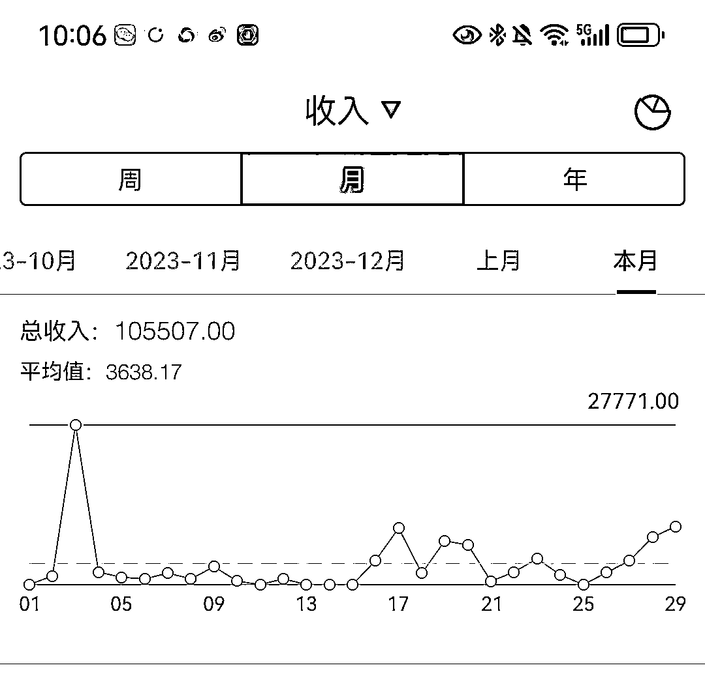

---

### 一、实体外卖店：那些交过的“学费”

许多年前，我还是一名财务人员，每天朝九晚六，和数字、报表、职场琐事缠斗。生活不算糟，但也看不到波澜。改变发生在一个普通的中午——我随手点了一份外卖，带给了我巨大的惊喜。一个念头破土而出：与其一辈子打工，不如自己试一试。

凭着这股冲动，我一周内就辞了职、租了店、交了38000元学费，拉着堂妹一起冲进外卖行业。现在想想，只学做菜不学运营，真是傻得可爱；当时砍砍价，可能8000元就够了。

第一家店开在了繁华的黄浦江边。选址很成功，竞争门槛高，两年内周边没有同类商家。产品口味过硬，红包策略也让人记忆深刻——我故意发外币红包，顾客看着真实却又花不出去的“钱”，留下了深刻印象。再加上会员卡免费送鸡汤的粘性服务，一家15平米的小店，日营业额最高能破万元，品类做到了黄浦区第一、全上海第一。

但命运很快给了我重重一击。

开店仅一个月，大房东突然出现，说二房东带着房租和押金跑路了。我这才知道，自己签合同的对象是个老赖。店铺被砸，6万元直接打水漂，官司赢了也没要回一分钱。那一刻，我觉得天都塌了。

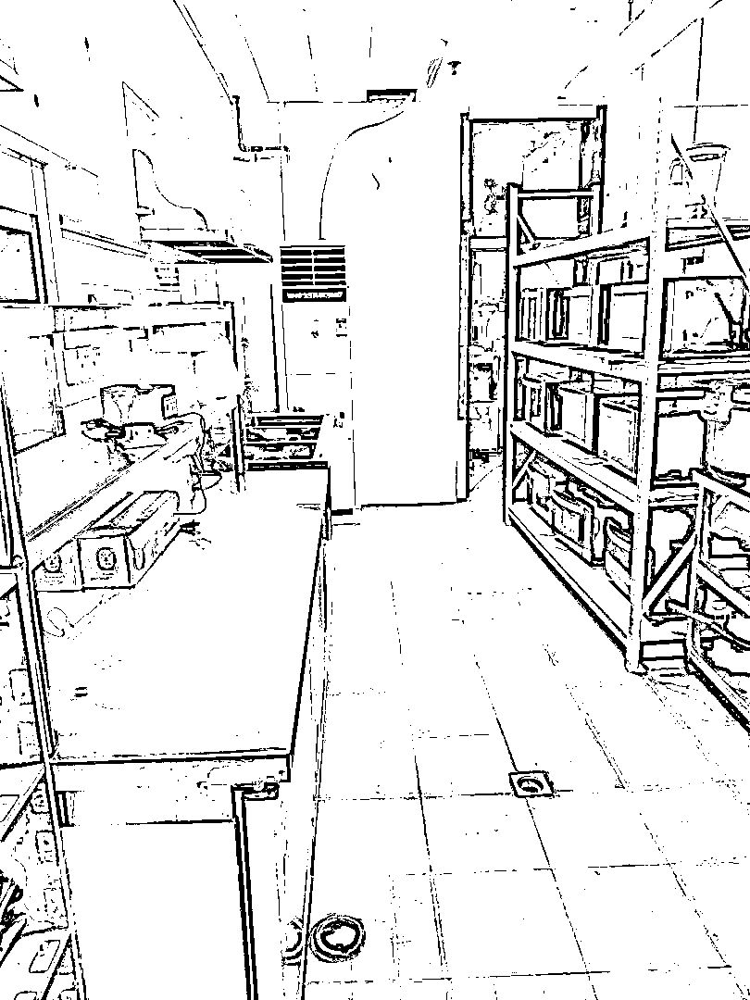

后来，我被初次的胜利冲昏了头。在4平方公里的区域内，扎堆开了多家同类店铺。结果可想而知：价格战、恶意差评、品牌内部互相倾轧。没有区域保护，没有自创品牌，一切都不受自己控制。

再后来，2022年上海疫情封控，员工被困两个半月，房租照付，资金链彻底断裂。前后投入超40万，最后清算负债20多万，所有门店被迫关停。前后投入超过40万，最终落得一地鸡毛。

**餐饮这行，我总结出几条血泪教训：**
1. 看似门槛低，其实竞争极度拥挤。
2. 刚需不等于好做，差异化才是生命线。
3. 自创品牌才能掌握规则，加盟容易被拿捏。
4. 加盟前一定要查清老店的财务与选址真相。
5. 别忽略黑天鹅——疫情、天灾随时会来。

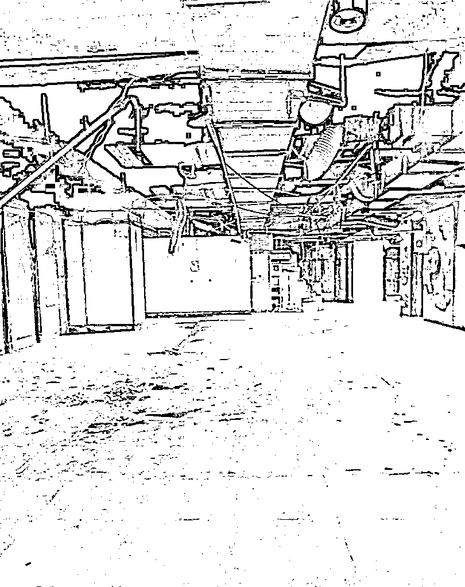

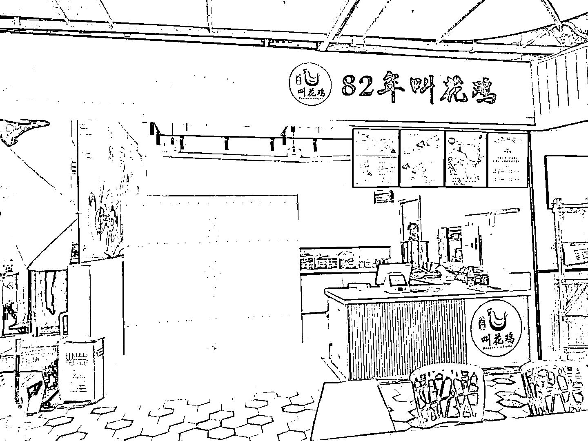

---

### 二、自媒体的光，照进低谷

创业的反复起落，让我患上了重度抑郁和重度焦虑。但绝望深处，我也读到一句话：“活着，就要坚定地走向未来。”命运像是关上了一扇门，又悄悄打开了一扇窗。

闲在家的时候，我花了3999元报了一个视频剪辑课，稀里糊涂地闯进了自媒体。刚开始，和很多小白一样，我交了不少“智商税”，各种副业项目轮番上阵，钱掏了一次又一次。但我始终相信：只要不认输，就算当韭菜，也要当一颗拼命生长的韭菜。

后来，我遇到了一来老师。她像一道光，照亮了我前方的路。跟着她，我先做了今日头条。开头也迷茫，但咬牙坚持了一个月后，我陆续写出了不少10万+、100万+的爆款。

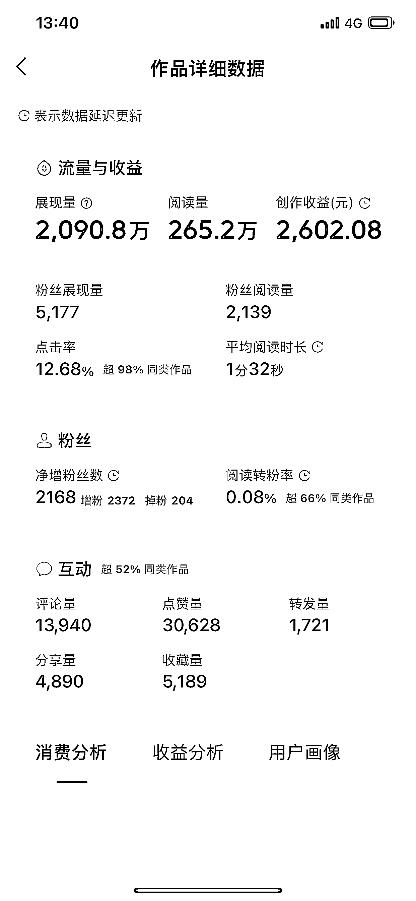

真正让我站稳脚跟的，是👸号流量主。新版分发机制下，文章有机会被“看一看”推荐，哪怕粉丝不多，也可能拥有几万甚至十万级的阅读量。运营者靠系统自动插入广告获得收益，这个模式对新老账号都开放。而且老号更容易进流量池，收益也更稳定。

靠着日复一日地写，我陆续运营了法律、民生、穿搭、军事等多个领域的账号，最多时同时打理6个号。每天输出上万字，终于等来了爆发：最高一篇爆文阅读量300万+，单篇文章收入过万。

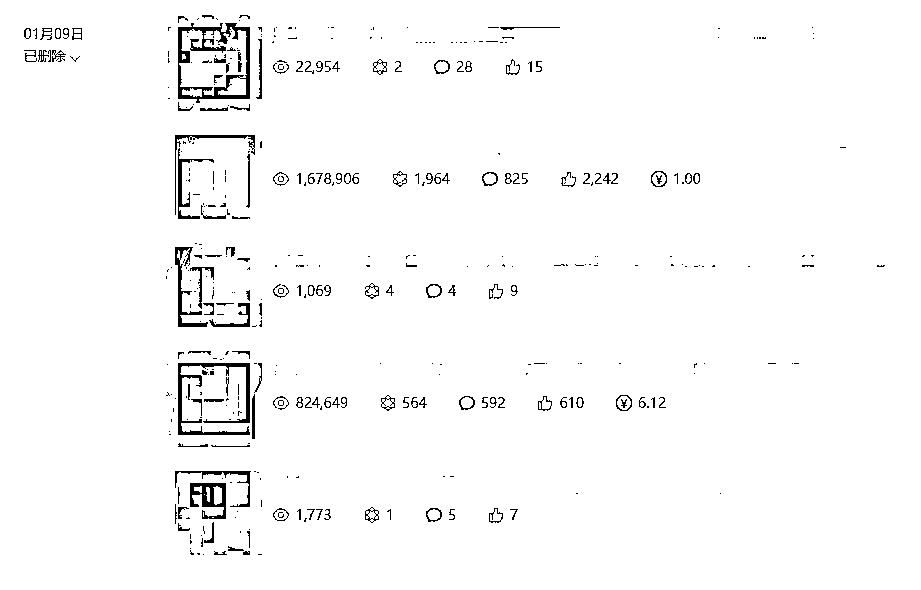

更惊喜的是，有段时间一周内，同一个号竟然出了两篇百万爆款。就这样，从第一篇文章到几千篇内容，👸号为我带来了每月1-2万的稳定收入。

**关于👸号流量主，我的核心心得：**
1. 找对对标账号，从热点中挖掘同领域参考。
2. 标题决定打开率，标题党依然有效。
3. 坚持原创，别用AI生成——平台检测越来越严。
4. 用巧妙的写法引导用户点赞、评论、互动。
5. 写用户关心的话题，而不是自我感动。
6. 蹭热点要自然，比如最近的Sora，别生硬拼接。

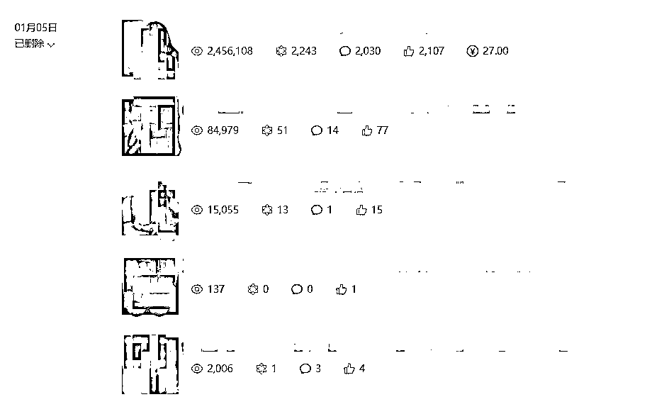

---

### 三、自创小红书商单项目：从“韭菜”到“开悟”

被割得多了，我反而看懂了背后的门道。最初付费学习小红书图文带货，折腾了一个月，连千粉都没过。我不服气，反复尝试后突然发现：小红书商单这个方向，居然很少有人矩阵化操作，市场上也没有现成的培训。

我马上行动，选了一个视频赛道。没想到运气与能力共振，三天做到千粉，第四天顺利接广告。核心逻辑很简单：做爆款视频→吸引粉丝→满1000粉→接商单赚钱，广告只需要复制粘贴，收益却稳稳入账。

跑通闭环后，我开始复制矩阵账号，分析数据、优化流程。随后又招募学员，到目前为止，已经有超过300人加入这个项目，严格按照流程执行的学员，80%拿到了正反馈。我也在不断试错中拓展到12个领域，自己的3个号纯接广告，单月收入过万。

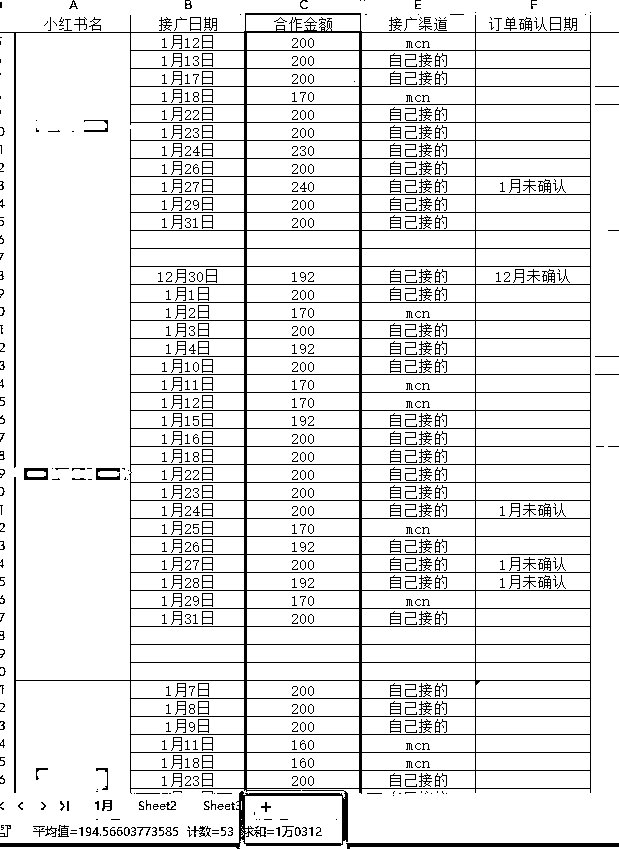

**小红书的经验沉淀：**
1. 原创优先，平台永远给原创更多空间。
2. AI是效率利器，值得好好用。
3. 重点永远是内容质量，而不是工具本身。
4. 敢于组合变通，让不同思路碰撞出1+1>2的效果。
5. 付费买经验不丢人，积累够了就会有质变。
6. 微创新能带来新思维和新变现路径，别怕打破常规。

---

### 四、个人IP的进阶：从项目思维到长期主义

项目做得越顺，我越在想：能不能把这些经验沉淀成一个长期IP？一来老师点醒了我：“为什么不做知识类个人IP？”我思考了一个月，决定行动。我做IP的初心是利他，帮助更多人在自媒体里赚到钱。

这个决定背后的逻辑：
1. 自媒体方法是可以复制的。
2. 账号本身就是稀缺资源，矩阵化价值更大。
3. 授人以鱼不如授人以渔。
4. 我能拿到结果，别人大概率也可以。
5. 找到同频的人，一起长期学习，会碰撞出更多玩法。
6. 真诚是必杀技，我坚持一对一服务学员，亲自解决问题。

于是，我搭建了《格子的方程式》👸号和免费星球《格子自媒体|副业创富圈》，和一来老师合作推出了万元私教陪跑项目，短短几个月就招了13名学员。

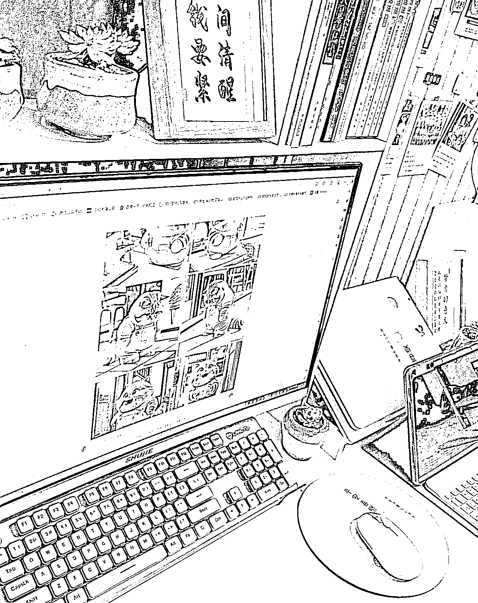

做IP的过程并不轻松。从0粉👸号起步，一步步写到4000多粉丝。有人质疑我数据是假的，有人问我为什么别人轻松赚钱而自己不行。我的回答很简单：直接晒数据、截图、账号后台。时间不会说谎，结果不会演戏。

我劝退过不合适的人，也拒绝过不想干的合作。因为我知道，IP是长期事业，口碑比一时赚钱重要。人和人之间的信任，是用真心换真心换来的。

在这条路上，我体会最深的一句话是：**先利他，再利己。**对平台，输出干货；对学员，实心实意；对同行，开放交流。当你真正帮助了别人，机会和回报自然会涌向你。

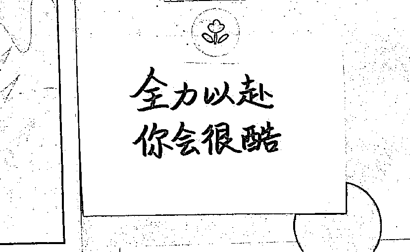

---

### 五、认知觉醒与破圈

如果说这500多天最大的收获是什么？我会说：认知升级。人永远赚不到认知以外的钱。一个人变得强大，是从看清本质开始的。

根据我的理解，人才大致分几层：
- **一流人才**研究框架、规律和本质，能一眼看穿事物底层。
- **二流人才**研究方法论和体系，能构建完整可落地的商业模式。
- **三流人才**研究具体方法，能解决单个问题。
- **四流人才**研究工具和操作，有专业能力，但容易被工具局限。
- **五流人才**只被动接受环境看到的表象，非黑即白，认知最浅。

认知升级像爬楼。你只需要每天往上走一两层，回头看看来路，别去管楼顶有多高，坚持走下去，就已经超过很多人了。

这个过程也不是一帆风顺的。王阳明讲“事上练，难上得”，我深有体会。从底层一点点爬上来，靠的是持续学习、不断破圈。我每年会花五位数加入各种知识社群，比如龙哥盟，主动链接优秀的人。如今，我还与老徐、老马、宫城、一来四位伙伴成为合伙人，互相借力，共同成长。

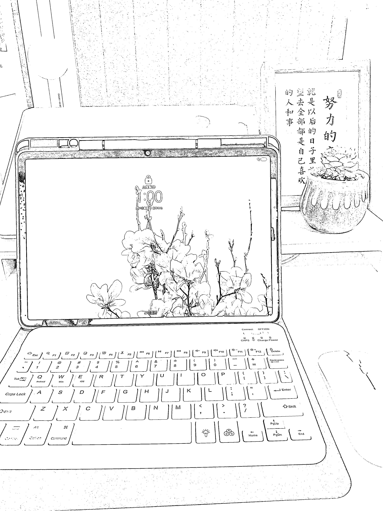

“道，可道，非常道；名，可名，非常名。”认知的升华，就是一个看山是山、看山不是山、看山还是山的过程。

未来的路还很长，但方向已经坚定。希望我的经历，能给你一些勇气和启发。一个人走，容易疲惫；一群人走，才能走得更远。愿我们都能在自己的战场上，坚持长期主义，做时间的朋友。

与君共勉，合作共赢。

三月沉淀，格子决定把私教这条路正式走下去。这个项目能成型，要感谢“一来”老师的点拨，从零开始的每一个步骤都是他亲手带教的。能在自媒体的路上遇到这样一位既有能力又极有耐心的前辈，格子一直放在心里。

自媒体的本质格子一直这么看：一根手指再硬，也硬不过紧握成拳的五指。做内容就是要抱团、要共赢。

去年底，格子第一次把私教陪跑放到台面上，最后来了13个人。过程中真的看到了反馈，也劝退了几位。执行跟不上、条件不允许、时间精力不够的，格子不会为了那点私教费硬凑，合不来就不强求。

有人问格子，要不要一起推小红书课怎么分钱。格子的说法很直接：五五开。一门999的课，我拿499，你拿500。合作我可以让利，这才是我做联动的底线。李嘉诚那句话格子记着：该你拿七成的地方，你拿八成也行，那我们就拿六成。

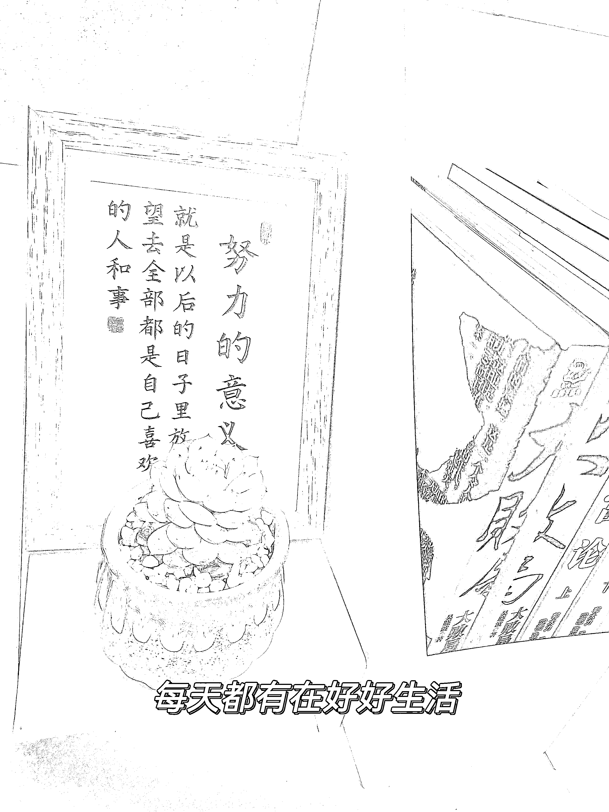

**6、资源整合，破茧成蝶**

2024年春节，别人出门走亲访友，格子把自己关在房间里干活。自律和自驱撑着整个假期，社交归零、旅行归零，全部精力all in在矩阵上。五号👸号、六个小红书号、十几部手机轮着转，这是格子那个春节的全部画面。每当想偷懒，就会在心里默念那句：努力到无力，拼搏到打动自己。

星球里持续输出干货，加上格子IP号500多天的沉淀，到了2月底，月收入第一次站上了十万。合伙人、学员、导师，所有能用的资源在当月完成了第一次整合。记账软件跳出 **105507** 那一刻，长期压着的自卑感终于松了。

那一瞬间，格子感觉自己像只蝴蝶，在蛹里挣扎了太久，终于挣开壳，扑向了舞台。

这半千多天，格子没有社交、没有娱乐、没有出行，日均工作16小时，每天稳定输出1000字以上、6条视频。关起门来，只做一件事。

曾经被债务逼得整夜失眠、焦虑到窒息的夜晚，在这一刻全部释放。向阳生长的希望，才是黑夜里最那束光。

**四、格子对24年的三个规划**

**1、运动健身**
长时间高强度输出，身体被掏空了，体重也在往上走。24年第一件事，先办健身卡。身体扛得住，才有资格去打下一场仗。

**2、小红书个人IP号**
小红书今年上了春晚，格子看得很清楚，未来变现的重心一定在这里。24年要把个人IP号做起来，一个广告就能做到四五位数，这个春天才刚开始。

**3、招募100位私教学员**
格子相信，个人IP是未来最公平的赛道，每个人都有机会成为赚钱的个体。接下来的一年，想拉100个人和格子一起，把自己打造成一个可持续变现的超级IP。

格子是山里走出来的90后女孩，不服天、不信命，只信自己能把路走出来。

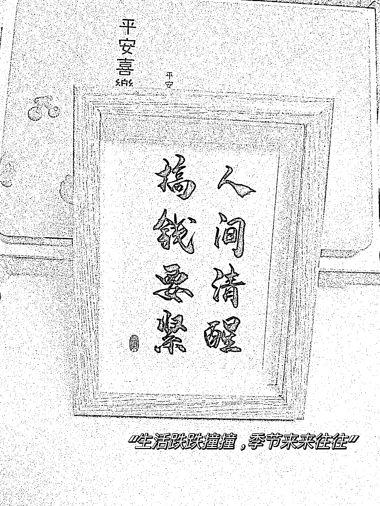

**听说，历经烈火淬炼的，才有资格化作凤凰。**

2023年格子吃过苦，也听过最亲的人的质疑。人情冷暖，自己尝过才知道。但格子始终相信一句：打不垮你的，都将成为你变强的养料。

这个春天，格子用一首小诗送给愿意星球的所有朋友，祝大家24年顺遂喜乐。

格子-桃花岛

碧海蓝天海风细
绿草欢声喜开颜
鸟语欢声脚步欢
情人岛边念桃花

* * *

评论区：

小牛 : 牛逼 plus

易芬 : 厉害[强][强][强]

Rio : 人间清醒搞钱要紧，自媒体最终出路还是收徒么？

千花百卉 : 厉害了👍

张小多 : 好厉害，向你学习！

小 c : 厉害的圈友 向你学习

修之 : 感悟，干就完了。

格子 : 6000 字的总结和分享，感谢大家宝贵的时间。

* * *