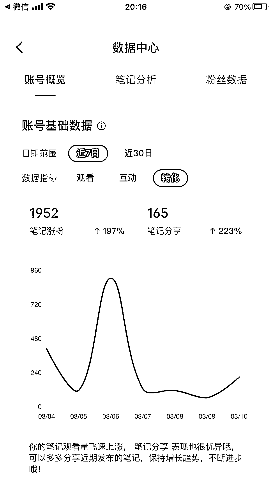
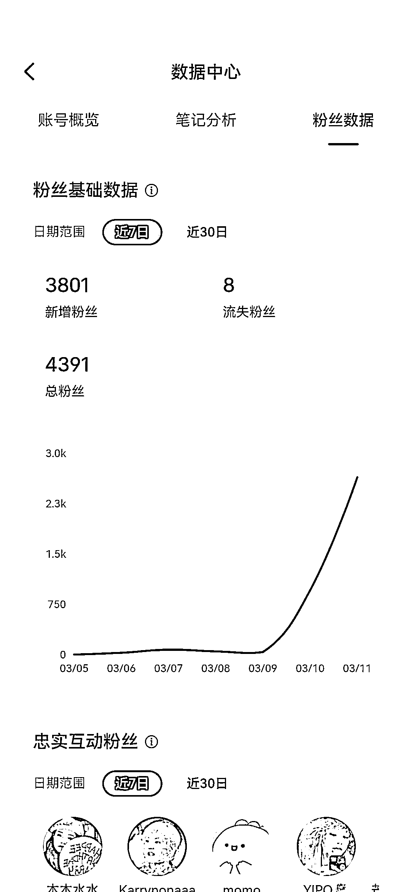
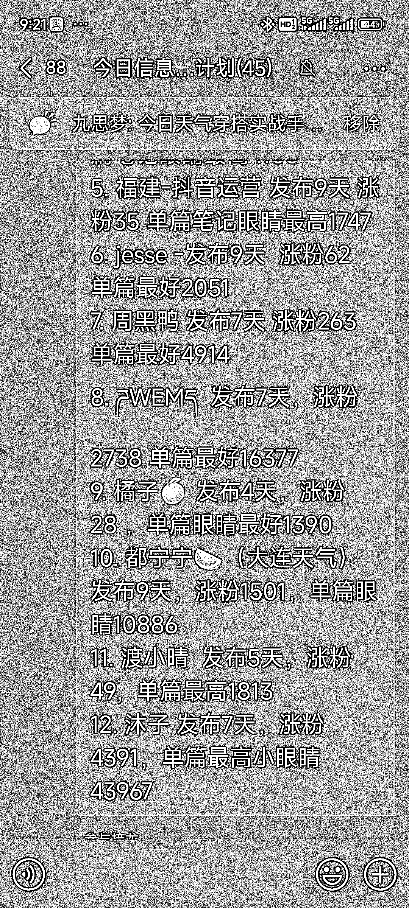

# 小红书7天涨粉4300！这个超适合新手上手的项目，真的赢麻了

你见过一周涨粉4300的小红书账号吗？不是什么大V，不是什么专业团队，普通人也能做到——小红书天气穿搭号，新人的友好程度堪比入门教科书。

事情的起因是今年2月中旬，刷手机时看到风向标里有人聊起小红书天气穿搭这个方向，当时就觉得有点意思。马上打开小红书搜了一下，发现很多城市压根还没人做，只有零星几个人在做，机会显然很大。于是拉上朋友一起试水，我们做的第一个号，7天涨了2000粉，节奏来得飞快。

这组数据摆出来，心里就有底了。既然验证了可行，干脆把流程整理成手册和实操方案，直接开源，大家一起玩一起完善。说真的，这项目门槛不高，没什么复杂的操作技巧，所以我才敢摊开来分享，大家直接对接飞书文档就能开始。

今日天气穿搭实战手册：[`fij9onv1q4.feishu.cn/docx/R6Jrd1EGboccbtxvtebcGE0TnAJ`](https://fij9onv1q4.feishu.cn/docx/R6Jrd1EGboccbtxvtebcGE0TnAJ)

评论区里也有不少有意思的讨论——

小吴姐：这不就是我之前发风向标提到的方向吗？太能打了吧！

九思梦：哈哈有可能！多谢风向标，感谢圈友的灵感启发[爱心]

玛卡瑞纳💫：马住！谢谢分享，必须学习[强]

辰安：这个反馈速度太猛了圈友！但一直发天气穿搭的话，更新方案你们打算怎么做？一天发两三篇，除了固定穿搭内容，还能靠什么变现呢？

九思梦：我们目前想的是把玄学穿搭接进来，用玄学内容承接流量。而且第一批做号的朋友里，已经有不少本地商家主动找上门投广告了。至于更多变现和扩圈的方向，还在继续摸索，毕竟这项目才跑了一周。

九思梦：一起进步！

辰安：[强][强][强]谢谢分享

silent：感觉这个方向真的可以试试哎[发呆]

