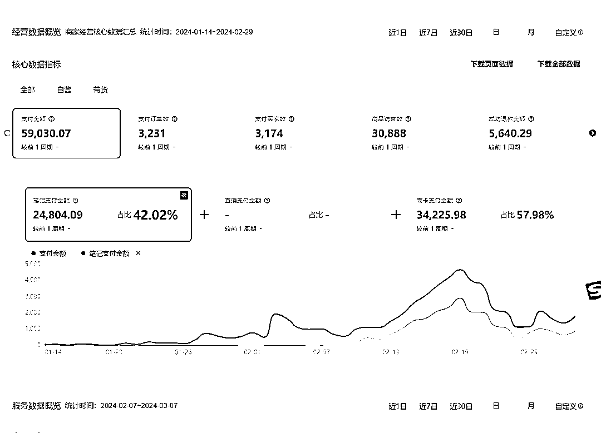
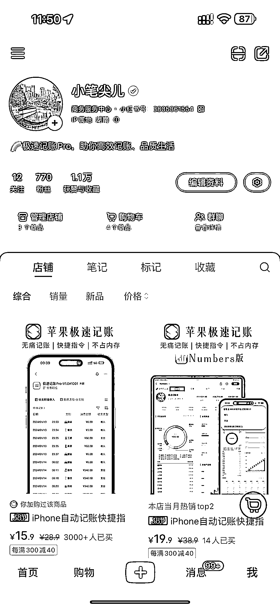
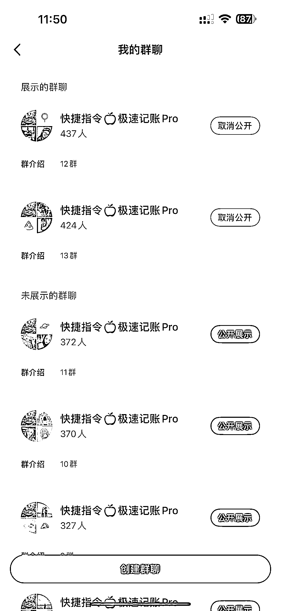
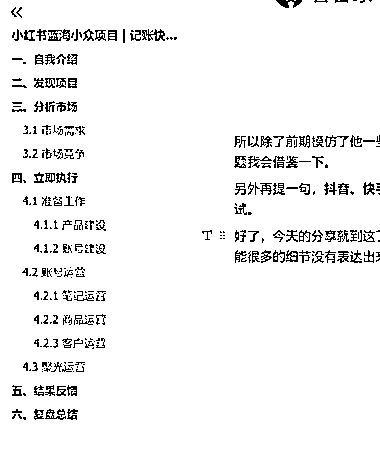

# 记账捷径冷门实战：1个人，45天，30篇笔记，挣了5.8万
作者：龙哥

先报成绩：一人操盘，45天，30篇内容，销售额5.8万，商品销量进入全站前三。

我叫 Gemini，00后，在网络圈混过6年，最近一次创业失败，现在自由职业。

年初，我把“记账捷径”这个方向与之前做网店积累的经验结合，在一个新账号上试水。没想到，第一波反馈就很正面，算是给今年带来了一个不错的开始。

这篇记录，就从账号准备到选品，从内容发布到转化，把关键动作拆开说。

如果你也有类似点子，比如自动化脚本、工具开发或系统搭建的需求，欢迎来聊。技术难度不用害怕，我可以帮你把坑填平。

完整版文章放在在线文档里，读起来更舒服。

* * *

留言区：

西昂：学到了[强]
米笠：你参考的那个对标账号也在这个评论区。
Gemini：嗯嗯，我也看到了
键凯：怎么联系你？
Gemini：YL518118
菜菜：那个账号我也关注过，销量确实能打。
加麻：很有胆量。
芷蓝：卖捷径这个点子有意思。

* * *