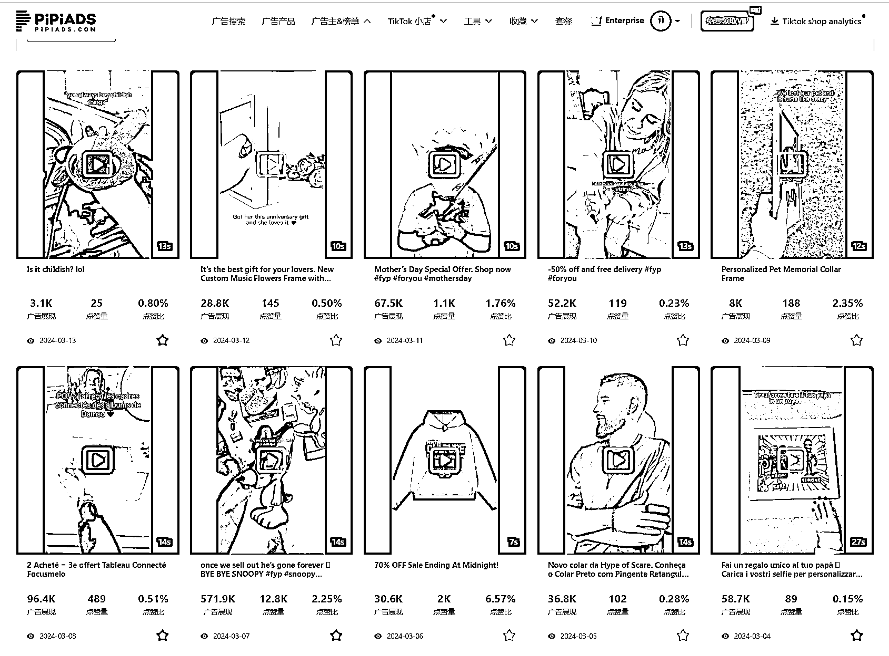

# 从算法底层看 Tik Tok 广告为什么能起量

## 算法视角拆解 TikTok 广告分发机制

作者： 阳光杉木

日期：2024-03-14

最近皮皮和一位做算法的朋友聊了聊 TikTok 广告的底层分发逻辑，收获了一些能直接落地的思路。下面把这套机制拆开讲清楚，方便大家在创作时更贴合平台的推荐规则。

如果这块内容对你有用，欢迎点赞收藏并转发，后续我会持续深挖案例。

### TikTok 广告推荐的核心链路

1.  素材理解与自动标注：平台会用机器学习模型去拆解上传的广告视频，识别画面、声音、口播文案、标题描述等要素，并自动生成一系列内容标签，用来刻画主题、风格、情绪等属性。

2.  用户画像构建：系统会追踪用户的一系列行为轨迹，比如常看什么内容、是否点赞评论分享、搜索过什么关键词等，通过这些信号反推出兴趣偏好和消费倾向。

3.  匹配投放：把第1步的素材标签和第2步的用户画像进行交叉匹配，算法就会把高相关性的广告推给最可能感兴趣的人群。

4.  动态迭代：投放过程中，系统会实时采集观看时长、互动率等反馈，不断微调分发策略，提升用户停留和转化。

简而言之，TikTok 是通过互动数据来判断兴趣的，比如看完率、点赞评论等。除了互动，它还会参考用户关注的账号类型、搜索习惯、对特定话题或音效的偏好。平台对素材本身也会做深度解析，涵盖画面质感、配乐、字幕、标题和标签。为了避免信息茧房，系统会主动穿插多元化内容，同时结合设备性能、地理位置等环境因素做个性化与广度兼顾的推荐。

搞懂这些原理后，后面我会用实操案例说明，为什么有些看似普通的广告素材却能爆量，以及精准人群下的优质广告到底是怎么打磨出来的。

## 系统抽帧打标，标签决定推送人群

TikTok 在分发前会随机抽取视频帧做截图分析，再给画面打上标签。打标完成后，系统就依据标签库去匹配目标受众。

所以做素材的关键就是让标签尽量干净、精准，减少无用干扰信息。

举个例子：

这条素材在投放时获得了 420 万次曝光，按美国市场平均 CPM 约 5 美元来算，仅这一组广告就消耗了约 2 万美元的预算。

素材具体表现可参考原文链接：

[`za6kyadmdr.feishu.cn/docx/PSstdNSd5oezwjxdzCvcLJFmnBc?from=from_copylink`](https://za6kyadmdr.feishu.cn/docx/PSstdNSd5oezwjxdzCvcLJFmnBc?from=from_copylink)

* * *

评论区：

暂无评论

* * *