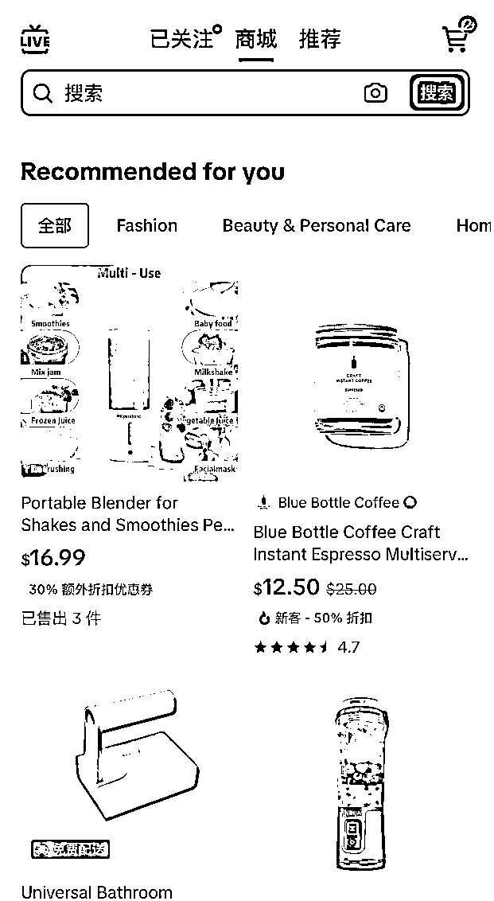
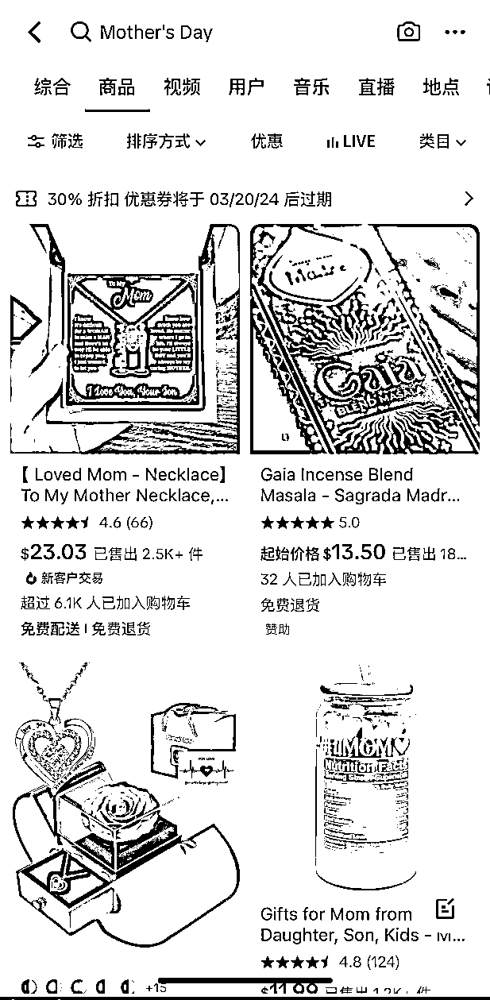
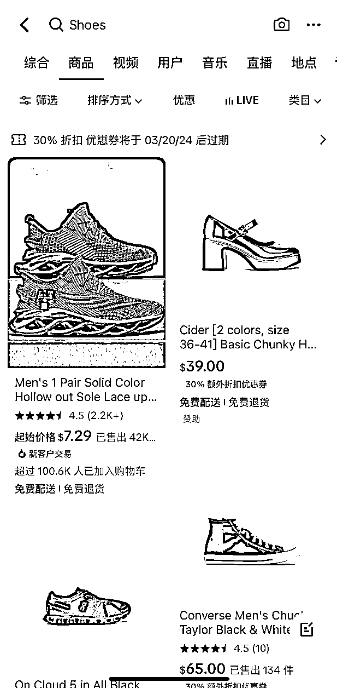
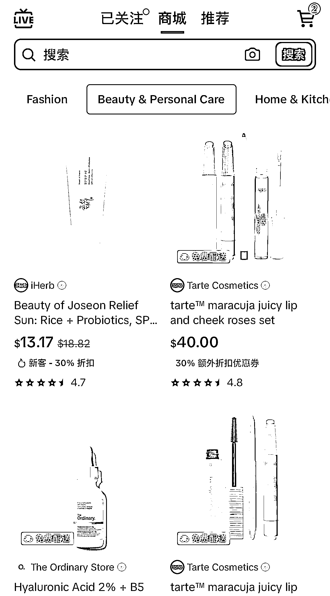

# TikTok 美区 PSA 商品购物广告正式放量，玩法与打法全解析

美国站 TikTok Shop 的重磅动作来了，产品购物广告 PSA 即将开启投放。同步平台已传来最新动态。

产品购物广告 Product Shopping Ads，简称 PSA，本质上是依托 TikTok Shop 生态进行商品曝光的官方广告形式。先前该产品已在印尼、马来西亚、菲律宾、新加坡、泰国、越南等多地上线，让用户借助 TikTok 购物中心内的推荐位和搜索结果来发现商品。

PSA 商品购物广告，是 TikTok Shop 体系中继 LSA 与 VSA 之后推出的又一电商广告形态，目前可通过 Seller Center 卖家中心以及 TTAM 广告平台进行创建与投放。

投放逻辑是动态化的。广告素材会精准分发到购物商城的 Recommendations 推荐流与 Search 搜索结果，以及 TikTok 全站搜索区域。系统会自动抓取推广商品的商品详情页 PDP 信息，自动生成商品卡片与详情展示，用户点击后直接跳转至对应 PDP 完成转化。广告展示的内容均来源于商品详情页本身的图片与信息，点击后即进入该商品的 PDP 页面。

整体使用框架与价值如下：

创建与管理：广告主能够在 TikTok 卖家中心内完成广告的创建、维护与优化，整个链路较为简化。

核心特色：PSA 给予商家在商城与搜索场景的可见度掌控权，投放无需额外制作创意内容，直接复用产品图与商品信息即可。平台依托动态产品优化与机器学习模型持续提升投放表现、受众匹配与转化效率，最终推动广告支出回报 ROAS 提升。

操作路径：使用 PSA 前需在卖家中心管理广告账户，包含账户充值与活动创建。商家可以选择推广全部商品或部分商品，并结合广告目标选择对应的出价策略。当前阶段仍需通过直客经理申请开通，可私信皮皮对接。

流量入口 1:

从 TikTok 全站搜索进入，输入关键词后会出现带有广告标识的商品卡片推荐，点击即可进入商品 PDP。注：目前美国区该入口仍在内测阶段，尚未全面开放。

流量入口 2:

进入 TikTok Shop Center Tab 购物商城的推荐页，刷到带有广告角标的商品卡片，点击后跳转至商品 PDP。

流量入口 3: 进入 TikTok Search Center Tab 购物商城搜索页，搜索关键词时会出现带有广告角标的商品推荐卡，点击后进入商品 PDP。

PSA 上线的核心优势

（1）新流量池竞争更友好
商城推荐加搜索共同带来增量流量，商城用户本身具备较强的购买意图与转化潜力。系统基于智能推荐自动生成创意，为不同用户推送偏好匹配的商品。

（2）门槛低，上手快
确认推广商品、设定投放周期与预算、出价方式三步即可在 TTAM 上对 TikTok Shop 的单个或全部商品进行投流，省去商家单独制作素材的人力成本，效率显著提升。

（3）效果可期，TTAM 创意能力增强
Beta 测试数据显示，达成 ROAS 目标的广告占比超过 75%，有效助力广告主实现营销目标。该产品支持多种优化目标与定向方式，支持多维度效果提升。

适合人群

商域精细化运营型：已在 TikTok 商城积累搜索数据与历史销量，希望进一步挖掘商城流量变现空间；

选品与流量测试型：首次尝试 ShopAds，希望快速进入市场验证商品与流量；

自动化定向需求型：无力或不愿自行进行创意定向优化，借助 PSA 自动生成商品素材投放更省心；

品类扩张型：已在 LSA 或 VSA 取得不错转化，希望借助 PSA 进一步放大生意规模。

推荐机制

PSA 采用 eCPM 排序机制向用户分发商品。

影响 eCPM 排序的关键因素：
用户与产品的购买意图及相关性、用户历史行为如浏览点击购买加购等、广告组出价与预算、商品标题及 PDP 的 CTR、CVR 等。

商家可通过以下方式优化商品列表表现：结合市场热点与购买趋势调整商品、优化商品关键词并将其加入标题、丰富商品SKU积累数据、对表现优异的 Campaign 适度加预算等，均有助于提升 PSA 投放量级与效果。

投放建议

初期可采用 50 美元/天的 Minimum ROAS 出价策略测试，或以平均每个付费转化成本 CPP 的 20-50 倍作为测试预算。

建议至少建一个 Campaign，选择 All products + Minimum ROAS，充分释放机器学习与智能推荐能力。

同时可额外搭建 Specific Product Campaign，单独投放爆款、热销或促销商品，形成组合投放。

当预算消耗率超过 80% 且效果符合预期时可逐步加预算，但加预算后 ROAS 可能会短期小幅回落，随后逐步回稳。

一句话概括，现在 TikTok 美国站已经可以投放商品卡了，且投放门槛大幅降低。

开户协助
https://za6kyadmdr.feishu.cn/docx/NLQEd6wQ7o4jSGxlO6jcNyhLn5g?from=from_copylink

* * *

评论区：

暂无评论

* * *