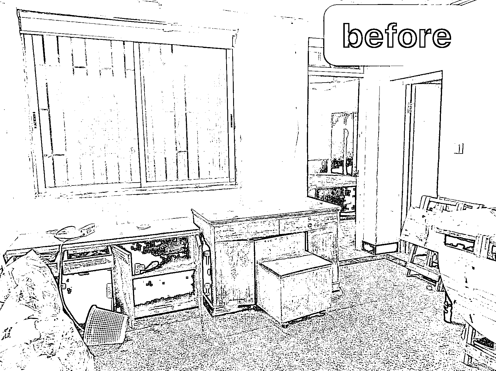
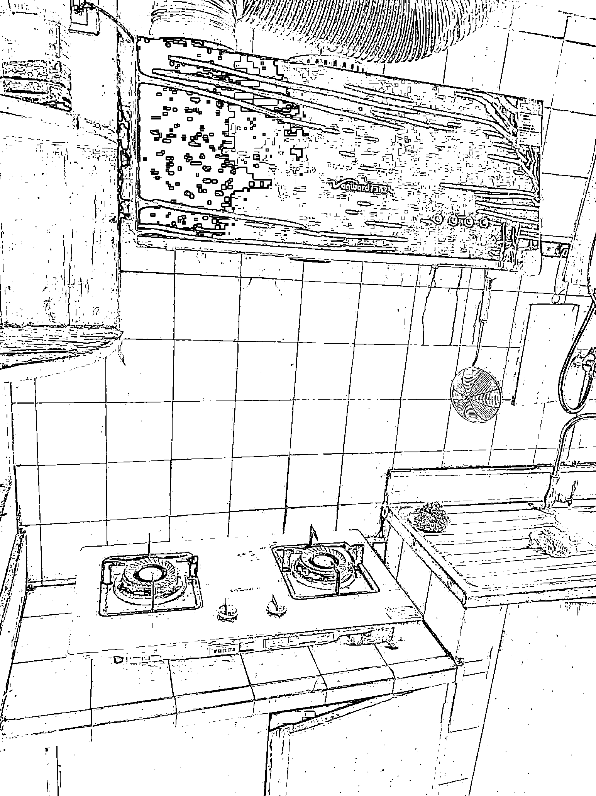
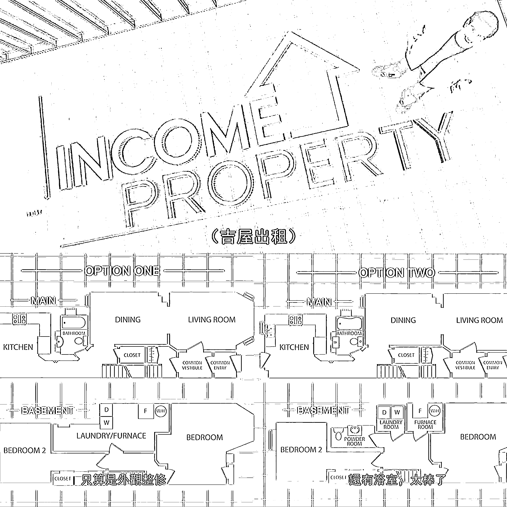
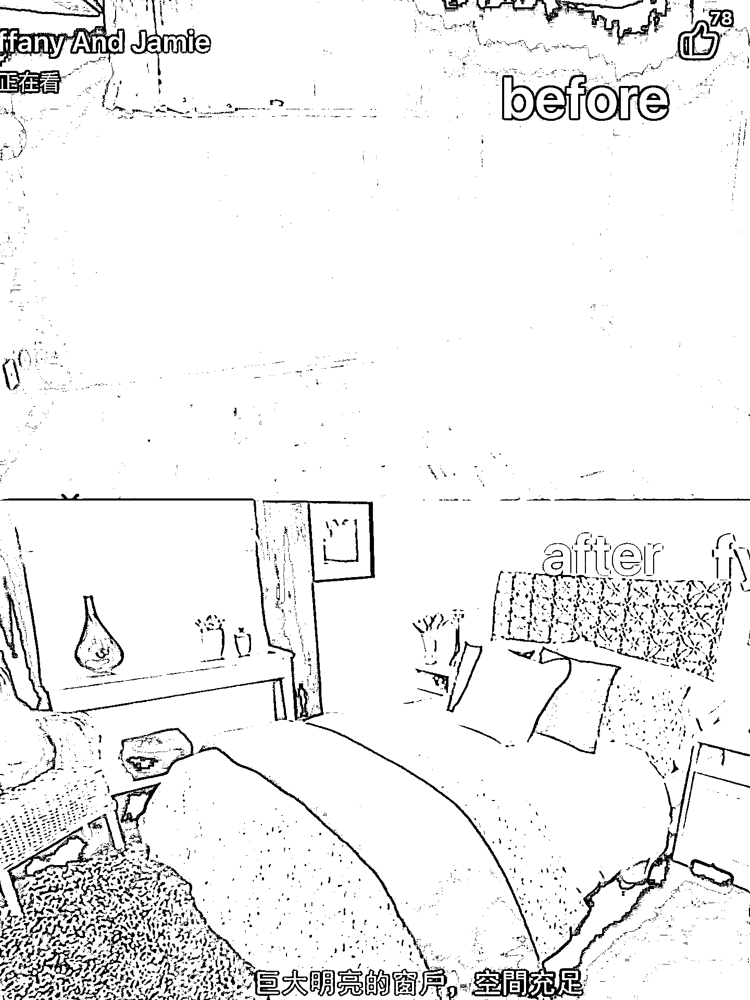
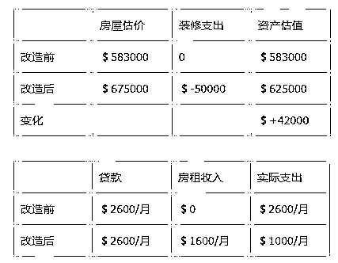
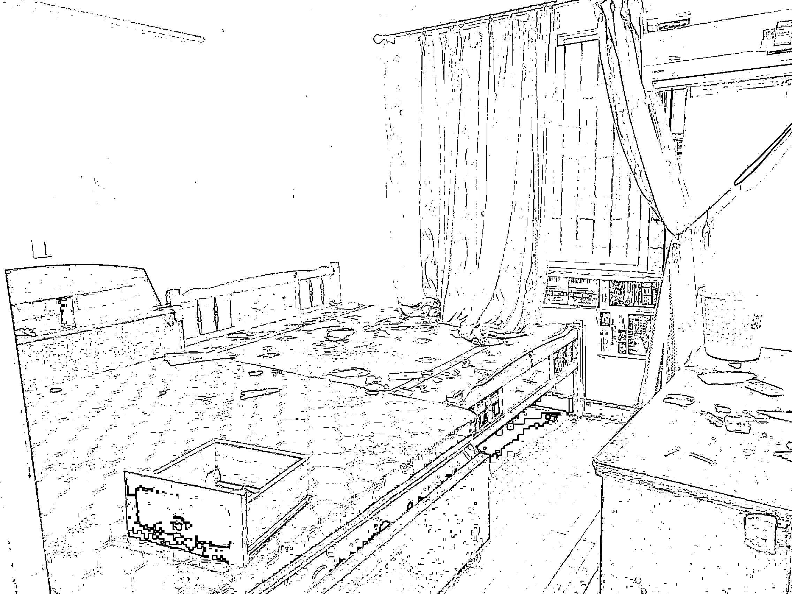
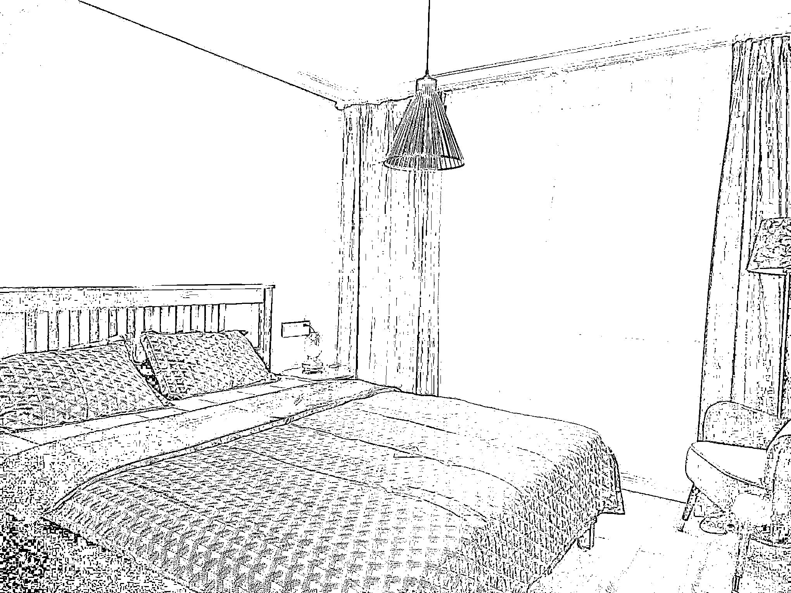
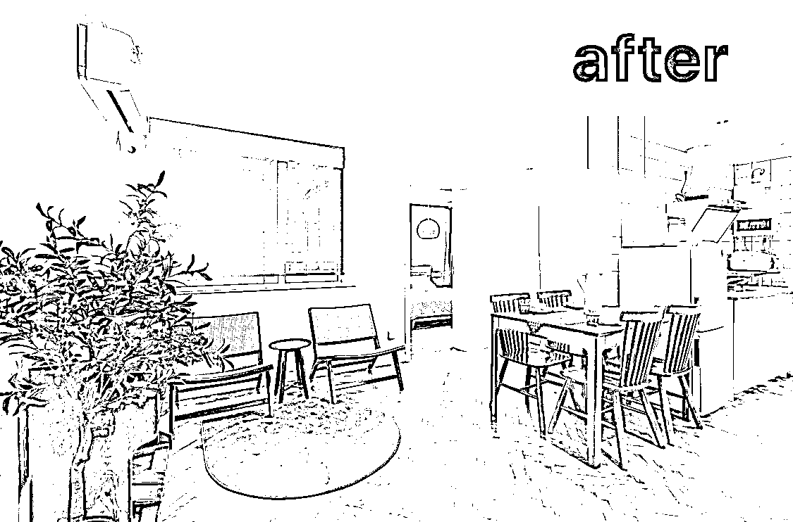
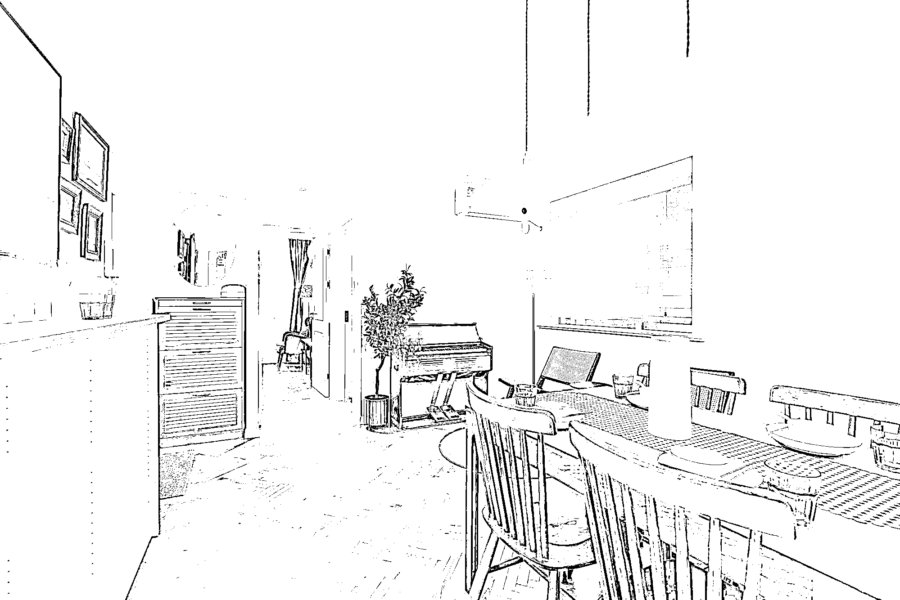

# 《繁花》摄影师 4 倍租金包租 3 年，包租婆实战出租经验分享。

一套上海远郊老破小，从月租2000无人问津到被《繁花》摄影师以8000元/月包租3年，这位房东做对了什么？

文/爱折腾的土豆妈

你是不是也有这样的处境：名下有第二套房，每月房贷压得人喘不过气；想靠收租躺赚，却总碰不到优质长租客；房子空着又不想低价抛售；哪怕有拆迁房，租客也是来了又走，租金不涨反跌。如果你的答案是“有”，那这篇实战分享，建议耐心看完。

我先把核心结论放在前面：与其拿重金去赌大项目，不如先把手头已有的资源盘活。这套方法的试错成本极低，能帮你先跑通0到1，再考虑要不要继续加码。

故事的主角，是我妈留下的一套房子。它在上海远郊，90平三房，建于90年代。因为一些历史遗留问题，这套房子暂时不能交易，只能出租。原装修早已老化，水电线路存在严重隐患，二房东白送都不肯接手。在普通租赁市场，月租只有2000块出头。

正对着这套烂房子发愁时，2018年我刷到了一档美国房屋改造节目《吉屋出租》，一下子被点醒。节目里，设计师通常会给两套方案：低成本微改，或者高成本大改，都能有效改善房子的基本面。举个例子，有一期屋主夫妻选了5万美金的PlanB，改造后直接让一套负资产房源满血复活。这也让我真正明白，房子想要产生更大的价值，不能一味抠成本、只求毛坯出租换来低价租金，适当的装修和美化，反而能让它变成持续产出现金流的资产。

于是我开始做市场调研。这套房子虽然偏远，但周边有老城古风貌景点、影视基地和大学城，这些都是可以深挖的潜力点。而当时方圆3公里内，连一家三星酒店都没有，短租房源几乎空白，整套出租的大户型，除了一些价格昂贵的独栋别墅和联排外，三房公寓少得可怜，基本都被二房东收走做了分租。我果断做出决定：把长租改成短租，价格对标附近的快捷酒店，用三房结构主打旅游家庭、朋友聚会和商业拍摄这几个方向。

定位清晰后，装修重点也就明确了。为了匹配目标客群，我累计投入约15万，进行了全屋翻新。硬装方面，用宜家家具配合小米全屋智能家电，再装上一台投影仪，对年轻群体很有吸引力。

软装方面，则用古董家具和有特色的饰品，把每个小空间都布置得有看头，随手一拍就能出片。

房源上架到了途家、美团和爱彼迎等平台，其中重点运营爱彼迎，因为上面的客群质量更高，付费意愿也更强。我为房源分别设置了日租、周租、月租价格，灵活对应不同客户的需求。后来的实践也证明，装修定位和目标人群匹配得非常好。

再来说说那位改变这套房子命运的租客——《繁花》的摄影师。他最初在爱彼迎上刷到我，看过照片视频后，先在平台初步沟通，随后转到微信私域细聊，前后对接了近两个月。他的需求十分明确：拍摄周期长，需要带着家人住得舒服，有厨房和洗衣机，至少三个卧室；离影视基地要近，方便停车；拍摄时间不确定，房租必须按月灵活支付；白天需要安静环境补觉；还要能满足祖孙三代同住。

我把他周边的房源都盘了一遍：传统出租房大多毛坯或简装，家具家电配得很不到位；酒店式公寓空间狭窄，做饭不便，而且人来人往非常嘈杂；酒店客房不能做饭洗衣，不适合长期家庭居住；独栋或大平层倒是宽敞，但中介费用高，租期至少一年起签，租金高也不够灵活。一圈对比下来，我家是唯一全部条件都能满足的。

最终谈妥的价格是月租8000元，一分没让，包含水电煤和宽带，按月付款，续租时间不限，入住期间每月还提供一次保洁服务。当时只预估他住半年左右，结果对方断断续续租了三年，在这里完成了一部院线电影和一部《繁花》。直到电视剧热播之后，我才知道那个低调的长期租客，竟然就是获奖摄影师。

回看这笔账：在疫情三年里，租金从2000涨到8000，翻了整整4倍，一套原本无人问津的房子被彻底盘活，投资回报率达到100%。

复盘整个过程，我有两个很深的体会。

第一，要敢于承受不确定性，做好最坏的打算。当初砸下这笔装修钱时，我根本不敢想能租到8000元一个月。我当时算的是：哪怕一个月只有3000，一年也有3万6，比存银行吃利息强多了。装修的投入，未来无论靠出租还是出售，总能收回成本，只是时间问题。那些做什么都抱着“必须100%确定赚钱”心态的人，恐怕连第一步都迈不出去。

第二，不要盲目投资，先着眼盘活现有资产。如今整体经济环境偏保守，大家都不太敢折腾。与其把真金白银扔进陌生项目，不如梳理一下自己名下有没有那种“月月还贷、价格下滑、又舍不得割肉”的固定资产。不管是老破小还是远大新，哪怕是老家的房产、商业用房，只要能挖掘出独特优势，找准定位，走精细化小众路线，先短期出租，等时机成熟再出售置换，总有一种方法能把它盘活。

赚钱的机会确实很多，但最靠谱的，往往是从自己已经拥有的东西出发。如果这篇文章给了你一点启发，欢迎来评论区和我互动。我是土豆妈，感谢你耐心看到最后。

