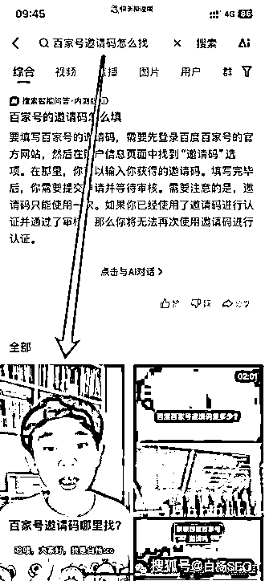
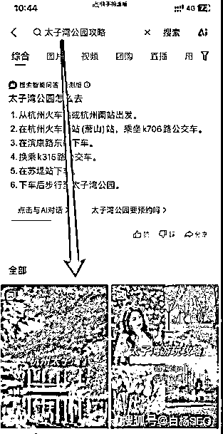
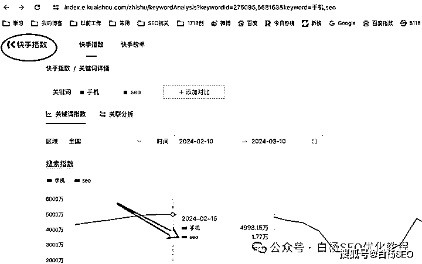
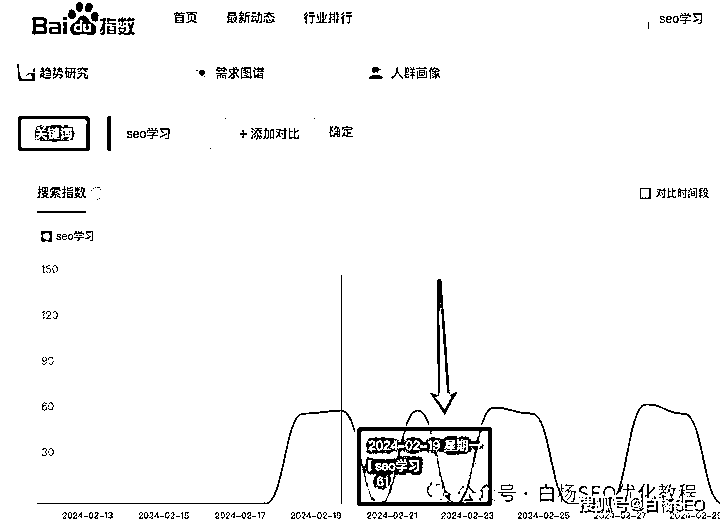
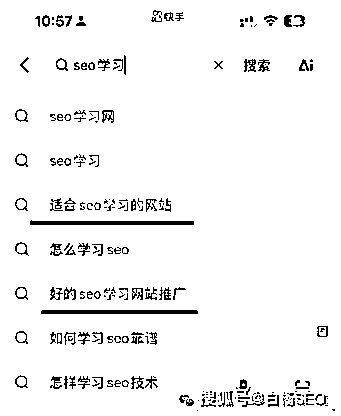
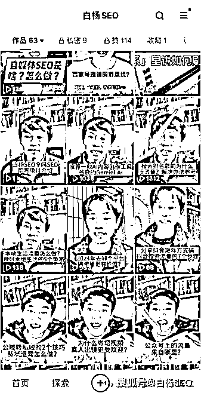
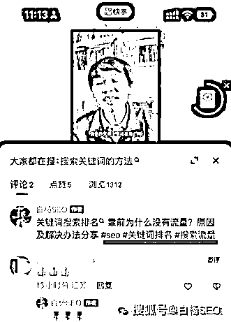
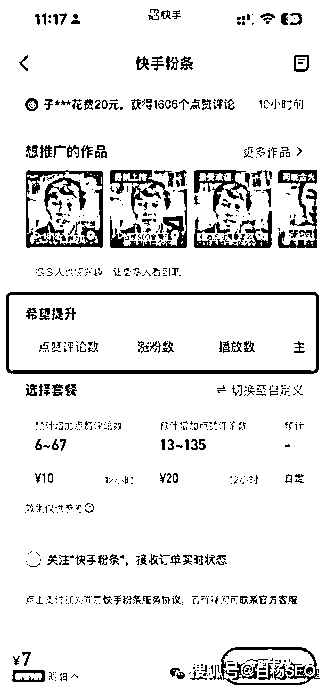

# 解锁快手搜索流量：关键词排名逻辑与实操玩法全解析
作者：龙哥

## 快手搜索流量如何做？关键词排名机制与SEO打法拆解

作者： 白杨 SEO

日期：2024-03-12

先明确一下，什么是快手SEO？

简单说，就是在快手App里，通过关键词搜索，让自己的短视频或账号排在前面。

这是我第一次系统梳理快手平台的搜索玩法。之前文章里提到快手，也只是建议企业去做各平台蓝V认证。如今白杨 SEO 一直在做各平台的搜索优化，涵盖百度、淘宝、🛰️、抖音、📕等，今天把快手搜索这块单独拎出来聊聊，希望能给你一些启发。

**为什么要做快手SEO？**

快手成立于2011年3月，2012年11月转向短视频社区，是国内最早一批短视频产品。虽然热度不如抖音和视频号，但江湖地位依然稳固。

平台日活接近4亿，月活接近7亿。日活指当天打开一次，月活指当月打开一次就计入。单从流量体量看，快手依然是一块大盘。

横向对比，除了🛰️、抖音、视频号，很少有平台日活能达到这个量级。即便淘宝、支付宝、百度App，用户日均停留时长也很难和快手比。

做流量有个底层逻辑：用户在哪，我们就去哪拿流量。用户在哪儿待得久，哪儿就有机会。这就是快手SEO的价值所在。

当然，这里并不是说做完快手SEO就不用管其他平台了。选适合自己的就行，如果精力允许，快手是值得布局的一个增量阵地。

**快手搜索排名的核心规则**

目前可观察到的排名影响因素大致有五类：

1、内容质量与相关度
快手会判断视频本身质量、是否原创、封面表现，以及内容和搜索关键词的契合度。质量高、原创度强、相关性高的作品更容易上位。

2、标签与关键词匹配度
发布时合理布置标签和关键词，能帮助系统更快识别内容主题。匹配度指关键词一致性，比如用户搜“SEO怎么学”，作品里就是“SEO怎么学”，这就是完全匹配。
但要注意，堆砌标签或关键词会被判定为作弊，反而降权甚至限流。

3、账号权重与活跃情况
发布账号的权重很重要，粉丝量、历史活跃度、账号健康度等都会影响分发。权重高的账号同等内容更容易获得好排名。

4、用户反馈与互动数据
点赞、评论、分享、完播时长等行为，都是系统判断内容受欢迎程度的信号。互动越好，搜索权重通常越高。

5、地域与时效因素
部分带有地域属性或时效性的词，排名会结合用户地理位置和搜索时间进行动态调整。比如搜“杭州本地活动”，系统优先推本地相关内容。

补充一点，快手搜索规则不是一成不变的。平台会根据用户反馈和策略变化持续调优算法。所以要想长期做好排名，必须保持对平台动态的关注，持续更新优化思路。

**快手SEO具体怎么操作？**

1、关键词筛选
选词是基础。关键词要同时具备搜索需求和搜索量。
比如想做“SEO学习”相关视频，可以先看快手指数，没有数据就参考百度指数，有需求就能用。再用该词去看快手搜索下拉推荐，从中挖掘延伸词和选题方向，这样内容和关键词天然相关。

2、标题与封面打磨
标题必须带核心关键词，比如“推荐几个SEO学习网站”，直接包含了“SEO学习”。
封面也不能用视频首帧糊弄，要和主题关键词呼应，视觉上明确传达内容点。封面是点击的入口，值得花心思。

3、视频描述优化
描述就是视频的文字摘要，便于系统快速抓取主题。可以把视频的核心内容用一句话概括，并在其中自然融入长尾词，例如“白杨SEO博客这个SEO学习网站...”，对排名有辅助作用。

4、标签选择
发布时选择的标签要围绕目标关键词展开。这样既能提升关键词命中率，也能增加关键词密度，提升识别度。注意适度即可，避免过度。

如白杨 SEO 之前实操案例所示，

5、数据表现的优化
这点做过推广的都懂。搜索点击、评论互动、点赞分享等行为都会影响排名。可以通过自然运营，也可以通过投放快手粉条等形式辅助提升冷启动数据。

用付费手段补数据再结合自然SEO，是常见的组合打法。当然白杨 SEO 本人目前更偏向真实自然流量的积累。

**用短视频拿精准搜索流量的关键**

说到底，最核心的还是内容对用户有没有价值。只有用户觉得有用，才会主动搜索、重复搜索、并形成转化。

拍摄手法不一定专业，出镜不一定自然，甚至有小瑕疵也没关系。知识类内容要提供干货，带货类内容要把产品卖点讲透。关键是视频内容和关键词要高度一致，画面、文案、配音都别跑偏。

做好快手SEO，除了懂规则，更重要的是做好内容本身。内容做不好，技巧再多也白搭。白杨 SEO 自己的快手账号也在持续迭代中，今天的分享希望对你有帮助。

**作者介绍：**

白杨 SEO，十余年SEO实战经验，全网流量玩法研究者，专注互联网精准流量获取。

**相关推荐：**

[白杨 SEO：👸号流量从哪里来？👸号搜索与推荐算法解密【干货】](http://mp.weixin.qq.com/s?__biz=MzU2NTQzMzA4Nw==&mid=2247498948&idx=1&sn=8bcbb33187c7891da8f68f21fc7f788c&chksm=fcb97b54cbcef242105e87bf4761c33ab664b79be8a5ae456fb66c71957cec043e0a084ade68&scene=21#wechat_redirect)

[白杨 SEO：抖音 SEO 是什么？揭秘抖音搜索算法工作原理和推荐算法](http://mp.weixin.qq.com/s?__biz=MzU2NTQzMzA4Nw==&mid=2247487236&idx=1&sn=522738747e7611df6b12aa725f7fd99a&chksm=fcba8894cbcd0182c21e7e15c7d5d3e2ab08e5de8975d7f64c72fbe86ea15b24ca4f581b40d3&scene=21#wechat_redirect)

[白杨 SEO：视频号 SEO 是什么？怎么做关键词排名和视频号推广？【必看】](http://mp.weixin.qq.com/s?__biz=MzU2NTQzMzA4Nw==&mid=2247493540&idx=1&sn=6626369c7a895e557783967d99b3dfe9&chksm=fcb96034cbcee922378e2fd2e1b6a2a9aa06f1affef44b805dc4aaea4e0d3bc07335543434c6&scene=21#wechat_redirect)

[白杨 SEO：旅游行业📕引流怎么做？免费 SEO 手段+付费投放结合](http://mp.weixin.qq.com/s?__biz=MzU2NTQzMzA4Nw==&mid=2247498923&idx=1&sn=3eead2227985241ce4b52d1f049293c7&chksm=fcb97b3bcbcef22dd01562261a287e201ba22026eee28ea62a5bffda5f7a690006d3f6c7a29b&scene=21#wechat_redirect)

* * *

评论区：

暂无评论

* * *