# 用同城亲子联盟做发售，一场就能收几十万利润，而且人人都能复制

## 一场活动赚几十万利润的同城亲子联盟发售模式，新手也能上手

作者： 孙策

日期：2024-03-15

门槛低、回报高，非常适合练手

我们团队一直在做实体流量的增长，本质是用线下私域给商家做一次裂变式发售，一次就能帮他们收几十万上百万现金。

现在在跑的模式有三套，今天重点拆 3.0 版本，这套我们从去年底开始落地，效果和利润都很稳定。

一场的利润基本在几十万左右，这是我们操盘方的净利，不是商家那边。按逻辑算，全国 2000 多个县、近 700 个地级市，只要有人去 BD，体量就是百万级。看懂了就是百万级的价值。

# 先看城市实操数据

先上几个真实城市的成绩单，

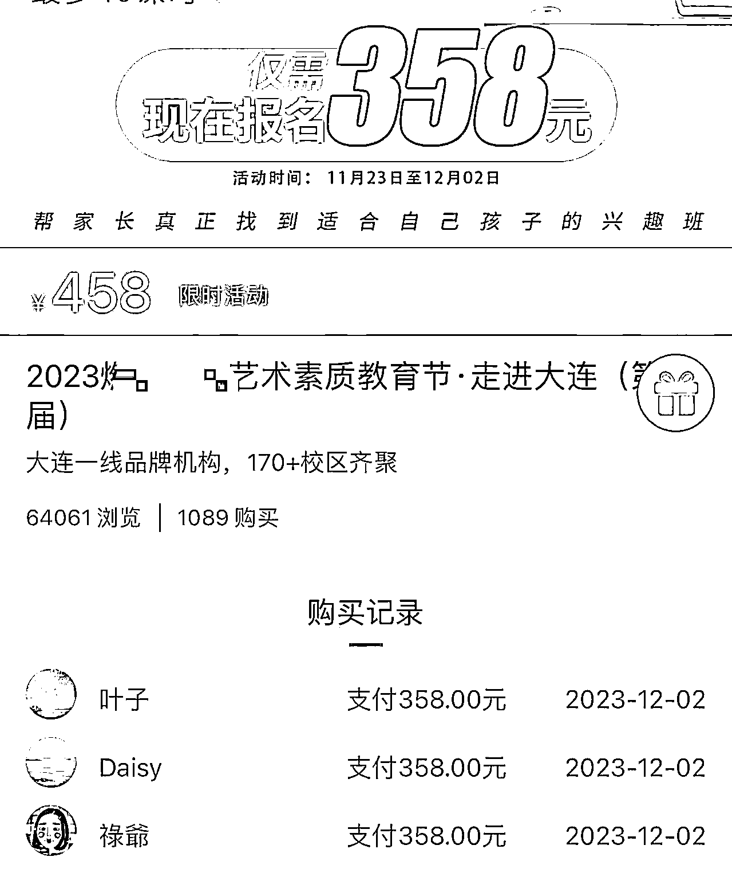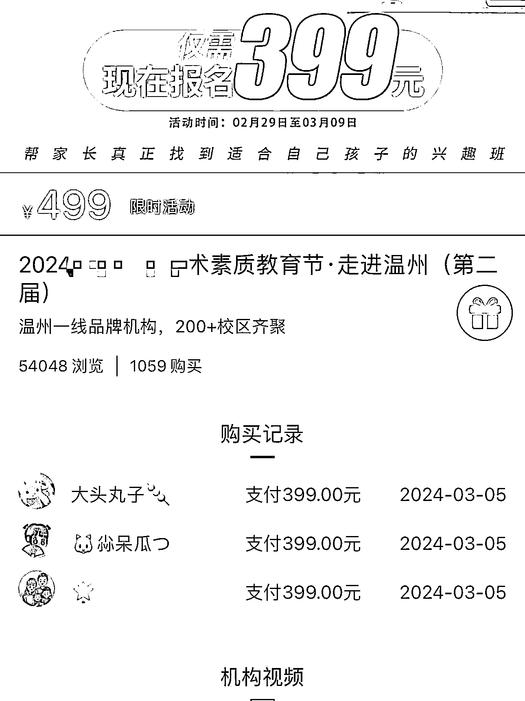

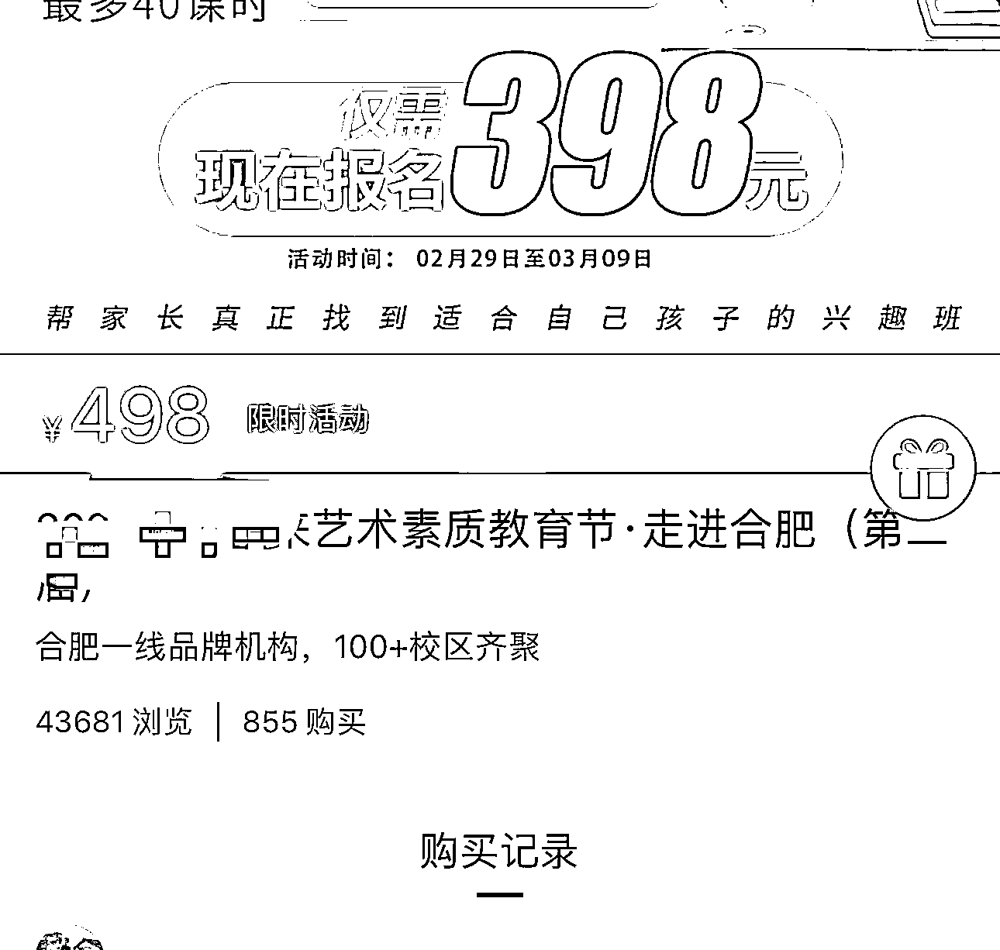

亲子节发售，合肥、大连、温州三地，分别成交 1000+ 单、800+ 单，客单价 398 左右，GMV 接近 40 万。前端利润就超过了 20 万，后续还有大量的 1 对 1 续费服务利润。把后端服务做起来，整体利润能摸到近百万。说的是扣掉团队开支之后的纯利润，不是流水。

一个区域一年做两场，全国上千个县城，量自己去估。

先把利润摆出来，是让大家先看见价值再相信。核心是这套打法极易复制，任何人都能快速拿到利润。

在讲细节前，先论证下为什么这个生意成立，再进入全流程拆解。

流量环境在剧烈变化，实体经营也越来越专业、越来越细分，急需服务方去补足链条上的短板。

### 缺乏公域引流能力

实体经营本身很复杂，大多数老板已经忙不过来。很多人想靠抖音、小红书拿流量，但 90% 以上的老板既没精力也没方法从公域稳定拿到客户。

### 流量成本变得更高

自然客流越来越少，2、3 楼的门店进店率基本为零。商家只能在外面买流量，一方面找第三方服务公司，另一方面自己投平台，成本只涨不降。

### 转化效率低

艺培、瑜伽这类业态，普遍是先体验再升单，高客单转化靠临门一脚。商家转化能力不足，带来的流量就浪费了。所以大量服务公司会帮他们集中引流入店，再搭建转化闭环收单，这里面机会很大。

### 出生率下行

出生人口减少对幼教、少儿培训冲击直接，倒闭潮已经开始，未来几年洗牌会更剧烈。

总结：实体经营复杂，需要专业团队助力升级，这就是机会所在。

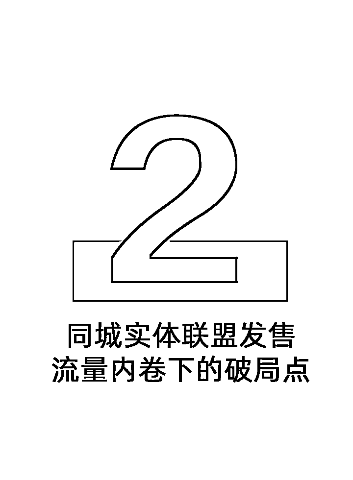

先说清楚发售是什么。发售就是一套成熟的私域变现打法，帮商家做流量增长和流量变现，快准狠拿到结果。

## IP 发售的优点和坑

现在 IP 发售很火，一场几百万上千万。逻辑是通的，但服务 IP 发售很难，卡在两点。

### 获取难

IP 越大效果越好，但拿下大 IP 的信任和销售难度极高。

### 交付难

IP 发售需要高度配合，大 IP 时间成本高。且 IP 发售本质是势能变现，IP 感觉得自己贡献大，操盘方利润就被压低。

## 实体发售为什么更优

### 销售阻力小

实体商家数量庞大，中小老板认知可同步，沟通能打通，不像 IP 需要高资源匹配。

### 天生有私域沉淀

大量实体的成交都在微信里完成，私域基础天然契合发售对私域数量的要求。

### 配合度高

老板一旦认可，愿意干脏活累活，执行力强。

## 实体联盟的打法

发售需要三要素：实体本身的势能、私域流量体量、成熟的方案。单个实体无论势能还是流量都有上限。

实体联盟解决了这个问题。把同类人群的实体店串起来共享流量，就能实现 1+1>2。

举例：舞蹈机构的付费决策者其实是宝妈。我们把瑜伽、医美、艺培等面向宝妈的实体拉进来一起做活动，做互导。

机构送出去 30 个客户，能收回来 120 个。三方共赢。

方案设计要同时兼顾流量共享、裂变和分销。

## 参与机构的选择

要势能强、私域足。艺术培训校区就是典型标的。一个三线城市就有 2000 多家，而且用户基本是三公里圈层，超过三公里就无竞争。正常可以邀约 100-200 家校区入局。

## 课程设计解决流量共享

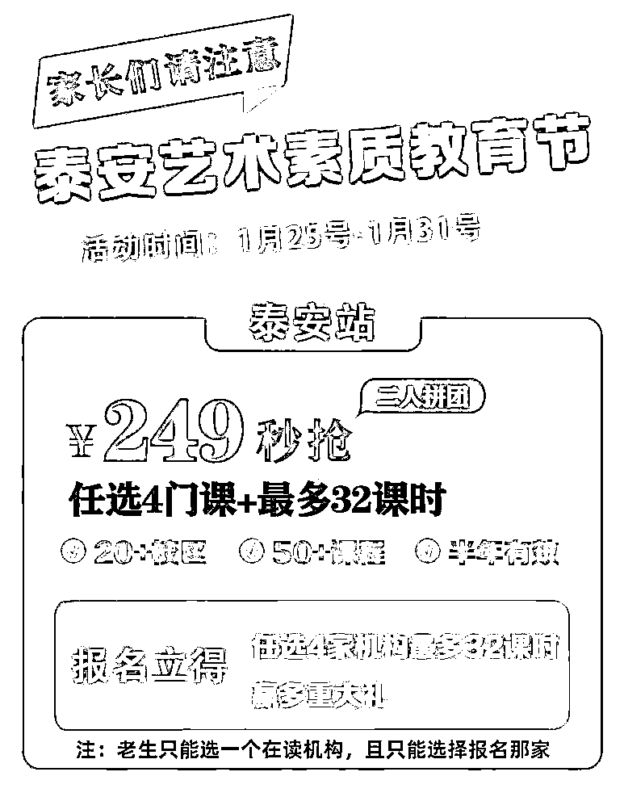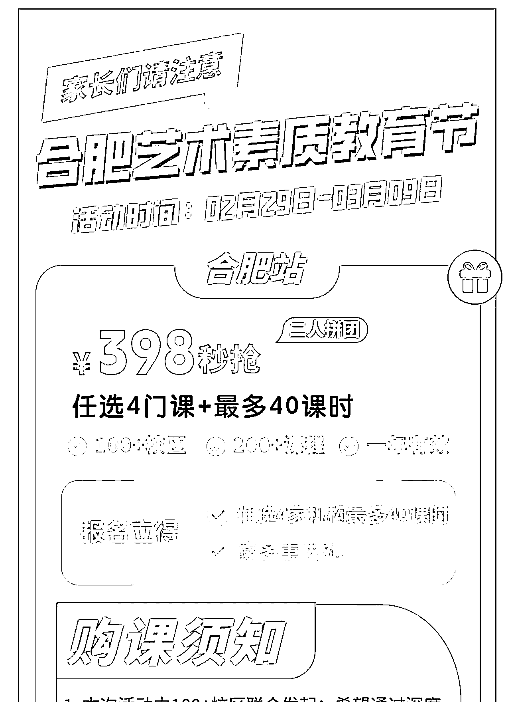

每家出 4 节课，用户可任选 4 家各 4 节课，共 16 节课，组合成 299 或 399 元的课包出售。100 多家校区共同用私域去推这个课包，流水全部由操盘方收，再按比例分配。

1 节课约等于 2 课时，16 节课=32 课时，艺术培训一节课市价 100 多，16 节价值 1600 元，卖 299/399 对用户极具吸引力。

校区为什么愿意出课？课程是虚拟成本，低成本引体验生，再转化高价课。还可额外赠送口腔、医美、游乐场、摄影等权益包提升价值感。

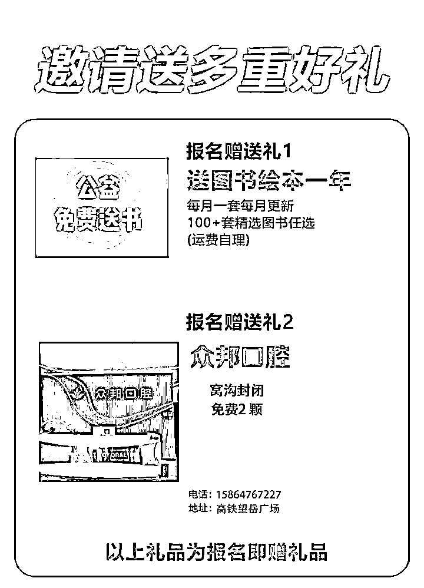

## 裂变设计驱动客户拉新

核心是让已购 399 元课包的家长有动力拉朋友。用礼品裂变或超市购物卡来驱动。

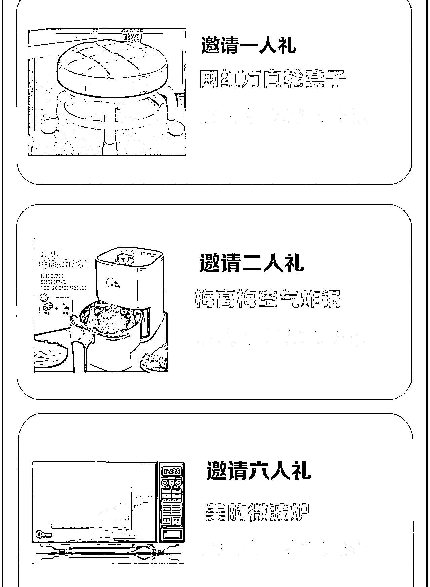

或着是

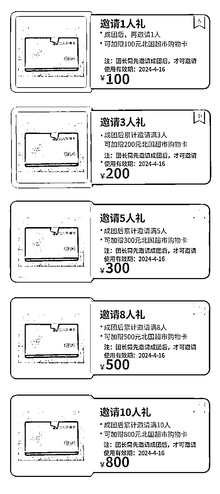

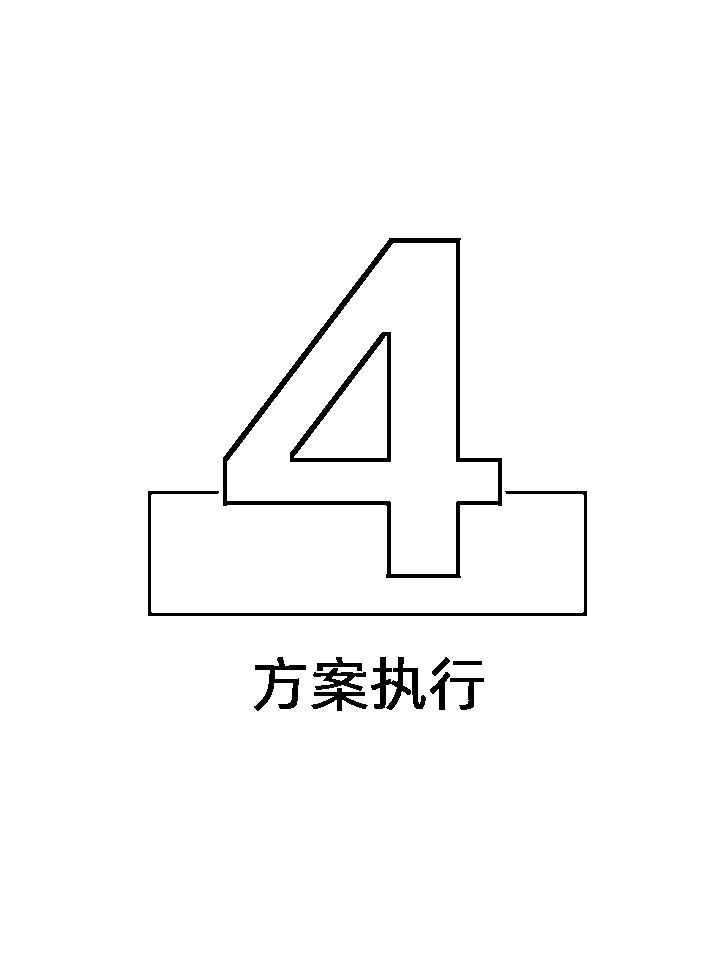

## 预售环节筛配合度

组织 100 多家校区，平均每家 3-4 人，现场要动 300-400 人。存在两个风险：有人想白嫖别的校区资源不推私域；人数多传达不到位。

所以要先开校长战略预售会，把所有校长集中讲透规则，统一思想。

会上启动 10 元定金预售，通过定金成交量判断校区配合度，配合的留下，不配合的剔除。

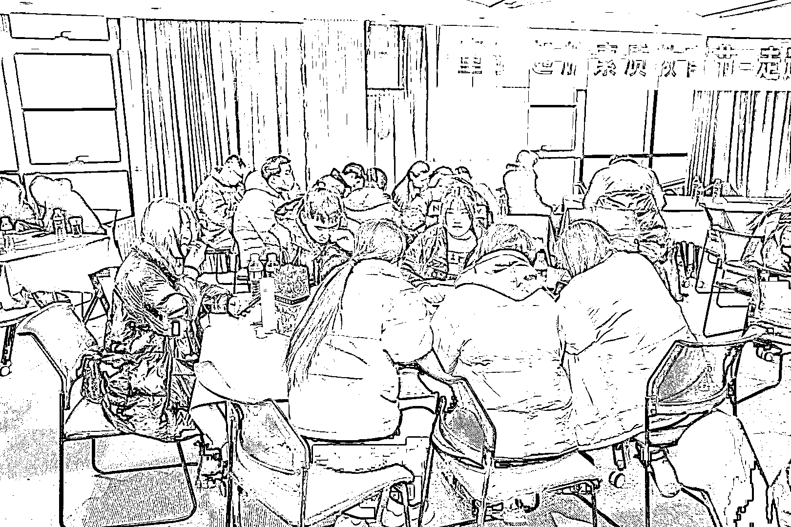

## 发售现场的操盘

租场地把所有校区集合起来，300-400 人到场，每人私域存量 500-1000 人，可动用的私域在 30-40 万人。

### 1、保证到场率高

老板和员工易缺席，人数少私域就打不出来。我们把发售做成新闻发布会形式，把所有校区老板名字列入嘉宾席，现场颁发联盟单位奖牌并上台领奖。

校长得奖牌机会少，上台有面子。到场率老板可达 90%，员工全勤 90% 以上。

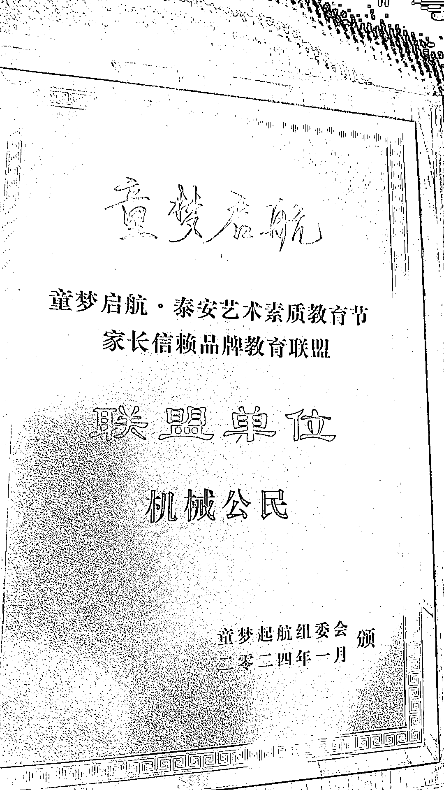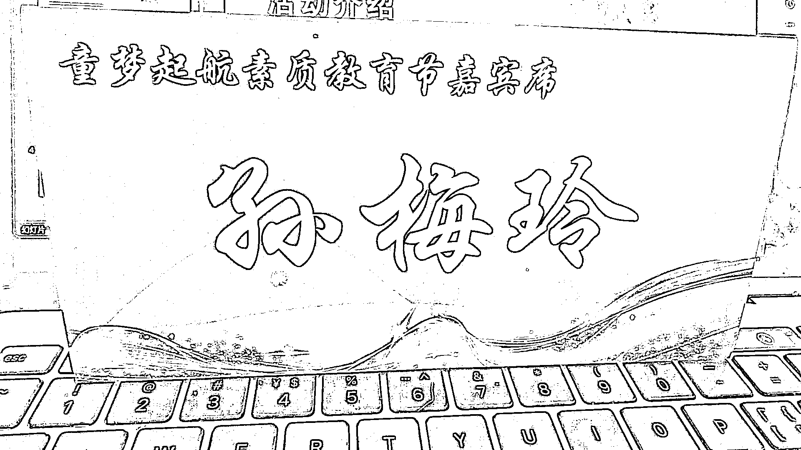

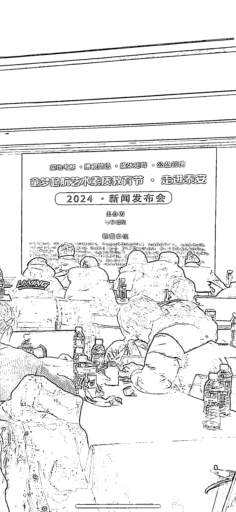

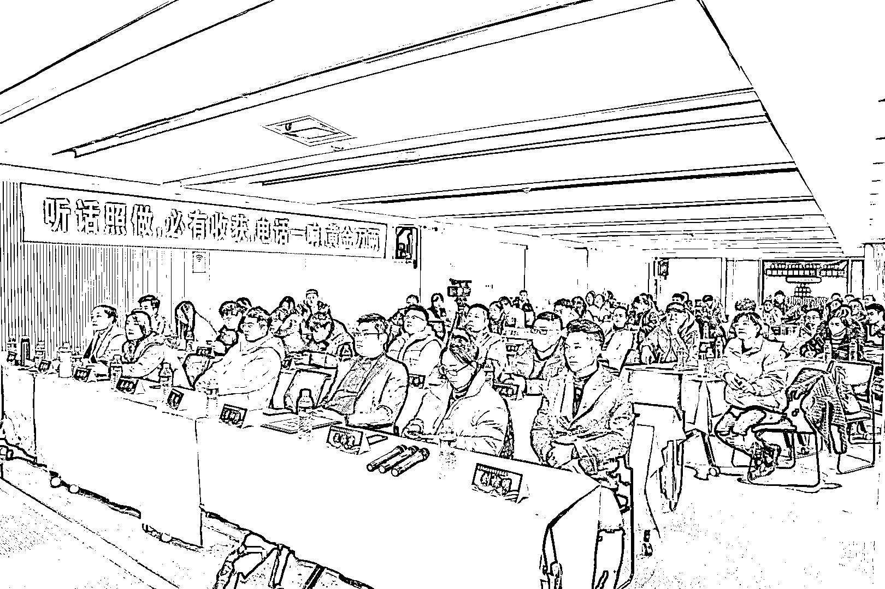

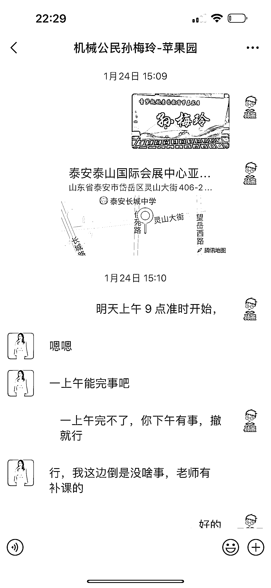

校长整体配合度直接拉满

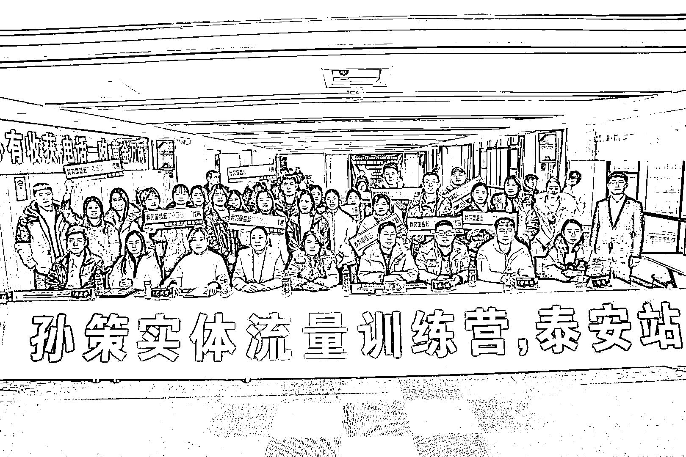

### 2、确保现场动私域

给参会人员设置 100 元/单奖励，分立返 50 元+晒单返 50 元。卖出一单就发钱，现金驱动成交。现场用小程序承接，员工推课，家长拉人。

### 3、达人分销增量

同时邀约本地社区团购达人、短视频达人到场分销课包。

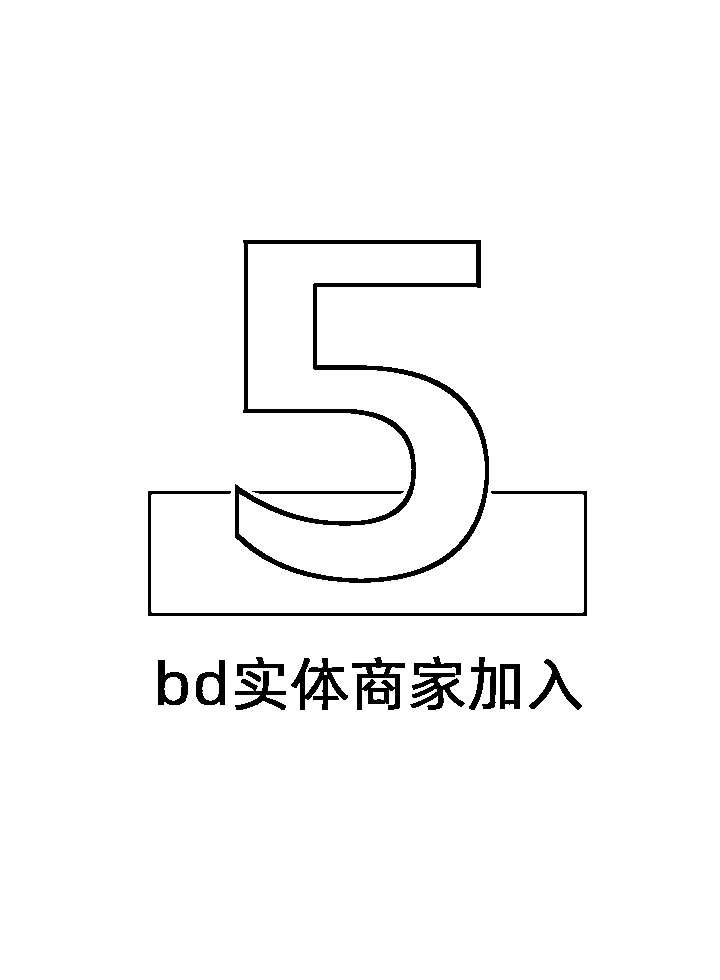

商家怎么来？发售要说服商家加入，核心是给曝光资源。

我们提供的资源包包括：本地公众号媒体曝光、大批量混剪短视频投放、本地达人探店、本地私域达人推送，以及后续的 1 对 1 深度服务。

销售方式两条腿走路：电话销售和线下陌拜。

电话销售先把城市内的艺术培训商家全部筛一遍，先建立认知。一个市区约 1000 多家，一轮下来能拉 10 多家意向，主要是让市场知道活动存在。

线下陌拜派人上门沟通，难度不大，制作邀请函递交。老板不在就让员工转达。

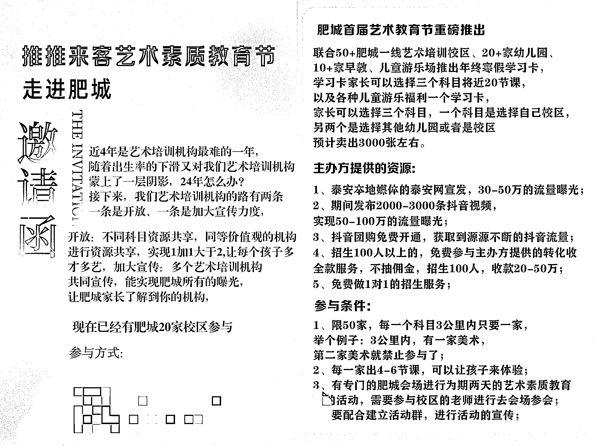

## 亲子节利润模型

以 399 元套餐为例，我们全额收取。100 元给老师，约 30 元礼品成本，剩场地费，其余都是利润。

做 1000 单：399-130=269，269x1000=26.9 万，再扣场地，净利就出来了。1000 单并不难，50 家商家每家 20 单就完成。

## 后端 1 对 1 利润

裂变活动前端利润已高，后端 1 对 1 深度服务利润更高。

* * *

评论区：

戴巍 : 如果能找到地方教委的人做代理，是不是很容易号召这些教培？

孙策 : 不难

芷蓝 : 孙总，有没有适合成人培训的发售玩法？

孙策 : 有的，瑜伽什么的都可以操盘

* * *