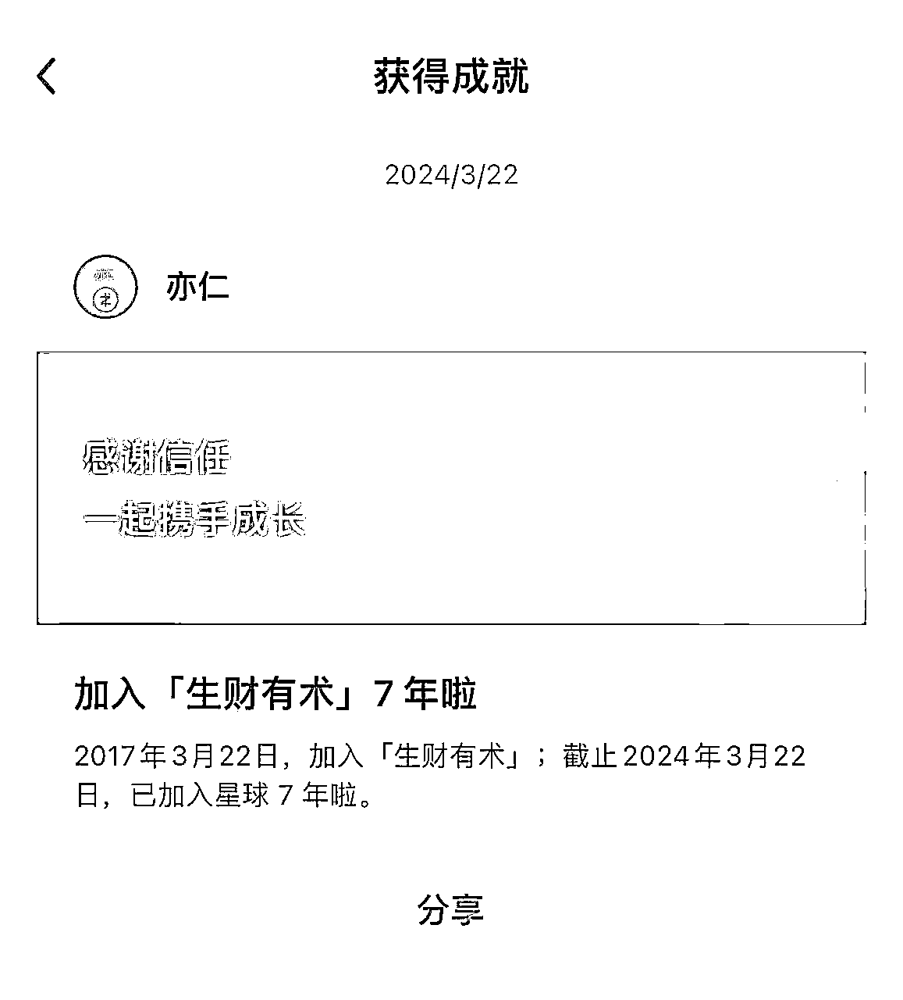
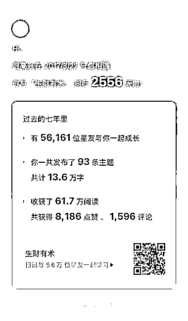

# 写字这件事，和收入到底有什么关系？我用7年写的答案

## 写，是怎么和赚钱搭上线的？4种连接，看完大概会想立刻动笔

大家好，我是明白，龙哥盟第七期的一员，星球 ID 20。

今天是3月22日，刚好收到了星球的提醒，今天是我加入龙哥盟整整7周年。李笑来说过，7年差不多就是一个人生阶段，今天这天还挺有感触的。晚上我还要去赚钱线下见面会的晚宴，先在这里和大家打个招呼。

说回正事。

不少人第一次记住我，可能是因为“晚九点半睡觉”这个标签。第二印象则多半是：这人公众号在日更，今天已经是第1339天了。

写作上我确实摸索了不少，也有了一些能拿得出手的成绩。但翻看我在知识星球的24篇精华帖，发现竟然一篇都没讲过写作本身，这事让我自己都有点意外。

所以我想换个很少有人聊的角度，把我对「写作与变现之间的关联」的一些理解梳理出来。希望读完之后，你对写东西这件事的看法会发生一点转变。

具体拆解我放在了飞书文档里：[`pznme756ly.feishu.cn/docx/JYQPdG2MKorfANxbnsqcfBPLn9b`](https://pznme756ly.feishu.cn/docx/JYQPdG2MKorfANxbnsqcfBPLn9b)

* * *

评论区：

根源 : 明白老師出手，這内容肯定不简单。

妙环 : 正在考虑这个问题，太及时了！！

乃鑫 : 明白老师如写作路上的引路明灯，照着那些也想一步一步向前的人。

帅彬（蟹老板） : 7 年就是一辈子

六和 : 明白老师日更一千多天啦

小椰 : 日更 1339 天，篇篇精品，只想说明白老师太了不起了！

花儿笑了 : 明白老师出品，必属精品

刘同学 : 明白老师太强了

* * *