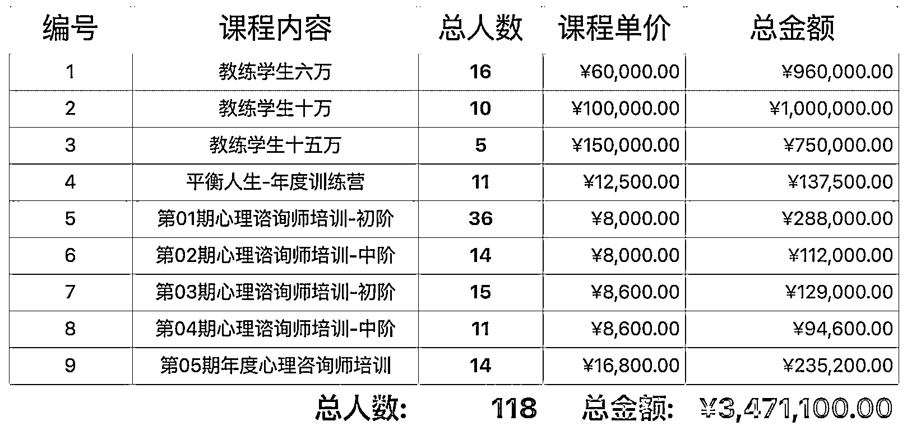

# 没有公司做靠山的线上新人，靠一套可复制的成交流程，卖出300万高客单

先说明一下，我们这次说的“高客单”，是指单价在8000元以上的产品。

大家好，我是根源。

做销售、做交付的人，谁不向往成交高客单？尤其是单打独斗的个体，要是哪天能一单收个几万、几十万，那种成就感真的会上头。更重要的是，大额订单能明显提升赚钱效率，也让交付时间更可控、更从容。

但恰恰是对于没有公司背景、没有平台背书的个人来说，想让客户掏出这么大一笔钱，真的不容易。

过去两年，我用一套固定的成交流程，让高价产品的累计成交额达到了300万。作为一个线上起步的新人，能有这个结果，说实话我自己也挺感慨的。

这套流程不是空谈，而是每一步都踩过坑、验证过的方法。我把细节整理成了一篇飞书好读版，需要的朋友可以慢慢看：

[飞书好读版链接](https://oee5lr7gsk.feishu.cn/docx/ZOaJdJTSuoflJfxSVIwc5xpCnNh)

文章发出去之后，评论区也被大家的认可刷屏了：“根源老师出品，必属精品”“干货一肚子，太牛了”“论聊天成交，根源老师yyds”“深入浅出，学到了”。其实这些反馈，比成交额本身更让我开心。

如果你正在为高客单成交发愁，希望这套被验证过的流程，能帮你打开一个新局面。

