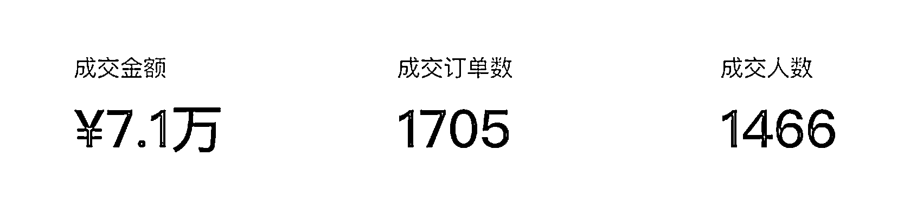
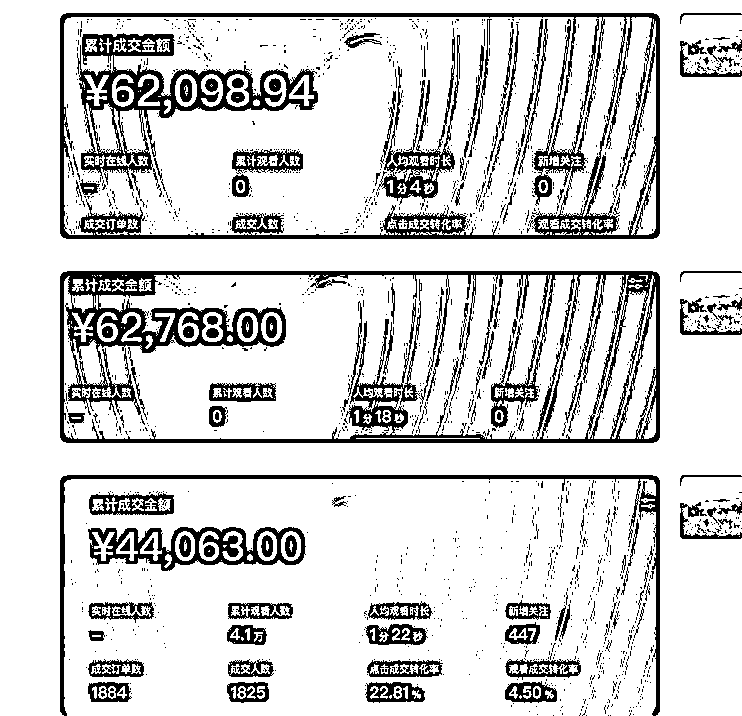
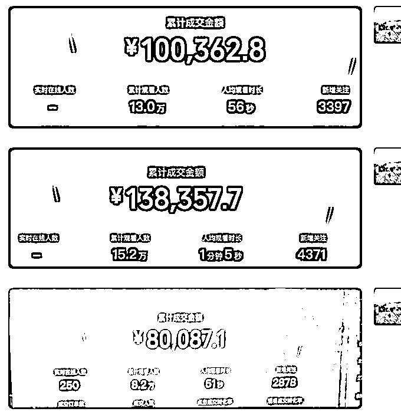

一个人，0粉0作品，不拍短视频，视频号直播30天卖了70万？

很多人一提到直播带货，第一反应就是“要团队、要拍视频、要有粉丝基础”。但最近看到一位圈友的真实经历，真的会改变你的想法。

她叫李嗯嗯，没有团队，完全是个体户，也是刚入行的新手主播。她的打法很特别：一条短视频都不发，从0个粉丝起步，完全靠直播间的自然流量，30天卖出70.8万GMV。当然，视频号开通带货需要100粉丝，她只花了不到一百块就解决了这个门槛。

说实话，在高手云集的社群里，这个成绩算不上耀眼，但对她个人来说，却是一剂强心针。她坦言，以前自己做什么都不太顺，甚至不知道视频号橱窗怎么开，一度怀疑自己适不适合做直播，看到别人项目赚钱还会动摇。直到拿到这个结果，她才真正坚定了继续深耕的信心。

她把自己踩过的坑、绕过的弯路，全都整理出来分享给大家，就是希望同样迷茫的新手能少走点弯路。最打动我的是她说：哪怕一个人、哪怕新手小白，在视频号也完全有机会赚到钱。她没有团队，全凭自己一步步摸索复盘，最终做到了。

她特意感谢了两位引路人——肖肖教练和Erik教练，也感谢百万教练耐心解答她各种“傻瓜问题”。她说两年前加入生财有术，是自己最值的一笔知识付费。作为一个没有资源的普通人，如果不是这个平台，她可能一辈子困在信息茧房里，更别说下场实操视频号、链接到这么多愿意倾囊相授的人。

完整的销售数据、直播细节和避坑指南，她都已经整理成飞书文档，想深入了解的朋友可以直接点开看：链接

评论区里，圈友们也纷纷点赞：“执行力、复盘能力拉满”“颗粒级别的复盘干货”“看得我都有点心动了”。如果你也正犹豫要不要开始做视频号，不妨去读读她的故事，说不定就是你的转折点。