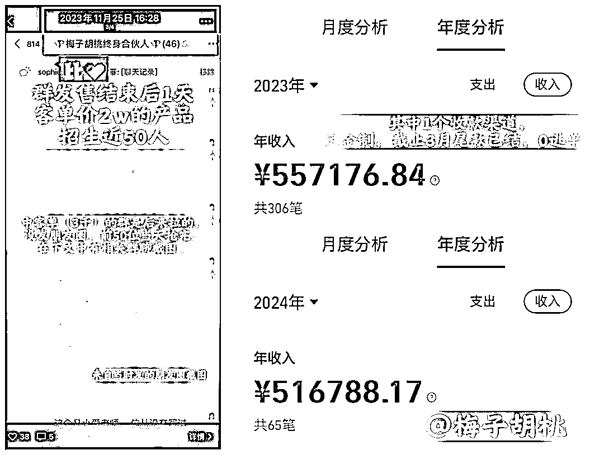
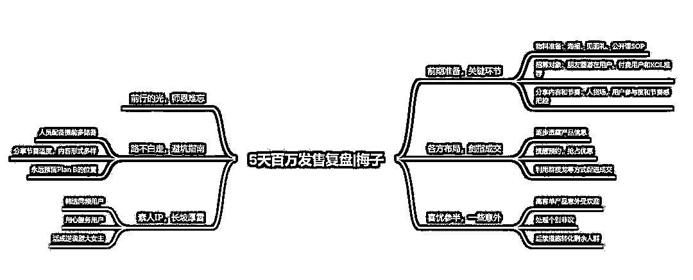

# 5 天破百万的理财营发售复盘：快闪群、朋友圈、1v1 怎么把流量变成利润

## 理财赛道开售实操拆解：用快闪群+朋友圈种草+1v1 私聊，5 天拿下百万利润

作者：梅子
发布时间：2024-03-20

《理财赛道发售，快闪群+朋友圈+1v1 成交，5 天利润过百万的复盘》

大家好，我是梅子。上一次在赚钱分享，还是去年 7 月 27 日，那篇盘的是全年 36 万的成绩单。这一回要讲的，是 5 天内高客单加中客单合计突破百万的实战。

图里能看到先起盘的高客单快闪群，这波群内发售最终拉进近 50 位学员，人均客单 2 万。中客单的快闪群则是在一个月后才开，限量前 50 个名额几乎都在当天被一抢而空。我做的方向是培训交付，核心是时间投入，所以营收几乎等同于利润。

这次开售到现在已经过去四个月，本来笔记早该发出来的，只是招完生后一直在忙交付和沉淀，花了不少时间去消化这次结果。现在整个体系已经跑顺了，才补上这篇复盘。

我从 2022 年 8 月底开始，和赚钱里的几位伙伴一起联合孵化这个理财营产品。产品沉淀运营一年多后，在一次准备时间其实很紧的发售中，爆发出了远超预期的成绩。

多亏赚钱里优秀的同行和几位引路老师的点拨，让我把自己的能力发挥到了自己都没想到过的程度。我的感谢说不完。今天就把这套发售路径拆开来讲，回馈给圈子里的朋友。能给大家一点启发，我就很满足了。

没有一蹴而就的百万，背后是 8 年多的理财实操经验加上 1 年多的社群运营交付经验。这 5 天的爆发，只是长期积累到临界点后的一次集中释放。

下面我会把台面上能看到的执行细节，以及台面下支撑它的底层逻辑全部摊开。本次复盘一共分为六个板块：

一、前期准备，关键环节
二、各方布局，剑指成交
三、喜忧参半，一些意外
四、素人 IP，长坡厚雪
五、路不白走，避坑指南
六、前行的光，师恩难忘

全文接近一万字，阅读前先上思维导图⬇️方便梳理脉络，完整可读版已同步到飞书：[`t.zsxq.com/18iLrX2G0`](https://t.zsxq.com/18iLrX2G0)[`a0nfyti51f.feishu.cn/docx/J8xZdIGEronfDwx1AtMcNrTYnXe`](https://a0nfyti51f.feishu.cn/docx/J8xZdIGEronfDwx1AtMcNrTYnXe)

* * *

评论区

胡桃 : 前排为梅子摇旗呐喊！！！

梁靠谱 : 太屌了，百万姐！

永奇 : 这个商业模式是属于合伙人加盟吗

小浩哥 : 牛

梅子 : 终身制，然后合伙人享受最高分销～

永奇 : 请问这个终身制付费只是一次性，还会有其他的项目以及盈利方式吗，就是类似复购那样，另外，会找其他入圈的合伙人共创其他新项目吗？

叶千岁 : 梅子 YYDS！！！

执 笔 写 洪 顺 : 厉害

* * *