# 1 万小红书高净值粉丝，10 个月变现 500 万，万字全流程拆解

一个小红书账号，粉丝只有一万出头，却能在10个月内卖出500万业绩，客单价6万的产品签下84单。这套打法，我决定完整拆给你看。

先说背景。2022年，我还是个纯小白，靠小红书从零做出一个自媒体账号，3个月赚了5万，涨粉8000。从那一刻起我就认定：做自媒体的那套方法，在小红书上最容易跑通。2023年3月，我换入一个完全陌生的垂直赛道——香港身份，账号从0起步，主阵地放在小红书，视频顺手同步到视频号和B站。到2024年1月，粉丝达到1.4万。

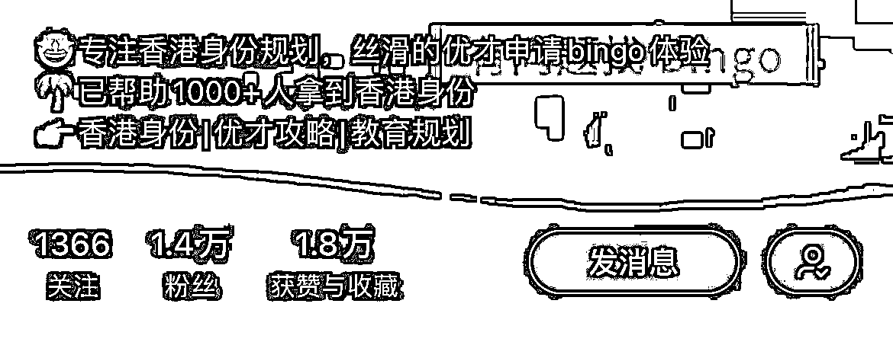
私域好友累计3600+。

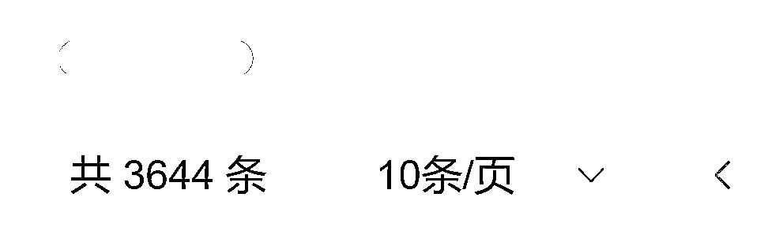
6万客单价的香港身份产品，先后成交84单，总销售额突破500万。

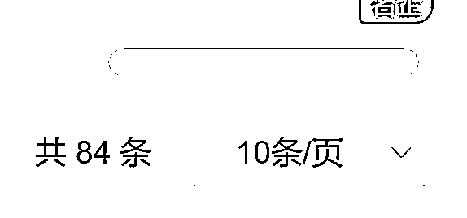
（先放一张战绩图，数据就是上面这几个：粉丝量、私域量、签单数、销售额。）

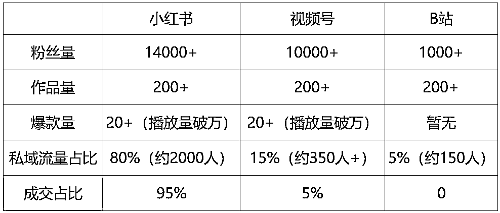

为什么这么多年，我一直死磕小红书？三个底层逻辑。

第一，用户结构。小红书女性用户占近八成，女性对情绪和感受天然更敏感。自媒体内容的本质，就是情绪价值的生意。再硬核的干货，经过镜头和文字传递后，用户感受到的首先是情绪；情绪一旦到位，爆款只是时间问题。

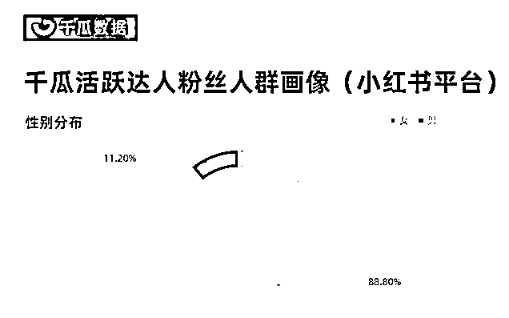

第二，平台定位。小红书从种草起家，天生是奔着“让生活更美好”去的。抖音的标签是娱乐，B站的关键词是学习，微信的核心是社交，而小红书在年轻人眼里，早就活成了“搜索框”：旅游、美食、住宿，打开小红书找答案，已经变成默认动作。所以在这里，你不必追求内容炫技，能真正解决一个问题，就是好内容。

第三，流量机制。小红书愿意给新号机会，会有意识地给0粉内容更多曝光，不会让大博主把所有流量吞掉。这三条凑一起，结论只有一个：只要你的内容够有用，情绪够真诚，平台就会把杠杆给你。

接下来进正文，分两块：先把号做起来，再把流量变成钱。

先说起号前期。我第一次碰香港身份，第一件事不是找对标账号，而是先琢磨产品对应的人群。我们的产品单价6万，目标用户画得很清晰：要么名企名校背景，可以走优才；要么年收入250万以上，可以走高才。同时我又找来一批高净值人群的兴趣报告，目的就两个：让账号定位和人群对齐；提前摸清他们关心什么，后面拍内容才不会跑偏。

人群摸完，开始做人设。我把同行和领域爆款拆了个遍，发现规律：表现最好的笔记，八成是“劝退型”的；涨得最快的博主，基本都是靠避坑内容起家。

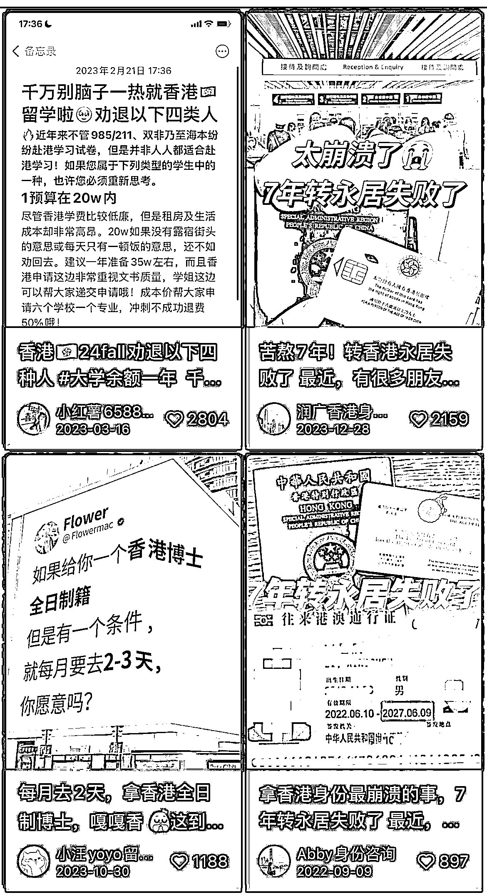

于是我把人设置成“劝退者”。理由很直接：劝退比避坑情绪更强烈，表达更有冲击力，也匹配我的镜头气质。账号装修同步搞定后，我花了半个月时间囤内容、拍视频、做封面。

拍摄会问到的一个细节：需要精心布景吗？我从没做过。劝退人设的要害，是内容和表现力。你要给观众一种“我实在憋不住了，必须拦住你”的劲头；哪怕我就坐在白墙前，也能对着镜头一直讲。这种粗糙感，反而让人相信他是真心劝你别踩坑。精致感是分领域的，劝退和避坑的内容，永远是越真实越有说服力。

3月底开始更新，一周5篇。第二个月，后台每天稳定收到10多条私信，咨询特别精准，基本三类：怎么办？我的条件行不行？费用多少？这里我想把“起号”的定义讲透。两个标准，满足一个就算成了。

第一种，出了标志性爆款。账号飞起，往往靠一篇爆款带动整体权重。热门赛道要1000赞才算爆，冷门细分100赞就算爆——香港身份恰恰是后者。

第二种，整体数据肉眼可见地变好。就算没有爆款，只要连续几篇笔记能拿到一两百赞，或者咨询明显起量，也说明账号已经完成冷启动。

起号成功后的关键策略，我管它叫“以点破面”：借爆款的势能把账号推向更高水位。当初我做了三件事。第一，拆解爆款数据，重点盯停留时长和关注量，反推用户为什么停留、为什么关注；第二，准备三版内容做测试，每版发三篇，跑出数据最优的那版；第三，照着最优模版连写十篇脚本，持续发布，效果稳定后就一直复制。很多人做到第一步就停了，所以流量才断掉。

第三个月，数据集中爆发：粉丝冲过5000，单月引流600多个，当月签下10单，其中9单是加微信30天内就成交的。

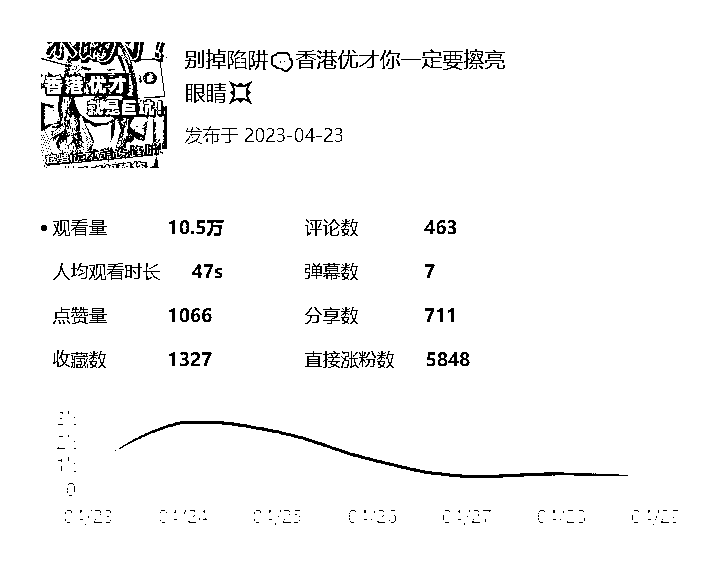

讲真，那个月的动作和前面没什么不同：选题、拍摄、剪辑、发布。以前我总觉得，“一个月赚10万”的故事应该很刺激，等自己真跑到这一步才发现，最值得记住的，反而是前期那些枯燥的摸索和反复的踉跄。

然后第四个月，我翻车了。流量下跌，像温水煮青蛙。第一周没出爆款，我安慰自己：平台这几天有大事件，正常。第二周咨询少了四成，我又想：爆款还发着，应该是私信被限制了。第三周签约走弱，我还在自我说服：成交总需要信任周期。直到一个月后，流量对比峰值腰斩，我才终于承认：账号状态出了问题，而我整整拖延了一个月。

做自媒体，真的是公平的。再大的账号，只要开始敷衍内容和用户，跌落就是必然。反过来，只要你肯回到数据里认真修正，回归也是必然。

第五个月，我开始自救，核心三步。

第一步，拉数据找病因。浏览量下滑，大概率封面出问题；停留时长下滑，内容呈现背锅；私信量下滑，钩子不够吸引；关注量下滑，人设弱了，用户看不到长期价值；成交量下滑，问题出在引流质量和销售流程。定位清楚再动手，才不会瞎忙。

第二步，对症下药。打个比方，封面点击率从30%掉到20%，其他数据没明显变化，那就把火力集中在封面。先跟过去的自己比：上个月的封面关键词是什么、排版有什么特征；再跟同行比：近期爆款封面是不是换了新玩法。光这一个点，就能做出好几个测试版本。此外，我还把以前的爆款按当下流量状态重做了一遍，内容做垂直还是做泛，随时调整；又把老爆款用图文形式再发一轮，封面套用当下最火的模板；结尾引导语也改得更具体，从“评论区留言”改成“评论区打出xx”。测试不一定立刻见效，但方向对了，时间早晚会给反馈。

第三步，耐心等待。自媒体动作要快，但等待也是一种策略。小红书有个特性：放了很久没动静的笔记，可能某天突然爆起来，原因都找不到。这就是自媒体的不确定性。

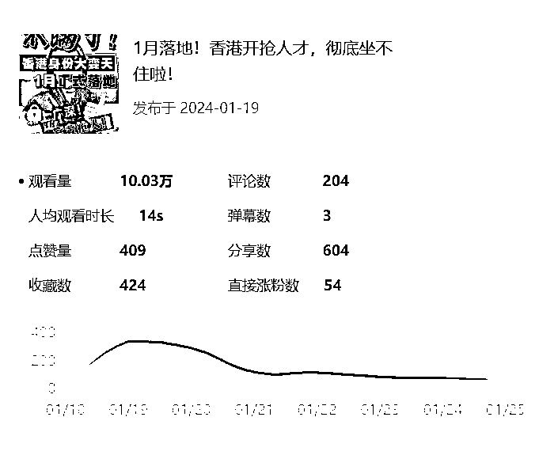
对抗这种不确定性的唯一方式，就是把自认为正确的动作做到极致，然后对自己说：我在等下一颗炸弹。我给自己设过测试周期：一周、两周，最长一个月。周期没到，哪怕没反馈也不乱动。你可以焦虑，但不能变形；可以着急，但不能乱试。只要正确动作一直坚持，你已经赢过大多数浅尝辄止的人。

第六个月，数据反弹。某天，一篇爆款毫无征兆地出现，当天私信咨询量直接拉到99+，来的人依然精准。

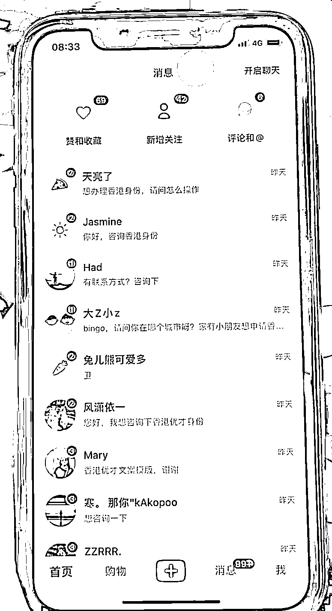
随着引流回暖，签单稳步上升，最后定格在84单、500万营业额。

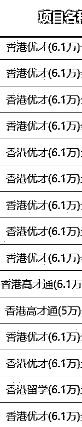
（数据回升图）

那一刻我有种奇妙的感觉：像在看另一个人冒险。她进场、试错、小胜、飘了、跌落、反思、爬起，最后拿到结果。这段路给我最大的收获，不是方法论本身——方法会过时——而是路径信心：我知道自己遇事能处理好，跌下去也一定能爬回来。

但自媒体最扎心的一句实话是：所有点赞收藏都是虚的，只有收到兜里的钱、加进微信的人，是真的。

下面说引流和成交。这些动作没有绝对先后，但建议一周内全部搭好闭环。爆款流量来了你接不住，就是白白浪费。

第一个动作，开通白名单。先申请企业号，交600元认证，一个主体现在能认证两个小红书号。认证后登录聚光平台，马上会有官方客服对接。你想引流，客服会让你先充2000元建立投放计划，每天投两三百元，投3天左右，就能拿到私信豁免权，也就是圈里说的“白名单”，有效期15到30天。有了它，你就能在私信里直接发微信号或手机号，引流效率成倍提升，被限流封禁的概率也低很多。

第二个动作，群聊+评论区双引流。建一个群聊，笔记发布后第二天关联上去即可。评论区引导话术要勤换，大约每5篇笔记换一种说法，不然容易被系统吞掉；话术常用“送资料”做饵，比如申请干货包、360页PPT、办理时间表、费用明细等。引导时既可以喊话私信，也可以喊话进群，哪个曝光效果好就用哪个；发完一定记得切小号，去自己评论区看看话术有没有正常显示。

第三个动作，搭建落地页。这是聚光平台收集客资的功能，相当于一个带表单的链接，用户点开后直接填写手机号。你可以把链接发到私信窗口，用户填完，你就能加微信或打电话跟进。落地页要做足吸引力，比如“一对一咨询诊断”，让用户心甘情愿留下号码。

第四个动作，私信激活。小红书每天主动私信的上限是20个，赶上爆款，评论和私信会铺天盖地，当天处理不完没关系，第二天、第三天接着触达，一个精准线索都别漏掉。

整套链路跑下来，流量才能稳稳流进私域池。粉丝量从来只是表象，真正决定你赚多少的，是能不能把内容流量转成商业闭环。找对平台，定准人设，吃透数据，然后重复、等待、复盘、迭代——这就是一万粉做到500万的全部秘密。

做内容拉新，最怕的就是只发一次就断联。笔记里一定要预埋能让读者主动留下来的钩子，比如留资料、关注后免费诊断、关注才能看完整清单这类诱因。没把人留住，你和他就只剩一次对话机会，整体的流量消耗效率会直接腰斩。

**一、付费拉新的初步探路**

目前在投放侧的动作还很少。该平台的私信触达和表单采集成本差别明显。表单一个线索要八十到一百五，私信开口在三十左右，单价看着高，但进来的体质更扎实。

限制点在香港身份话题审核偏严。像香港优才、香港高才这类核心关键词基本投不出去，所以现阶段只能投一些泛兴趣的围栏内容。这个赛道盘子非常大，有投放预算的可以慢慢试，预期是很大一块蛋糕。

**二、转化侧的打法**

我们做的品类非常垂直，对用户资质也有要求，前端进来的本身就是精准粉，所以转化的重点不是话术堆砌，而是让用户看见我们的专业背书，并马上解决他当下的困惑。

在该平台从进粉到成交往往需要十到六十天，期间主要做了三件事。

1. 用户分级 A B C D

先按资质和意愿度把人群拆分：

A 级：资质强意愿强，这批通常二十天内能收口。
B 级：资质不错意愿一般，争取三十天内推进。
C 级：资质和意愿都中等，需要拉到六十天左右慢慢养。
D 级：资质弱意愿弱，短期难成，先放在朋友圈孵化，等意向变化。

2. 分层唤醒，按层级反复激活

销售每天会按标签做不同强度的触达。转化推进的核心有三点：

强调时效，香港身份政策风向随时会变，促使用户尽快行动。
强调利益，结合用户真实诉求去讲身份能带来的具体好处。
强调背书，把公司软实力和过往案例分层展示。

对于高客单客户，反而不需要太多营销动作，真诚沟通即可。对资质不匹配的敢于劝退，把坑讲清楚，反而更容易建立信任。

3. 朋友圈的信任陈列

朋友圈本质是个人 IP 的信任展柜，主要展示三类素材：

获批案例、续签案例、客户好评等正反馈。
香港身份证实拍，让用户知道每月都有真实交付。
权威政策数据和官方解读，提升专业可信度。

**总的来说，转化层面细节很多。**
**但最核心的，还是能不能把流量拉进来。**
**有流量，才有一切。没流量，什么都没有。**

## 经验复盘

我把整个跑通的路径整理成了一张思维导图，很多都是实操中沉淀的小细节。

起号阶段的复盘
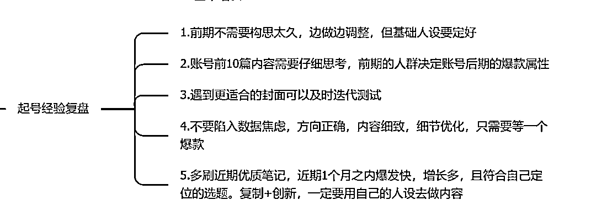

爆发后趁热加码的复盘
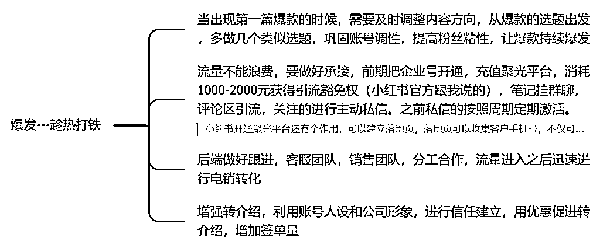

下滑与稳定增长期的复盘
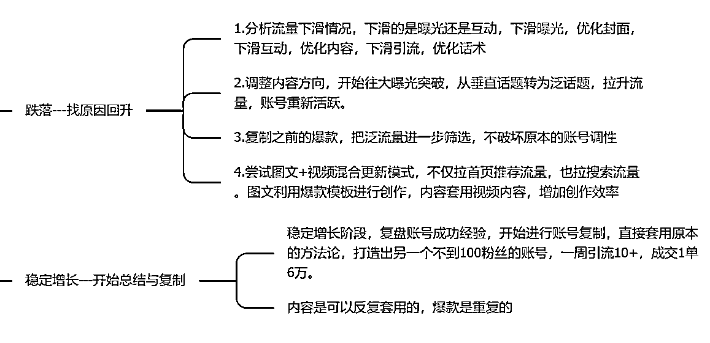

除了执行层的复盘，我更想聊聊做内容时的思考。这些是我写笔记时产生的碎片想法。

为什么要分享这些碎片？

**因为成大事，都是无数小事的叠加。**
**内容能否持续爆，也是无数细微思考的累积。**
**在一个赛道持续思考持续沉浸，量变会引发质变，成长曲线会进入指数级。**

1. 该平台的胜负手一定是封面和标题。封面是预期，内容是兑现。视频或图文的开头必须承接封面标题的承诺。前三秒把预期锚定，后面才有留存。开头需要绕弯子，绕弯有三点：先讲自身背书、罗列真实案例、直击痛点与焦虑。

2. 高认知金句要穿插在内容里，对高净值人群做价值灌输，输出情绪价值。

3. 做自媒体，千万别做一个让人无感的人。必须要做到让人爱你或恨你，两极分化才有传播。讨厌你的人会帮你扩散，喜欢你的人会付费并转介绍。内容的核心是制造情绪波动。

情绪发生转变，就意味着沉没成本出现。一旦产生沉没成本，用户就会主动进入你的内容。

4. 高认知金句加引导关注，能触发平台的 CES 评分机制：
ces=关注 8分 + 转发 4分 + 评论 4分 + 点赞/收藏 1分

一篇笔记一旦把关注数据拉起来，账号整体曝光权重都会提升。所以以引流为主的内容，一定要在文案里埋关注钩子。

5. 爆款是可以重复做的。

深层看，是人性不变。浅层看，是爆款因子不变。

经典好书好电影会被反复刷，因为人对喜欢的东西不会厌倦。三年前听过的段子，今天再听也会会心一笑，因为有怀旧情绪。

信息差也一样。你知道的事，至少有上亿人不知道。一个人听过一个笑话，不代表别人听过，所以笑话可以一直讲。

内容同理，一条被验证过的爆款逻辑可以反复做。第一次能爆，第二次依然能爆，因为底层逻辑没变。原创不是关键，能用的内容才有价值。重复是高级内容人才能领悟的道理。

最后附上我的完整复盘图，感谢阅读。如果这篇文章能带来一点启发，那就是我最大的收获。

[1 万小红书高净值粉丝，10 个月变现 500 万](https://vc4j7eioov.feishu.cn/mindnotes/Fr6sb0c33mj11anVjIKcTBB9nYd#mindmap)

感谢你的时间，也感谢平台让这些干货被看到。评论区欢迎交流，有问必答。

* * *

评论区：

念一通（无我觉悟版) : 先看火钳刘明

念一通（无我觉悟版) : 500w 是利润吗，李润泽多少啊

念一通（无我觉悟版) : 有看得懂圈友回复一下我这几个问题，
有几个问题：
1，那个香港优才计划服务合作方哪里找，
2，这个 500w 营收，利润有多少个点啊，
3，去哪里找香港优才计划合作方，如果帮助别人引流，一个收多少钱合适。

劲猫 : 1.朋友公司合作的，如果你想找合作方，最好找口碑好一点的，深圳本地的为主。
2.500 万人力占大头，办理香港身份提交材料那些费用，不到 1000 元，除去这两个之外，几乎是纯营收
3.做流量那一方，建议谈单个有效流量的价格加上后端成交分成，高客单的成交周期较长

大胡 : 1，香港身份有多种方式，优才计划是其中一种，目前香港优才的获批周期 1 年以上，所以很多办香港优才的机构会玩账期的游戏，所以找机构优先选择真实经营➕规模尚可➕经营时间长，建议 7 年以上，有成功拿到香港永居的公司，近两年很多小机构遍地开花，谨慎选择。
2，如果想做香港身份这个业务，优才项目是美丽的烟花，流量端➕销售端➕交付端，6 万的客单是成功获批后的收费，如果没获批，大部分公司就收 1-2 万，其余退还客户，优才真实获批率很低，且时间周期很长。
3，如果你想切入这个业务，找合作方，只能做流量端，按照 500 万的业务，获批率不高，时间周期长，整个业务真实营收需要打不少折扣，那么只做流量端的话，收益的想象空间不大。
4，香港身份真正有想象力的是后续服务，客户拿到香港身份后，会有香港教育➕香港保险➕香港保险等等高客单服务，这些高客单，一单就是几十万的利润，深入服务几个高净值客户，年人百万很正常，但如果你只是做流量端，很难吃到这部分利润，需要躬身入局，自己跑通整个环节。
5，酷炫的营收，和到自己的兜里是两回事，不要问我怎么知道的，我是其营收 20 倍的机构流量负责人。

念一通（无我觉悟版) : 感谢大胡如此真诚解答。

老风 : 感谢，全是干货[强]

张小凡 : 收货很大[玫瑰]

* * *