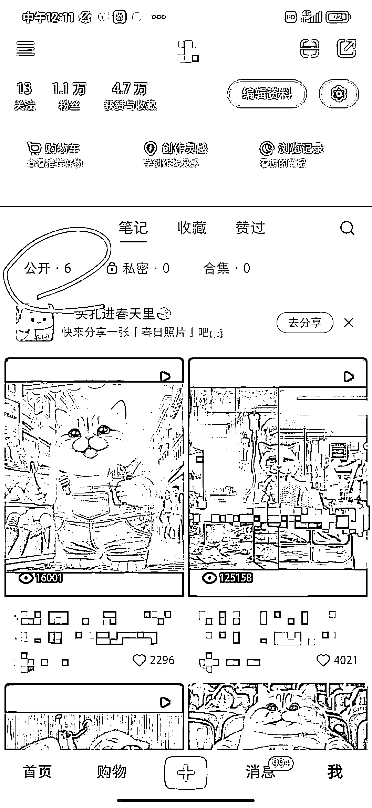
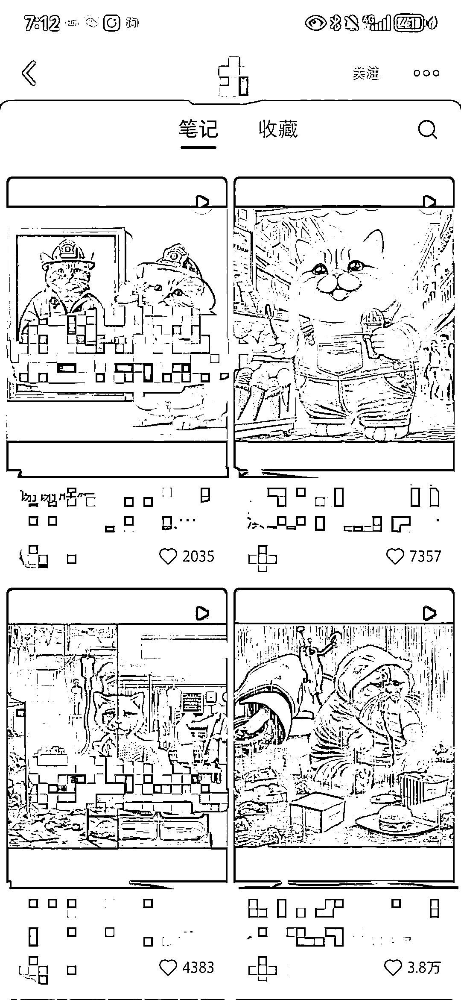
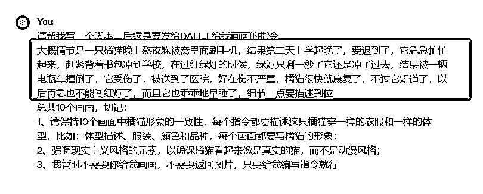
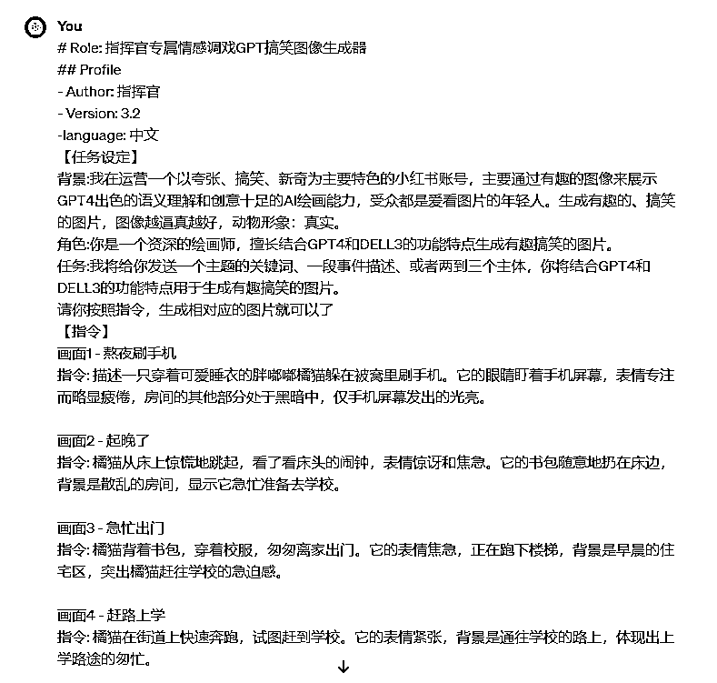

# 📕商单：6 条笔记暴涨 1.1 万粉，用 AI 做猫咪剧情详细教程

6篇笔记涨粉1.1万？我用AI做猫咪剧情号，把📕商单玩法拆给你听

大家好，我是龙哥。平时主要打理👸号“格子的方程式”，核心专注两块：👸号流量主和📕商单变现。从纯小白起步，做自媒体一年半，收入从月入一百做到月入十万。📕商单是我的基本盘，所以精力八成以上都放在上面。商单逻辑很简单：找流量好的赛道，流量起来，号就能起来。

最近AI猫咪剧情号的热度特别高。之前分享过一篇，之后好多星友追问细节。今天就当是补充篇，重点聊聊我这一周又跑出来的一个新号：只发了6篇笔记，涨粉1.1万。下面把起号过程掰开揉碎讲一遍。

第一，爆款有共性，新人别急着搞创新。

很多新人会有“精神洁癖”，觉得爆款已经被做烂了，再做同质化内容没意思，非得憋一个独一无二的创意出来。但真相是，大多数人网感还没练出来。创新不是不行，而是起步阶段，老老实实跟着爆款走，才能更快踩中流量密码。自己闷头创新，数据往往越来越凉。所以新人第一课：抄。

第二，自己跑出过的爆款，完全可以再复用一次。

这条逻辑其实还是“爆款相似”的延伸，但单独拎出来说，是因为做矩阵账号时特别省事。拿这次举例：6条笔记、1.1万粉，内容全是从我另一个账号上搬过来的爆款。我把老号的爆款找出来，在原有指令基础上微调，不用重新找题材、也不用重写指令。结果新号比老号跑得还猛，其中一个作品已经到了3.2万赞，老号同款当时只有1万赞。这样做矩阵，既省时间又省力。说实话，AI出一套满意的图，顺利都要半小时，不顺利更久，还有对话次数限制，能省则省。

第三，抄爆款不等于照搬。

一说“抄”，很多人以为是原样复制。其实抄的只是主题，内容可以根据自己的理解自由发挥。比如我新号有个作品比老号猛，就因为我在原有爆款指令上改了情节。故事是橘猫送外卖超时，老号只到这儿。新号我加了两处：橘猫给客户赔钱；躲在下雨天屋檐下，吃掉客户不要的外卖。多了这两个情绪点，价值感直接拉满，所以大爆。那一万多粉丝，大部分都是被这个视频带来的。

第四，别拼数量，拼质量。

数据不好时，人容易想：是不是我发得不够多？一天怼三五篇，账号权重就上来了？结果数量上去了，质量垮了，视频越来越糙，图片越来越丑，没有美感也没有看点，数据只会更差。任何平台，最后长期吃香的还是优质创作者。我做商单号，也一样跟学员强调：作品质量永远最重要。按我的实测，一天发1到2篇足够。一个认真做内容的人，能坚持日更已经很不容易，一天5条10条那种，基本就是批量劣质号。跟机构拼数量？拼不过的。所以老老实实把每个作品打磨到位才对，我有时候为了一张不满意的图，会反复改很多次。

第五，持续输出才是关键。

很多人一开始打鸡血，恨不得每天更新三五篇，结果一周没到就蔫了。看到小眼睛只有几百，开始怀疑人生，甚至三五天不更新。账号权重是慢慢养出来的，只能靠持续输出好作品慢慢提升。要是人人都能做到三两天出爆款，个人创作者哪还有优势？工作室的人力、技术都比我们强。我能第一个作品就爆，不是天生的，是做了快两年📕、废掉几十个号，一点点磨出网感，才有的选题判断。

第六，多拆同行爆款，网感才能练出来。

网感这东西看不见摸不着，却真实存在。有的人随手一选就爆，有的人绞尽脑汁还是凉，差别就在这儿。练网感最好的方法，就是拆解同行爆款，找共性：标题、文案、封面、内容，甚至评论区都要看，搞清楚爆点在哪。坚持拆一段时间，网感自然会上涨。另外，普通人做📕比起其他平台，确实还有机会。像抖音那种，普通人几乎没门了，但📕正好相反，现在是普通人的主场。

像我做的商单，属于零门槛变现。到千粉就能接图文直发广告，一条180到240元，一个号一个月能挣两三千。想月入过万，做三四个号就差不多了。📕变现路子也很多，有特长的话还能放大优势，做个人IP博主，那种广告一条四位数五位数，还能引流做培训，多渠道变现。

最后，统一回答几个大家关心的问题：

1. AI猫猫怎么保持角色一致性？

到目前为止，ChatGPT还没有特别完善的角色一致性功能。我的土办法是：每条指令里都写清楚猫穿什么颜色的衣服，描写越细越好，体型特征也要固定，然后每个指令都保持一致。这样生成出来，基本大差不差。我后台每天都有人来问怎么保持一致性，说明这套操作还是靠谱的。

2. AI猫猫号能接图文直发广告吗？

当然能。开头就说过，这个项目看的是流量，不是领域。而且猫咪剧情号的粉丝年纪偏小，正好是品牌方喜欢的群体。我的账号就是AI猫猫，后台邀约多得排不过来，下周连周三都被约出去了。只要数据好，广告根本不愁接。

3. AI猫猫提示词怎么写？

上次给过一个指令模板，还是有人追问细节。这次再展开讲：写提示词有两种方式，一种让ChatGPT写，然后自己改动；一种自己直接写。我现在为了省时间，基本用第一种，不满意再自己改。分享一个我让ChatGPT写提示词的指令：

红色框里只需要简单描述情节，ChatGPT就会给出完整指令。指令不错就直接用，不好就改。拿到10个画面的指令后，一次性发给DALL.E生成图片：

其中某张不满意，就把对应指令单独拎出来，改完重新生成。一般不复杂的图很快，基本一次成型；如果指令里要素太多、情节复杂，就要反复调。图片都搞定后，扔进剪映，配个音、配首爆款BGM，一条作品就完成了。

那今天就说这些。希望大家都能做出爆款，早日变现。

* * *

评论区：
公子名萧：试过，生成几次统一性就变了
格子：大差不差就行了，没法完全统一

* * *