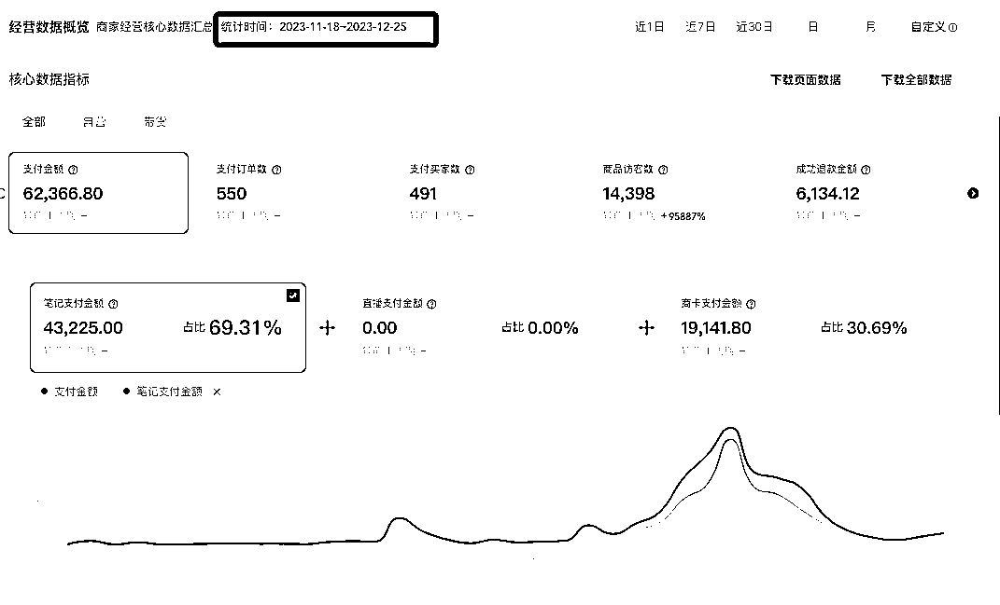
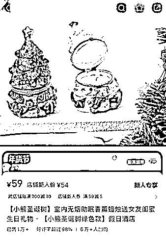
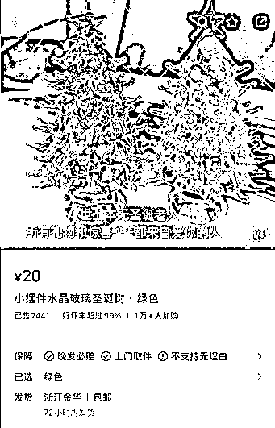
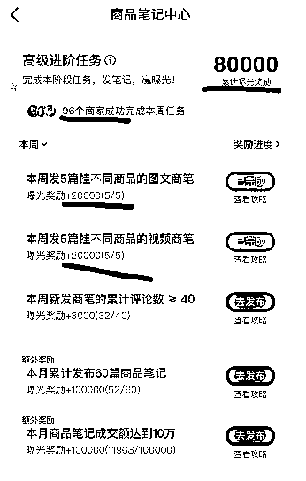
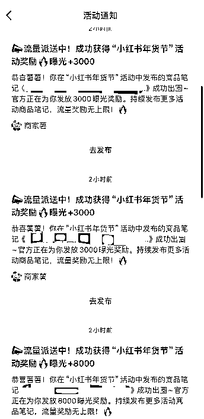
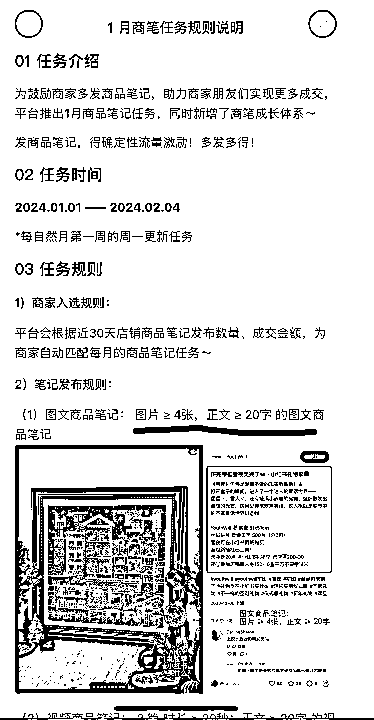
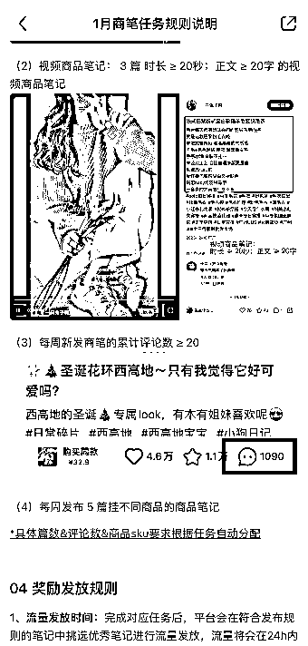

# 0 粉入局小红书节日礼物赛道，我是如何靠圣诞节点跑出 6 万+ GMV 的

## 抓住小红书节日红利卖礼物，我的爆品打法全拆解

作者：霖霖

日期：2024-03-22

跟着平台节奏走，就有流量吃。

去年 11 月我瞄准了小红书的圣诞礼物市场，用香薰礼盒做切入，0 粉发第一篇带货笔记，到圣诞结束后，GMV 直接破 6 万。

能做到这一步，核心就是顺势而为。抓住平台的节日营销节点，拿到了一大波免费曝光。靠着这套打法，我的店铺现在还在稳定运转，品类也从圣诞主题平滑切换到其他商品，持续在出单。

下面我就把整个项目的来龙去脉讲清楚，从项目起因、选品逻辑、工厂和供应链准备，到实操过程中的运营心得和平台任务经验，方便同样想在小红书起步的新手快速拿到第一波正反馈。

大家好，我是霖霖。曾经在大厂做过电商，到了职业倦怠期就开始到处试副业。小红书之前一直没碰过，直到 11 月份突发奇想想试试，于是就有了下面的故事。

# 一、项目成绩回顾

23-11-18 发出小红书第一篇日记，当时完全是小白，粉丝还是 0。一直做到 23-12-25 圣诞节收官，GMV 62,366.80。

数据截图如下：

0 到 1 的目标算是达成。现在店铺还在正常经营，圣诞季结束后我也及时换了品类。下面就详细说说我的操作思路。

# 二、为什么选圣诞节

11 月的时候我想入局小红书电商。自己没有强供应链资源，就想找一个能快速验证的蓝海赛道。

但我能想到的品类基本都被卷爆了，无论是冷门新奇还是搜索热度，都很难抢到位置。

当时是 11 月 18 日，距离圣诞还有一个月。节日礼物属于刚需，尤其是小红书这种氛围感强的平台，圣诞相关内容一直是流量洼地。

我去翻了下圣诞节的关键词，发现 2022 年的圣诞主题笔记至今还在出圈。于是我把赛道锁定在圣诞送礼上。

# 三、选品思路

当时还没加入赚钱，选品全靠之前电商的经验。

先去小红书搜“圣诞节”，发现已经有玩家在 9-10 月就开始铺货了，动作真的快。这两款当时销量都已经 2000+：

接着我在 1688、淘宝、拼多多找货，筛选标准大概是这样：

1. 价格卡在 50-80，决策成本低，转化会更好；毛利最好做到 40%-50%；
2. 有新奇感但别太小众，能做团购、公司福利那种；
3. 颜值在线，拍照有质感，有节日氛围；
4. 最好自带礼盒或圣诞礼袋，拿出来送人有面子；

最后定品如下：

1. 主推款：2 款圣诞香薰礼盒，单价 50-70，毛利 50%；
2. 辅推款：4 款圣诞相关周边，毛利 30%-40%；

我刻意避开了上面两位博主的产品。他们笔记比我早两个月，搜索和发现权重肯定比我高，而且人家已经有千粉基础。我 0 粉去跟，很吃亏。

我最后挑的香薰礼盒在小红书当时几乎没人卖，颜值也高，我觉得一定能打动一部分用户。而且这款特别适合送客户、做企业团购，所以我额外配了圣诞限定礼袋来提升质感。

# 四、工厂对接与备货准备

**1、沟通方式和云仓布局**

工厂主要在 1688 找的。通过店铺页面就能大概判断工厂的运营成熟度。我的沟通方法：

1. 一定要先打电话，联系到老板本人加微信。真到缺货关键期，老板能直接插队排单，这是救命的。客服通常没有这个权限；
2. 聊产能的时候就能听出工厂实力，语气、用词的专业度都会暴露；

3. 如果工厂不提供代发，就提前备好最近的云仓。
A. 当时我还不知道小红书每天仅 20 个解密收件名额的限制，纯粹是云仓更快更便宜。
B. 节日品对时效要求极高，云仓必须选在工厂附近，方便当天用货拉拉把货拉走即到，比走工厂发货快很多，运费也更低。

**2、踩过的工厂**

香薰礼盒工厂：这个品第二天就出单了，我对它很看好，所以前期沟通很密。不仅加了老板微信，还会定期在旺旺上跟客服核对库存。为了摸底产能，我还提出做少量定制，看老板能什么时候交货，就能大概判断产能水位。为防做坏批次，我会隔几天自费下几单验货，样品也能直接卖出去不亏本。

陶瓷工厂：其实一开始我就感觉这家不行，客服像是老板自己在回。但当时找了几家成本都比他高，沟通又比较顺就签了。最后坑就来了，圣诞前一周产能直接崩了，原本 24 小时能发的变成 96 小时，紧急改成预售。

供应链是根本，选工厂和云仓一定要多维度评估。

# 五、运营阶段复盘

**1、运营心得**

0 粉起步，我在发第一篇笔记前看了大量同行笔记，总结几点：

1. 起步期多看平台话题、互动、爆款案例。封面一定要吸睛；
2. 要学会和平台共创。小红书 12 月推出了“圣诞礼物季”活动，还有商家笔记进阶任务，我靠这个拿到了 27.5 万的曝光助力；
3. 心态和时间管理很重要。测新品别指望一夜爆，不要自我怀疑。有人说发笔记就像存钱，存够量自然会回本。我一个人做项目，前期重选品和供应链，后期全心发笔记；
4. 时间块要排好，运营和供应链别顾此失彼。

**2、平台笔记任务是新手流量密码**

这个真的要重点说。

1. 开店后进入“商品笔记中心”，每周每月都有任务，完成就会有流量奖励。我觉得这就是平台在奖励和它一起做事的人。1 月的任务进度截图如下：

2. 商家薯会标记优质笔记并额外扶持。每收到一次商家薯的流量奖励通知，我都特别开心。

所以多学习优质笔记，多发笔记，奖励自然会来。

**3、商笔任务规则**

# 六、给新手的建议

**1、先盘优势再开干**

1. 卷直播还是卷笔记？我的优势在笔记。我试播了几次数据很差，没经验。看到前面两位博主纯靠笔记出单，我就坚决卷笔记；
2. 跟爆款还是做新品？我有电商选品经验。粉丝大的账号在搜索和发现的权重天然更高，我 0 粉去硬刚肯定吃亏，所以我选择做小红书的新品。事实证明虽然我拿到正反馈，但晚于上架的千粉博主结果更好。

**2、账号包装要提前**

做了一个月我发现垂直账号涨粉更快。如果我再做圣诞，我会把账号包装成礼品号，名字、头像、封面风格都统一。

**3、平台规则是免费流量的入口**

我这次的成绩很大程度上靠商笔任务的扶持。

**4、想快点看到结果，可以先做节日品**

春节、情人节、妇女节、儿童节...只要提前布局，选品对了就能起量。节日就是刚需。

希望对想做小红书的你有帮助！

* * *

评论区：

芷蓝 : 送礼这个场景是永久的刚需

霖霖 : 找一个合伙人，有没有一起的

* * *