# 千粉后广告接不上了？先查清楚蒲公英后台这些关键指标
作者：龙哥

多数人在📕做到一千粉丝后，满心期待能接到商单，结果实际操作起来却发现单子寥寥无几。根源往往不在内容本身，而是蒲公英的数据没达标。

下面这篇就把蒲公英后台怎么看、怎么养，讲得清楚一些，方便你对症调整。

# 数据查询路径

蒲公英平台入口：[`pgy.xiaohongshu.com/`](https://pgy.xiaohongshu.com/) ，网页端和移动端都能打开，登录必须使用对应的📕账号扫码。

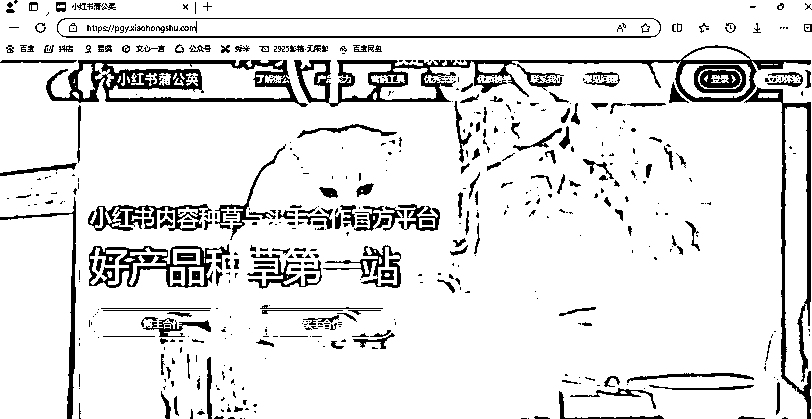

手机端登录方式：打开📕进入个人主页，点击左上角的菜单图标，找到扫码功能扫描网页二维码即可完成登录。

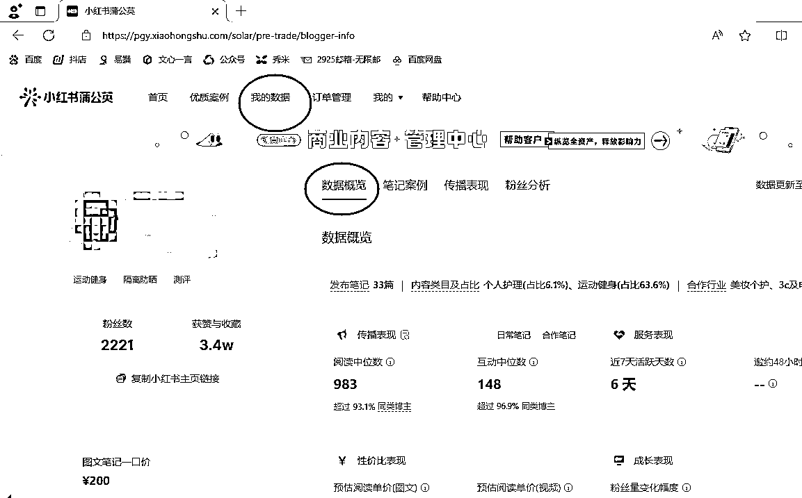

登录后进入“我的数据”页面，全盘指标一目了然。

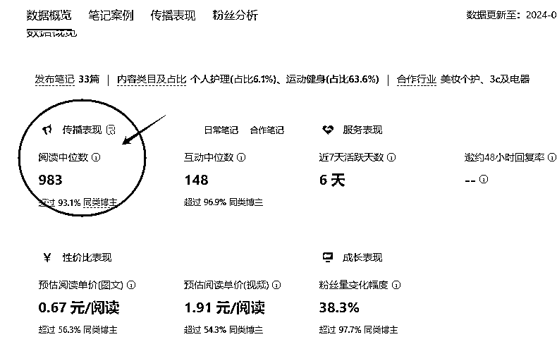

首要关注的是阅读中位数。行业普遍的门槛是1000，达不到这个数就说明内容表现不理想。此时需要围绕选题做调整，去研究近期走高的内容方向去创作。

另外，表现极差的笔记可以清理，优先处理最差的几篇。但清理节奏要慢，单日清理1-2篇即可，循序渐进拉升中位数。根本上仍要回归内容质量提升。

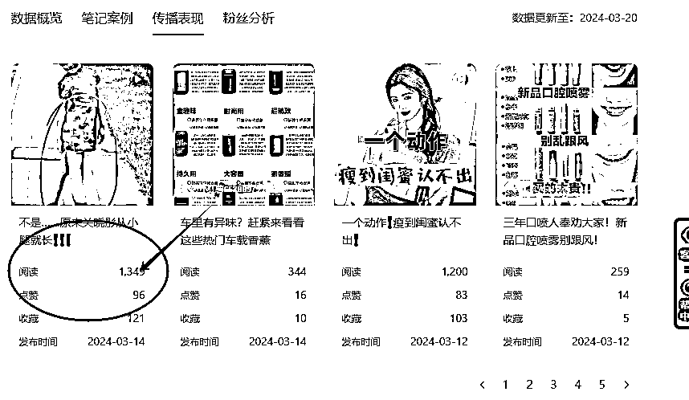

这里展示的是单篇笔记的有效阅读。蒲公英统计的有效阅读通常比📕 App 后台显示的小眼睛低出四成到五成左右。

例如我的一篇笔记，App里显示两千多阅读，蒲公英里只有一千三百多。品牌方提到的日常笔记过千，指的是蒲公英里的有效阅读，不要混淆。

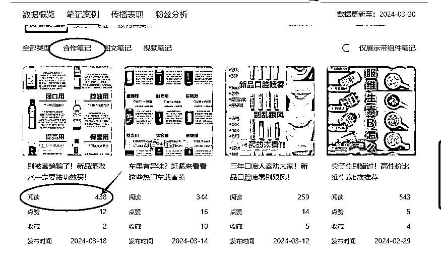

合作笔记阅读量也就是广告笔记的表现。普遍要求单篇广告阅读不低于两百。

由于折损较大，📕后台看到五六百阅读，到了蒲公英可能仍不达标。

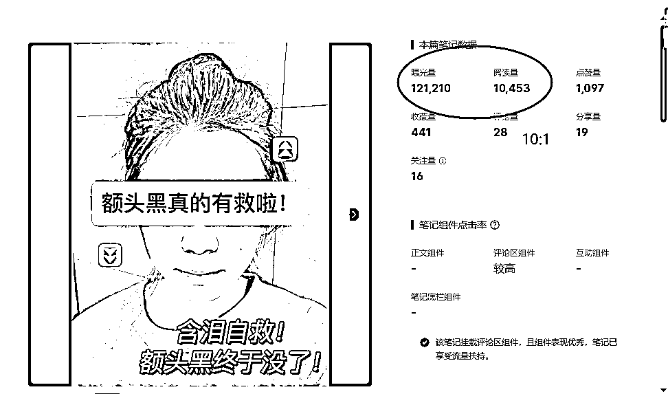

点进具体笔记，能看到该笔记的曝光与阅读。健康范围大致是曝光与阅读约十比一。若比例失衡，就要补齐偏弱的那一方。

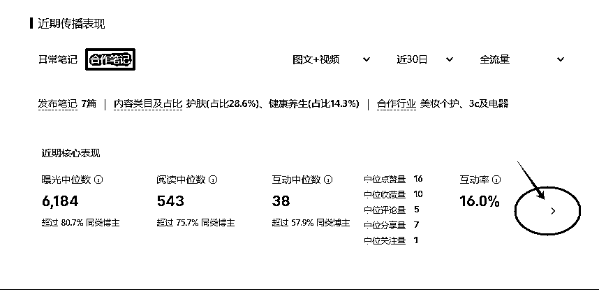

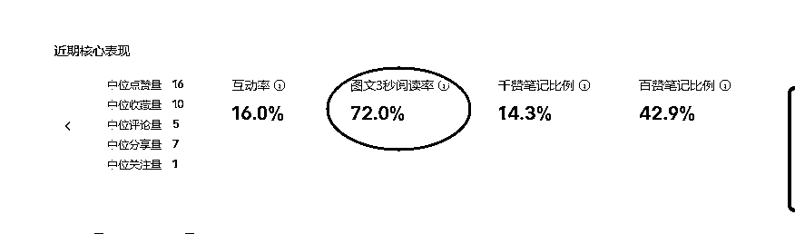

继续向下翻动页面，点击箭头展开整体概览，能查看到三秒完读率。

该指标一般要求在五成以上。

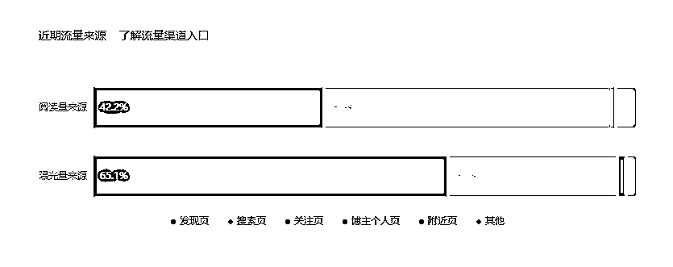

深蓝色条和浅蓝色条，分别对应发现页和搜索页的曝光与阅读。

这是非常容易被忽略却极其关键的维度。即便前面的指标都正常，接单仍困难，多半问题出在这里。大多数甲方会更看重浅蓝条，希望其占比超过一半。若浅蓝条不足，就需要针对性补充。

# 数据养护方法

上面讲的是中介和品牌会查的数据位置，下面讲如何主动养护。

甲方常见要求：日常阅读中位数过千，每篇日常笔记也有过千的基准。若广告表现优秀，日常要求会适当放宽。

广告侧的共性要求大致为：单篇广告阅读两百起步，浅蓝条占比过半，三秒完读过半。

部分甲方还会看数据是否平稳。若每条广告都差不多两百，没有起伏，容易被判定为人工干预。因此让数据带点自然波动更可信。

接不到单，基本就是指标不到位，找到短板再处理。

## 一、日常数据养护

日常数据核心靠内容本身。对标近期爆款，学习其选题逻辑和表达方式进行创作。

质量极差的笔记可以逐步删除，注意每天删一到两条即可，不要一次性大量清理。

日常阅读量在账号受限时也可以适度补充，待恢复后再接单。操作前需评估投入产出是否划算。最稳妥的仍是提升内容本身。

## 二、广告数据养护

### 1、阅读量
广告阅读的底线是两百，每篇都要达标。判定依据以蒲公英为准。若不足，可考虑补充阅读，市面价位大约十几元。

### 2、浅蓝条与深蓝条
对应发现页和搜索页的曝光与阅读，缺口在哪补哪。

浅蓝条最好能占到整体一半以上，接单成功率会更高。如果有一条爆款广告阅读超五千，对浅蓝条的依赖会降低。

关键是要保持两类条的比例协调。曝光与阅读通常保持十比一的关系，偏差不大可接受，偏差过大则补弱项。

具体查看可进入单条笔记的曝光与阅读详情。

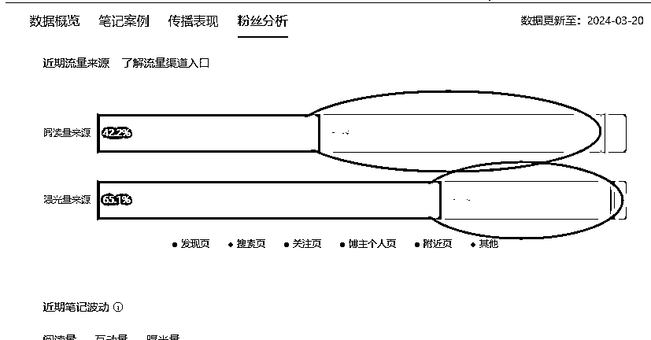

比如搜索页曝光明显偏少的笔记，就需要补充搜索页曝光。

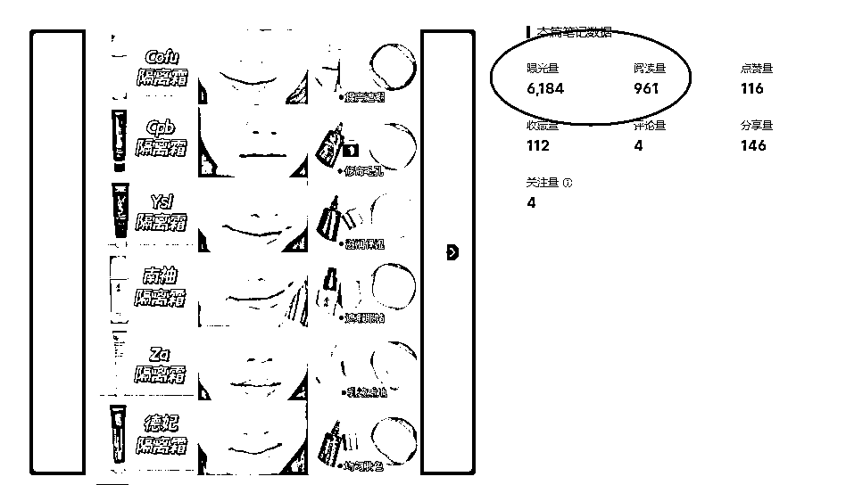

以阅读九百为例，曝光理应接近九千。若实际偏低，就可补充约三千搜索页曝光进行平衡。

### 3、三秒完读
三秒完读的底线多为五十%。不足时可优化开头钩子，或通过数据补充提升。

### 4、账号波动性
阅读量条目继续向下，能看到粉丝分析以及近期广告阅读的柱状图。

部分甲方不希望数据过于平坦，全部卡在两百左右会让账号显得缺乏潜力，投放后出爆款的可能性被质疑。

# 最后的话

突破千粉后，数据维护直接决定能否持续接到商单。哪个指标短板就补哪个，保持健康且自然。

祝各位都能稳步破千，商单不断。

* * *

评论区：

暂无评论

* * *

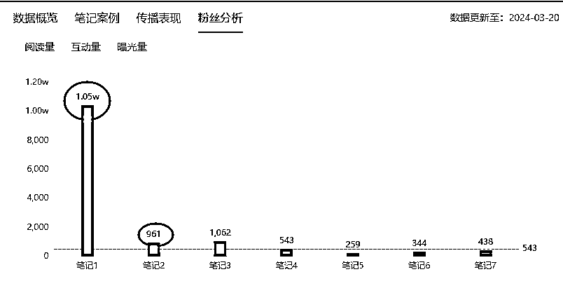