# 三步拆解：怎么快速判断一个产品在海外的真实市场规模？B端和C端都要看

## 快速判断海外产品有没有戏：B端和C端市场拆解实操

作者： 希声

日期：2024-03-18

年初去新加坡时，我认识了一位做传统线下大宗贸易多年的老板。

他想把身份转到新加坡，担心老业务撑不住，同时也想找个新赛道来配合移民规划和落地。

我提议他可以试试跨境B2B贸易。

这篇文章就是围绕他抛出来的几个核心疑问写的：

*怎么判断某件产品在海外到底有没有需求？*
*目标市场的地道英文名到底是什么？*
*全球这么多国家，该先从哪一个国家切入？*

为保护隐私，我换了个案例来演示。假设我们要卖的是一台电子秤，更具体点，是菜市场里那种能称重货物的平台秤。

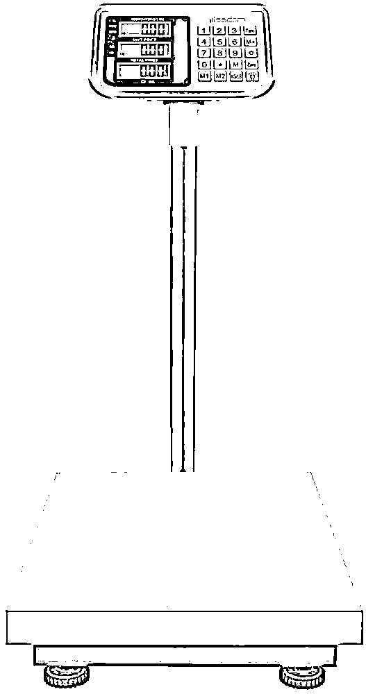

# 先把产品名字定准

第一步一定是把产品的英文关键词锁定下来。因为词不对，后面所有的数据查询都是白做。

找词有两条路：

第一条是直接用翻译工具，比如百度翻译。

第二条是用AI。

先试试百度翻译，得到的结果是 Electronic scale。

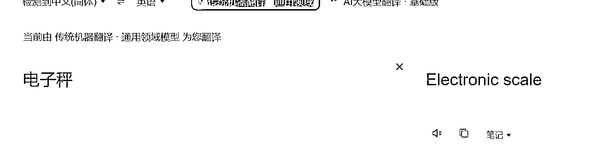

再用AI验证。拿着产品图喂给 Gemini，提示词写：请告诉我图片里这个产品的具体英文名称是什么？

AI给出的答案是 digital platform scale。

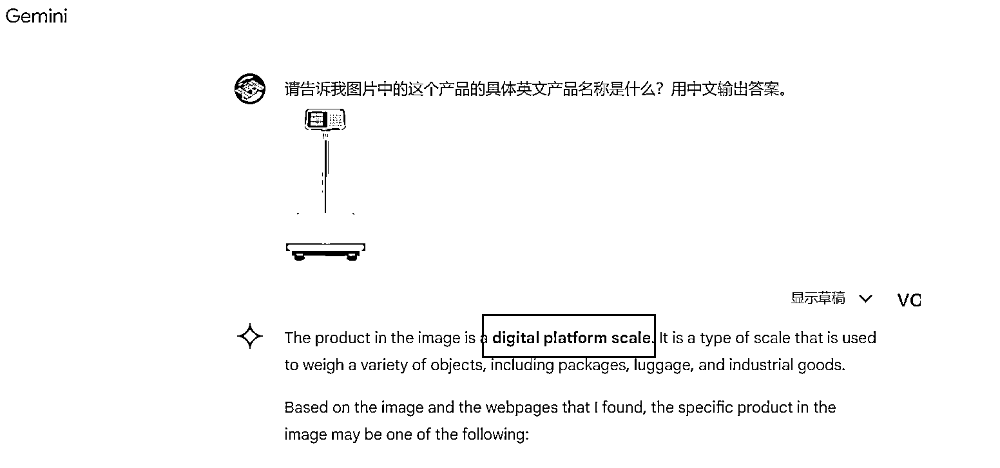

到这一步，我们手上就有两个候选词了：
electronic scale 和 digital platform scale。

# 关键词对不对，必须验证

到底哪个词更准？哪个词才是买家真正会搜的？

这一步往往是B端外贸踩坑的第一关：词没找对。

打个比方，番薯。

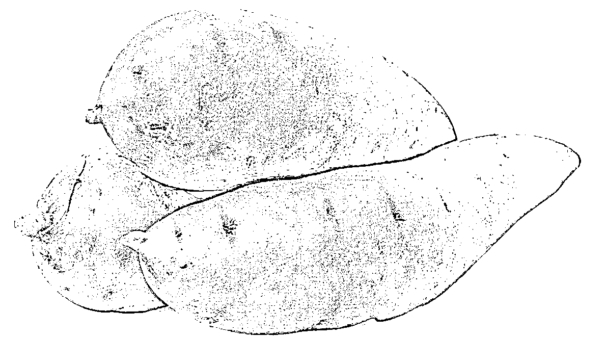

在国内不同地方叫红薯、地瓜；在日本叫薩摩芋 Satsuma-imo；在美国更常说 sweet potato。

词错了，后面就是在错误赛道上狂奔。

我常用的验证法是谷歌图片反向校验。

打开谷歌图片搜 electronic scale。

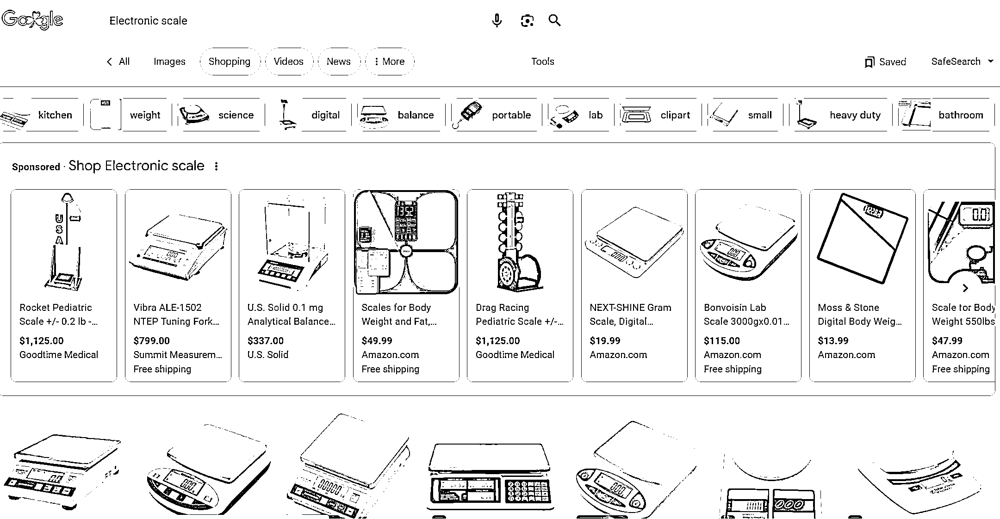

能看到结果基本都是迷你型电子秤，跟我们要卖的平台秤完全不是一回事。

再搜 AI 给出的 digital platform scale。

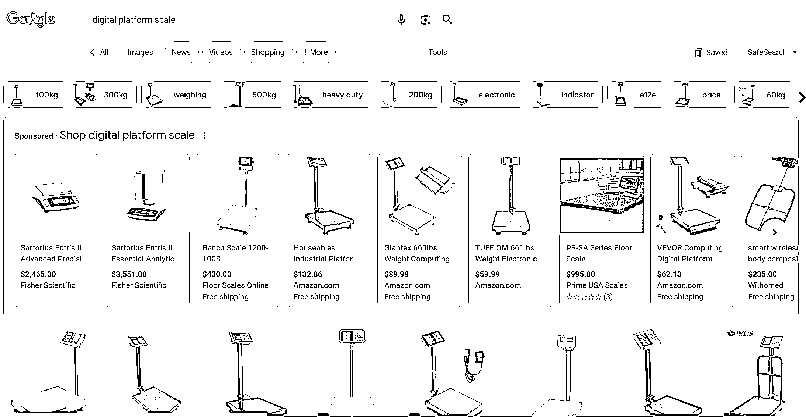

这下很像了，基本就是我们要的那款。

为求更稳，可以点进几张结果，看图片下方的标注名称。

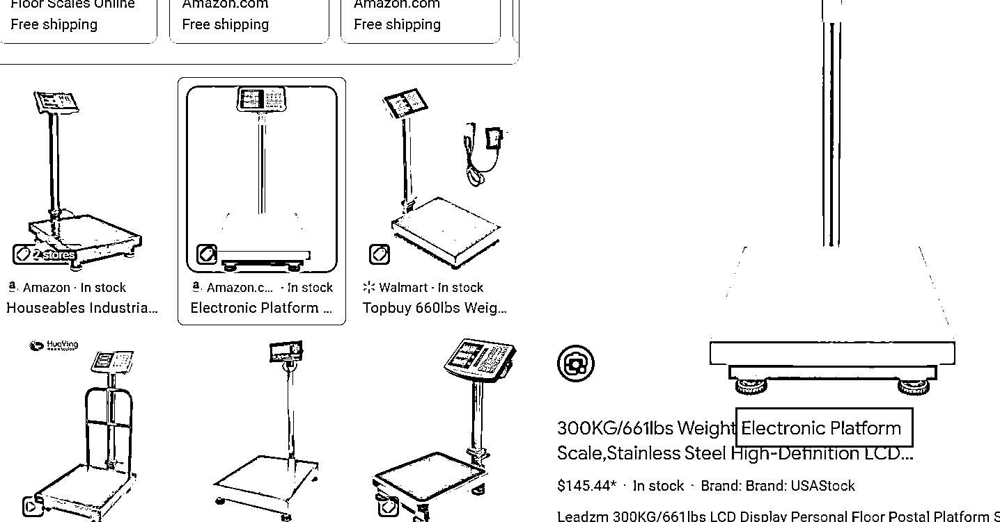

多看几张后，会发现还有一个说法是 electronic platform scale。

目前比较靠谱的两个词是：
digital platform scale
electronic platform scale

接下来就用数据看看，目标市场的买家到底更习惯用哪个词，以及需求量大概有多大。

# 用搜索量估算市场体量

假设主攻美国。

底层逻辑很简单：关键词在谷歌的月均搜索量≈市场需求≈市场体量。

虽然B端用户不只用谷歌，但谷歌仍是他们最直觉的搜索入口。

关键词工具很多，付费的有 Semrush、Ahrefs、KWfinder；免费可以用谷歌广告里的关键词规划师，不知道怎么开户可以参考这篇[白嫖！3000 元的谷歌广告优惠你要吗？](https://articles.zsxq.com/id_sa1bz4dckqeq.html)

这里演示 Semrush。

先看 digital platform scale。

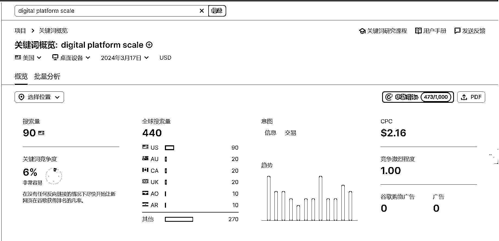

全球月均约440次，美国约90次。

再看 electronic platform scale。

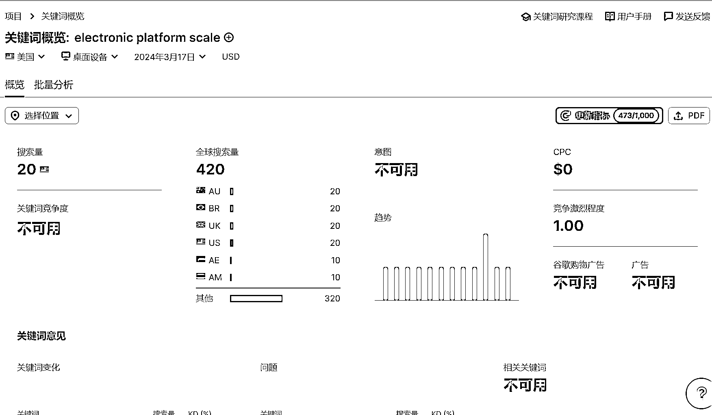

全球月均约420次，美国约20次。

对比下来，如果主做美国，核心词更建议用 digital platform scale。

工具里还能扩展出相关长尾词：

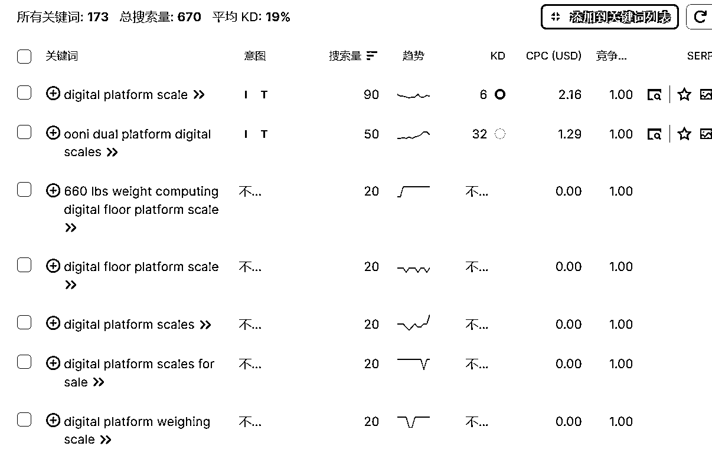

后续也可以做竞品词库收集，这里就不展开了。

# 用谷歌趋势做交叉判断

打开 trends.google.com/trends

把两个词放进去，地区选美国，时间选近五年。

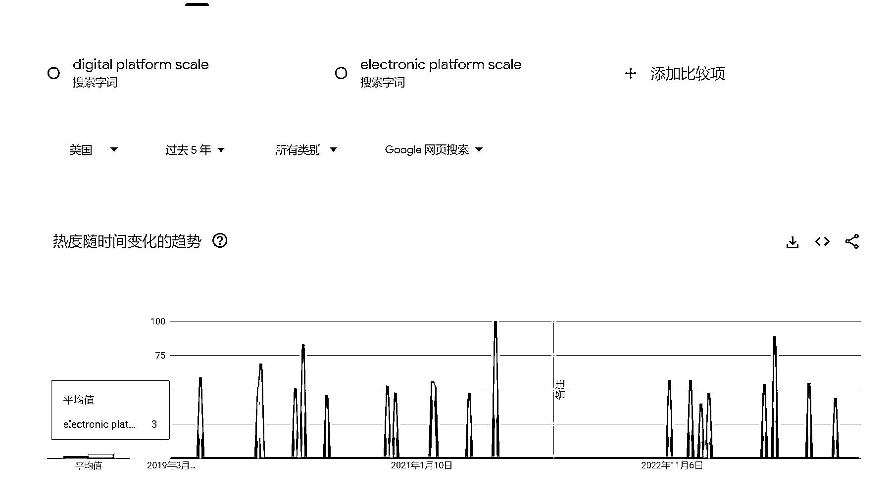

趋势曲线基本重合，差距很小。

往下滑还能看到不同州的偏好。

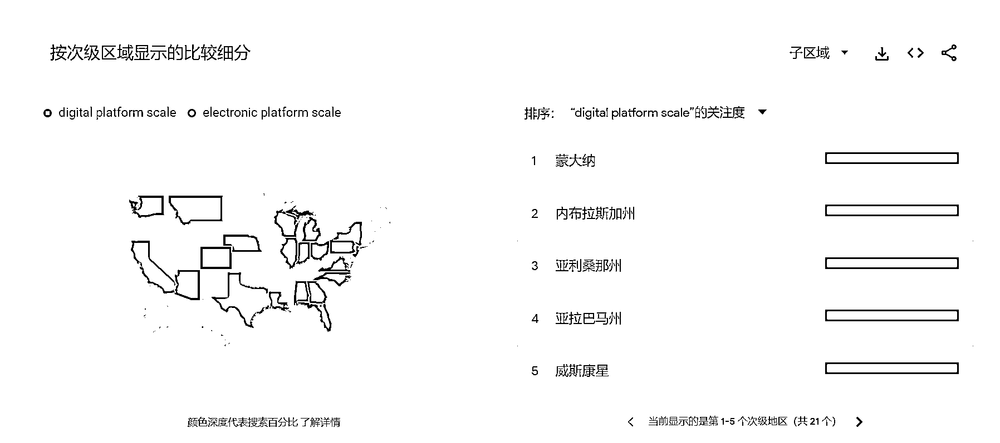

这个数据对投放很有用。比如谷歌搜索广告可以按州定向，这时候就知道哪个州更习惯用哪个词。

综合来看：核心词 digital platform scale，次核心词 electronic platform scale。

# B端市场怎么看规模？别用C端数据误导

我们目标是B2B外贸，不是C端零售。所以要用B端的搜索行为来验证。

打开这个B端关键词挖掘工具：
[`2uncle.com/google-search-ads-keywords-2b/`](https://2uncle.com/google-search-ads-keywords-2b)

输入 digital platform scale，系统会批量生成一批B端常见搜索词。

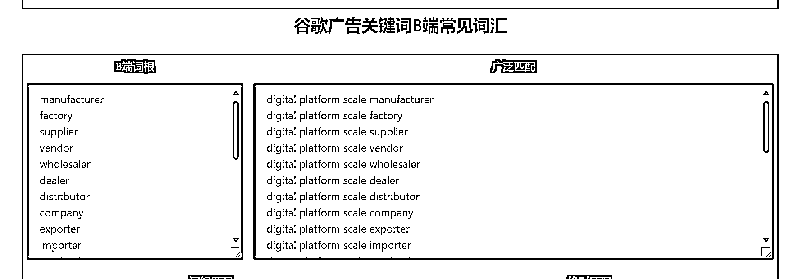

把这些词再丢进 Semrush 看搜索量。

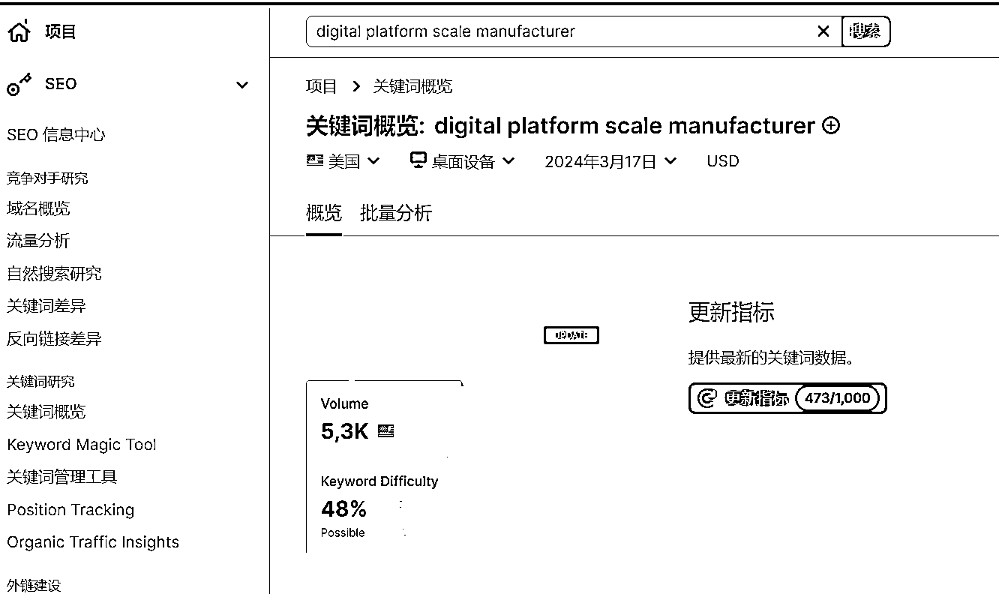

很多词搜索量太低，直接查不到数据。

# 查不到数据就等于没市场吗？

做B2B外贸经常会遇到这种尴尬：工具查不到数据。

但一定要记住：查不到不等于没市场。查不到不等于没市场。查不到不等于没市场。

说三遍。

原因很简单，第三方工具拿不到谷歌全量数据，只能靠算法估算。尤其是长尾、B端词，基数小，更容易显示空白。

工具只能做横向对比，不能当绝对真理。

那怎么办？我用土办法：看同行。

同行数量、做得好不好，直接反映市场真实温度。

# 怎么快速找到同行？

用这个本地化搜索模拟工具：
[`www.brightlocal.com/local-search-results-checker/`](https://www.brightlocal.com/local-search-results-checker/)

它能让你像当地人一样看谷歌搜索结果。

知识点补充：你在国内搜谷歌，很多时候看不到广告。不是没人投，而是谷歌识别到你在中国就屏蔽了广告。

谷歌也有千人千面，淘宝会推你羽绒服，谷歌也会根据位置推不同结果。所以做调研第一步是伪装成本地人。

在工具里填入关键词、目标国家美国、语言，开始搜索。

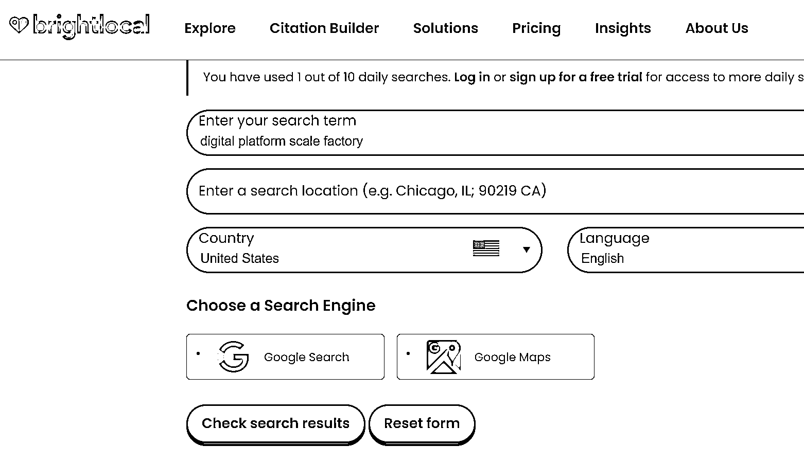

点进第一页。

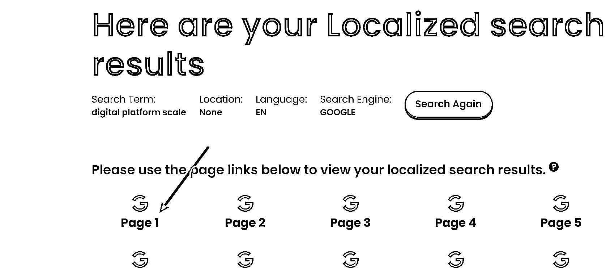

如果看到很多 sponsored 标识，说明伪装成功。

第一页就能看到一堆人在投放相关产品广告，有人持续投广告，基本就能说明市场是活的。

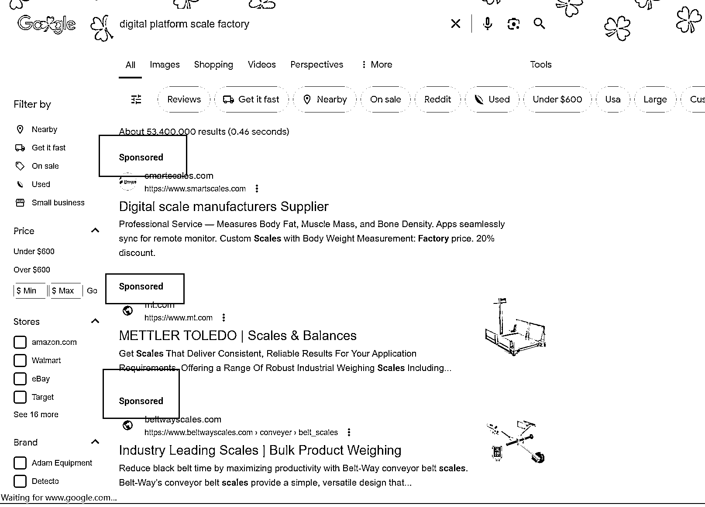

接下来逐个点进这些网站，看产品页、公司介绍、主推品类。

也可以把网址丢进 Semrush 或 SimilarWeb 做深度分析：流量、付费广告、主要市场、核心关键词、品牌声量、竞品等。

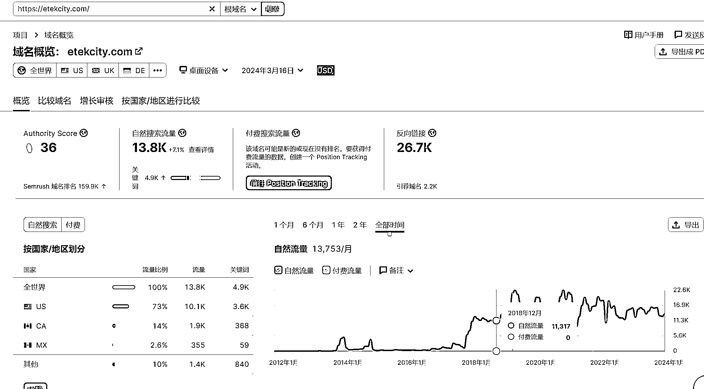

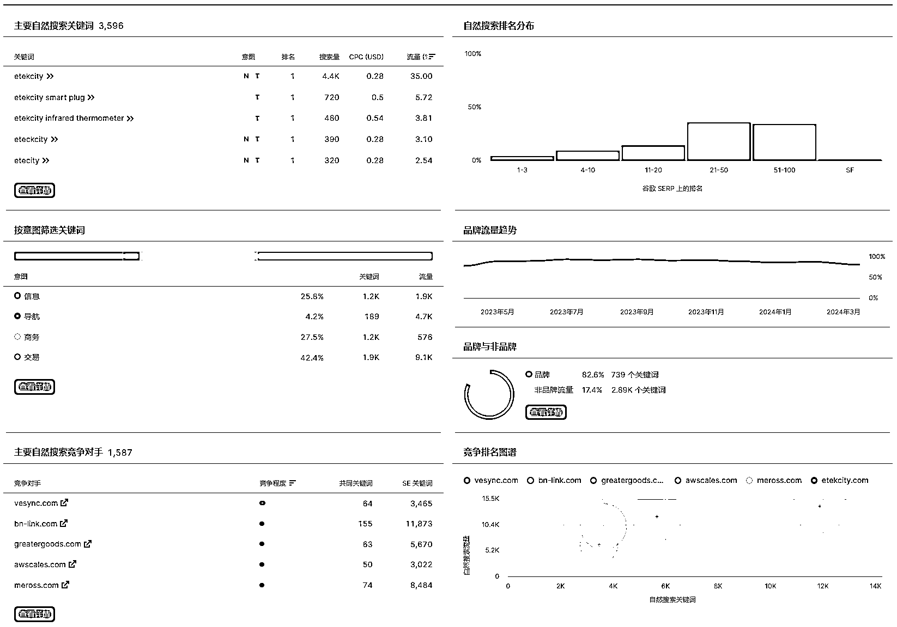

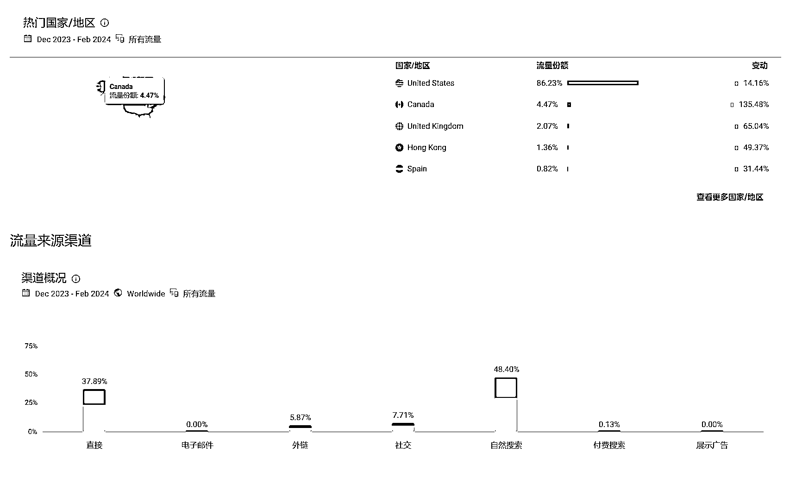

网站数据的详细解读方式我后续会单独写一期，包括建站系统、历史变化、关键词策略、流量来源、广告投放、订单估算等。

# 放大竞品搜集范围

做B端外贸，还可以在阿里国际站、made-in-china.com 上找同行。

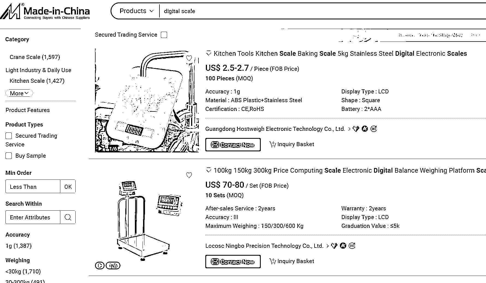

做C端，则去亚马逊、速卖通、Temu、沃尔玛等看销量和评价。

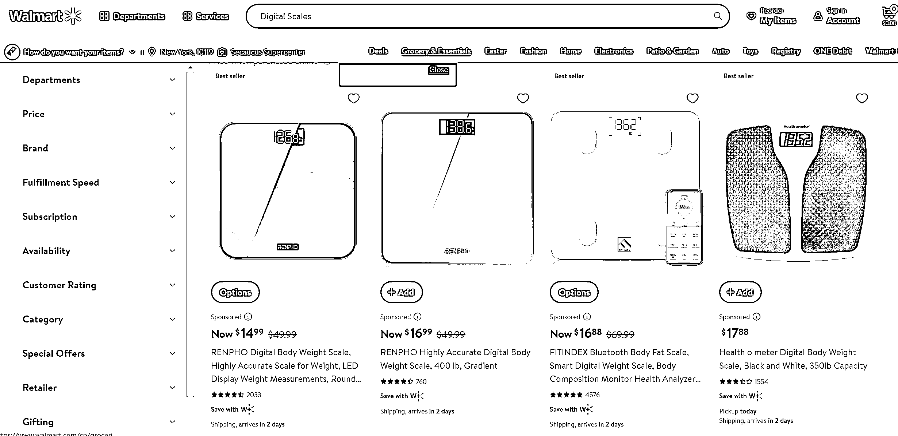

# 怎么挑全球最好的市场？

回到B端贸易：想做全球生意，怎么知道哪个国家需求最大？

用谷歌趋势，关键词不变，地区选全球，时间选五年。

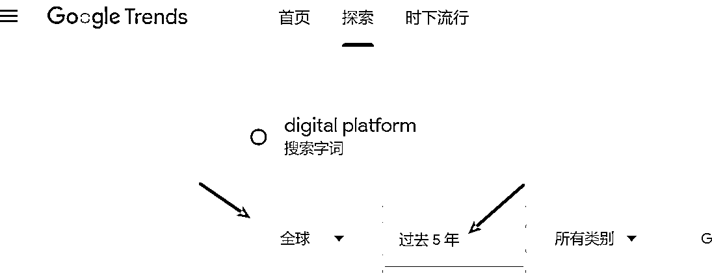

往下滑就能看到各国热度分布。

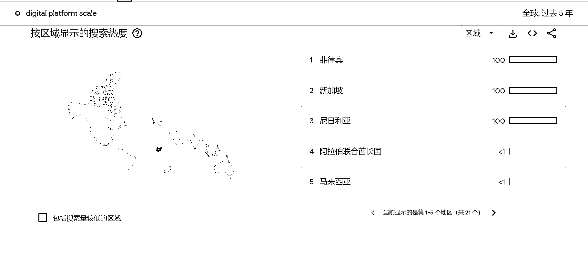

这只能做初步判断，最终选国还需要看单价、物流成本、汇率稳定度、政策门槛等综合因素。

总结一下，本文只是抛砖引玉列出了一套常规的海外市场快速判断思路，具体的数据采集、清洗和建模部分篇幅有限没展开，B端和C端差异也很大，后续我会出更细化的实操教程。

**这篇文章对你有启发的话，帮忙点个赞~**

————————

**我在赚钱的其他文章链接：**

[跨境创业？新手下场前必看的赚钱指南！](https://articles.zsxq.com/id_n97vrpiahx5w.html)

[保姆级教程！注册 Midjourney 并开通付费订阅功能](https://articles.zsxq.com/id_gnm2x96buu9t.html)

[跨境电商的 ChatGPT 应用指南全集 v3.0](https://articles.zsxq.com/id_eh50cr4chn8a.html)

[1 天内如何启动电商/外贸/跨境网站？ChatGPT 来助力！](https://articles.zsxq.com/id_1azlnfovac6q.html)

[一个工具管理上百个社媒账号？指纹浏览器使用全攻略！](https://articles.zsxq.com/id_u2ub0iv60p1g.html)

[白嫖！3000 元的谷歌广告优惠你要吗？](https://articles.zsxq.com/id_sa1bz4dckqeq.html)

[Etsy 注册最新最全指南！一文回答如何注册、需要哪些材料、如何避免封店、如何申诉](https://articles.zsxq.com/id_590wii7jr4iu.html)

[批量做📕图片/视频的方法-canva 批量创建](https://articles.zsxq.com/id_pnpv1g2m5fi6.html)

[一个 ChatGPT 高效使用技巧—编辑原有内容](https://articles.zsxq.com/id_5twbrd3idlbw.html)

[效率飙升！跨境电商领域的 ChatGPT 应用指南 v1.0](https://articles.zsxq.com/id_7wu5dtpkh4m4.html)

[《段永平投资问答录-商业逻辑篇》精华金句摘录](https://articles.zsxq.com/id_xrltpwocer4p.html)

[《段永平投资问答录-投资逻辑篇》精华金句摘录](https://articles.zsxq.com/id_2k5d3mdace44.html)

[《穷查理宝典》精华金句摘录](https://articles.zsxq.com/id_er7b3dm8lx7w.html)

[《零编程知识怎么在 AI 帮助做一个贪吃蛇的游戏》](https://articles.zsxq.com/id_nqxxc79whz1t.html)

[快速获取谷歌 SEO 流量的一个策略](https://articles.zsxq.com/id_txli3kufpvig.html)

[ChatGPT 4.0 新功能，让你的数据和设计工作事半功倍！](https://articles.zsxq.com/id_it0blu6we0p4.html)

[打造转化率页面的 13 个技巧大公开](https://articles.zsxq.com/id_ohdbfoxwndkx.html)

[什么是跨境电商独立站？有哪些运营模式？](https://articles.zsxq.com/id_3lz2mf370csx.html)

[👸号想要 10 万+？试试这几招！](https://articles.zsxq.com/id_4mnsrw79as1d.html)

[《新手如何入场 Tiktok》—Sky 老思的直播记录](https://articles.zsxq.com/id_d7qg98gocnvh.html)

[4 个技巧获取无限个邮箱账号！](http://xn--4!-hy2ca373eyfm37d9uii0h032dppse2zzfk0zt/)

[新加坡有哪些商业机会？-附 2024 新加坡免签入境指南](https://articles.zsxq.com/id_7q5dj0lt0tjq.html)

* * *

评论区：

暂无评论

* * *