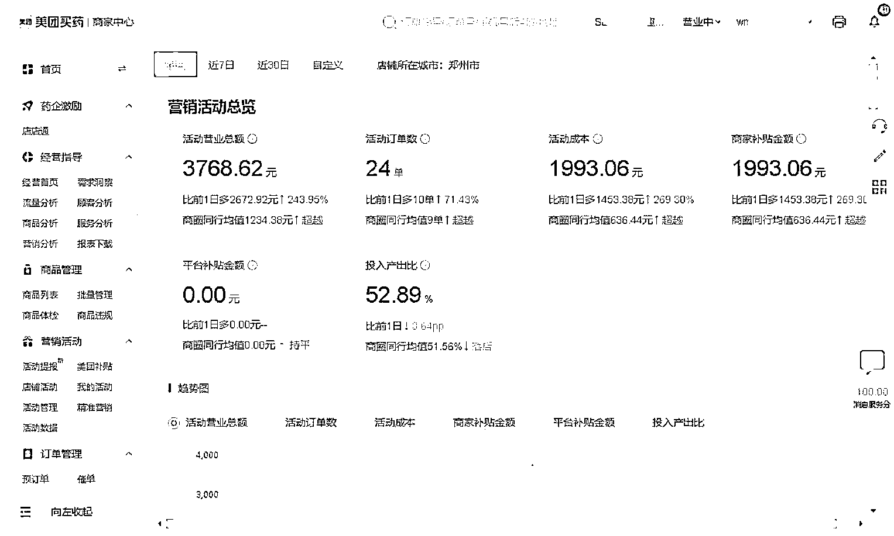
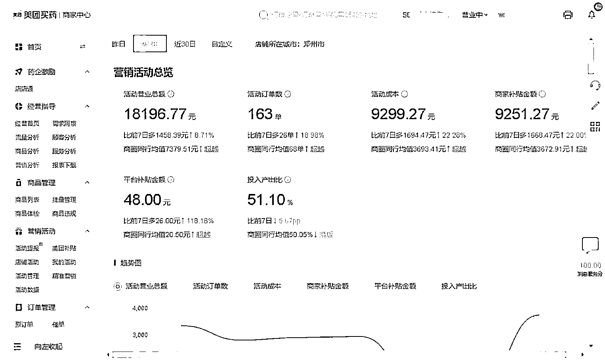
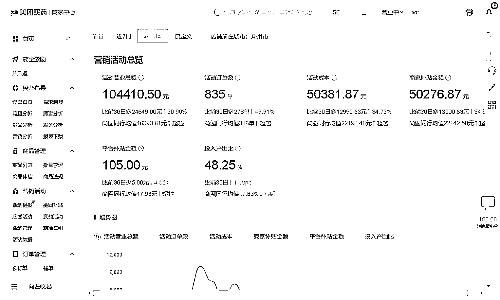

# 成人用品美团开店运营像素级教程

成人用品美团店，今年是实打实的热门赛道。线上消费越来越普及，大众对这个行业的态度也开放了不少。如果你正打算入场，或者已经在这个领域深耕，都欢迎一起聊聊——毕竟今年想快速抢占市场，抱团交流是个好主意。

启动资金方面，一家店算上货品和房租，大概准备3-5万左右就差不多。但这里提醒下，别急着交钱，先评估选址合不合适，位置不行的话后面很难做起来。

关于日常运营，有几个重点值得注意：黄金营业时段通常是下午六点到凌晨三点，这段时间要保证有人在线接单；员工薪资可以参照当地平均工资来定，如果租公寓作为门店，还能商住两用，房租压力会小不少，具体看你的预算灵活调整。

我把整套运营教程和实际数据整理成了文档，链接放在这里，有需要的自取：https://fc8b1fft88.feishu.cn/docx/WlgmdzrpToNIXhxFQqscnVlynZw 

欢迎各路朋友交流探讨，一起把这个赛道做起来！