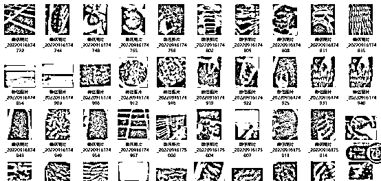
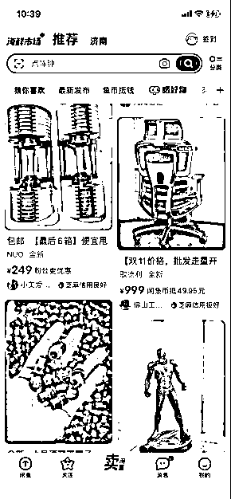
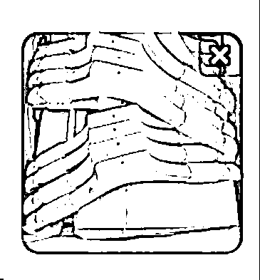
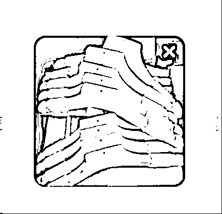
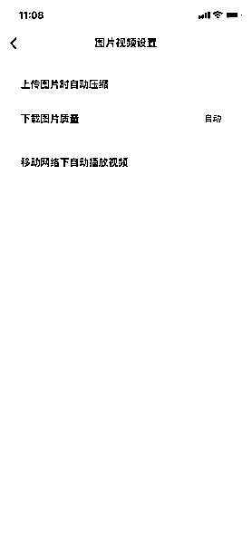
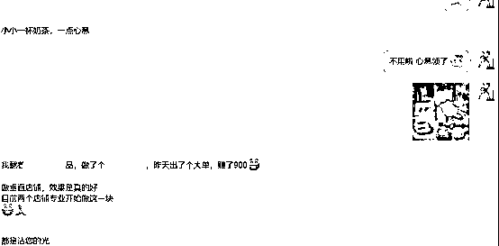
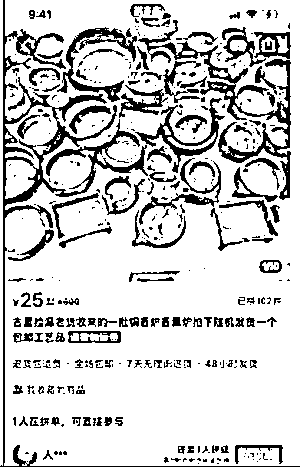

# 带全家 6 口人做闲鱼 2 年，分享帮你订单量翻倍的 6 个闲鱼实战经验

很多人问我，普通人在闲鱼上到底能不能赚到钱？我的答案是：能，但拼的全是细节。

我是张老板，以前做过报社记者，在互联网上自由职业七年。这两年多，我不仅自己跑通了闲鱼，还带着全家六口一起做——我老婆、姐姐、姑姑，还有已经退休的丈母娘都参与其中。我大姐是两个孩子的全职宝妈，她靠这个项目一年能赚到十万左右。接下来分享的六个经验，都是我们自己在实战中验证过的，不是网上那些空泛的大道理。

**一、用一次集中操作，备好十天的卖货图**

很多人做闲鱼最烦找图。我之前测试过一个海参高客单价店铺，货源老板只给了部分产品图，剩下的都得自己找。我先把铺货需要的图列了一遍：单品细节、批量堆放、生产场景、渔船捕捞、渔村环境。从产品到场景都覆盖到，客户看了才会产生信任，进而愿意下单。

随后我刷了抖音、淘宝、📕，发现📕上这种图特别多。于是挑了个固定时间，集中搜索这个产品的所有相关关键词，图片和视频都筛一遍，能用的直接截图，一次存了一两百张。简单处理后，按一天发三个链接、一个链接用五张图来算，足够撑十几天。当时存完还挺有成就感的：

这套方法总结起来就是：先明确需要什么图，再集中批量下载处理，最后存着慢慢用。千万别用一张找一张，太浪费时间。

**二、头图抓住眼球，三个细节不能漏**

头图决定了客户愿不愿意点进来。清晰、美观只是底线，真正拉开差距的是下面三个细节。

第一，尽量用竖版图。仔细看闲鱼首页推荐，基本都是两列展示，竖版图占的面积更大，视觉冲击更强，也更容易被推荐。就像这样：

第二，发布前一定要盯一眼缩略图。竖版图上下留白多，如果商品主体不够居中，很容易被忽略。同一张图稍微调整后，第二张明显更有卖相：

第三，把闲鱼的图片自动压缩功能关掉。路径是：我的—设置—图片视频设置，关闭上传自动压缩，图片就能保持更高清：

**三、垂直店铺怎么玩？先从研究同行下手**

大部分人都是从杂货铺起步的，但做到后面想转垂直店铺，就得明白鱼小铺更认可“专业卖家”。垂直店和杂货铺没有绝对的好坏，关键看哪个适合你。但做垂直店，一定要先研究对标。

研究哪些内容？账号人设怎么搭、店铺怎么包装；店里主推哪些产品、哪些卖得好；同行的图文细节；评论区里藏着的客户痛点；还可以用小号假扮客户套话术；有精力的话，顺手统计同行的成交量和转化率。

不少卖家会隐藏动态，不想让对手看到。没关系，点开他任意一个宝贝链接往下拉，就能看到总成交数量，再观察一段时间的波动，销量大概就有数了。

千万别闭门造车。我们很容易“自以为某个产品好卖”，但市场不一定认。答案就在闲鱼市场上，也在同行那里。之前有个伙伴做了一个大家都觉得冷门的产品，结果一单赚了九百多： 至于具体是什么品，电商圈里店铺和选品基本都保密，大家应该也理解。

**四、评论区，才是被低估的转化阵地**

说到店铺包装，很多人第一反应是头像、名字、简介、背景图。其实评论区同样重要。现在买家下单前基本都会翻评价，如果某条评论刚好戳中他的顾虑，订单很可能就成了。

所以记住四个字：以终为始。反向到评论区去布局产品卖点。

比如你卖的是送礼型产品，就布局“礼盒精致、朋友很喜欢”的带图评价；卖五金件，就布局“结实耐用、材质好”；卖配件类对时效敏感，就布局“物流快、没耽误用”；如果产品容易有色差，就布局“实物和图片一样”。千万别弄成干巴巴的“很满意”“卖家很好”这种模板。

当然，自己维护好评要注意：请亲戚朋友帮忙下单时，一定要让他们模拟真实客户的购物路径和行为，不能做得太假。

**五、标题别只会写“清仓处理”**

闲鱼上两个入口最关键：头图和标题。我起标题的习惯是“卖点前置+关键词铺后”——前面用卖点抓人，后面放搜索量高的产品关键词。

但很多人上来就是“清仓处理”“赔钱甩卖”，每个链接都这样，客户早就免疫了。卖点可以多角度测试，因为客户需求是多样的。比如：数字稀缺——“仅剩9个”，比清仓处理具体得多；个人闲置——“客户送的便宜出”；价格对比——“原价100现在18卖”；送礼场景——“送长辈”；特定人群——“孕妇专用”；制作工艺——“纯手工打造”。

举个小众蓝海案例：鞋拔子。很多人不知道这玩意儿，但它能让孕妇和老人不用弯腰、轻松穿鞋。如果你主打“解决这个难题”，比“清仓处理”有吸引力得多。

**六、清仓体文案这么写，出单更稳**

清仓体不是不能写，但有两个要点。

第一，具体数字比模糊描述更抓眼球。“剩一批电饭锅处理”和“剩12个电饭锅处理”，后者明显更能让人产生紧迫感。

第二，清仓文案必须配清仓图。标题写清仓，图片却放一张干净的电商原图，可信度直接打折扣。换成仓库堆货图就好很多：

那这种库存图从哪找？用“产品+清仓/处理/批发/尾货/库存/特价”等关键词，在全网搜一遍，电商平台、📕、百度都行。另外多加几个货源老板🛰️，翻他们朋友圈，素材也不会缺。

说来说去，闲鱼没有一夜爆单的秘诀，拼的就是在标题、图片、文案上抠细节。深挖产品、深挖客户、深挖市场，把这些全落到图文里，就是最好的执行。

这几年我测试了不少类目，也都赚了点钱，但最终决定深耕一个方向，并往上下游延伸：闲鱼铺矩阵店，淘宝开店，📕引流，最后沉淀到私域。闲鱼本身不是项目，在闲鱼上“卖什么”才是项目。

希望大家都能把这个起点变成跳板，做得更细、挖得更深，赚到钱，也长本事。

更多关于货源、流量的讨论，可以看看评论区：