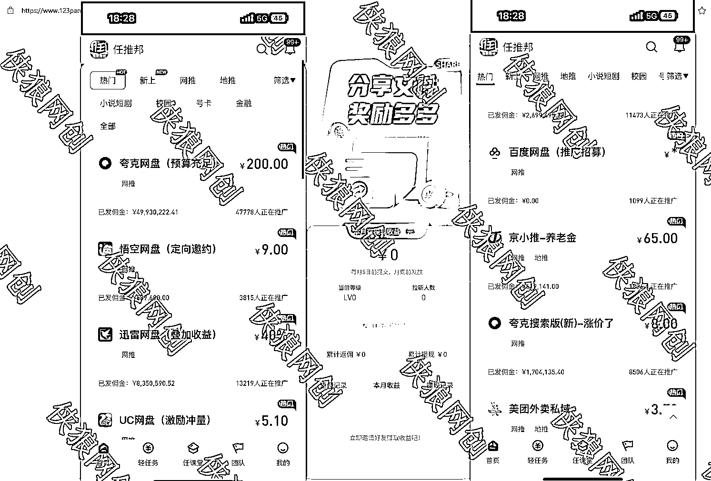

# 当网盘的补贴一波接一波，普通人能不能从这场流量战里分一杯羹？

网盘拉新的声量最近明显起来了，各家都在撒钱抢用户抢存量。

从阿里云盘、夸克网盘先点火，到如今几乎遍地开花。夸克网盘、阿里云盘、迅雷、头条网盘、UC网盘、悟空网盘、123云盘都在推新客补贴、转存补贴，连百度网盘也重新杀进来了。上一次出现这种垂直赛道的集体补贴狂欢，很多人记得是社区买菜，美团优选、橙心优选那轮，普通人也是靠拉新赚了第一笔快钱。

现在盘点平台，我个人更常用的是任推帮，平台覆盖面广，夸克、头条、悟空、迅雷、UC、百度网盘都在上面能接，数据回传快，客服响应也还过得去，就是没做到全天在线。

任推帮夸克、头条、悟空、迅雷、UC、百度网盘，这几个在任推帮都是有的。

目前来看补贴力度最狠、用户体量最大的还是夸克网盘。想先起步的话，夸克是性价比最高、流程最成熟的选择。

**一、网盘为什么一直被说不赚钱**

在不少巨头眼里，网盘就是个烧钱的业务。

阿里云盘当年喊出“终身不限速”，现在同样有限速了。原因很简单，互联网最贵的成本就是带宽和流量，爱奇艺、腾讯视频、B站的钱大头都砸在这上面。公开信息里，单提供1TB存储空间一年成本就要奔着140多元去了，这还只是存储本身，下载、上传的带宽成本另算。

所以早在2017年，360就关掉了自家的网盘业务。后来大家常用的基本就只剩百度网盘了。

**二、这轮网盘战到底在抢什么**

表面是网盘，实质是用户和流量。

🐧、🛰️本身不直接赚钱，但背后的流量价值巨大。百度贴吧也是如此。只要流量在手，要卖广告、导流、做生态都好说。流量在哪，商业价值就在哪，连“智商+1”“叫爸爸”这种虚拟东西都能被人买单。

互联网已经从高速红利期进入稳定内卷期。网盘是个很合适的内卷赛道，因为人人都有资料存储需求。把文件直接放在服务器上免费下太烧钱，于是云盘应运而生。它像一个留存用户的壳，本身不赚钱，但也不能完全免费，给一点使用额度、做一点付费分层，反而能把用户留住。

网盘现在的日常使用频率很高，后续会不会出现更高频的形态值得提前观察。按使用频率和用户诉求去布局，往往能抢先站位。

**三、新手怎么用拉新转存赚点零花**

网盘拉新很难一夜暴富，但有一个核心认知要放第一位：

**这是一个流量入口**

**这是流量入口**

**流量的入口**

只靠一笔拉新佣金，操作得当几百块很轻松。核心就是把目标人群需要的资料、工具、资源整理出来，再挂上网盘链接。

举几个可操作的思路。

开一个工具号，把好用的免费工具整理成清单，用夸克链接分发，赚拉新和转存。

把GitHub上的热门项目、软件包、工具包下载整理后，发布到程序员社区，同样能产生收益。

也可以直接拿一个能变现的项目资料买下来，包装成免费分享放到网盘里，这本身就是在做流量生意。

玩得更高级一点，可以和培训机构合作，免费发放课程试看或完整内容，里面埋🛰️钩子或自己的渠道链接，按成交分成，比如Python教程、减肥饮食表、自律打卡表、乐谱、小吃配方、做小程序教程、美甲自学教程、餐饮SOP、商标注册教程、企业财务规划、摄影教程等等。只要人来，就能找合作方转化。

关键是别想着自己做全链路，把自己定位在流量分发的一个环节就够了。

风向已经从单纯拉新变成了活跃度竞争。夸克现在的全网声量很大，原因就是转存补贴高。新用户下载安装再转存能到5块钱一个，新用户转存大概4毛，老用户转存也有2毛，还叠加会员开通分成。现在显然才在起步阶段，后面出现10块、20块一个头的概率都存在。

**四、入口一旦打开，变现怎么走**

网盘是入口，价值在于你能不能把用户导到自己的私域。

在免费资料里夹带一点引导，放一个钩子，流量进来后怎么成交就看你了。手握入口就能主导节奏。

例如做AI教学的，可以先放免费教程、工具、软件。用户用工具遇到问题时，自然会产生付费需求。

再比如小吃配方免费发出来，真想做成的人，大概率还是要去线下学。视频是视频，落地是另一回事。

资源的价值不在堆砌，而在用的时候。能用的、有用的资料才值钱，囤资料本身没意义，需求产生时才有意义。

另外圈子里已经有人在做两类工具：网盘搜索工具、网盘电影搜索机器人，并且开始对接拉新系统。这一块可以提前研究布局，要么自己做卖铲子，要么找人合作，未来需求会放大。

**五、最后归纳**

说了这么多，核心就几条。

**1、网盘项目本质是流量入口。**
**2、把流量用在更大的变现上。**
**3、拉新和转存补贴还在，那就是纯被动收益。**
**4、流量就是钱，带宽流量也是钱。**
**5、普通人赚小钱很简单，把握住入口。**

文章到这就收尾了。喜欢的可以点个关注，有条件的支持一下再小的钱也是心意。

没钱的就先去试试网盘拉新，给自己赚点启动资金。

没项目可做的，就把这个流量渠道深挖一下，互联网的答案基本都写在网上，先自己找，先自己试。

有具体问题可以交流，前提是别白嫖时间。先把问题说清楚，网络上大部分问题本身就有解。

* * *

评论区：

花雨 : 任帮推是 app？

侠狼 : 嗯，对的

* * *