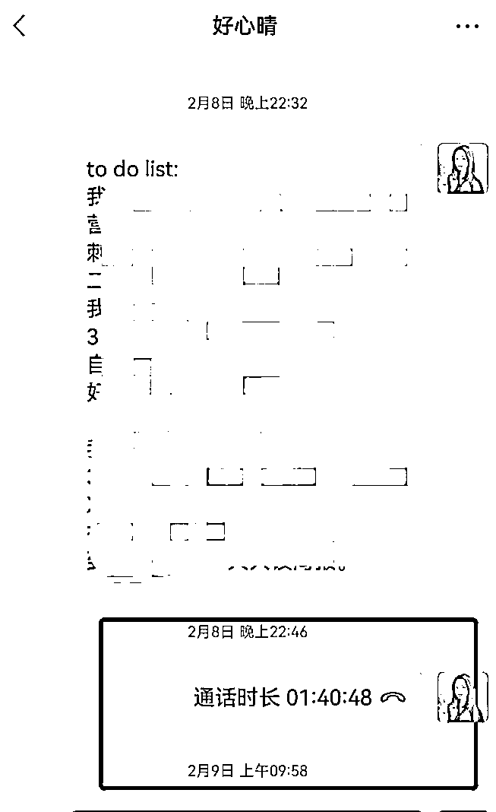
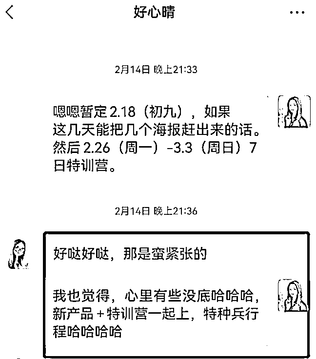
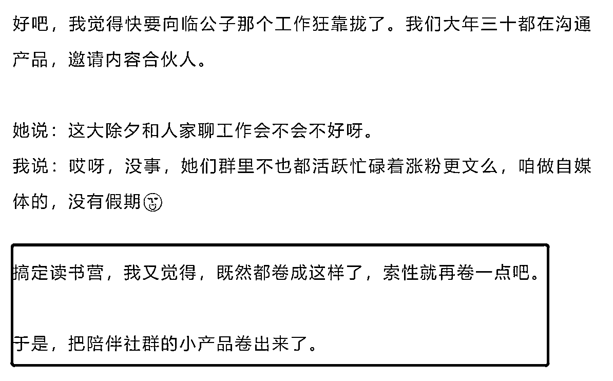
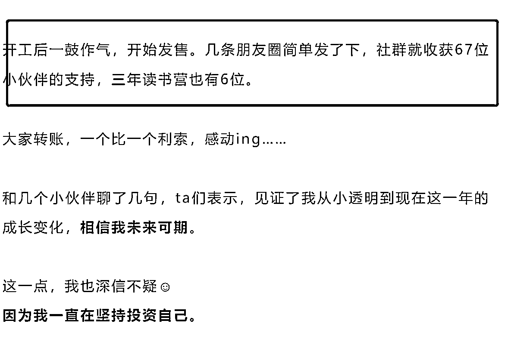

# 一个新品 7 天破十万，复盘 0-1 全过程

## 一个新产品，7 天营收过 10 万，复盘从 0-1 之路

作者：临公子

日期：2024-03-22

大家好，我是临公子。本职在一家 500 强做产品经理，空闲时间做自媒体，累计读者 40 万，副业年收入七位数，出版过一本书。

在知识付费这条赛道，我起步算晚。去年才推出第一款知识产品，至今一年半，累计发了 5 款产品，变现已接近百万，且仍在持续增长。

最近我推了一个以读书变现为核心的新品，并配合群发售，首周营收就超过十万。趁着热度，我把从零到一的整个路径梳理了一下。这次分销环节，我给到伙伴们的佣金大约 2.5 万，发钱的体验真的很爽，之后会多做这类激励活动。

先说整体结论：在本职工作极度繁忙的情况下，我用一个月业余时间，完成了新品策划、落地、首发售卖以及星球首期共读的闭环。

这个想法是怎么来的？其实去年就酝酿过做读书类产品的念头，但主业占用太多精力，加上多个账号的日常更新、陪跑营的备课、各种运营杂事，一直没能开工。好在赶上春节假期，2 月 7 号正式放假，便立刻进入执行状态。

开工前，我拆解过十几款同类产品，形成了四个不同方向的方案，各有利弊。2 月 8 号，我和团队核心成员好心晴进行了近两小时的语音会议，敲定了最终方向并列出任务清单。

2 月 9 号除夕，我先把星球账号注册好，联系星球运营开通权限，随后逐一与内容共创伙伴沟通权益并发出邀请。2 月 10 号大年初一，着手海报、LOGO、内容排版和定价。2 月 11 号到 16 号，集中梳理读书营的核心权益、分销规则、共读互动机制、海报物料以及后续微信群的承接流程，基础设施基本搭建完毕。原本考虑过用定金星球的方式试水，但年后要以特训营形式启动，时间窗口太紧，于是放弃该方案。

2 月 14 号到 18 号进入双线作战，一边推进新品，一边筹备特训营。联系讲师、确认主题、分配职责，逐步推进。整个计划表里有三十多项具体工作，我像个发动机一样把节奏带起来。

2 月 19 号开始预热一元读书特训营，动用了陪跑营 150 多位同学作为种子用户，把新品首发当成一次营销实战演练。2 月 26 号到 3 月 3 号特训营期间，我和好心晴保持高频互动，二丫负责销售引导，再次完成了一场转化率很高的群发售。3 月 4 号到 8 号继续直播转化、社群跟进和数据结算。3 月 12 号，分销佣金发放到位。

3 月 13 号至今，开始组织首期共读，并通过多渠道做持续推广，下周进入新一轮。

一个月的时间，每天摸鱼的 2-3 小时里，我不仅完成了一个十几人共创的新品，还操盘了一场千人级别的群发售，同时让星球首期共读启动。用四个字概括就是疾风暴雨，非常符合我的工作风格。

复盘几个关键感受：

1. 累是真的，但已成常态
全年几乎没有休假已成习惯。特训营期间正好本职出差，只能从日程缝隙里挤时间，既要在线互动，又要处理突发问题。

2. 高强度带来的能力跃迁
这半年迭代速度明显加快。其实去年底才第一次尝试群发售，效果就超出预期。这次是第三次，每一次都在尝试新玩法，每一次都在优化，投入产出比都很可观。

有学员问我：你发售做得这么好，不怕被同行搬运吗？我回答不怕。因为能被直接复制走的部分，本质价值有限。市场上发售案例很多，大家互相参考很正常，但真正决定结果的不是流程，而是人。

举几个细节。我们这次群发售的问答环节质量很高，不少学员都说不敢相信这是在一元群里看到的内容。很多同类活动，问答都是助教敷衍几句就推课，而问答恰恰是直面用户的关键节点。我们几乎每次高质量的问答后，都能立刻带来几单转化。

另外，开营、结营以及我的个人分享，都花了不少时间打磨。讲师稿件我也会逐条审阅，确保水准在线。方法大致相同，但执行者的差异会让结果完全不同。

3. 展示自己很重要
这次我把分销权限开放给了陪跑营里的 150 多位学员。每一次活动都是他们展示能力的舞台，也让我更清晰地看到每个人的优势，后续可以持续合作。实战是最好的筛选器。

今年我计划继续迭代产品和商业模式，必然需要更多伙伴加入。选人逻辑很简单：在实战中看表现，把表现好的持续培养、给予更多机会，和他们一起成长。

4. 借势的价值
好心晴借着这次读书营，直接把自己的陪伴营从零搭建起来，还成为她转化的增益项，最终获得 1.5 万以上的分销收入。

陪跑营里还有一位学员，之前从未做过分销，通过这次群发售接触到大量用户，发现大家对考研、求职、大城市落户有需求，而这正是他的专业领域。他立刻据此开发了自己的咨询产品，并迅速开始变现，很赞。

很多人忽略了一点：花钱报课的核心资源之一就是老师，老师不仅是资源，还能成为合作伙伴。我刚入行知识付费时认识了二丫，她执行力强、每次合作都稳妥，后来与我合作两年，收入超过 50 万，且仍在增长。好心晴从去年 9 月加入做排版助理开始，表现远超预期，后来我把岗位调整为编辑，再到现在成为核心运营，正是我持续给予机会的结果。

上周我在朋友圈定了一个目标：今年让好心晴的副业收入翻倍。这个月她基本要达成副业月入两万的节点了，目标正在实现。

5. 输出的必要性
最近我有很深的体会。之前我更专注于做事，忙完就觉得满足。但很多成果只有写出来、形成传播，才能被看见，才算真正产生价值。有些人擅长把小事写成大叙事，把自己塑造成公众喜欢的形象，从而获得 IP 溢价。这点我做得不够，接下来会刻意练习，所以今天才写下这篇复盘。

说到底，本来只是随手记，结果越写越多。恭喜自己再次完成一次升级，也非常感谢团队伙伴的支持。群发售作为综合型营销项目，市场上很少有副业团队能稳定做到高转化，我们算是其中之一。

今年我还计划引入更多优秀伙伴，大家各显身手，把盘子做得更大。做自媒体很有意思，极大满足了我对世界的好奇心，也很享受这个过程。

如果这篇复盘对你有用，欢迎点赞支持。

【更多文章】

《5 天营收 20w+，第一次做社群发售，全流程复盘》[`t.zsxq.com/16wILbuy7`](https://t.zsxq.com/16wILbuy7)

《写作变现之：写作课到底能不能赚钱？》[`t.zsxq.com/182ZJJ04g`](https://t.zsxq.com/182ZJJ04g)

评论区：

暂无评论

