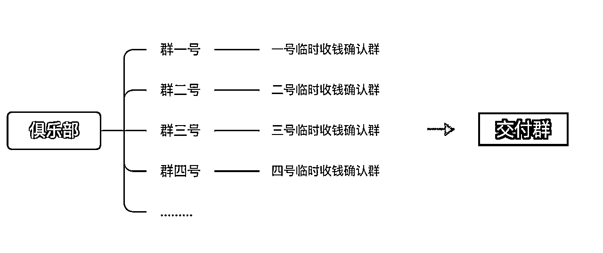
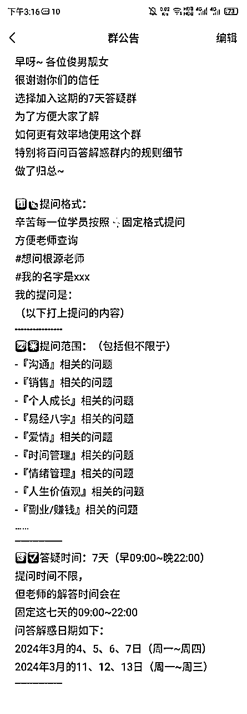
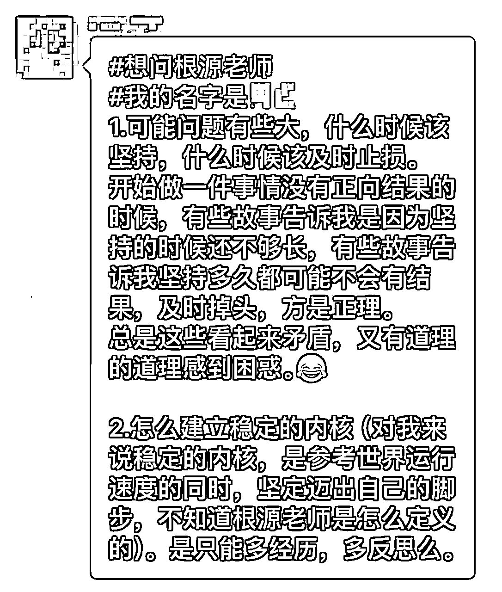
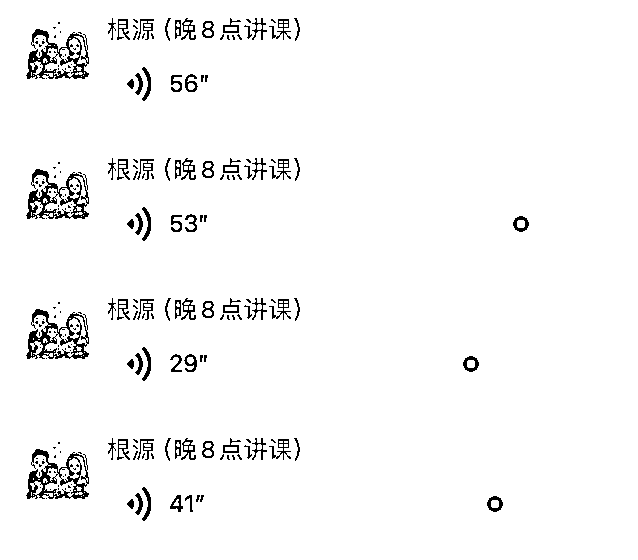
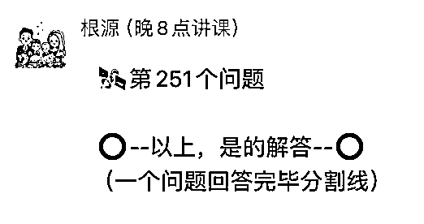
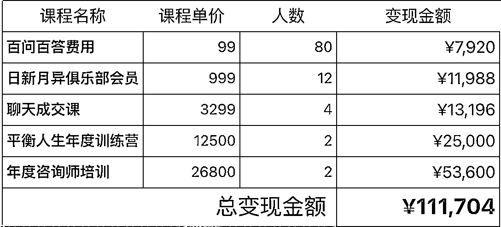
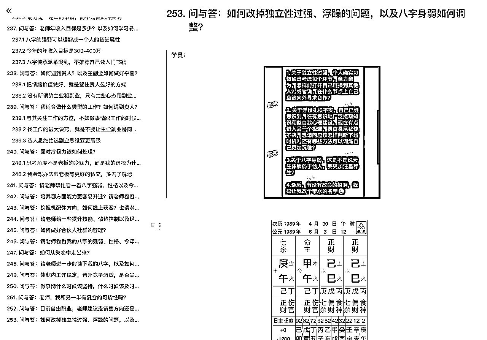
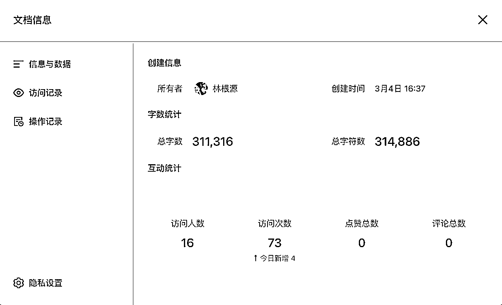
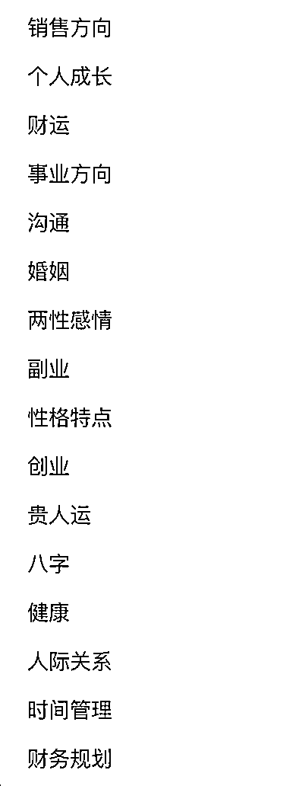

# 第一次尝试「问答群形式」的私域转化，7天变现11万

大家好，我是根源。

今年给自己定了一个小目标：在原本不太擅长的公域流量上，找到一种更高效的承接方式。很巧的是，前阵子文章被大号推荐、录了播客、上了采访，再加上恢复了日更，陆陆续续吸引了不少公域粉丝。粉丝来了，自然要考虑怎么留得住、怎么进一步产生连接。

于是，我做了第一次「问答群」模式的私域尝试。结果还不错：7天累计变现11万。

这篇文章，我想把这个从公域到私域二次转化的完整思路和实践过程，尽量拆细了讲。如果你也在做类似的事情，希望能给你一些参考。

## 公域粉丝不够精准，怎么变现？

之前和团队伙伴开会，聊到一个问题：公众号和播客的听众，其实商业认知深浅不一，算得上“不那么精准”的用户。

为什么这么说？因为看文章也好，听播客也罢，门槛很低——关注即可、订阅即可，不需要付费。和本身就带有强付费意愿的社群成员相比，这部分粉丝的精准度自然差了一大截。

所以，在谈变现之前，我第一反应是：怎么把人群再筛一遍？

第一波筛选，是从播客听众变成听友群成员。第二波筛选，是听友群里的人，如何被进一步确认。

我的想法很简单：先别管有多少人听过节目，只看已经进群的人，怎么用一个小动作，把愿意付费、愿意深度互动的人筛出来。

## 第一步：用一笔小钱完成付费筛选

我一直相信一个逻辑：任何变现，都是先从一块钱开始的。大额交易，也是从一块钱长出来的。而且，用户愿意为你付出金钱的那一刻，代表着一种更高级的信任。

所以当时我设想，在每期播客更新后，在听友群里发一个公告：

“如果你对本期内容有兴趣，或者想让嘉宾回答你的具体问题，欢迎进一个七日提问群。这个群是付费的，定价99元。7天内，你可以向当期嘉宾提任何相关问题，7天后解散。”

这个群能带来什么？

对运营方来说，好处是：

- 完成了付费筛选；
- 99元本身就是一次小金额变现；
- 可以测试每个群的活跃度；
- 能看出听友对当期内容的兴趣程度。

对嘉宾来说，好处是：

- 为自己带来潜在客户；
- 参与分润；
- 能深度回答节目里没聊透的话题；
- 找到真正认可自己的人。

99元不是大数字，做决定不需要太多犹豫。所以，利用这个价格门槛，既可以完成筛选，又能启动第一轮互动。

实际执行时，第一波效果其实不理想。我们在所有大群群发之后，面对约9000人，最终只有35个人支付了99元，转化率大约0.3%。

但这件事让我意识到：能不能转化，不在于价格高低，而在于社群运营的细节和活跃度。如果只做公告式通知，不设计互动，群就会慢慢沉寂。所以，用这个小付费群测试各群的活跃度，就成了一个很有用的动作。

比如，假设有8个群，每个群500人：

- 1号群有10人付费；
- 2号群有30人付费；
- 3号群有15人付费……

通过这样的数据，就能快速判断出哪个群更愿意链接、哪个群的认可度更高，从而决定后续该重点维护哪个群。这件事看起来琐碎，但每一次筛选做得越细，私域的地基就越稳。

## 问答群运营细节：从开营到答疑

正式开群后，前期由小助理负责拉人，后面由我自己接管。开群时，我会先做开场仪式，并发布群规则。

群规则公告大概长这样：

问答流程上，我用了固定的格式：

1. 先把提问者的问题截图；
2. 然后发一段语音回复；
3. 最后用一条分割线收尾，表示这个问题已经回答完毕。

如果有人在群里不好意思提问，可以私下发给我，我会抹去昵称和头像，用匿名形式在群里统一回答，这样既保护隐私，也能让更多人看到对同样疑惑的解答。

实际操作中，一张图片（代表提问）：

一段语音（代表回答）：

一条分割线（代表结束）：

这种模式的好处是：只要有一个人开始提问，其他人就会觉得“钱都交了，不问白不问”。于是群内的氛围会慢慢热起来。

第一天下来，我回答了接近40个问题，累计回复了将近4万字的文字量。第二天，有听友在播客大群里主动推荐：“这个99元的群太值了，老师回答得很认真。”于是群从40人涨到了80人。第三天继续有口碑传播，之后到了第六天，人数增长到了102人。

在答疑过程中，我也会顺势介绍自己的课程。你把它理解成“广告”也行，但本质上，它是在回答问题的过程中给出解决方案，让需要的人自然产生进一步了解的意愿。

有的学员会主动问：“老师，有什么课程推荐吗？”这时候我就能很自然地介绍一下课程体系和适合的人群。于是，在7天里，陆续有人报名我的课程。这就是第二层转化。

到了第七天，我还安排了结业直播。直播里除了现场答疑，还会再介绍自己的课程可以帮助哪类人。这相当于把一个阶段的转化再做一次收口。

最后，这一轮的成交情况总体上还可以：

值得一提的是，999元以上的高单价产品，主要来自我自己的俱乐部老会员。他们在这次答疑中再次获得价值后，重新购买了产品。

## 一个关键细节：群人数别超过200

做完这一轮，我最大的一个感受是：想在私域里做好转化，群人数不需要太多，200人以内最舒服。

原因很简单：

- 群超过200人，运营压力会明显变大；
- 人数太多，成员会觉得“反正说了也没人看见”“讲师不一定看到我的消息”，反而更不愿意发言；
- 消息一多，很多人干脆连看都不看。

大部分人的500人大群，其实很难保持高活跃度。就算你有能力激活，需要投入的精力也很大。所以，宁可把群拆小，也不要死撑一个满员大群。

如果群满了200人，我会直接开新群，不再往老群加人。这样做，既是降低自己的交付压力，也是保护社群成员的参与感。毕竟，一个能让人感到被照顾的群，才能有更好的转化效果。

## 最后

这次尝试，从整个数据来看，初期转化率确实不高。但我认为，它是一种非常有效的长期打法。

它既能帮你激活老会员，又能让公域过来的人，用“第一块钱”完成付费初体验。之后随着答疑内容的沉淀，还会留下一份宝贵的内容资产——这次7天下来，一共积累了253个问题和31万字的回复。

整个过程可以用一张流程图来直观理解：

253个问答，意味着253次深度链接的机会：

如果你也在做公域转私域，或者正在寻找一种轻量级的变现方式，也许可以从一个99元的问答群开始。不一定要冲着赚多少钱去，而是把它当成一次筛选、激活、积累用户信任的练习。做好了，后续的价值会慢慢长出来。

在私域这件事上，最能撑底气的不是话术，而是内容池。

这里沉淀了超过31万条问答，覆盖私域、销售、产品、成长等方向，几乎把大家关心的问题都收进来了。

这几年的实践让我重新理解了私域和销售：私域不是一套管人的工具，而是一张织关系的网。网织好了，成交是自然发生的事。比成交更让我在意的，是服务的质感——每一次连接，有没有让用户觉得找对人了。万一对方暂时没有下单，不用急；服务到位了，细节做足了，就算他先去别家逛一圈，迟早还是会想起你。被认真对待过的人，很难真的走远。

顺手交代一下我的背景：我是根源，龙哥盟四期圈友。我的咨询方向偏心理，这几年攒下两万多个真实案例。转行线上之前，我在销售一线摸爬滚打，也带团队，前后12年；2022年之后开始做在线知识产品。

这些年写过的内容，按年份整理如下，链接都贴在标题后面：

2021年：
01｜用爱好型社群做到146万营收 → https://t.zsxq.com/116B1bcYc
02｜整理了73种可以躺赚的收入方向 → https://t.zsxq.com/11EHjTH0P
03｜一场杭州线下聚会，我写了一份复盘 → https://t.zsxq.com/19IkX4UMl
04｜一支20人的队伍，慢慢扩张到四万人，一年赚到百万 → https://t.zsxq.com/19JYt77hL
05｜线下见面后，怎么把关系续上 → https://t.zsxq.com/19VY2LWg4

2022年：
01｜第一次在线上卖课，七天就把门票钱翻了十倍 → https://t.zsxq.com/11ooZZbM7
02｜把唱反调的人变成铁粉 → https://t.zsxq.com/19lipLhJ5
03｜好内容依然是最能打的变现路子 → https://t.zsxq.com/19BLMAYw1
04｜从老师的一句话开始，连续写100天，赚到30万+ → https://t.zsxq.com/19BgNoxfi

2023年：
01｜私域贵在经营，不在管理 → https://t.zsxq.com/19WEsfSq1
02｜实业9年，转型第一年就赚到200万 → https://t.zsxq.com/10nmEr1cA
03｜25个方法，让微信端的成交比例往上走 → https://t.zsxq.com/11AgRW24F
04｜35个法子，把微信里的生意放大3倍 → https://t.zsxq.com/11FmV2aqZ
05｜微信用得好，成交有套路：第26到50招 → https://t.zsxq.com/13yRbmUwo
06｜产品涨价了，怎么跟客户交代才能留住人 → https://t.zsxq.com/11UJk9HxQ
07｜想从坐班变成自雇，先看这20条 → https://t.zsxq.com/14XTxhh15
08｜36条实操经验，让成交数据在私域里翻倍 → https://t.zsxq.com/17zSrYzvk
09｜已经备好了引流产品，怎么聊出升单机会 → https://t.zsxq.com/17ocUJEFA
10｜做课程生意，怎么化解异议，让用户持续回购 → https://t.zsxq.com/181fSc5rv

很庆幸遇到龙哥盟，很多坑不用自己亲手踩一遍；时间久了，也沉淀出一些能复用的方法。想找人聊聊这些话题的话，我的微信是：AF54094。

▲ 扫码就能找到我。