# 闲鱼租号怎么玩？不花一分钱囤号，靠“转租差价”月入过万，还能稳定吸粉2000+

> 分享人：石头 🛰️：DDSSJ98

大家好，我是龙哥，这些年一直深耕游戏租赁和私域流量。2023年对我们来说很特别，不仅业务稳步上涨，还跑通了不少新玩法。以前我们靠自有号池，每月保底几万收入；后来我们不断扩充资产，同时也在测试各种项目和引流渠道，想让副业收入再上一个台阶。

在众多流量平台里，闲鱼给我的印象最深——粉丝质量高、复购强、需求明确，关键是竞争还没那么激烈。今天就用闲鱼举例，聊聊新手怎么从零起步，靠“游戏转租”每月稳定做出5000到10000的收益。

整个过程不需要买号、不需要投资，纯靠信息差赚差价，实操性很强，没什么门槛，适合正在找项目的人。

# 一、先搞懂什么是“游戏转租”

说白了，就是从低价渠道拿到账号，然后在闲鱼上挂链接，吸引有人来问，再引导到🛰️成交。

之前我写过游戏租赁，那个门槛偏高，动不动就要十几万的号库，新手很难进场。所以这次说转租——不用自己拥有账号，相当于“空手套白狼”：比如转租平台上拿号价是3毛一小时，但你在闲鱼可以标5到10块一小时，具体看账号的皮肤和价值加价。

为什么建议新手先做转租？

因为市场大、风险小。市面上能租的游戏基本都能赚差价，只要搞定客源，这事就很有搞头。而且闲鱼现在还是蓝海，竞争不大，利润空间却很可观。

看个案例：

拿号成本0.3元/小时

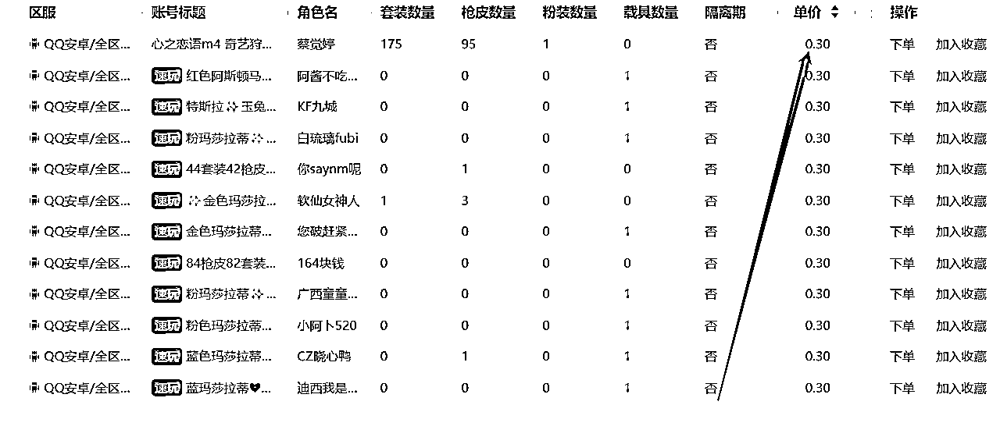

实际成交价：

10元/小时

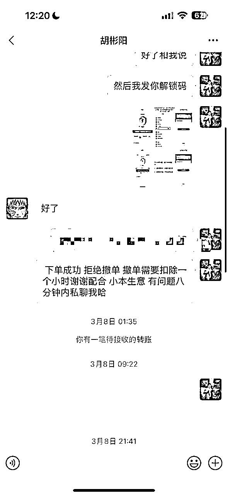

# 二、闲鱼账号怎么准备？起号流程要记牢

1. 先检查自己的闲鱼号有没有违规记录。
2. 一定要做到“单号、单机、单IP”，别问为什么，别在Wi-Fi下随便切号操作。
3. 把账号资料完善到90%以上。
4. 设置方面：关闭闲鱼的手机定位权限，打开消息通知，允许后台刷新（操作都比较基础，不贴图了）。
5. 芝麻信用尽量650以上，700左右更好。支付宝搜“芝麻信用”就能查。
6. 以前违规过的号也能用，但要看实际情况。如果一周没曝光没出单，直接换号，别浪费时间，有疑问随时找小助理反馈。

账号的模板样式也可以参考同行修改，下面抛几个对标账号的参考：

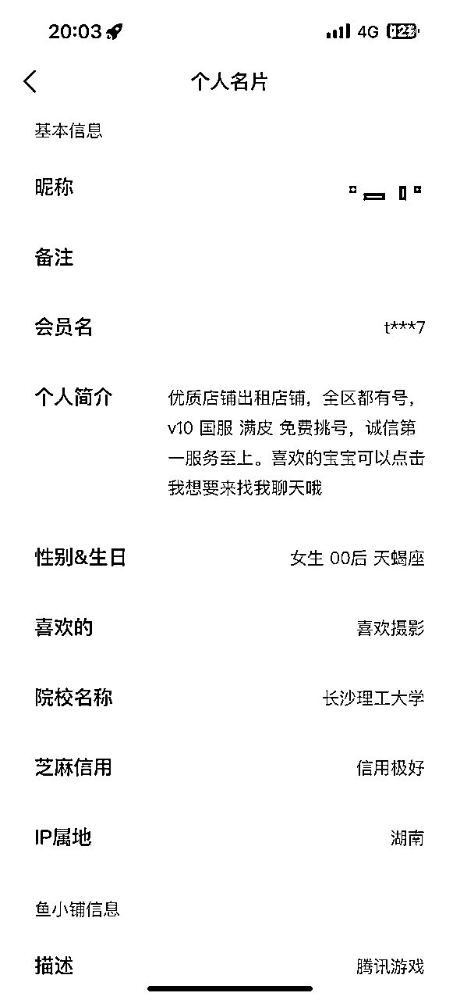

# 三、实操前要准备什么？

先根据自己情况选游戏——你玩过什么？熟悉什么？如果都不熟，推荐几个赛道：手游选和平精英、王者荣耀，端游选无畏契约、CSGO等。

如果是完全不懂游戏的新手，前期至少要了解皮肤数量、段位、能不能排位这些东西，不然顾客问你的时候会答非所问。

需要用到的App：租号玩、虚贝、u租号。

后面全文用和平精英举例，其他游戏逻辑一样。

## 3.1 闲鱼上架怎么做？

**文案编辑：** 给个万能公式——热门皮肤+热门载具+热门套装。

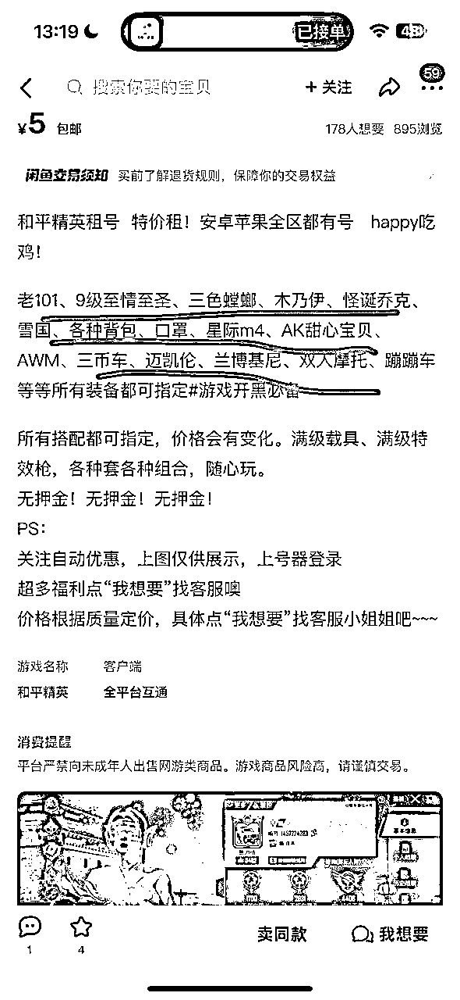

**主图找法：** 打开租号平台，找对应账号截图。

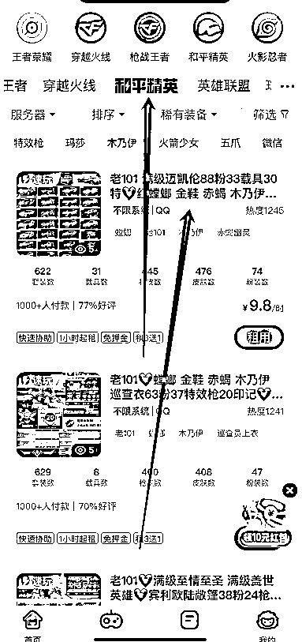

截取账号信息：

文案和主图搞定后就能发布了。前期建议先上2-6块的引流款，把店铺权重养起来。

**地区选择：** 我们测试了5个号，发现选小县城曝光和出租率更高。不过这仅供参考。

# 四、怎么快速出单？

在闲鱼搜“和平精英租号”：

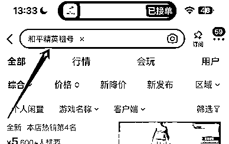

找到销量高、浏览多的同行，直接参考他们的主图和地区，但价格要比他们更低。

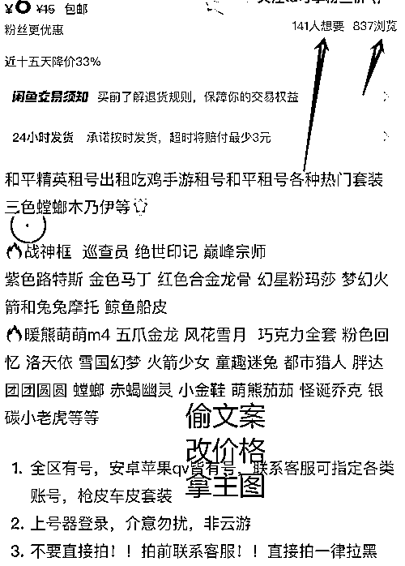

几个注意点：

1. 拿主图要改MD5，比如截图、调滤镜，不能直接搬原图。
2. 价格策略：对方6块，你就5块或4块。
3. 文案标题可以调换顺序、简单改改格式。

# 五、咨询来了怎么接？

闲鱼是先有咨询才有成交，客服这块有两种模式：

**第一种：引导私域**

设置自动回复：亲，想玩什么皮肤和载具？这边帮你找号！

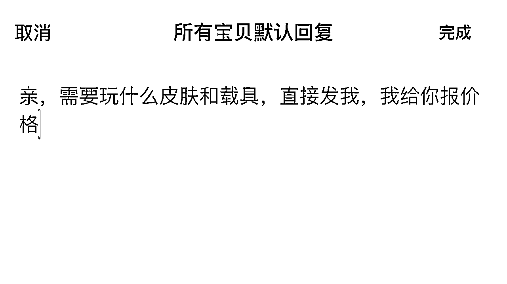

客户一般会说某个载具或皮肤，你统一回“有”，然后导到🛰️成交。

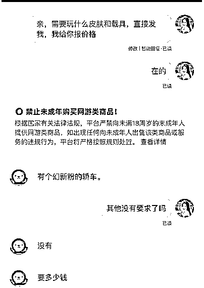

**第二种：闲鱼直接下单**

也行，但比较麻烦。比如客户租了三个多小时要退款，你不同意就得走小法庭，流程繁琐。

# 六、加了🛰️怎么成交？

愿意加🛰️的客户通常比较急——要么是急着和朋友开黑没号，要么是年纪稍大不熟悉租号平台，再就是闲鱼的价格确实更便宜。

具体步骤：

1. 确认区服：安卓还是苹果，🛰️区还是🐧区。
2. 问需求，发账号皮肤截图、数量。
3. 引导转账下单。
4. 让客户下载上号器。
5. 发解锁码。

成交案例：

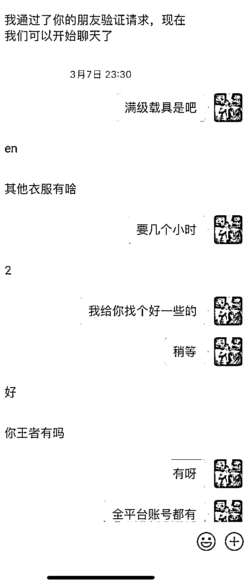

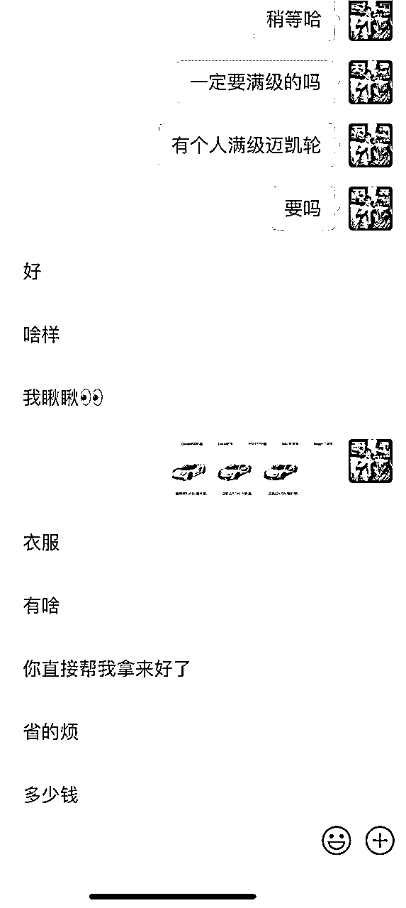

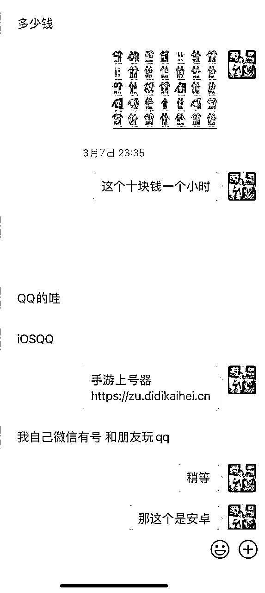

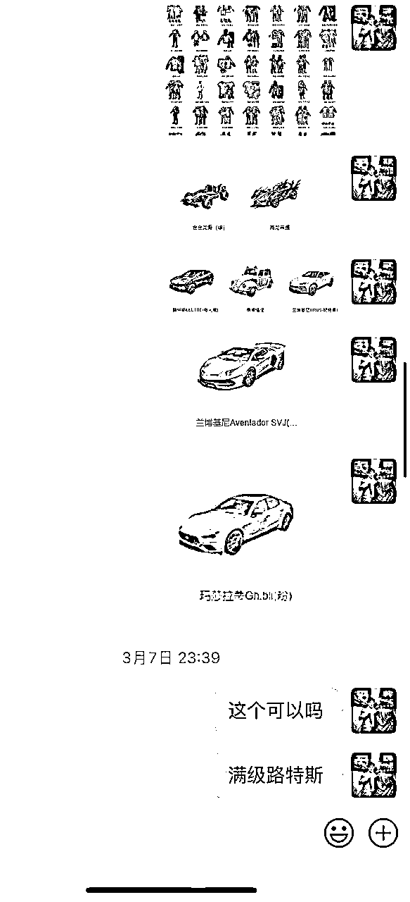

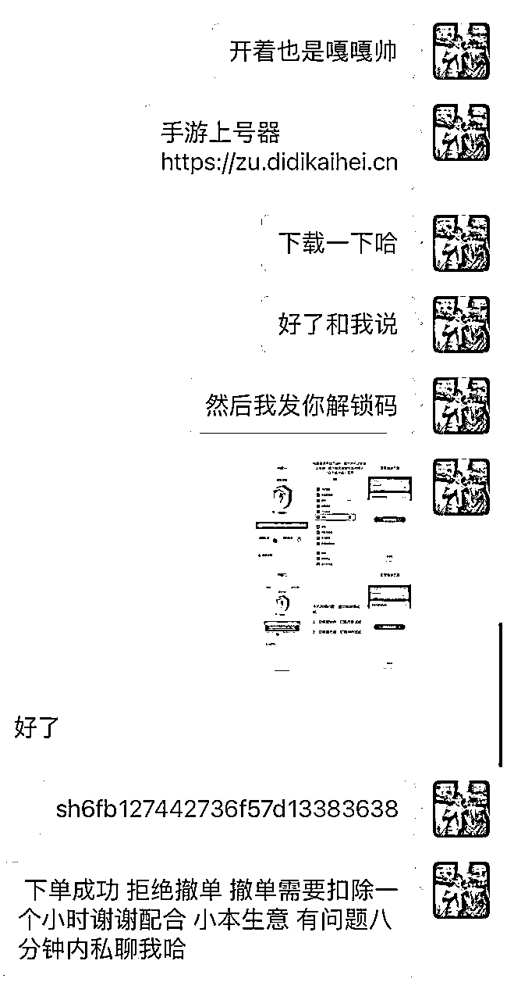

# 七、转租账号从哪里来？

平台：https://guwei.vip.zuhaowan.net/

这是我们自己的平台。

## 7.1 注册

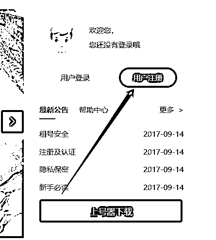

注册后界面长这样，市面上大部分热门游戏都能开。

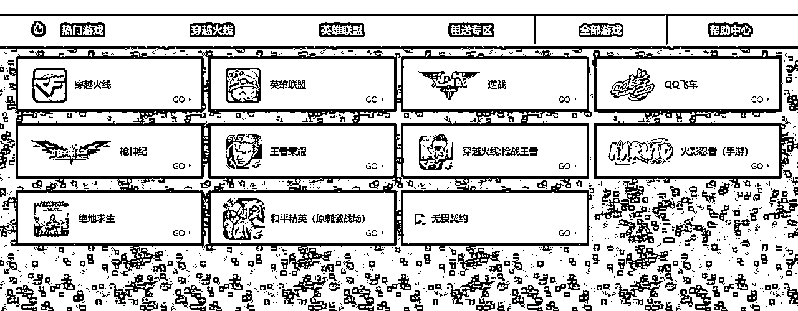

## 7.2 下载上号器

客户下单成功后，把上号器下载链接发给他，这样能规避外挂等问题。下载好才能用解锁码上号，这点很重要。

端游+手游上号器下载地址：

https://zu.didikaihei.cn

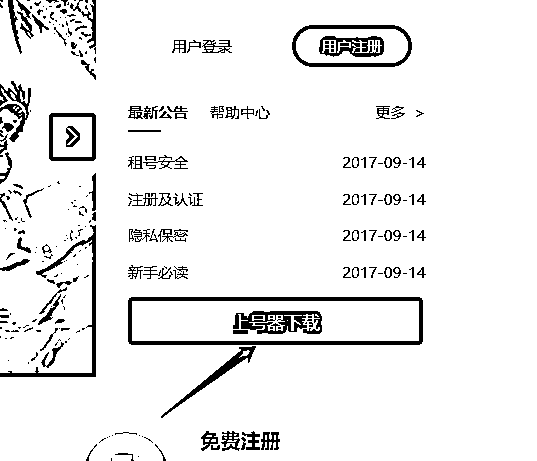

## 7.3 怎么下单

点“立即租赁”，按客户需求搜账号皮肤、数量就行，操作不难。

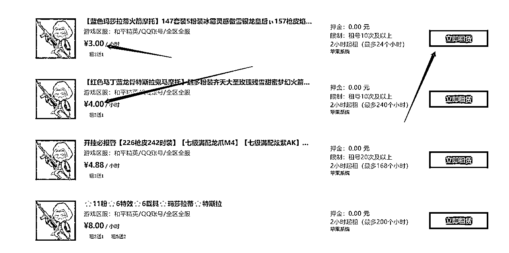

## 7.4 价格怎么定

平台拿号一般3块左右，我们对外挂6-8块一小时，两小时起租。有些1块钱的号里皮肤价值很高，定价可以更高。常见区间就是6-8块，个别能到10块，具体看顾客。

## 7.5 怎么看账号皮肤

私域成交时，发截图很关键，能明显提升转化。

点链接进去，往下滑：

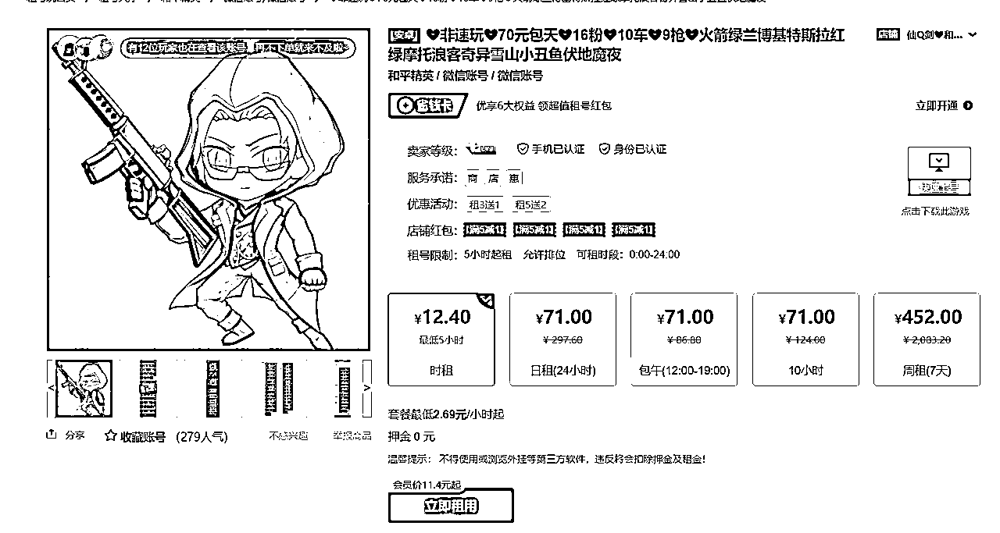

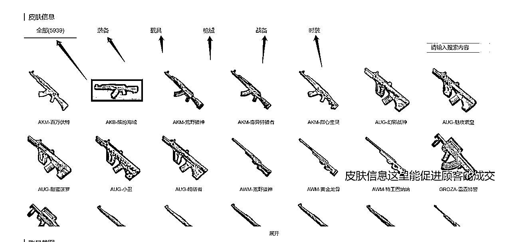

这里的皮肤信息都是真实数量，可以按顾客要求挑载具、皮肤、战备截图发过去。满意的话80%能成交；不满意就问清楚需求再找。

# 八、新手适合做这个吗？

## 优势：

1. 游戏租赁复购极强，一个私域客户每月通常能下单四五次。
2. 门槛低、适用平台多，不止闲鱼能做。
3. 对比之前分享的买号模式，转租不用计算回本周期，也不需要承担固定资产风险，对小白更友好。
4. 实测下来，5000人的私域，每月变现大几千甚至上万不难；如果做到1万人，想象空间更大。

## 劣势：

1. 回复要快。闲鱼来的客户都比较急，回复慢了人就跑了。
2. 完全不懂游戏的话，入门需要先熟悉皮肤、版本等知识。
3. 想靠转租短期月入几万不现实，它是积累型的项目。

如果你现在比较迷茫，不知道选什么项目，游戏私域转租可以试试。别想着一步登天，把流程跑熟，每天赚个百来块还是挺轻松的。我是石头，专注游戏租赁和私域引流，欢迎交流。