# 我翻了30万条微信推荐文章，才发现公众号的“隐藏规则”

> 经常看我文章的朋友应该知道，我喜欢用一句打油诗开场。这次数据又多又猛，我就直接开聊。
> 我是赵天应，一个天天和素材打交道的“半仙型选手”。

这波原本说好聊20万篇，结果素材挖掘机一发力，直接抓回近30万条公众号推荐文章，总容量约91M。这些内容大多来自微信的推荐位，包括文章底部的相关推荐、看一看，以及其他各类入口。每条记录都带有分类、标题、是否爆文、发布时间、阅读量、点赞量、在看数、分享数、原创标识、原文链接、评论数、文章简介和高赞评论。

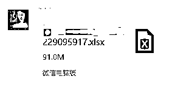

不过，挖数据是一回事，清洗数据又是另一回事。几十万条里免不了重复和低质量内容，我用RPA自动化跑了一遍筛选流程，最后只留下约10%。我个人的处理也比较直接：阅读量3万以下的全部不要，最终剩下3127条。

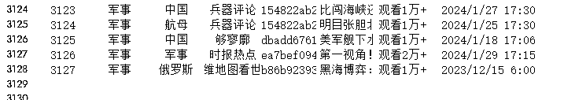

看发布时间，微信的推荐喜好非常清楚：主推近3个月内的内容，尤其是最近1到2个月的文章。我的数据里出现4个月跨度，是因为1月和2月各抓取了一次，横跨了两个自然月。

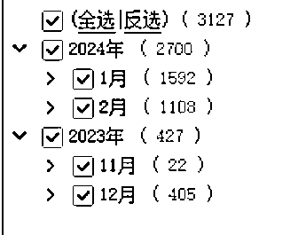

再从行业和场景看，前十名依然是熟悉的面孔：娱乐、时事、职场、军事、教育、情感、电视剧、生活、社会、科技。一个有意思的规律是：被大家吐槽“最卷”的赛道，往往也是收获最丰厚的赛道。

下面是我基于这批数据形成的几点想法。不一定全对，但希望提供一些不一样的视角。

## 1. 公众号的流量狂欢，早就过了

以前我随手一挖，就能看见大批10万+、甚至100万+的推荐文。现在再看，要么是腾讯把算法调整完毕、流量被摊分到更多文章上，要么是抖音、微头条、小红书这些平台又抢走了一波注意力。总之，那个“随便写写也能爆”的时期已经翻篇了。

## 2. 再卷的领域也有机会，小众赛道更是宝藏

搞内容、搞公众号、搞互联网的人，普遍会觉得同行越来越多。可我们看到的，其实只是一片树林；真正的世界是一片大森林，至少还有80%甚至99%的人，根本不知道我们正在做的事情。

在竞争激烈的行业里，有人坚持不住离开了，有人找不到方法一直做不出成绩，也有人埋头苦干，最终等来了属于自己的机会。而在小众领域，只要方法得当，再把AI用起来，搞一搞“跨界打劫”“降维打击”，反而能活得很好。

## 3. AI这朵云，已经飘到头顶

我非常认同一个说法：一个动作如果重复三次以上，就可以考虑让它自动化了。另外，《唯有偏执狂才能生存》里有句让人警醒的话，大意是：我总觉得有一朵阴云正朝我这边飘来，但可能要过几年才能看清它到底是什么，所以我始终诚惶诚恐、小心翼翼。

在我看来，2024年的这朵云，就是AI。所有行业都值得用AI重新走一遍：以文生文、以文生图、以文生视频，每一个环节，放进自己的领域里都有巨大的优化空间。公众号爆文也一样。账号有没有统一管理？文章能不能自动化批量产出？配图能不能交给AI生成？内容质量能不能自动分析？数据能不能做分词、拆解和拓展？这些事，可以做的太多了。

## 4. 爆文不是一场纯靠实力的游戏

公众号改版之后，算法越来越像搜索引擎：先去中心化，再逐步释放流量。很多人试着拆解规则，但必须承认，它更像一个“暗箱”或“灰盒”，核心算法不会公开，最多只能靠猜想。

我搭素材库的出发点，其实就是用案例说话：从大量的爆文样本里，找出哪一类文章更容易爆。公众号爆文也一样，不完全靠技能。技能占比到底是60%、50%、80%还是20%，要看具体情况。

如果你选的是小众领域，稍微花点力气，可能只需要30%的技能，剩下的交给运气，也能获得不小的流量。可如果你冲进大众最卷的赛道，也许就要拿出80%的本事，另外20%靠运气。当然，在大众领域里，你也可以先做选择题、再做解答题，逐步切出更细分的赛道，从而降低技能权重，让运气多发挥一些作用。

## 5. 能赚钱的时候，先冲进去赚

至少目前来看，公众号还能做。如果没有更好的项目，就别犹豫，赶紧入场：先做起来，先赚到钱，再想办法赚多，然后稳定地赚、持续地赚。如果你永远站在场外观望，那所有的机会都和你没什么关系。

## 各赛道爆文拆解

下面进入重头戏，看看这些分类里跑在前面的爆文，到底长什么样。

### 娱乐

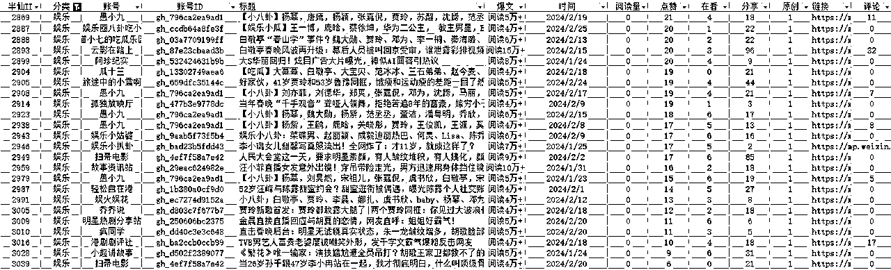

### 时事

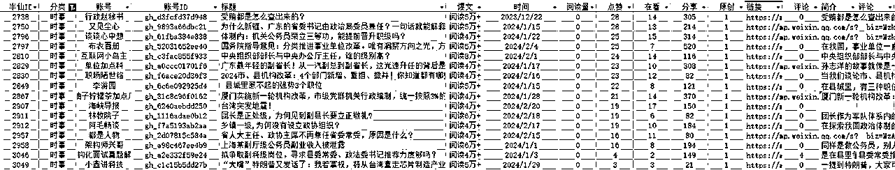

### 职场

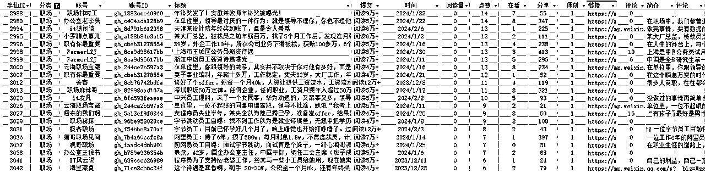

### 军事

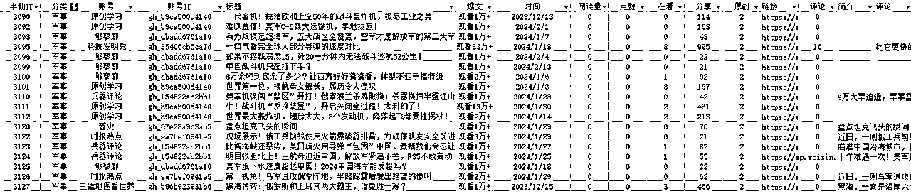

### 教育

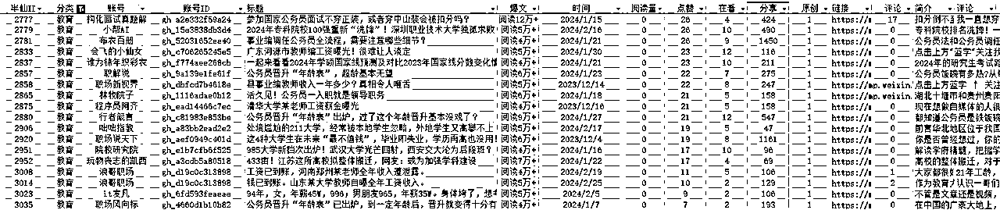

### 情感

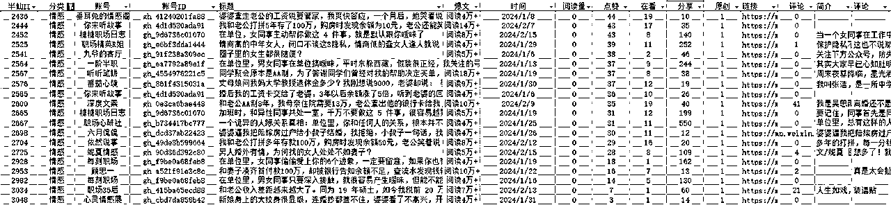

### 电视剧

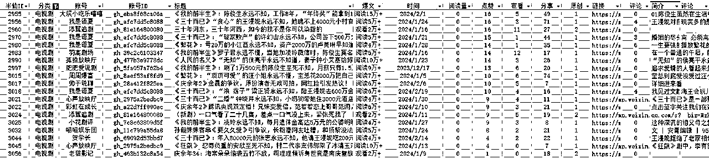

### 生活

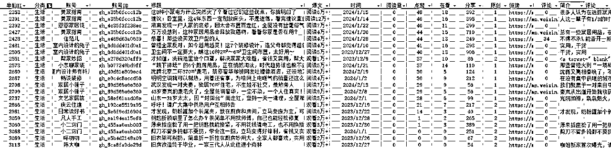

更多分类，欢迎来找半仙继续聊。我的微信：13401616。

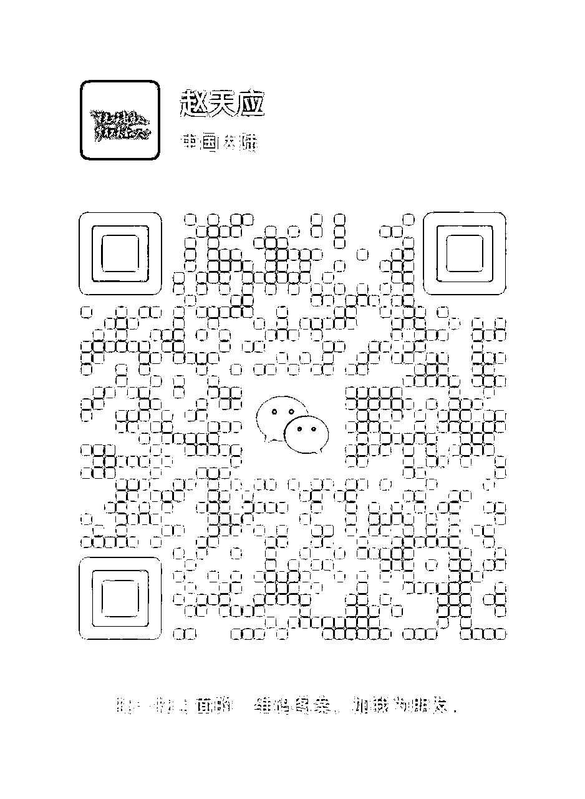