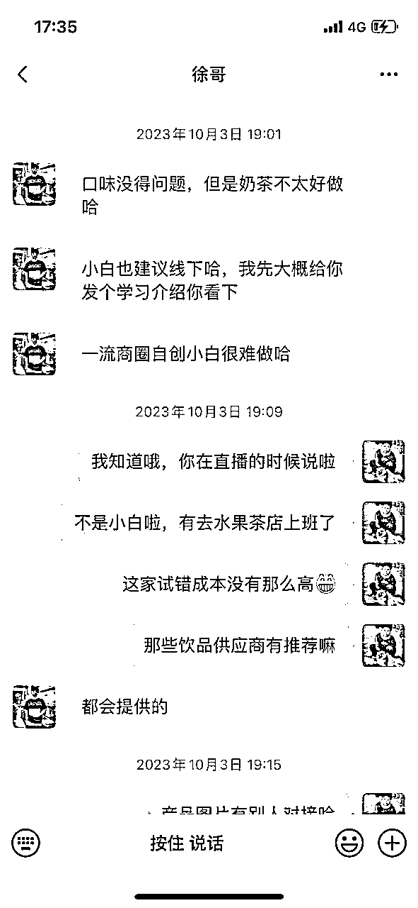
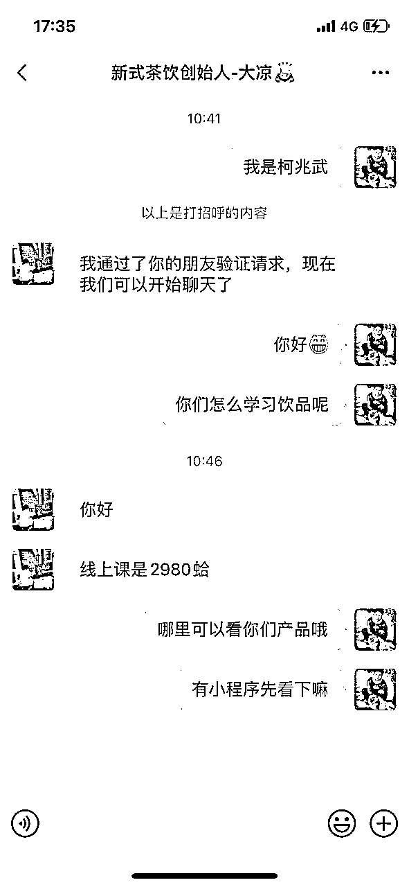
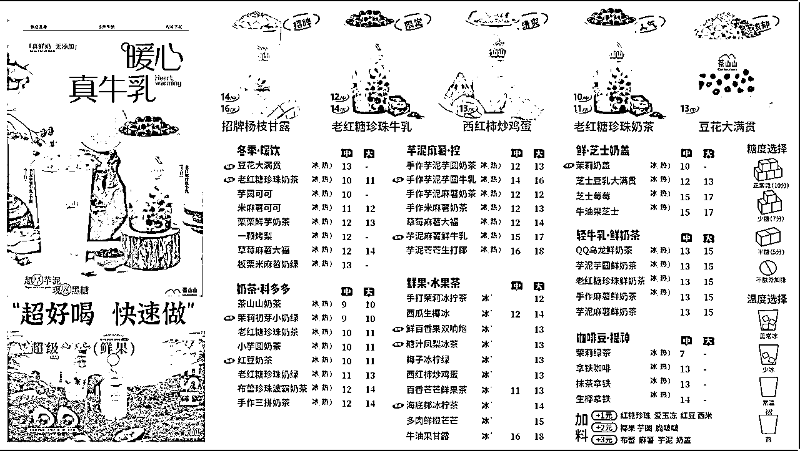
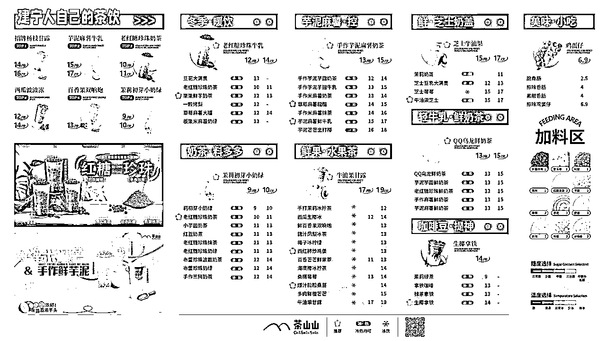

# 在小县城开一家自创奶茶店，我摸索了一年的真实体感

县城还能不能做自创茶饮？我还在路上试探。

大家好，我是阿武，一个在乡镇做自创饮品的实操者。今天把我回老家开店这一年的经验摊开讲讲，给还在犹豫的同行一个参考。先做个交代：我所在的县城常住人口也就五万左右，对大城市来说顶多算个镇。基于本地经济和现实情况，我选择回家创业。这篇内容算是给2023年的一个复盘总结。

一、产品篇

二、选址篇

三、设备材料篇

四、人员篇

五、价格定位篇

六、开业篇

七、门店运营篇

八、心态篇

一、产品篇

小县城的消费逻辑很直白：工资低、就业选择少，能留下的年轻人很少。大部分是体制内、家庭小店继承者、在家带娃的群体，以及初高中学生，40岁以上的人群占比较大。别指望单品卖高价，市场不买账，认可的人也有限。

我给自己定的参照线是茶百道，产品的性价比和分量感比较实在。

在县城，东西好不好很快就传开了。我刚回来时当地有22家奶茶店，现在只剩17家。淘汰速度说明风险不小，投资要慎重。口味如果做不到和品牌齐平，第一步就站不住。

产品到底怎么选？

①去店里打工。挑一家开业至少两年以上的自创奶茶店进驻实习，城市越大越好，能在品牌夹缝里活下来并盈利，说明产品力过硬。去上班不只是学手艺，要系统看门店的出品技术、迭代节奏、操作SOP、服务细节、突发状况处理、设备使用、人员管理、供应链渠道等等，能学到的全部记下来。提醒一句，别轻易跟只有两三家店的老板坦白你的真实目的，他们格局往往不大。碰到愿意带、离职后还肯分享的老板一定要好好珍惜。2-3个月基本能把核心东西带走。

②如果你是新人想快进，建议找师傅。现阶段想靠自己研发超越品牌，难度很高，品牌背后是专业团队，更新频率和口感都在顶端。客人常跟我说你这做得不输古茗茶百道，我也只会笑笑不敢自负。

拜师后你就有了后续对接，产品更新配方会同步给你，物料费是他的合理收入，觉得贵可去淘宝找平替，至少省掉自建研发团队的成本。稍微包装一下就是你本地唯一的品类。

拜师务必线下学，很多基础常识是视频学不到的，比如粉与热水混合后要过滤再降温。别信只收线上的。小红书、抖音找老师，或者熟人介绍，客流爆满的店都是潜在师傅。我水平大概60分，也能做前辈了。关键是找个靠谱的，学完还肯理你。最好加进他们的学员群，里面有大量参考意见。

③跑供应商。社牛可以直接上门问同行从哪进货，社恐就上抖音搜奶茶供应、淘宝搜奶茶，筛选本地公司并导航过去。这条路不是最优解，基础不牢会被供应商牵着走，最后陷入闭环只做他家的东西。打破局限要靠持续看小红书、抖音茶饮内容，了解市场动向。给自己定个小目标，一周至少加一个做饮品的人，保持在信息流里。别人做不做是另一回事，先做到懂。

二、选址篇

产品过关后才有资格谈位置。找铺面很焦虑，合适的不多，好的位置早已被稳定经营者占据，需要极大耐心。也可以先锁定位置再学技术，前提是师傅联系好。我的第一家店花了整整两个星期才确定，那段时间我一度觉得要泡汤了。10月份我去找铺子，正好赶上餐饮倒闭潮，很多奶茶店撑不下去，这就是机会。转让费能压就压，冬季生意惨淡要熬到春节才有爆发，大部分人急着脱手。

可以约几个朋友打电话给房东/原经营者，说店面哪里不值钱，重复几次让他自己怀疑定价是否偏高。心里要有底价，别一直往下压最后被别人抢走。

我原本想做大城小店、小城大店，实地看完商圈后只有这一个选址可行，37平的小店。现实总是要妥协。在没有知名度时，县城人不会专门骑车开车来喝一杯。之前看中一家颜值不错的店，位置偏了点就倒闭了，这更坚定了我选核心区。

这家店在县城的中心点，租金自然偏高，但仍在承受范围。要量力而行，租金是压垮店主的最后一根稻草。

县城人看重面子，请客喝大牌有体面。形象必须做好，开业时我被问了无数次在哪加盟的，即使招牌上写着本地品牌。对面蜜雪冰城，隔壁益禾堂，对面古茗，后面茶百道，压力很大但曝光度也高。很多人会说居然有人敢夹在这几个品牌中间开店。心中要有底气，相信自己的产品不输给它们。喝过我的再去喝别人的，虎口抢食。

如果想选偏远位置，差异化必须足够强，让人觉得值得专程跑一趟。未来有知名度了再考虑开大店带座位区。现在没名气，就尽量选人看得见、自然流量大的地方。选在中心附近，不要怕租金高，知名度打不出来更难。

三、设备材料篇

不懂设备就抄作业。搜霸王茶姬、古茗、茶百道用的设备，照着配一套出品到封口的动线，流程才能顺畅。品牌底下一般都有设备商，一个个联系。

设备是坑。有条件就买全新且集中一家采购，品牌售后有保障，当地优先没条件就挑能维修的地方。网上卖的二手大型设备别碰，小物件可以考虑。

机器一定要买靠谱的，使用周期长，平摊下来并不贵，品质也更稳定。

没预算就找供应商买二手，他们会更上心，出了问题能处理，价格稍贵但安心。我在小红书买过一台二手的坏机器，卖家不管，毫无保障。

买设备要会砍价，哪怕是熟人。我找前同事买蒸汽机，他嘱咐我价格保密，结果我后来闲鱼发现新机只贵50块。当时没多聊，错失了再降100的机会。即使不买，也要加微信了解行情。

2.①粉、酱、浆、茶
好喝离不开好原料，多试多比。先买一包试，确定再囤十包，量大更划算。原料取决你学的是哪套产品体系。

②水果、牛奶
西瓜：美都、8424、普通无籽
柠檬：香水柠檬，广州产，一级、二级微瑕
橙子：江西赣橙、新奇士、埃及橙
草莓：本地草莓、奶油草莓、红颜、丹东、双流
葡萄：巨峰、夏黑
芒果：台农、凯特芒，淘宝君探水果
牛油果：智利哈斯、墨西哥
凤梨：都乐官网购买
牛奶：选本地家庭最常用的鲜奶，不要盲目追新。普通牛奶可选用大M波兰进口

3.有条件去饮品展会，结识全国供货商，运输也方便。他们的朋友圈值得常看。可以不做，但不能不懂趋势。奶茶、果茶、鲜奶茶一直在演进。

四、人员篇

1.招人
第一句忠告：宁缺毋滥，不合适直接让走，别抱希望他会改。时间成本太高。

县城招人难，年轻人外流，留下的人工资预期低但稳定性差。

①招来多是刚毕业、高中辍学、春招生，心智不成熟，一切向利益看。画饼没用，用制度和奖惩约束。

②培训别拖长，每个阶段要达标，时间节点反复强调。

③辞退时他们会闹着要马上结工资，不会反思自己问题。面试前就把工作内容、条件、薪资说清楚，是我多次试验后总结的。

2.员工入职须知：
1.1试用期工资2200元，全勤200元，迟到则无，月休4天，三人轮班。节假日全天班，工资额外+150元不可休。迟到1分钟扣3元或10个俯卧撑。
试用期3天，第一天全天，第二三天早班熟悉流程，未通过无薪。超过30天计入当月工资，未满30天中途离职不结算。
工作7天未达标按60元/天算。
工作30天未达标按70元/天算，休息日不计，迟到累计4次即辞退。
工作60天未达标按75元/天算，休息日不计，迟到累计4次即辞退。
未达标辞退后工作服需清洗，夏季50元、冬季100元，钥匙500元，第五天发薪，请归还物品。勿催，不会少，劳动局可投诉。
1.2转正后工资2300元，全勤200元，迟到一次扣50，轮班制，节假日全天班+160元不可休。可迟到2次合计30分钟内，超时按每分钟3元或俯卧撑。
开始提成奖金3万元+100元抽成，累计5000再+100递增。
次月15日发薪，离职同理。离职归还工作服、钥匙同上。做满一个月次月15日全额，未满一个月80元/天，休息日不计。
上班守规矩。
3天认识物料
7天会备早班物料
20天能按菜单制作
30天会报备缺料
看完确认回复：我已知晓规章制度

3.店内操作
①仪容仪表：操作区必须戴口罩、帽子、工服、围裙，女员工戴发夹，统一着装。
②迎宾：你好欢迎光临，请问需要喝点什么，手势引导看菜单，语气温柔。
③送客：慢走，欢迎下次光临。
④催单：不好意思，现在订单稍多，可能需要等待一下，我们尽快制作。
⑤先从备料、收银、卫生开始，再学制作。

如果是夫妻店，不建议一开始双无业，至少保证一方有稳定收入。店面稳定后再一起投入。

五、价格定位篇

前有猛虎后有狼，没有最低只有更低。大牌靠活动拉流，周三9.9，周日买一送一，我们的价格打不过。

物料单店拿不到优势，倒不如把价格定位稍高。721原则：7成赚钱、2成微利、1成走成本。

产品定价比茶百道古茗低1-2元，性价比会更突出。有人会想不如多加两块喝大牌，县城人很在乎这点差距。

没价格优势就要另辟蹊径。我开始送小零食和烤肠，一杯送零食，两杯送烤肠。家里人觉得败家，我坚持。香肠成本约2元，零食3毛，但口碑回报很好，给人占便宜感。

一个月后活动开始见效，知名度逐步打开。

六、门店开业篇

开业决定第一印象，前期准备要做好，让人产生好奇。

1.线下：
①围挡广告要清晰，让路过的人一眼知道是干嘛的。挂7天，街上大部分人能看到。
②发传单，老方法但县城有效。告诉他们是奶茶店，很多人会问加盟哪个品牌。你可以大方说这是自创品牌。
③摩托车巡回播报，开业时间、优惠，县城传播很快。

2.线上：
①发传单时加微信做裂变活动：朋友圈连发一天8折，两天7.5折，三天7折。我只做了7.5折。县城裂变很快，亲戚朋友会主动转发。
②抖音开业前连更几条视频，讲回乡开店的心路、用的物料。我的播放也就2000，但都是同城，转化很好。可投抖加。

试营业一周不做活动，让子弹飞一会。正式营业再叠加活动，4天周四到周日，第一天预热，周五放假，周末人多。想占便宜是人之常情。

七、门店运营篇

门店运营很广，这里说点实操细节。

1.朋友圈及时更新产品出品，让人看到你在做事。
2.抖音快手每周至少发一条，讲门店日常，不会也要发。
3.节假日不一定打折，我多以送礼为主，比如38妇女节送花。
4.别过度吹嘘产品。茶颜悦色也没说自己健康，品质看得见。我用的牛奶是本地人认可的牌子，信任感会迁移。
5.统一杯子、杯套、纸袋定制，专业感立刻提升。我用启城公司的物料。
6.菜单第一视觉放招牌产品，放大明显，第二张可以好看，但第一张要一眼懂。

八、心态篇

1.开店容易守店难。业绩波动很大，一天300我都经历过。不能以单日论英雄。心态要稳，气场很重要。每天开心上班，生意自然来，笑容是客人感受的能量。

2.前期时间会被掏空，我现在每天在店12-13小时，几乎没业余生活。前半年基本是自己干，招1-2人。半年内别想出去玩，要耐得住孤单。我会看小说刷小红书，看到有趣的就拍。

3.业绩不好别气馁，好时别膨胀。过年一天能做到3000，初六后人群回流又降。接受波动。

总的来说，县城做自创奶茶店是可以的。当然有钱直接加盟更省心，总部兜底。

我是阿武，还在饮品路上摸索，有同行的欢迎交流，看看你的朋友圈。