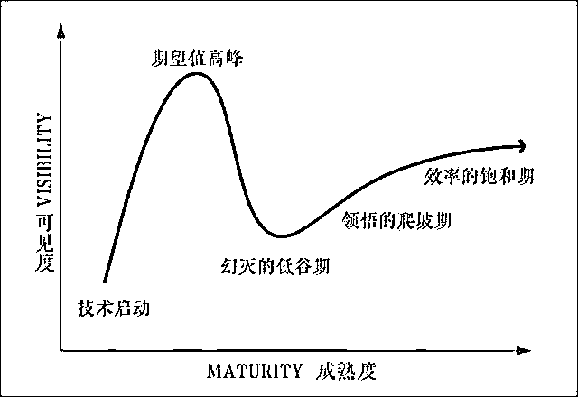
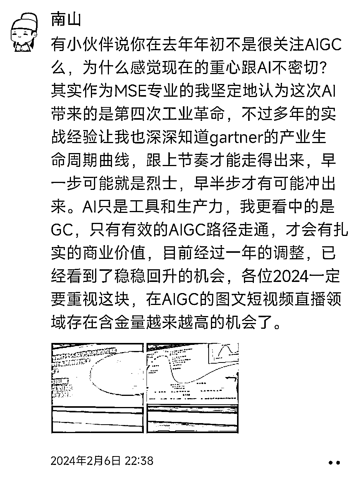
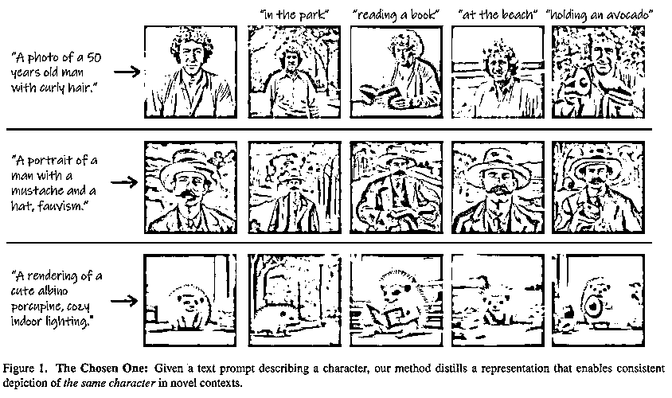
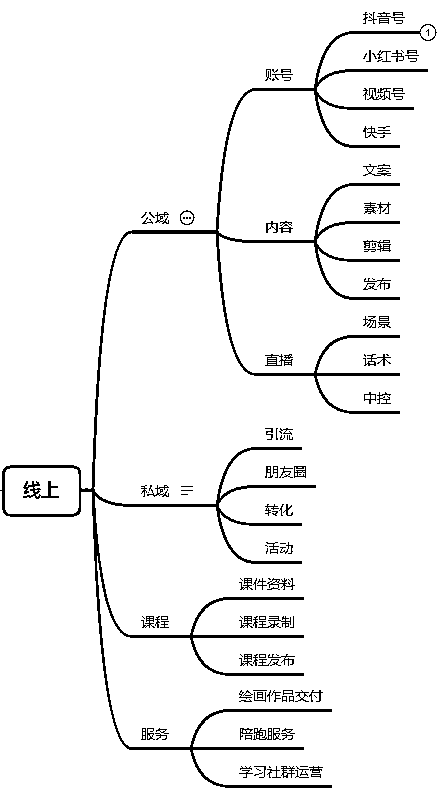
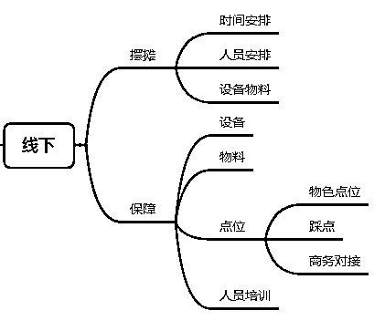

# 风口已至！AI变现元年正式开启，普通人如何抓住这波红利？
作者：龙哥

AI技术正在经历从“能用”到“好用”的蜕变，而真正的商业价值正在从技术突破转向实际变现。2024年，AIGC商业化元年的大幕已经拉开，这个判断正在被越来越多的信号所印证。

我一直在一线操盘短视频直播私域和IP孵化，每天和数据打交道。去年年初ChatGPT刚出来的时候，我就开始紧盯AIGC变现的商业化路径，也做了不少实践测试。

有个做商业判断的重要方法：重视异常值。一旦看准了异常值背后的逻辑，往往能挖掘出巨大的价值空间。今天就想和大家聊聊，为什么说2024年是AIGC商业化元年，以及我们应该怎么上车。

## 从测试到跑通：我们踩过的坑和拿到的结果

我是龙哥。当看到生成式AI技术突飞猛进时，我意识到UGC和PGC之后，AIGC的时代已经来了。去年4月，我组建了团队，同时测试了两个方向：AI小说推文和AI图文带货。

测试结论很明确：前者因为技术限制还不够成熟，暂时不适合商业化；后者我们集中了十几个小伙伴实战跑通了流程，效果相当不错。我们产出的最爆的一条内容，一晚上跑到了180多万的观看量。

之后我又陆续测试了AI👸号流量主、AI数字人直播、AI无人直播以及AI电商商品图等方向，基本把AIGC的头部热点都摸了一遍。

有人问我，去年为什么没有all in AI？我在朋友圈说过：从产业生命周期来看，任何一项新技术从出现到应用成熟再到商业化落定，要经历一个曲线。

走得太快，很可能熬不过低谷期；节奏踩稳了，才有机会穿越周期笑到最后。为什么？因为AI的核心在于“GC”，也就是说，只有跑通可变现的商业闭环，技术才有持续壮大的根基，否则就是空转。

今年2月初我就感觉到机会在回暖，而到了现在，趋势已经非常明显了——在图文、短视频、直播这几个AIGC细分领域里，含金量越来越高的机会正在密集出现。

## 一个关键信号：MidJourney的“角色一致”功能

为什么我这么确定？给大家看一个非常典型的信号：3月初，MidJourney上线了consistent characters功能，简单说就是同一角色可以在连续多张生成图片中保持人脸一致。

从技术角度看，这只是一小步，不过是一次常规功能迭代。但它的商业意义，却是里程碑式的。

回想去年的AI小说推文测试，最头疼的问题就是主角面部不稳定——男主每张图长得都不一样，用户根本入不了戏。当时想解决只能手动换脸，效率低到没法规模化。而现在，这个痛点直接被抹平了。

这个功能对AI图文、AI小说推广、AI绘本，甚至AI动画几条应用赛道都是巨大利好。举一个很直观的例子：去年我们用宝宝照片做定制化绘本，非常费劲，因为每张图里的宝宝形象都保不住，客单价虽高但效率上不来。今年效率翻了几倍，一个单子很快就能交付，这意味着可以规模化、可复制、赚钱的密度就更大了。

再看看其他方向：去年AI绘画还会画错手指、多长一条腿，今年这些问题已经被大大控制了，生成的风格也越来越丰富，甚至可以应用到装修设计这类需要高精度交付的真实商业场景中去了。DomoAI的视频生成动漫功能也是越来越好用，目前嘴型同步还不够精准，但用在场景类内容上效果已经很靠谱了。而嘴型这个事，我相信会是接下来技术迭代的重点，很快就能见到突破，届时商业化的想象空间又要上一个台阶。Sora也一样，刚出来的时候商业化能力也许一般，但随着技术成熟，变现路径会快速跟上。

## 判断：2023是AI技术元年，2024是AIGC变现元年

从技术的演进脉络可以看到：2023年是“从0到1”把科技树点亮的一年，而2024年则是“从1到N”让商业价值落地生根的一年。这就是我今天最核心的判断——AI技术一小步，AI变现一大步。和去年相比，值得扣动扳机的靶子已经明显多了。

但在下场之前，有几类项目要特别慎重：变现模式模糊不清的；变现环节太长的；投入产出比低、变现密度不够的；门槛过低容易红海化的；没有明显竞争优势的；生命周期太短的。如果一个项目命中以上两条以上，建议新手尤其是个体慎入。后面我会专门写一篇详细的“避坑指南”，感兴趣的朋友评论区冒个泡。

## 我们在做的尝试：AI绘画摆摊，线上开花线下香

最后说说我们正在做的一个很有意思的共创项目——AI绘画摆摊。3月份，我们选定了这个方向作为今年的第一个落地实践。

有人觉得摆摊太重了，单点体量有限，也没法快速放量。确实如此，纯线上的人一看就觉得“不性感”。但凡事辩证来看：在线上流量见顶的当下，适度的“重”本身就成了护城河，反而没那么卷。

我们的打法很明确：线上开花，线下闻香。把线下摊位定位为内容素材和场景来源，对外输出给抖音、视频号、📕等帐号。每一个摊位对应一套线上帐号，通过线上引流卖AI绘画摆摊课程，同时服务线上想要定制画作的用户。所以本质来说，它还是个线上项目，线下只是内容拍摄的片场而已。

目前已经有二十多个小伙伴加入了行动。等有了阶段性成果，再来给大家汇报。我们计划在更多城市复制落地，后续还会叠加AI老照片修复、数字人永生、AI学习机销售等增值服务。

今年方向很多，好项目和好玩法一定层出不穷。大家要多看，但更重要的是敢下场。记住：犯错的成本很低，错过的代价很高。AIGC这条变现大赛道上，动作快的人已经开始跑了。