# 在职暗中启动陪诊项目，半年营收破十万，糯米如何借助生财打开第二赛道

> 来源：[https://f8f5eqx2mx.feishu.cn/docx/AubodhBdioLH3tx2LRecK98anbb](https://f8f5eqx2mx.feishu.cn/docx/AubodhBdioLH3tx2LRecK98anbb)

各位好，我是糯米，白天是医药代表，晚上是陪诊公司创始人。

生财里不少朋友都是边上班边寻找增收方式，很多人对打工的现状并不满意。

在职人群普遍有一种状态：想突破却缺乏抓手。今天糯米把自己的经历拆开讲，希望对同样在摸索的人有启发。

本文聚焦陪诊、在职、第二事业三大关键词，特别适合：

1. 医药行业从业者，尤其是医药代表；
2. 对陪诊赛道好奇的人；
3. 希望不离职也能做点事业的人。

读完这篇，你可能能更清楚怎么用好生财，了解陪诊行业的真实面貌，以及在职创业的一个可参考路径。若能激发一點行动力就更好了。

# 先上目录

# 一、陪诊行业基础认知

#### 1. 陪诊是什么
#### 2. 陪诊存在价值吗
#### 3. 陪诊的生意逻辑

# 二、我的第二事业启动历程

#### 1. 锁定杭州，加入生财，先把基本盘稳住
#### 2. 在职时捕捉到陪诊机会并完成首单
#### 3. 从一人服务到搭建分单网络
#### 4. 流量受阻，意外收获一位小合伙人
#### 5. 公司化、轻资产化运营陪诊业务
#### 6. 近期进展

# 三、实战心得与方法

#### 【心态篇】
#### 【操作篇】

# 四、行业现状与前景判断

#### 1. 认知度低，付费习惯培养不易
#### 2. 符合国家服务趋势，有长期空间
#### 3. 边界与合规要点
#### 4. 各平台对陪诊的态度差异
#### 5. 暂无绝对龙头
#### 6. 赛道盘子有多大

# 五、总结与致谢

#### 1. 怎么用好生财
#### 2. 感谢

# 一、陪诊行业基础认知

## 1. 陪诊是什么

字面理解就是陪患者看病，核心是陪伴。

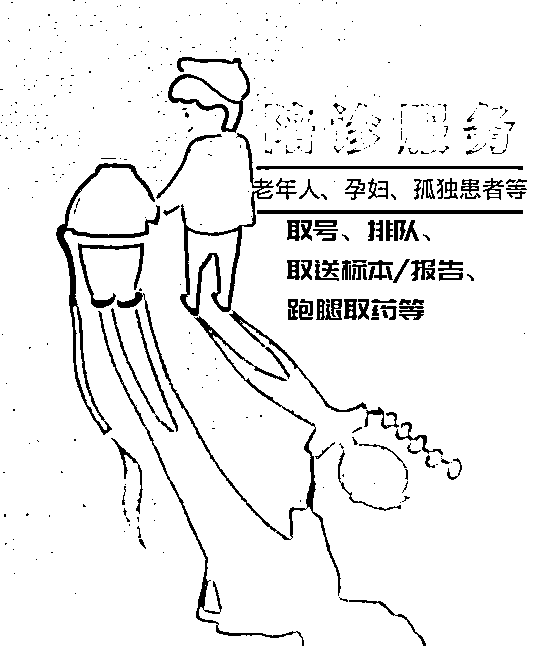

内部我们常说陪诊师是“患者的临时家人”。

实际交付内容比名字复杂，主要形态有跑腿、代办、代问诊、陪同、绿通资源五类。

跑腿相对轻，挂号、取检查报告、打印影像等，主要是操作机器和流程，门槛低，熟悉医院动线即可。

代办稍重，如代开药、预约检查，需要同时掌握患者病情和诉求合理性，以及与医护的沟通解释，对专业和沟通能力都有要求。

代问诊是代办的升级，患者不直接面对医生，陪诊师要做信息整理、诉求梳理，有一定疾病知识储备，懂得医生提问逻辑，减少信息损耗。

陪同服务是线下全程陪伴，要求服务意识和医院规章地理的熟悉，核心是情绪价值和就医体验提升。

绿通资源是通过自身医疗人脉，帮助客户解决手术排期、专家号源、床位等硬需求。

## 2. 陪诊存在价值吗

有需求就必然有市场。

糯米举几个场景：

1. 异地就医人群，需要提前代办，减少滞留时间与成本；
2. 工作繁忙无法陪同家人的群体，需要替代性照顾；
3. 行动不便者，需要护工式支持；
4. 社交焦虑或对医院陌生的群体，需要向导式服务；
5. 慢病人群复诊购药频繁，需要降低时间精力损耗，实现远程就医。

本质是弥补医院服务短板，帮低能或失能人群完成就医。

从医生端看也有价值：信息被提前提炼，医患冲突概率下降；沟通效率提升，医生能更快抓住要点。

虽然部分医院及政务平台尝试过陪诊，但落地和优化普遍不足，这就留出了空间。医院自营人力成本高，交付精度难保证，收益又不被重视，大概率走外包合作。越早卡位，越容易成为大医院的优先合作方。

## 3. 陪诊的商业逻辑

生意逃不开产品、流量、转化。

### a. 产品
陪诊是服务生意，产品就是交付方式。可以自己做，也可以调度他人做。糯米早期是亲自交付，后来转为调度。

交付者从哪里找？糯米没有招素人，而是从医药代表圈子里选人。圈内人专业基础扎实，熟悉医院流程和资源，培训后即可上岗，形成了天然壁垒。

服务流程和理念来自一线复盘。比如提前15-30分钟报备位置，结束后把陪诊纪要和医嘱汇总整理发给客户，排版干净。

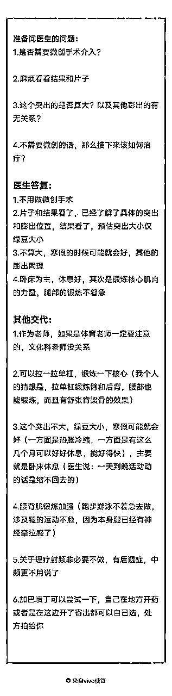

产品形态上可分为跑腿、代办、代问诊、陪同、绿通，也能按标品与非标品拆分。标品走固定SOP，非标可做高客单定制，比如糯米的5.8万元年度健康管理会员。

### b. 流量
在陪诊赛道，流量是前提。服务再好无人知晓等于零；哪怕服务一般，流量足够也能接到源源不断的单。

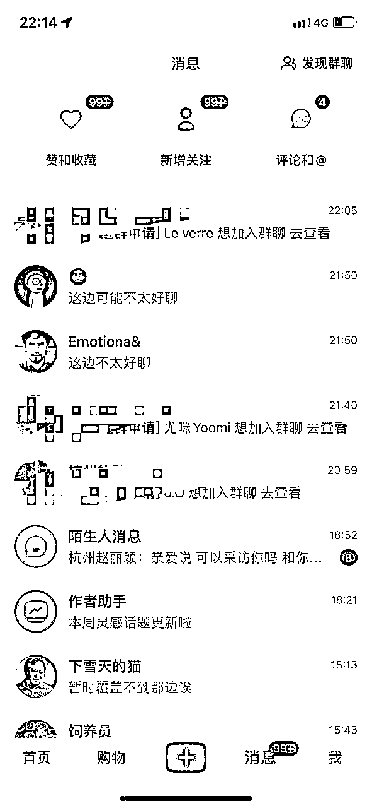

目前流量难点：行业认知不足，很多人不知道有这个服务；线下获客信任成本高，高端投放小玩家玩不起；线上获客受平台内容管控。

实战里自媒体获客为主，目前首选小红书，但医疗话题敏感，操作难度大。

行业常见获客方式：抖音小红书矩阵，用数量换机会；与保险、养老、残联等机构合作；地铁或朋友圈广告投放；老客转介绍；美团等本地生活平台。

### c. 转化
客户进入私域后，通过朋友圈、话术模板快速摸清需求，匹配产品成交，再交付。

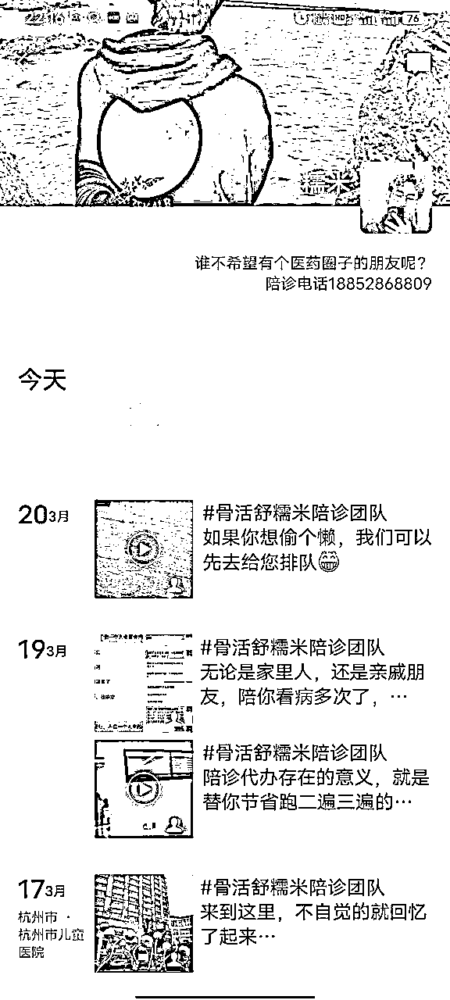

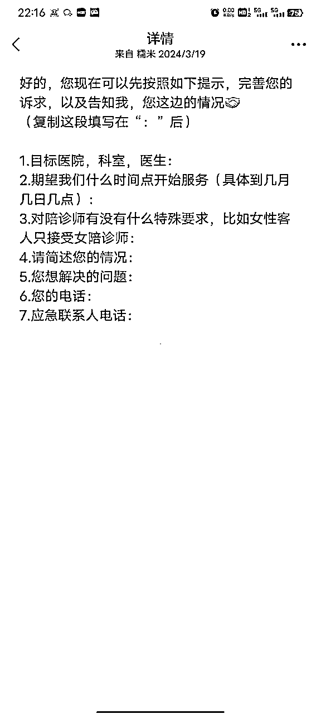

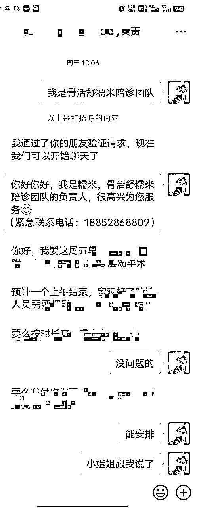

陪诊成交率普遍不低，糯米高峰期做到50%-70%，就医是刚需且多为急需，卡住时客户付款决策成本很低。

注意：别做吃人血馒头的生意，在满足诉求前提下收费，项目才能长期走下去。

# 二、第二事业我是这么开始的

糯米2019年药学本科毕业，南京做两年半医药代表，裸辞折腾一年半，期间通过生财日历认识生财。2023年带1万存款到杭州，下半年切入陪诊并坚持至今。

回头看，像是命中注定：没有裸辞经历、没有生财启发、没有入局时的助推因素，可能就错过了窗口。

## 1. 锁定杭州，加入生财，先把基本盘稳住

2023年3月底给自己设了截止期，若副业无进展就回职场。当时是全职游戏主播。

最终选杭州。信息流中杭州出现频率高，综合看政策友好、氛围积极、便于链接资源，且生财总部在杭州，于是带1万块到杭州，半个月找到医药代表工作，4月中旬进入生财。

新人引导里许下的愿望，如今基本兑现。回到职场后每天投入12小时，先稳住收入，再搭建自己的生财版图。那段时间一边做业绩，一边刷帖认识人。

## 2. 在职时捕捉到陪诊机会并完成首单

入职四个月后，8月主业趋于稳定。在生财搜索“医药代表”，想找案例，意外刷到陪诊内容。同期医药圈也在讨论。

感觉时机来了，晚上加班把生财里所有陪诊内容过一遍，和好友胜前聊完，第二天就开始行动。

当天发第一条小红书笔记《医药代表做陪诊是不是好的副业》，小范围爆了。

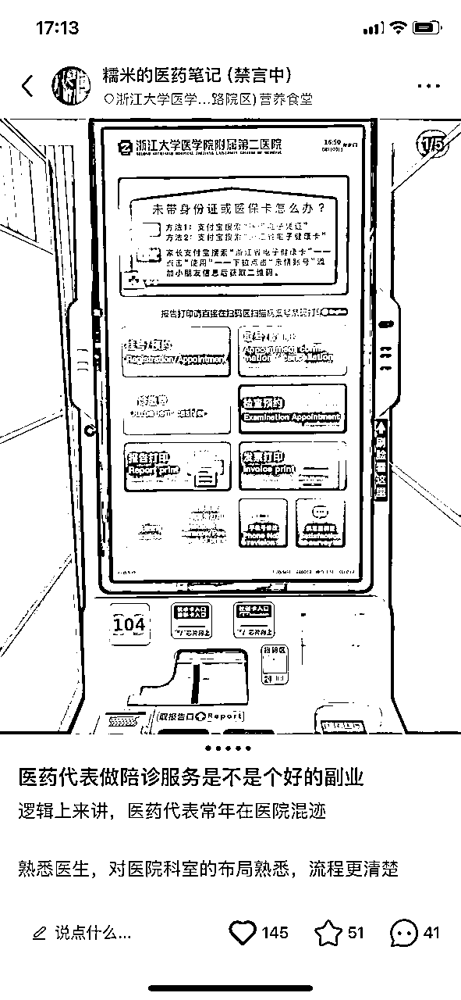

有了初步反馈后投入更大。8、9月一边上班一边做内容，但两个月基本都是B端咨询，没有真单。回看原因是内容偏向医药人思考，未落在C端需求。

意识到问题后调整方向，花两周改成面向患者表达。10月后开始接到咨询。

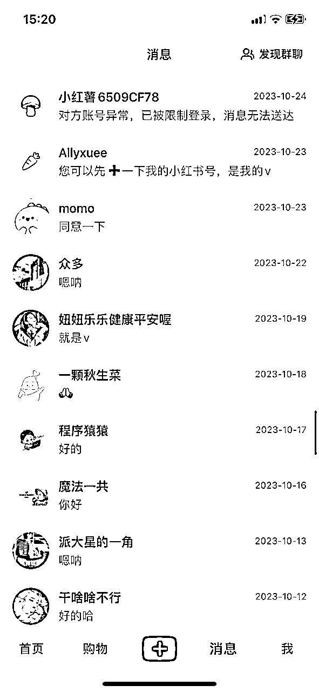

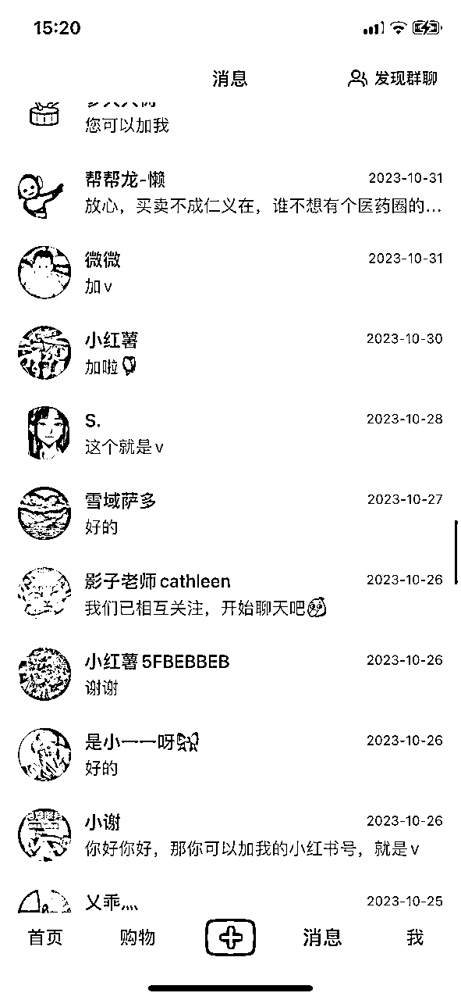

第一单是一个要做胃肠镜的小哥。为稳住自己，随意报了价。医院不熟也去了，最坏也就退钱白跑。结果客户很满意，首单完成，还拍了真实陪诊Vlog。

此前的笔记都是“演的”——找个人站旁边拍张照，假装在服务。其实并未接过单。

这张图看起来像是正在陪诊？其实只是过去坐了一分钟拍个照就走了。

只有先假装自己在做、正在服务，才能让潜在客户相信你能做，并真的接到订单。

## 3. 从一人服务到初步建立订单分单团队

方向对了后，11月订单集中，一人忙不过来，且时间冲突。

于是开始思考搭建陪诊师团队，把订单分出去，自己抽成。

医药代表身份在此阶段很占优：工作时间弹性，业务稳定后空闲多；专业性强，懂病懂药懂医院；绿通资源可靠；本身常在医院。

于是开始在同行群里分发订单，招募固定陪诊师，逐步建立接单规则、交付标准、产品分类、分佣机制、激励方案。

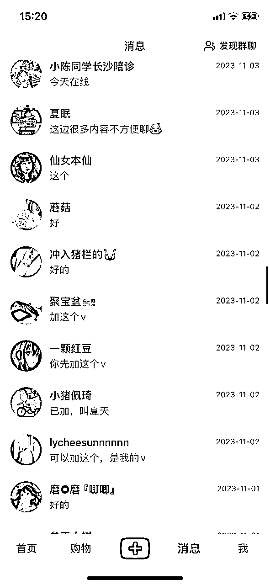

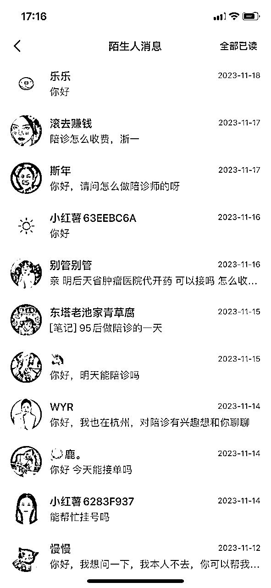

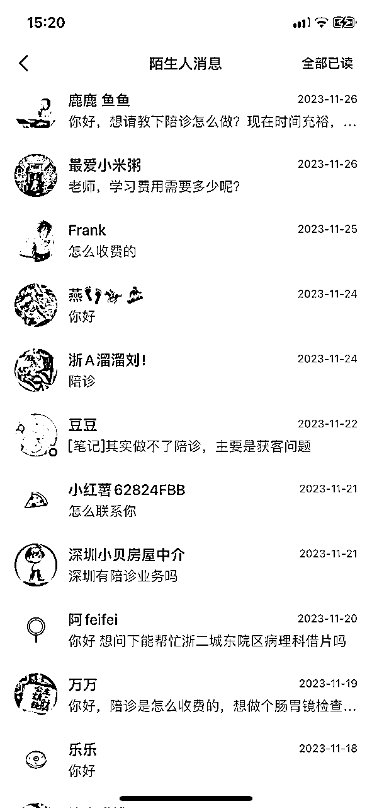

初期一个人兼顾自媒体运营、获客、产品设计、私域成交、陪诊师培训、规则制定，心力交瘁。体系起初像破渔网，处处漏，边跑边补。补着补着，业务链就完整了。

目前杭州有10个成熟陪诊师、60个初级陪诊师、1000个潜在可用人员。订单接收、分发、监管流程已成型，正在放大。

## 4. 流量卡点出现，顺带捡了个小合伙人

2023年12月，账号被平台监测到，私信永久封禁，接单量跌一个量级。厌倦了与平台打游击，开始寻求同行合作分流，做CPS。

那段时间每天私信二三十个同行，最后锁定一位长期合作者，也就是现任小合伙人。

她当时刚尝试副业，随手发笔记就爆了，糯米主动联系。线上犹豫，线下见面后达成共识，决定一起把杭州的陪诊公司做起来，甚至向外扩张。

前端能力还在成长，糯米没有停下：通过生财组局分享项目、参加线下聚会、一对一请教前辈，被Emily姐引荐见了亦仁大大，得到项目建议。

## 5. 公司化，轻资产运营陪诊项目

经过碰撞后，糯米做了几件事：注册公司和商标、开通美团店铺、继续找前端合伙人。

思路是：前端暂时打不开，就先把产品做到极致吊打同行，等前端通了再放大。

美团店铺成为重要背书，不再是微信转账，客户下单有保障，满意可评价。目前店铺评分已到5.0分。

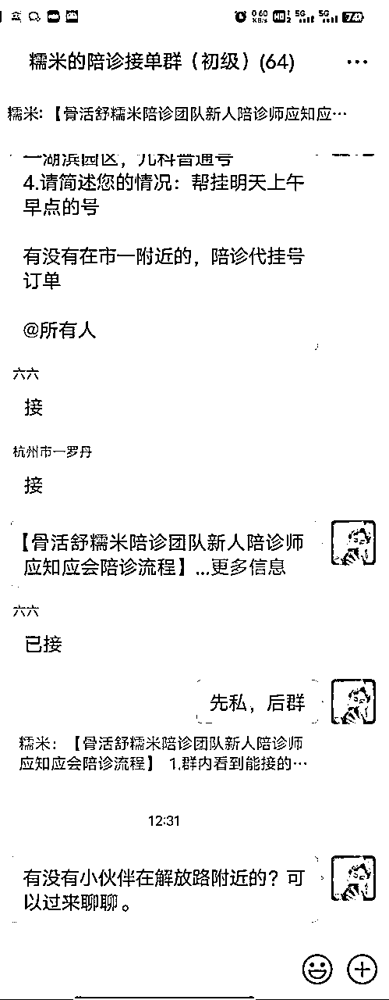

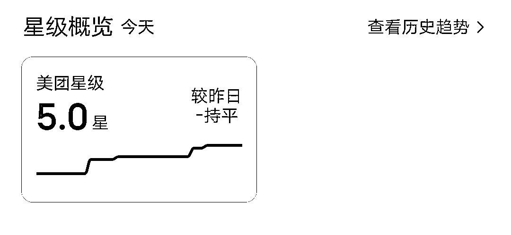

这个逻辑和刘杰哥的云家政类似：不需要实体店面，线上装修好，获客渠道打通，订单丢进陪诊师群即可。

糯米测算过，杭州20个随时待命的成熟陪诊师就够用。按薪酬加提成算，人均月入1.1-1.4万有吸引力。项目配置：操盘手月成本3.5万、流量负责人3.3万、私域销售运维3.1万、陪诊师团队22万、场地杂费2万。若月流水50万，月成本35万，年利润约180万。

# 三、实战心法

- 流量是最大门槛，也是最大杠杆。
- 自媒体是主线，但要规避红线，分散渠道。
- 没有订单时“假装在服务”是一种低成本启动法。
- 产品要迭代，边用边补。
- 人比钱重要，合适合伙人等于十个员工。
- 公司资质、商标、美团店铺等背书能显著提升信任。

# 四、行业现状与未来

当前陪诊赛道：大众认知低，付费习惯未形成；契合国家医疗服务趋势；合规边界模糊；平台态度不一；暂无绝对头部；市场体量未知但足够容纳先行者。

# 五、写在最后

糯米觉得一切像命中注定：没有裸辞、没有生财、没有入局时的推进因素，可能就错过了这个窗口。

怎么用好生财？关键词检索、主动链接、参加活动、提问。生财的价值是信息、连接和行动氛围，让在职的人也能启动第二事业。

不想只给别人打工，受气还赚不到钱，这是很多人的心声。糯米的答案是：上班的同时可以悄悄启动自己的事业。从一条笔记、一个订单、一次合作开始。

如果你也在找方向，希望这段经历能给你一点行动的勇气。最怕的不是慢，而是从未迈出第一步。

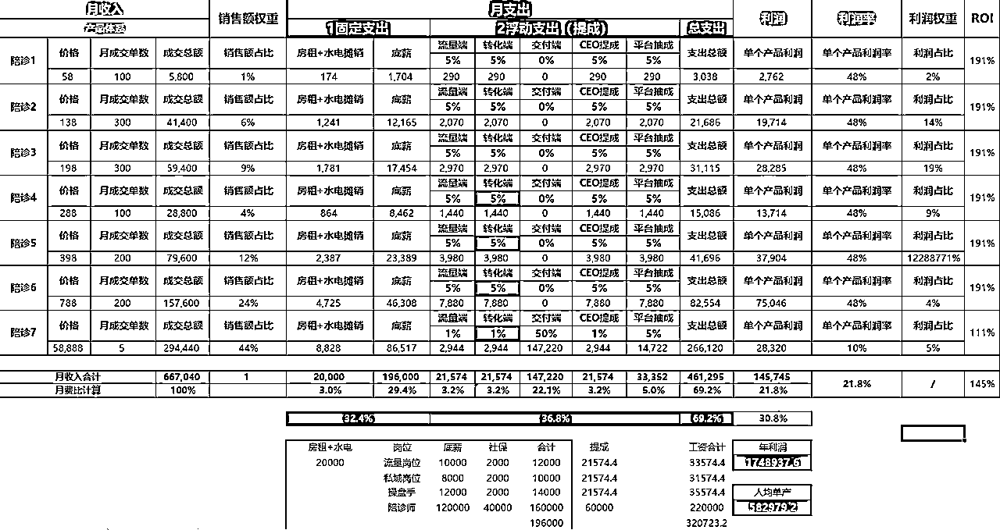

用公司化运作的逻辑来操盘陪诊业务，是我心里早就画好的一幅远景图。作为一个白天还得上班的普通人，我实在太期待那一天的到来了。

要想让蓝图落地，头一道坎就是订单量。我最初的构想是批量铺小红书账号，趁早圈住市场。可迟迟没有动手，是因为当时还没摸索出一套经得起平台封禁考验的打法，加上自己精力实在有限——主业得稳住，项目也得盯，心思基本都耗在订单分配和后方管控上。坦白讲，我的优势一直落在后端，但彼时的搭档在前端开拓上还欠点火候，于是这事就僵了一段时间。

那段时间，我把全部重心都沉到了后端：理顺老客户升单的路径，把高客单价的服务产品补全，靠这两招，业绩总算有了起色。

这个方向的转变，来自我和刺猬哥的一次深聊。他当时劈头问了我一句：

“你身上最值钱的那部分，到底是什么？”

我想了很久，最后看清了自己的底牌在后端。如果冲到前线和别人拼获客，那就是放着长板不用，非要拿短板硬碰。小红书上找人做陪诊，门槛低得很，谁都能干；但能像我这样，轻松调动医生资源和同行人脉的，真不多。跨行业想搭起信任的桥，硬来的话代价相当沉重。

反过来讲，把宝全押在前端解决流量，变数就太大了。眼下不少同行都困在获客这一关，我贸然冲进去死磕，就一定能解开这个死结吗？大概率不能。

走那条路的结果，无非是跟所有同行挤在同一条起跑线上，每天的工作就是躲在平台机制的眼皮底下反复试探，说不定睁眼醒来，一切又被打回零点。既攒不下什么家底，人还越干越郁闷。

所以那次和刺猬哥聊完，我果断调转了方向：让人操心的前端交给别人去做，交给真正擅长的人去做，只要利润能覆盖掉这笔开销，就完全划算。

那阵子我还专门写了一篇文章发在公众号上，统一转发给从各个矩阵账号那边找过来的朋友，把我的来意和合作构思一口气摊开讲明白。

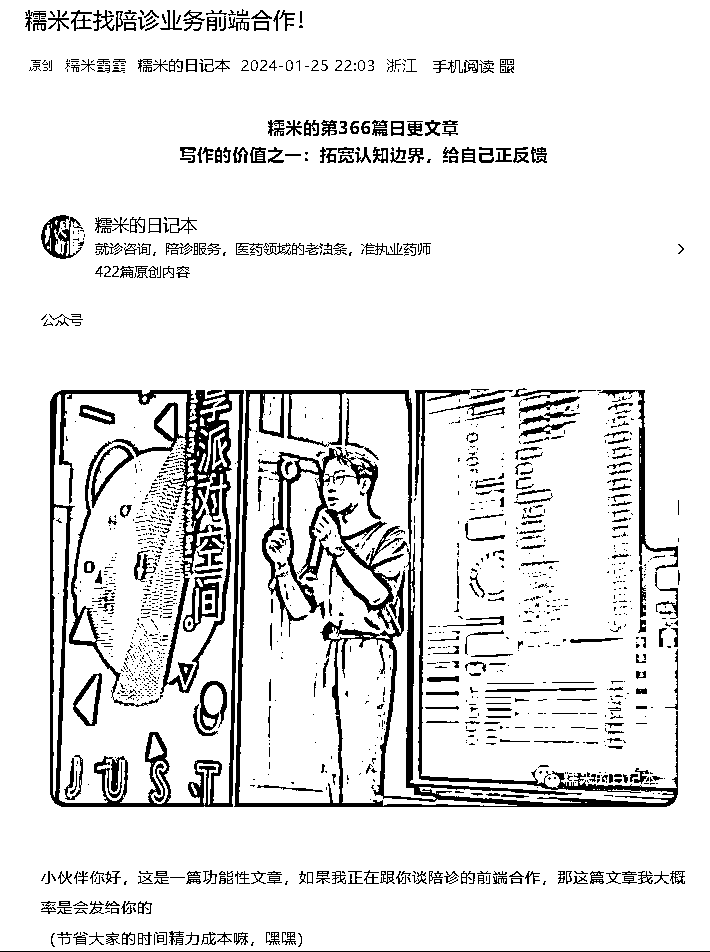

在这儿再次谢谢刺猬哥。

之后和小合伙人商量了一下分工：她继续管账号、做内容拉客，我这边出资金，让她去找一些素人小号铺KOC软文广告；与此同时，我也在持续寻找成熟的前端团队谈合作。

顺嘴夸一句，这类事在生财里解决起来太方便了！社区里扎堆玩矩阵账号的圈友一抓一大把，我后来正是借着这个平台，兜兜转转对接上了现在的前端合作人选。

## 6.最近

过完年回到杭州，我把后端又彻头彻尾优化了一遍，然后集中火力敲定前端合作。这些动作全是见缝插针完成的，前提是主业不能出任何岔子。好在平衡得还不错，第一季度在主业上的业绩也相当漂亮，陪诊这边更是越做越顺手。

大概是2月底，芷蓝姐牵线让我认识了文静姐，文静姐又把现在这位前端代运营伙伴推荐给了我。第一次沟通，我们把代运营的交付标准聊透，确认彼此预期对得上之后，我先买下了一期30天的代运营服务，主攻前端突围。当然，我心里还揣着更长远的念头：希望在合作过程中，多亮一亮自己的价值，也亮一亮这个行业的含金量，看看有没有缘分变成深度绑定的伙伴。

我不爱一见面就把未来吹得天花乱坠——什么“以后咱们怎么怎么样一起玩”，这种漂亮话我说不出口，先踏踏实实处一段再说。也许是对方看中了我这股说到做到的劲头，慢慢也对项目上了心。就在前两天，我们刚聊过以后的合作模式，前景值得期待。

眼下前端的从零到一已经走通，4月份的目标就是复制和放大。业务目前分两条线走：一条守着个人陪诊客户，一条面向网上想学陪诊的新人做培训教学——毕竟我们现在拿得出手的成绩，已经足够有说服力了。

# 三、分享一些实战心得和经验技巧

## 【心得篇】

### a.一边上班一边折腾项目，要有牺牲休息时间的觉悟，尤其是周末，还得习惯跟烂摊子待在一起

老话说，鱼和熊掌难以兼得。真想两头通吃，总得拿点什么去换。

一边上着班，一边在业余时间折腾项目，图的不就是万一项目黄了，工作还能兜底吗？既然有所求，就得付代价。

要想真把项目做起来，你的业余时间注定要大量让渡出去。项目能不能成，跟你下多大的决心、砸多少时间精力，有直接关系。

不妨算笔细账：一天工作8小时，睡觉8小时，兜里只剩8小时。吃饭、上厕所、收拾屋子，哪一样不要时间？掰着指头数数，真正能自由支配的还剩多少？要是再想刷刷剧、出去浪一浪，那项目干脆趁早别做。

所以，周末这两天的分量怎么强调都不为过。每个周末，都得逼着项目往前蹿一大截。别再用打工人的惯性思维，觉得假期就该出门找乐子；你应该想的是：太好了，终于能甩开膀子为自己大干一场了。

对上班族来说，上班本身就把大半精力和心气耗光了，下班后再去扑副业，没有一股狠劲真的撑不下来。投入的时间精力不够，项目只会在“赚点零花钱”的层次打转。

拿我自己举例，本职是医药代表，跑医院做产品推广，时间上确实比较自由。即便这样，我也是先把业务做出成绩后，才敢腾出手碰副业的。等两边都上了正轨，那段日子真是连轴转，忙得晕头转向。

当时单靠我个人的能量撑不住那么多事，项目的体量又没到能请人、能拉合伙人的地步，所有环节只能自己扛。主业副业两副担子压在肩上，累到近乎虚脱，可陪诊这边还有一堆窟窿等着补。

现在回头想，很多环节一拖就是好几个礼拜，就那么在原地烂着，我根本没空去收拾。心里免不了毛躁，总在嘀咕自己怎么天天跟烂摊子打交道。后来慢慢就习以为常，人也想通了——学会和烂摊子同吃同住。

烂着就烂着吧，又不会要命。等主业闲一点、手头宽裕一点，再回头清理也不迟。

心态一旦放平，哪怕烂摊子堆成山，哪怕每个摊子都像老牛拉车一样慢吞吞，只要项目还能往前挪，我就不再焦虑。

其实从做陪诊至今，甚至可以说打去年踏进杭州起，我就再没有过完全属于自己的时间。想想以前只上班的日子，那叫一个无牵无挂；如今呢，朋友圈隔一个多月都难得发一条。这点，愿与所有还在上班的伙伴共勉。

### b.上班族反应慢半拍，更要勤复盘，前期多向有结果的人“抄作业”，内容别拍脑袋

前面提过，我最开始发小红书笔记，发了三十来天，硬是没人来下单。直到我把自己的内容拎出来和同行做对比，才发现两边根本不是一回事。

我写的全是什么“陪诊适不适合做副业”“陪诊跟医药代表很配”这类分析，可同行呢？发的是再朴素不过的陪诊实拍视频。

难怪人家数据平平却一直有单接，我这边数据看着热闹，来的人却全是问怎么学习的。

最让我五味杂陈的是，这个问题我整整迟了一个多月才看出来。一个多月啊！

不过说实话，也不能全怪我。前面算了时间账，上班族每天能拨给副业的时间精力就那么一丁点，等你反应过来，往往已经耗掉一两周了。

所以起步阶段，千万别拍着脑袋凭感觉搞内容。最快的路径就是照着那些已经做出结果的人“抄作业”，或者直接花钱报班学，能少走多少弯路啊！

### c.别背着问题上路，遇到了再想辙

这条心得算是老生常谈，可还是有不少人习惯在开工前给自己预设一卡车困难，硬生生把念头打消了。

我的原则很简单：先把事干起来，真撞上问题再说。这才是在对付真实冒出来的麻烦，舒服得很；至于那些压根没影儿的假设，一律先当它不存在。

刚开始跑陪诊那阵，流量一下冲起来，我脑海里闪过一个荒唐的念头：接单的时候领导要是刚好来医院撞见我怎么办？两摊子事都甩不开又怎么收场？

可事实是，做到今天，领导一次都没来医院找过我。

### d.项目的第一负责人，得拿出主人的姿态

记得裸辞那一年，我在广州折腾某个创业项目。那时候商业头脑不行，自媒体经验也薄，每天活得又忙又盲，特别想攀上一条大腿，最好能天天告诉我今天该干嘛、明天该干嘛。

等到真觉得自己抱上了大腿，我才发现根本不是那么回事——所谓大腿压根不会替你操心项目。这也难怪，人家跟你的项目有什么关系？有利益往来吗？并没有。

从那一刻起，我的主人翁意识才算真正醒过来。我是这个项目的头号负责人，我得为自己负责。遇到卡点，该想办法的是我；往前推进，该出手的也必须是我。我躺平一天，这一天就白白作废，一分钱进账没有，后果自己兜着。

项目是你自己的，就别指望结交一个能人，他会替你扫清障碍、带你突破。假如真有这么个人出现，你非但不该庆幸，反而要警惕：自己会不会有朝一日被一点点边缘化，最后被请出局？

正因为把自己当成陪诊业务的掌舵人，我做了太多琐碎事：给陪诊师裁培训模板，在团队中间来回协调，推动大家共创一些疾病资料和具体医院的陪诊手册，张罗绿通资源的对接，还要兜底那些没法按时交付的售后问题。

掌舵的人还必须敢拍板。谁做决定？只能是你，因为最后担责的也是你。我干陪诊这么久，接过不少一早就预计可能交付不上的单子，但我全都咬牙接了下来。

先把单子接住再说，最差的结果无非是退钱；可一旦接下来，可能就是业务版图的新增量，是挖到的新需求！我从来不会转头问陪诊师、问合伙人：“这单咱到底接不接？”

### e.事事都做成模板和SOP

凡是同一件事要反复交代、同一份东西要反复拿出来的，麻利点把它沉淀成模板，效率往上翻十倍都是少的。

【跑腿类】

🚴🏻♂代取报告，代挂号一次性50

（如果需要多次完成，或者是耗时很长，价格另谈）

【代开检查，代开药寄送专用】

🛼2小时为一档，120

（超时15分钟内不加收费，超时15－30分钟150，超时30－60分钟200）

【陪诊服务】

每小时60元，3小时起

（超时15分钟内不加收费用，超时15－30分钟加收30，超时30－60分钟按1小时算）

（💪同时糯米团队提供就诊分析规划，资料整理，家人式服务，诊间提醒和记录，就诊后叮嘱，送离）

【代问诊】

🏏线上规划，分析，整理需求，出规划书，100

🏸线下问诊按照【陪诊服务】收费

【号源，医疗资源绿通】

✅具体收费详谈

㊙简单的问题咨询免费

🧧复杂问题咨询发小红包即可

💰确定需要服务需要先交定金

🇨🇳糯米承诺：没有提供服务就不会乱收费；服务的不好，可协商补偿；做最用心的，最靠谱的陪诊团队🤟

（这是冷启动阶段的第一版报价单，但凡有人来询价，直接丢过去就行。）

所以，我的私域成交话术、陪诊师的交付流程、合作规矩、引流沟通脚本，全部模板化了。尤其是团队里那些不太会主动的人，凡是得你反复催着讲的内容，更要早早固化成SOP。

前端的内容生产流程同样做了SOP。这些东西最大的价值，是把你的决策负担压到最低，犹豫少了，焦虑也就淡了。照着清单一步步走，慢慢变成条件反射，操作起来就不觉得累了。

谁都知道工业革命厉害、内燃机改变了整个时代的生产方式，但这些只是书本上的概念。现实里的多数人，根本意识不到把手头工作流程改良一下，才是最立竿见影的生产力解放。

不信你去问问学校里的老师。学校组织学新的教学工具时，相当一部分人先是烦躁、觉得又是负担，压根想不到——学会这东西，自己上课反而更省力，学生也更好懂。

### f.专业的事，交给专业的人，该花钱就花钱

公司注册、美团店铺装修、每月报税，这些我一律交给了代办。

并不是说注册公司难如登天，也不是PS学不会、报税啃不动，而是以门外汉的身份从零起步，要搭进去的时间精力实在太吓人。等你好不容易把这一圈都学完，项目恐怕早就凉透了，人也累得不想干了。还在上班的朋友，听见没？该掏钱的时候别犹豫。

## 【实操篇】

### 1.获客环节

#### a.自媒体平台获客

先把阵地列出来：

抖音、小红书、视频号、快手、B站。

这是我起步时同步运营的五个平台，剪好一条内容，全平台铺开，一鱼多吃。

一圈跑下来，小红书的效果最冒尖，其次是抖音。视频号那边明文规定陪诊内容受限；B站和快手相对宽松，可宽松换来的结果就是有效客户寥寥无几。这背后是平台自身的气质和主要消费人群决定的——你总不会想到去B站搜陪诊吧？对吧。

接下来，就拿小红书当例子，拆一拆自媒体获客的门道。

##### 1.先把号养起来

先分享一个心得。早几年我初碰互联网自媒体时，觉得“养号”这说法神神叨叨的：你只要勤勤恳恳做内容、做有价值的东西，至于养什么号吗？

哪怕后来被训练营按着头，跟着大部队一起养号，我也是耐不住性子，养着养着就摆烂，因为实在太枯燥，刷着刷着就被别的内容带了节奏。

要么就是掐着秒表机械地点赞、写评论，熬完整套仪式，真的无聊透顶——毕竟刷的全是业务相关，我压根提不起刷的兴趣。

有这种想法很正常，我也先不劝你“听话照做”，就拿我这个不听话的孩子当案例。

不好好养号，结果真的未必就差。有些人一步没养，发出来的内容流量照样不错。

可常在河边走，哪能一直不湿鞋？等你多碰几回壁，摸清了养号里真正要紧的动作，自然就找到了自己的侧重点，根本不用全套照做。就像老师傅修电脑，从来不会把机子全拆了排查，见多了心里有数，只挑关键处下手。

但如果你还没到师傅的段位，又不想多走弯路，那就老老实实把养号做到位：一台设备配一张卡、只登一个号，用移动流量别连公共WiFi，手机恢复出厂设置，App删干净重新装，所有流程一项不落。

硬件方面说完了，再讲软件层面的实操：

1.每天留出10-20分钟，挑高赞笔记或者最新发布的笔记，互动15条上下就行。
2.刷什么呢？和陪诊搭边的都行，直接搜“陪诊”这个关键词。不用刻意锁定你所在的城市，天南海北随便看，刷到对味的就点赞、收藏、留个言。
3.留言说什么？随你发挥，感叹工作辛苦、感慨看病艰难都好，但关键词务必带上“陪诊”。
4.同行不要关注。不过在陪诊笔记的评论区，经常能碰上有真实需求的人，这种潜在客户倒是值得关注一下。小红书的算法有点意思：你被别人关注后，哪怕没有回关，也更容易刷到对方的笔记，算是种社交推荐机制。
5.这套动作维持1-3天，就够了。

##### 2.然后就是账号搭建

各平台的账号装修大差不差：头像、简介、背景图、引流钩子，这些弄齐，基础的架子就立住了。

具体的细节，一个一个拆开说。

###### 1.头像

头像首要考量的，是有没有亲和力。

把自己放进客户的鞋里想：什么样的账号让你更愿意掏钱下单？是不是面目和善、真人出镜的，第一眼就更容易被选中？毕竟真人露脸，天然就多一分真实感。

实战数据给我的结论是——人设上的排序大致如此：颜值高的女生接单最吃香，和颜值高的男生持平；其次是长相普通的女性和男性；最末的是毫无记忆点的从业者。

说白了，女性干这一行本来就更容易接到单，长得好看又是一层buff。

当然，这些都是细节功夫，能影响成交，但决定不了胜负手。真正的关键还是两点：你的笔记能不能传得开、能不能扎进目标人群心里；你的主页历史内容，能不能透出专业度和那股子服务诚意。这些咱们后面说。

###### 2.简介

简介要把“我是做陪诊的”这个功能属性写清楚。同时得留心避雷，医院、药品这类敏感字眼，不妨用emoji顶上。

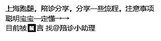

现在不少平台都允许在简介里艾特小号，大家也可以把这个功能利用起来。

###### 3.背景图

刚起步那会儿，我会花心思P一张背景图，要么放上目标医院的图景，要么写明可以陪诊，要么直接甩联系方式。可现在我的建议变了：把引流和内容拆成两个号，引流的号专门用来蹚雷试险，做内容的号干干净净，别瞎折腾。

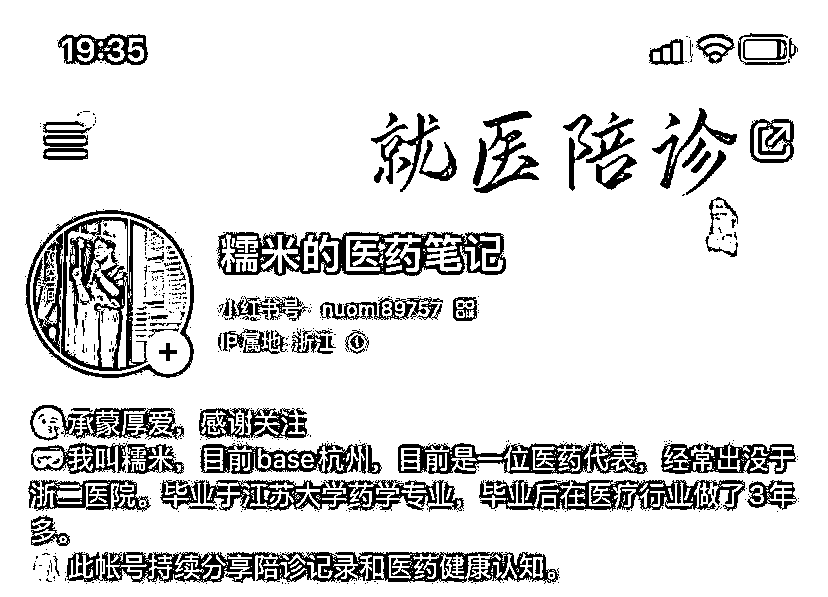

###### 4.安全引流钩子

说到安全的引流方式，前面提过，建议准备一个敢死队式的小号，引流失败就销号重来。不过小号也别白白浪费，分享几个我们一直沿用的办法。

<h7>a.联系方式藏在头像里</h7>

这招是我哥们传给我的，用到今天一次都没出过事，而且是直接用大号引流。他的昵称上写着“头像里有v”，这个号不太方便公开晒出来。

<h7>b.主页只放一篇引流笔记</h7>

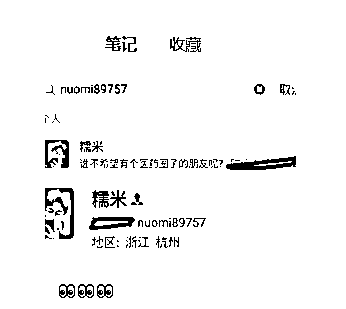

第一张图是我自己的引流小号，只放了这么孤零零一篇笔记。做法很简单：在微信搜索框输入自己的微信号，把搜索出来的页面截个图，像我这样用涂鸦把敏感信息抹掉即可。

不需要配任何文案和标题，只要能正常发布出去就行。等需要引流时，让客户点进主页看那篇独一无二的笔记，就能找到我。

第二张是某个同行的引流套路，逻辑一模一样，就不啰嗦了。

<h7>c.靠收藏夹导流</h7>

这招会把大号牵扯进来，虽说风险不高，但它依然是个隐患，不建议大家采用。

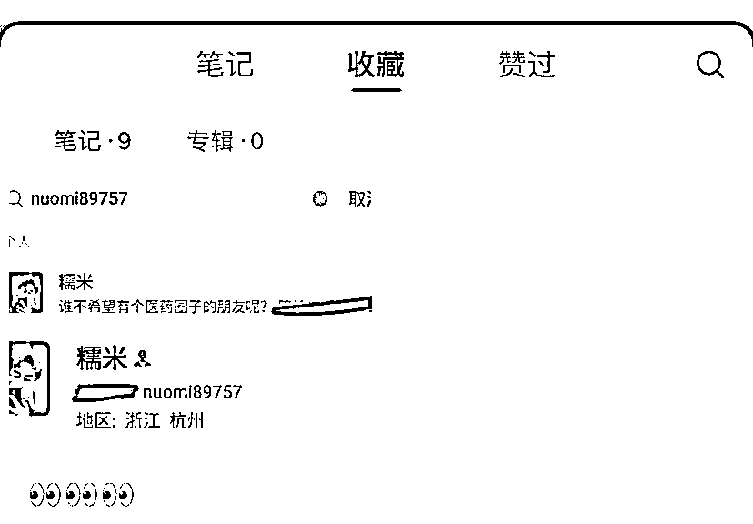

<h7>d.粉丝群里的暗度陈仓</h7>

让引流小号混进大号的粉丝群里捞人，这是到现在为止最稳当的玩法，从没踩过雷。

##### 3.账号升级术：先剪5支陪诊vlog

先剪出5支质感稍好的vlog，每一帧都要能体现你的专业和用心，这是给账号上“真实性”保险。

这5支视频不必在意数据，挂上去就行。当初我就是这么要求付费学员的：先产5支，就算没有真实订单，也要摆出正在陪诊的姿态。这行的规律往往就是这样——你先看起来“有单可接”，真订单才会找上门。后来我带的三个学员里，有两位顺利走通了从零到一。

前期没有订单可做，正好把工夫下在账号沉淀上。这类内容确实偏重，剪辑要花不少心思，可一旦做出来，就是碾压同行的存在。这一点，我是实打实做过客户调研的。

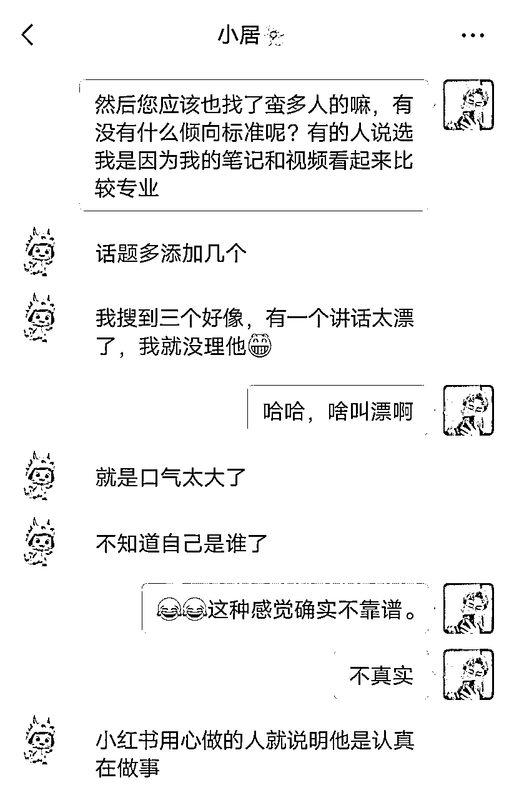

有了这5支短片，起码客人点进主页，会觉得这人是靠谱的：确实经常在他想去的那家医院进出，确实在认认真真做着陪诊这门生意。信任一建立，成交就有了底气。

账号根基打好之后，下一步就是不停地给自己制造曝光，做点有流量潜力的内容，把目标人群引进主页，再一步步完成转化。当然，内容创作务必守好平台的红线。

##### 4.如何在小红书持续获客

持续获客=持续更新内容+日常维护动作。

内容持续发，但不必较劲追求爆款。陪诊这个行业的特殊性摆在这里，常常是动静搞得越大，死得反而越快。

持续更新的过程中，还得注意SEO的铺设。散客几乎都是靠搜索流量来的，脑子里先有了明确的陪诊需求，才会跑来搜索。

内容要持续发，可发什么不能拍脑袋，得先找优质对标+参考近期被市场验证过的好内容。那要怎么找优质的陪诊对标呢？

###### 1.如何在小红书上找优质对标

1.小红书里搜关键词。

“陪诊”“杭州陪诊”“无痛胃镜陪诊”，随便你，代入客户的搜索习惯去搜就行。一般客户有需求时，会搜他的城市名加陪诊，比如“杭州陪诊”，或者直接搜医院名，“浙二陪诊”这种。

2.搜完词，在结果列表里挑那些已经有一定数据基础的笔记。

陪诊领域的内容，数据真不用太好看，7到50就已经顶用了——这个行业的笔记很难炸圈。当然，这不妨碍你多看一些千赞账号的作者是怎么做的。

3.锁定几篇顺眼的笔记，先瞄一眼它的发布时间。

做陪诊业务，很多新手卡在不会系统操作。其实整条链路拆开，就是找参考、做内容、拓渠道、引流量、促成交、做交付。每个环节都有窍门，也都有坑。这篇把实战经验全部分享出来，希望能帮你少走弯路。

## 一、先找对学习对象

刚开始别急着写笔记，先找到几个“作业模板”。我的挑选逻辑是这样的。

第一，看整体数据稳不稳。偶尔一条爆款不能说明问题，大部分笔记都能跑出正常流量，才代表内容有套路。

第二，看内容是不是最近发的。时间隔得越久，参考价值越低。优先翻那些新近发布的内容，才有借鉴意义。

第三，看主页的整体气质。头像、昵称、背景、简介放在一起，能看出运营者的审美和思路。如果页面乱糟糟的，说明对方并不讲究。

第四，看数据是一时风光还是细水长流。只有一条爆款，其他都很平淡，多半是运气好。真正有水平的号，内容生产是稳定的。

第五，看发布节奏。如果发帖稳定、数据也稳定，说明对方在获客上很有章法。如果数据差又更新慢，说明不够用心，但偶尔出现一两个还不错的笔记，也可以抄下来参考。

第六，翻留言区。一个作品下面，真实客户的咨询、同行的评论、莫名的引流动作，都能看出这个内容到底有没有水分。

第七，看有没有科学的引流方法。会引导流量的人，脑子清楚、行动力强，这才是值得长期观察的高手。

总之，只拿流量正常的号做参照，去模仿同行近期被验证过有流量的内容，不一定要爆款，但要有真实数据支撑。

## 二、内容制作和日常维护

先说内容上的几个要点。

首图要干净、主题要明确。一张简单的图，配一行直白的标题，比堆砌花哨元素更有效。

这种风格哪怕有点土，至少用户一眼就能看懂，转化反而好。

内容要多讲故事，少打硬广。把你的服务细节放进故事里，顺便埋入SEO关键词，让用户带着情绪被你吸引。

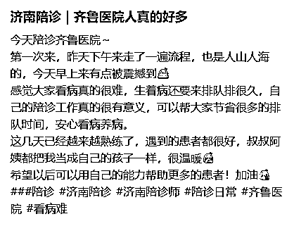

大概是这个意思，参考即可。

笔记配图数量没有固定标准，能把故事讲完整就行。

做陪诊内容，敏感词要格外小心。微信聊天截图容易触发审核，截图范围要控制，转账记录要打码，截图里出现人脸也不行。

文案最好有话题性。婆媳矛盾、欠债不还这类人性话题，天然容易引发讨论。

日常运营方面，发布时间可以选早、中、晚任意时段，一天别超过三条。11点左右和19点左右比较合适，其实一天一更就够，关键是要坚持日更。新号发完不要急着人工干预，也不要到处转发。粉丝群里发引流表情包是安全的，具体做法自己研究一下。笔记关联群招募之后，可以在留言区引导大家进群。留言区要主动引导下单，也可以抛出话题让大家聊起来，增加互动权重。不用怕群里混进各种人，先把人分流好——进群先发引流表情包，再发分流文案，平时不让群成员闲聊。账号里也要穿插和陪诊相关的生活内容，比如陪诊师的一顿午饭，能让账号更有人味。

## 三、闲鱼和美团怎么用

闲鱼我尝试过一次，有人问价但没成交。这个平台价格太卷，所以没有重点经营。心得是：直接复制同行的接单模板，首图和第一句话要击中关键词；经常擦亮商品，用闲鱼币买曝光，参加抵扣活动；多上几个链接，覆盖不同区域，做到全城都有你的入口。排名机制我不确定，推测跟定位和芝麻信用有关，但发出去就有曝光，这是底层逻辑。

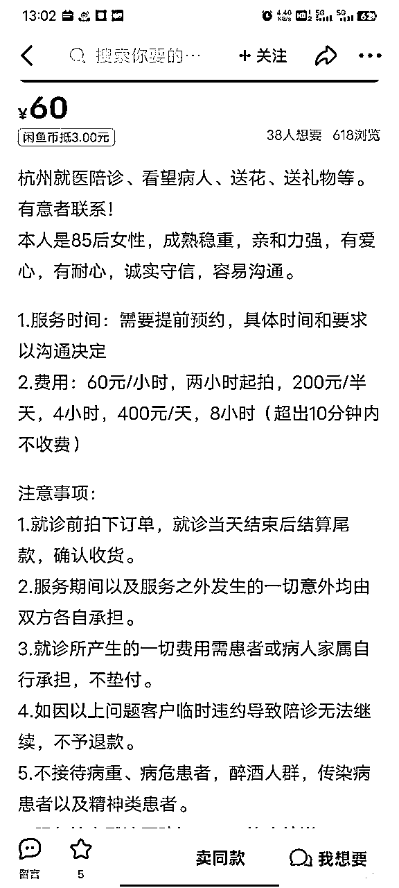
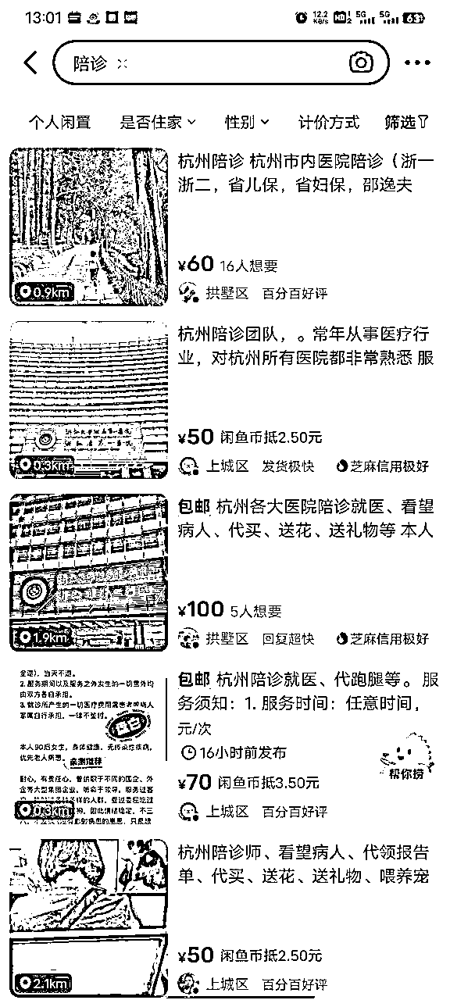
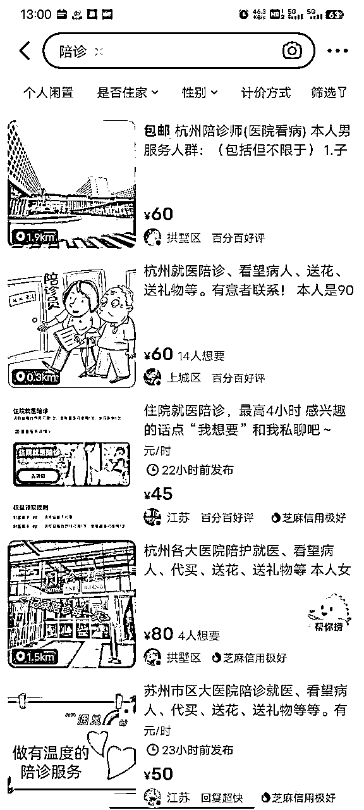

美团是后来受启发开始做的。当时在短视频平台遇到瓶颈，刷到一些相关帖子，去美团搜了一下，发现真有陪诊服务，而且已经有人在复制品牌了。

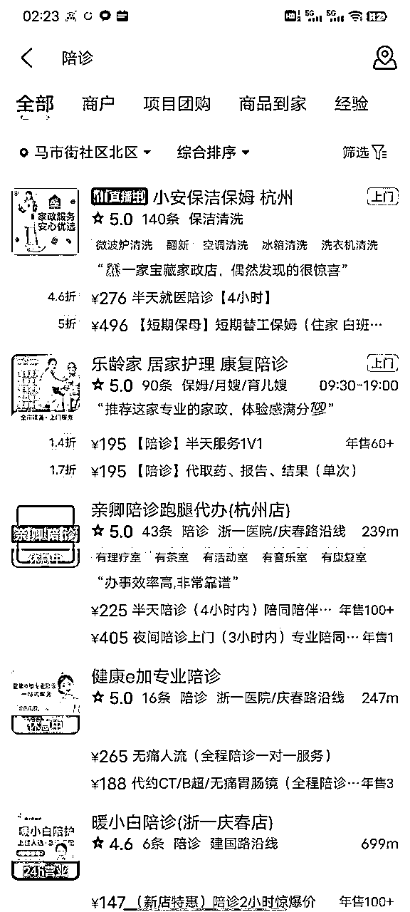
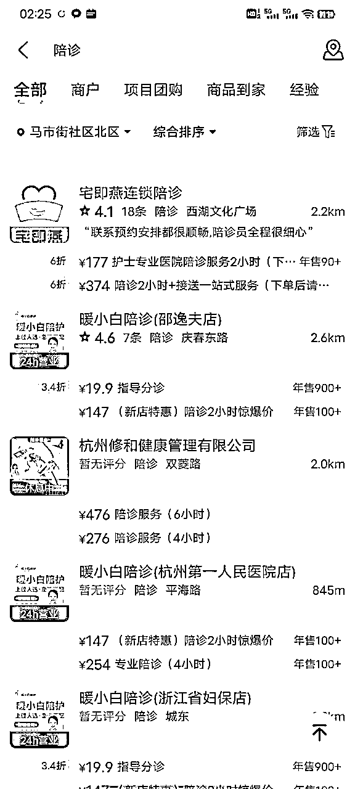
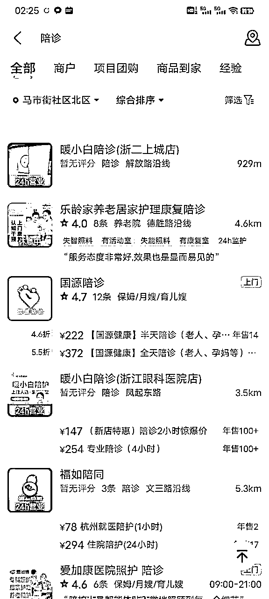

从表面数据看，美团能带来一部分客源，但水分多少不好说。和官方人员聊过，他们不公开数据，言谈间透露出美团陪诊消费量还没起来。我试着调研杭州市场，发现很多机构自己都没数。粗估杭州整个陪诊市场流水可能不到千万。

不过美团依然值得入驻。开店流程很简单，只要你想开，平台BD会主动帮你搞定入驻，因为商家入驻对平台有好处。加上BD后，要准备什么资质，对方都会说清楚。

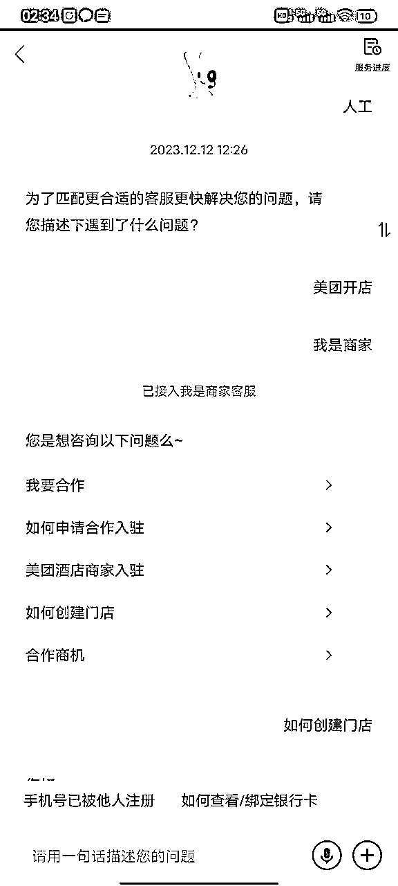
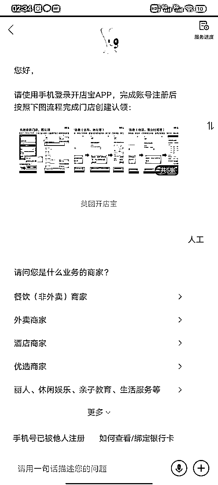
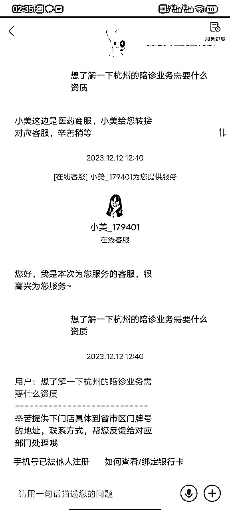
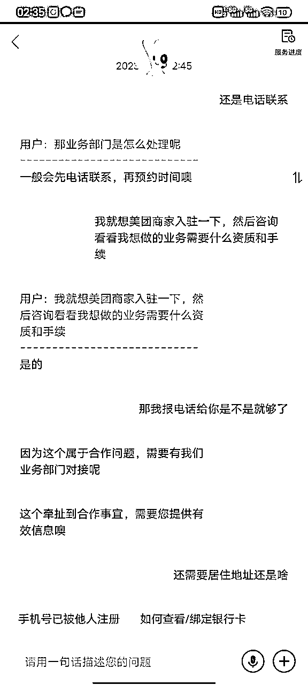
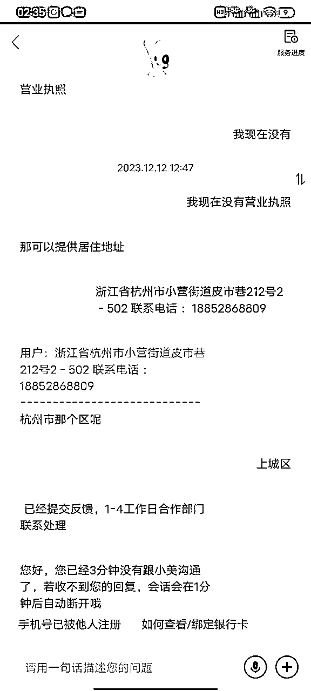

但有个前提：美团陪诊需要公司资质，个体户不行。我没有公司，就找代办处理。按平台要求选好公司类型、经营范围和名称，BD还会发同行的资料给你参考。代办费2000元，包含商用地址、对公账户和13个月代报税。在淘宝上搜索相关代办服务就能找到。公司注册好后，再找人P一张门头照片，BD需要用它来核实门店真实性。

这里要特别注意：P的门头名称必须和美团店名对应。比如门头写的是ABCDEFG，店名只能在ABCDEFG里选一部分，比如ABCD或EFG，不能出现门头上没有的字。

接下来跟着BD指引提交资料、下载开店宝App、交年费。我当时年费是1800元，平台抽成3%，2024年3月涨到5%。除了BD，还会有运营和推广通销售对接你，建议多和运营沟通，另外两位前期用处不大。

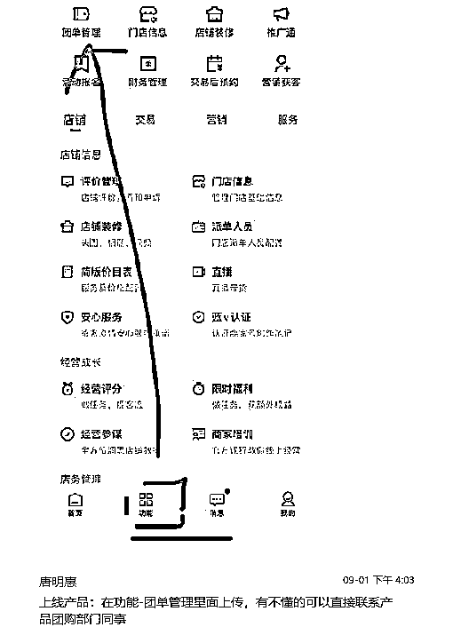
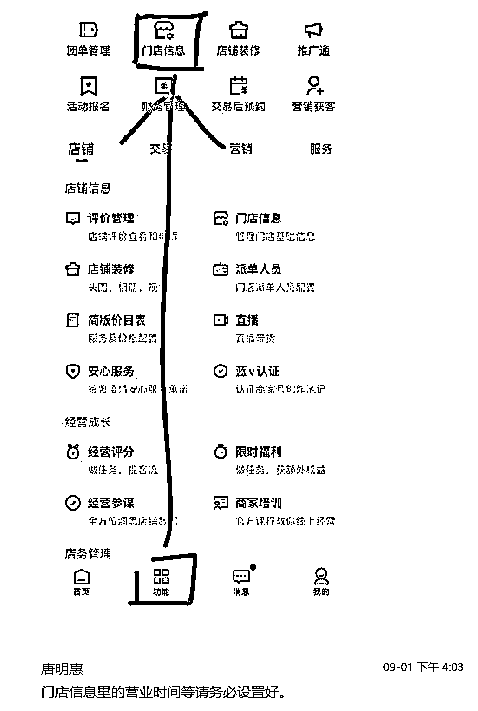
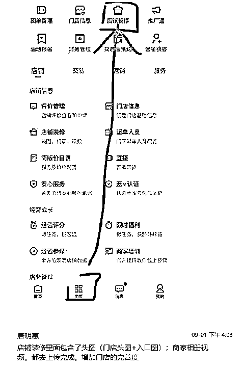
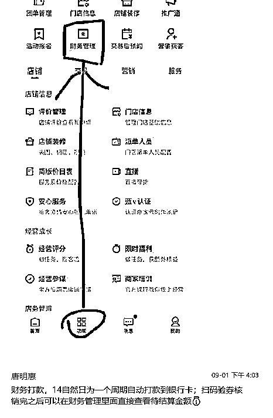
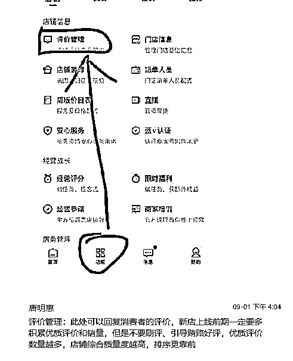
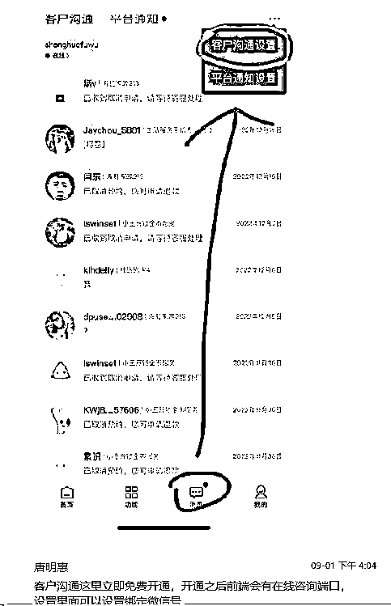
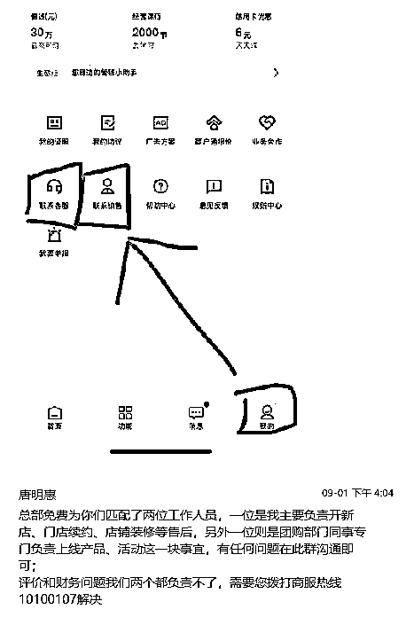
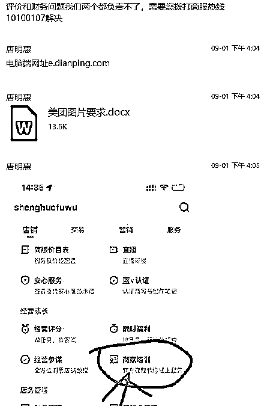
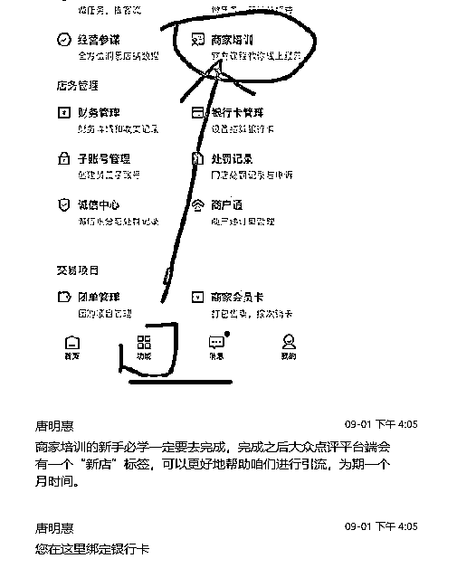
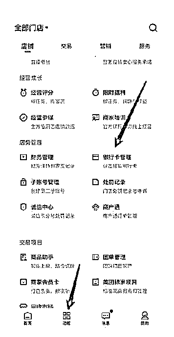

美团平台对上传图片有格式要求。

店铺装修我也让代办直接复制了同行的套图。具体过程之前在生财发过帖子，想看的可以去翻翻，记得点个赞，哈哈。

https://articles.zsxq.com/id_9vfx1oaes6h5.html

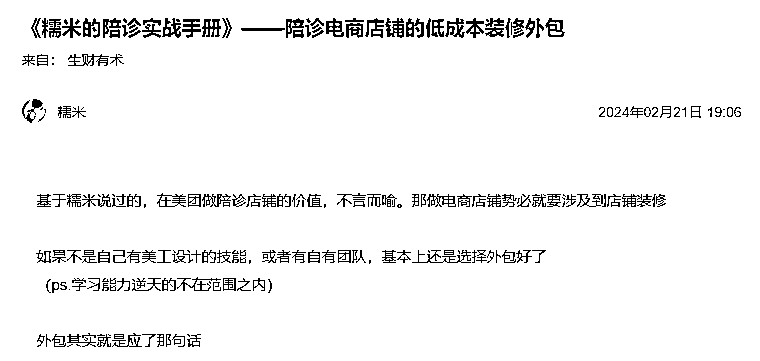

目前没有针对陪诊类目的运营教程，实操问题直接问对接的运营就行。另外开店宝后台有经营参谋功能，在网页端e.dianping.com可以看到，能跟同城同行对比团单数量、好评数量等指标。

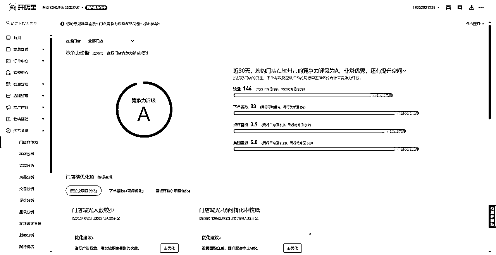

这个工具挺好用，但美团目前消费量还不够大，不建议投入过多精力。把它当做一个自动接单和背书的工具就好。

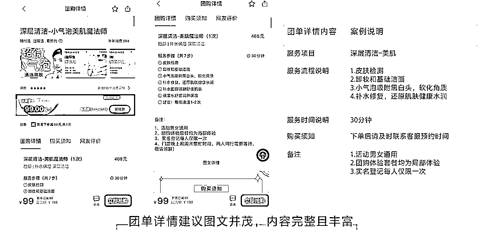

上团单的时候，不要追求完美。服务项目、流程、时间、购买须知等，使用一套模板就能搞定，先上架，再逐步完善。唯一要用心的是团单名称，取名足够细分，用户搜索时就能直接找到你。

## 四、注册公司的小科普

我第一次注册公司，虽然找了代办，依然完全没有头绪。给没经验的朋友提个醒：注册公司必须有商用地址，住宅地址不行。如果地址不是自己租的实体店，要问清楚代办能不能开发票、能开多少额度。因为这涉及地址所有人的税务成本，代办未必会主动说。公司成立后每个月要报税。我没有实体店铺，对公账户办不下来，就干脆让代办一并处理。银行开对公账户会派人来实地拍照，代办服务里包含这一项，按商家指示做就行。

## 五、引流的核心思路

引流最终是为了成交，所以要围绕两点做文章。

第一，不断增加对方的沉没成本。客户加了你的微信，说明已经投入了时间和耐心。如果这时转身找别家，又要重新沟通一遍，太麻烦，所以更愿意留在你这里。第二，这次没买，还有下次；这次买了，下次还来找你。私域的意义就是反复触达、建立信任、促成复购。

具体技巧：

一，留言区要铺好下单路径。用小号问“怎么下单”，主号回一句“厚台踢踢我”，给旁边的人做个示范。

二，主动私信要讲究方式。一条消息的机会，对方回复后才能继续聊。所以首条信息要准备一份万能模板，把自己的服务范围、常见问题都讲清楚，不要只发“你好”两个字。用户耐心有限，不明白你能做什么，很快就会流失。最可惜的是你明明帮得上忙，对方却不知道。

三，引流动作越简单越好。我通常直接发加V表情包，愿意加的，说明真有需求。一上来就问价格、不给价就不加的人，多半只在意经济性，不看重你的服务和情绪价值。他找谁都行，谁便宜找谁。我们不做低价内卷，做的是高溢价的海底捞式服务。

四，尽量让对方多说、多做。到达微信后，我发一份简单的问卷，让客户填写意向医院、科室、医生、时间、陪诊师性别偏好等。他愿意完整填完，说明需求真实且迫切。那些一上来就东问西问、不按流程走的人，反而不容易成交。

五，遇到同行不要敌视。同城同行加过来，忙不过来时还可能分单给你；你做得够好，还能卖课给对方。同行拿不走你的东西，真能学到手的，那是人才，你也挡不住。

六，所有能留人的入口都要用。很多客户不私信，只在留言区留一句咨询就离开，所以一定要把群聊入口关联到笔记里。

七，流失的主要原因就是响应太慢。等你去回复，人家已经找到人，或者不想找了。前期只能辛苦盯着消息，条件允许就配个客服。

## 六、转化环节的门道

私域转化离不开聊天和朋友圈。聊天用模板化的话术，能提高效率；朋友圈持续展示现场，让人看到你每天都在医院里跑，信任感会越来越强。

陪诊的聊天比较特别。一方面要像医生一样权威，让客户觉得你能搞定问题；另一方面要照顾患者情绪，体现出服务感。一个反直觉的办法是：客户要求你百分百保证结果时，坚定地拒绝，反而比勉强答应更容易成交。

遇到的客户大概有三种。第一种是刚需急用型，只要价格接受，转化率高，我曾经做到50%到70%。第二种是年轻人，他们习惯用App，容易接受新事物，是目前付费主力，但喜欢反复比价，因为行业价格标准还没固定。第三种是试探型，只是想了解一下，聊天中如果没解决他的顾虑，一句“不需要了”就跑了。解决方案是：对价格敏感型客户，要在人设和内容上树立“贵但值”的气质，直接筛选掉不合适的。对试探型客户，要从朋友圈、话术、成交技巧上下功夫。多说一句，多拿自己和同行比较，只要你在专业度、态度、背书和造势上超过对方，赢面就大了。

## 七、交付：从慌张到熟练

很多人没接触过陪诊，最担心的就是交付环节。“到了医院不知道干什么”，我最初也一样。其实做得多了，自然会有章法。每一次的新需求，都是在升级你的服务能力。

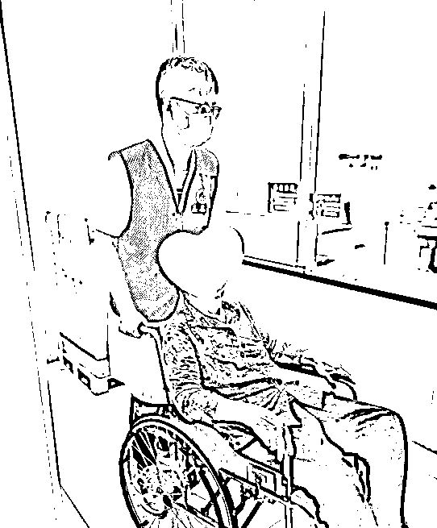
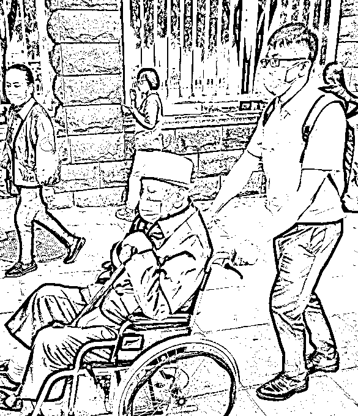

常见的陪诊需求有这些：无痛胃肠镜、人流等需要麻醉的小手术；代取报告、代挂号、代开检查、代开药；代问诊；陪同腿脚不便或骨折的人；陪同子女不在身边的老人；陪同跨省就医、不熟悉医院环境的家庭；陪同做眼部手术；需要绿通、专家号、VIP病房、大主任亲自手术的资源型需求。

无论是哪一种，交付流程都差不多。第一步，接单后沟通好服务时间、地点和具体内容。第二步，服务前一天再次确认，避免临时变故，同时提醒客户做好配合。第三步，服务当天提前通报行程，到达后实时记录和反馈。第四步，结束后整理汇总，发给客户，确认有无额外费用，结清款项。

不同需求的细节增补：麻醉类手术可能需要送客户回家；代开药要提前确认开药记录和首次处方单，否则白跑一趟；腿脚不便的人要用轮椅，得知道医院哪里能借，一般免费；子女不在身边的老人，要先想清楚解决的是子女的焦虑，还是老人自己的需求；绿通和专家资源，考验的是人脉和资源整合能力。

如果你是从业者，掌握这些就够了。如果你是管理者，还要懂得搭制度、建架构、管理人力和设计产品。我自己的做法是，联系医药代表的组织，征得群主同意，在群里发布订单召集人员，然后说明合作规则。合作要求就是：录制三段30秒的视频，内容包括见面、陪诊过程、取报告或取药、送离医院，不用露脸，拍脚部视角就行；费用按50%比例结算分佣。

陪诊这门生意，每个环节都要从头摸一遍，但只要肯下笨功夫，把每块基本功都练扎实，路就会越走越宽。

当前阶段，针对非正式合作伙伴，我在试运行几条规定：如果顾客对交付不满意，可能退还一部分佣金作为安抚；但只要事先把用户心情照料好，这类补偿基本用不上。临时放鸽子的，直接拉进黑名单，终止合作并在朋友圈公示。任何人不许私加顾客联系方式，就算顾客主动请求也不行，确认后当即解除合作。

眼下基础比例是五五开，这条线还有上调余地，想谈可以找糯米。不要认为佣金收得多，拉流量、谈成订单、前期客诉处理，每一样都在烧钱烧精力。制度会动态优化，目标是参与各方都能赚到钱。

这套方案你看是否可以？另外给一份沟通话术参考：先建立自己的接单群，在接单响应速度和接单意愿上多下功夫，有节奏地拉新群，把优质人员筛出来，再做激励设计。比如从50%调到60%的升佣条件，是能独立完成陪诊全流程、不需要人盯。

糯米早期找合作者也遇过麻烦：说好的分成，等客户被送过去后临时抬价；有人绕过中间方私下加顾客。但制度一旦落地，就要强执行，这条底线不让。

被问得最多的“飞单”，即顾客越过你直接联系执行者。我的态度是：淘宝也会有人绕过平台去商家私域成交，1688也一样，这种事堵不住。既然堵不住，就明文写清楚规则和代价。你可以在暗处犯规，但别让我知道；一旦我知道了，会在陪诊派单圈里点名。失了信誉，以后没人再带你玩。信用越用越有价值，自己把它卖便宜了，路也到头了。

再从顾客视角看：一个人单干的陪同者资源稀缺，还缺少约束，未必能随时满足需求。顾客私下找他们吃亏后，会想起正规渠道的可控。就像平时在微商那里买亏了，还是会回到平台重新下单。所以在交付端，创始人要把所有业务线亲手跑一遍，把产品、定价、作业SOP都定下来，再培养信得过的陪同者去执行交付。

## 尚未落地的几个构思

第一个构思：让陪诊员共创一本医院导航手册。创富社群的协作气氛很好，不过我试着和陪诊员们聊，他们积极性不高。如果大家能一起把杭城主要医院的楼层分布、常规检查耗时、快捷办理通道都写成内部手册，团队服务力能上一个台阶。好比习惯跑城东的人突然接到城西的单子，翻出对应医院的“地图”就能上手，再也不用怕陌生环境。

第二个构思：个人IP不能省。糯米最近要启动陪诊IP更新，做面向B端的内容账号，讲操盘经验、讲落地方法。这类内容最好放在审核不严的平台，给未来做信任背书。那些所谓区域联盟，无非是圈内人快速给自己挂头衔；只要IP能持续做，行业里有点风吹草动，咱是被请去当嘉宾的那种角色。

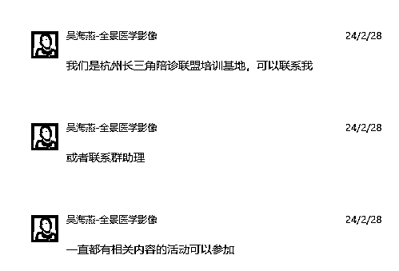

第三个构思：线下拜访机构找合作。以糯米现在的接单量，可以跟保险、银行、医院甚至政务单位聊聊。帮政务部门设计陪诊入行培训，为康养岗位输送人才，就算一时没收益，也能拿到官方背书，这个名声远比钱值钱。

第四个构思：流量是一切订单的源头。甜瓜哥点拨过我：要解决没单，先解决没流量。但流量平台这么多，不必非在大家扎堆的渠道里卷。试试那些池子大但垂直的角落，比如医疗健康类平台？大胆想，别把自己绑死在常规内容平台。

第五个构思：私域里患者的需求可以继续延伸。等陪诊跑通，患者沉淀在私域，能不能凭专业能力接入更多产品？比如陪诊加云药房。糯米正在准备药师资格考试剩下的科目，考下来还能开药店，直接给患者供药。

## 四、陪诊赛道的现状与走向

### 1.知晓度低，消费习惯还在养成

陪诊很早就有，但进入大众视野是近几年的事。早期它服务范围窄、非常隐蔽，主要是替高价值人群对接稀缺医疗资源，因为涉及公平，不能公开做。2023年三四月间，央视报道了一位常驻北京、专职陪伴就医的普通人。

那次报道一出，短视频平台上立即冒出一大批类似账号，陪诊才开始真正进入公众视野。看过、试过的人目前还不算多，可服务的真实价值摆在那里，市场正在增长，小玩家和跨界者可以从个人用户切入。

行业还在发展初期，我们也没能力砸钱教育市场，只能先守好阵地：认真交付、积攒好评、坚持发内容、偶尔办公开课或卖些培训课程。

陪诊在社交平台看着热闹，主因是虚假信息泛滥。有人假装天天接单，把行业渲染成订单接不完；卖培训的人则拼命讲这行多赚钱。于是外行一窝蜂进来，实际需求根本养不了这么多人。但虚假喧哗并非全是坏事：一来，进来体验过的人即便退出，也知道了陪诊的存在，将来或许会因此去尝试消费；二来，熬过筛选的人把供给端做厚，对行业生态也是补充。

### 2.顺应国家需要，贴合未来趋势

人社部曾发布过关于“康养职业技能培训计划”的记者问答，这里引用如下。

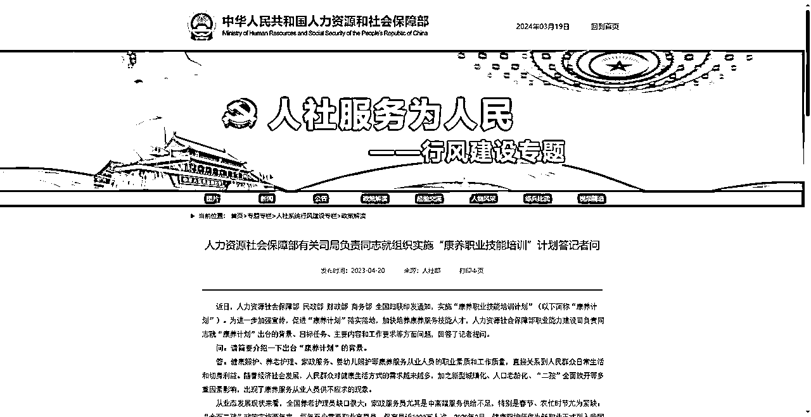

http://www.mohrss.gov.cn/SYrlzyhshbzb/ztzl/rsxthfjszl/zcjd/202304/t20230420_498763.html

2018年高层提出要完善养老护理体系；2019年高层再次要求加强养老服务人员培训，建一支素质过硬的队伍，并用政策增加康养从业人员供给。资源会跟着政策走，古话说得好：国家的风吹到哪，钱就在哪。

这份材料还给出，当时全国失能半失能老人已达4000万。老龄化越来越明显，中高端养老护理人才严重不足，未来围绕老年人群的岗位会大量涌现，陪诊就是其中一条支线。将来陪诊员的职责不会局限于陪同，还可能叠加陪护、看护、居家养老服务，这些能力可以跨岗位迁移；对于机构来说，一套人才能服务多条业务线，价值很大。

眼下养老行业从业者多半来自家政，以四五十岁的阿姨大叔为主，康养技能并不扎实。这种状况恰恰是未来机会。

举个例子：有的老人因泌尿系统问题无法自行排尿，需要放置导管，而且导管必须定期来医院换，折腾不已。以后康养服务人员就能上门换导管，这是实实在在的需求，也是老龄化时代的必然场景。

我还在招聘平台看到，已有人开始招陪诊员，其中不少是跨界公司。按我对行业的了解，这种玩法多半不赚钱甚至亏钱，可他们仍然愿意砸钱站位，说明大家看得懂，哪怕亏也要挤进赛道。

现在老年人受节俭观念影响，未必愿意为陪诊付费；但未来的老年人，也就是现在的年轻人，会买单。我们总以为老人是陪诊的主要用户，因为老人不会操作机器、不会在线挂号查报告；其实年轻人也搞不定：一年去不了几次医院，对流程和规划一头雾水，所以照样需要陪诊。还有那些“久病成医”的人，更是会主动购买陪诊，因为他们知道麻醉手术时有人陪同有多省心，目标明确、不情绪化，属于优质客群。

目前最新版国家职业分类名录还没有把陪诊收录进去，具体可看图片截图。

### 3.边界与合规

网上关于陪诊的讨论鱼龙混杂，这里放几篇截图感受一下。

其中一篇说得还算公正，对职责边界的描述比较准确。但网上也有大量过度包装，不少人幻想轻松高薪，现实落差一大，就可能去碰倒号、炒专家号这类灰产。医院一定不允许第三方扰乱秩序。如果陪诊只是帮患者跑腿、节省时间，院方还能接受；要买卖医院资源、沾医院便宜，行业迟早被医院卡脖子。

https://www.ncss.cn/ncss/jydt/jy/202309/20230926/2293143209.html

高端陪同就医、资源对接、特殊通道这些不能公开宣传，只能潜在水下做，同时还得解决高净值客户来源和稀缺资源拓展，很难。对普通人和小玩家来说，真正的入口是普通个人消费者。想持续做下去，先靠散客起家，以后要碰高端，资源和人脉都会顺手许多。

### 4.各平台态度

央视报道之后，账号数量暴增，平台6-7月就开始整顿，一批陪诊账号被处理。为什么？因为行业没有成熟监管，容易越界。一旦出事，比如陪诊员推销劣质产品造成患者中毒，平台作为内容传播方难辞其咎。所以几乎所有内容平台都对医疗健康内容很敏感。

小红薯平台：糯米最初在5个平台布局，抖音、快手、小红薯、哔哩哔哩和视频号，除了快手和哔哩哔哩没被封，其他都或多或少被处罚过。其中小红薯被封最频繁，也最好申诉，只要内容不是医疗硬广，基本申诉就能放出来。下面这些违规和申诉截图，可以当成错误示范来看。

经常被提示“资质不够”。小红薯官方社区公约和规则百科把这些都写明白了，糯米把和陪诊相关的规则贴出来了。

多研究规则，能少踩坑。比如不能提药品，不能做代购代买，帮人挂号也不行，不能推荐医院自制制剂，不能发布含院区二维码的院内照片。许多人都在一边违规一边抱怨规则难懂，但平台早就写明白了。再补充自己的经验：内容在明显位置标注“不构成医疗建议”；画面里不要出现医院logo、诊室门牌、医疗器械；不要有站外导流；应避免使用分诊、导诊、陪诊相关表述，也不要推荐医生和专家。

抖音：糯米已经停更一段时间，但抖音的真实流量依然不小，值得尝试。它的问题在于申诉流程漫长，笔记封一天，可能解封后申诉才审核。处罚也更重，周期多为30天。

视频号：延续腾讯系一贯求稳的思路，不与政策对着干，因此规则里明确不允许陪诊内容。

从上图第五条可以看到，陪诊被明确禁止。

快手与哔哩哔哩：目前最包容，但也最不产生订单。平台不管也不推，真实客户少，适合用来积累IP背书，靠它获客很难。糯米自己还没做出大IP，未来做大了或许有变数。

美团：属于有专门陪诊类目的平台，运营合规，但要注意别踩医疗资质的红线。比如团单里不能使用医生形象，不要出现“专家推荐”一类关键词。平台有清晰提示，按要求调整就能正常运营。

当初美团的“陪诊”搜索量大幅上升，于是平台开通了陪诊类目，现在已有规模，态度算是友好。

### 5.头部缺席

目前陪诊赛道还没有真正意义上的全国头部，至少纯陪诊起家的巨头不存在，因为个人端的消费习惯还在培育。不过美团生态里，有一家从重庆起步的全国连锁品牌做得还可以；小红薯平台上，成都的一批矩阵号也经营得不错。

上海、北京这类一线都市，陪诊赛道早已进入成熟期，但实际落地的流水相当多都处于合规灰色地带。以上海为例，优优陪诊的声量一直很大，抖音搜索占据优势，长期霸榜。

郑州的潇小潇陪诊则走了一条不同的成长路径，早期因央视报道被推到大众视野，随后逐步做大，并延伸出面向机构的培训业务。郑州的特殊之处在于，郑州大学第一附属医院规模位居亚洲前列，床位数过万。高密度的就诊人群，为当地陪诊服务的拓展提供了坚实基础。

糯米的判断逻辑是：不必过度纠结医疗资源在全国的集中分布，做陪诊并不局限于京沪。评判一个城市是否可做，要看人口体量和区域GDP。人口基数大，必然支撑起大型综合医院；大医院带来持续的病人流动；区域消费能力则决定客单价水平。三者叠加，就能大致评估该区域是否具备运营条件。

此外，病人并非都集中涌向北上广。地理距离本身就是天然屏障，医疗资源不均并非不可逾越的障碍。关键变量只有两个：当地是否存在大型三甲医院，是否具备稳定的就诊客流。

| 账号名称 | 平台 | 粉丝 | 播放量/点赞 | 视频数 | 最早视频发布日期 | 最近更新日期 |
| --- | --- | --- | --- | --- | --- | --- |
| 郑州小护陪诊 | b站 | 1082 | 283-39w | 15 | 7/8 | 7/23 |
| 乐福陪诊 |  |  |  |  |  |  |
| 南昌医方通陪诊吴艳萍 | 抖音 | 7667 | 8-980（普遍是几十点赞的） | 212 | 22年/2/10 | 4/30 |
| 郑州潇小潇陪同 | 抖音 | 6.5w | 100-200居多 | 40 | 2022/9/6 | 2023/7/6 |
| Noproblem | 西瓜 | 6016 | 2000多播放量居多 | 26 | 2022/6/10 | 2022/6/30 |

以上表格是此前收集的公开账号样本。可见该细分领域很难诞生头部大号，但并非零突破。张景南、暖暖等账号粉丝量均在十万区间，暖暖作为快手上的垂类陪诊号，近期的数据表现同样疲软。

ps.即便在快手，波动也明显

## 6.陪诊市场的容量边界

在杭州做测算时，糯米给自己设定了月度营收50万的目标。为此需要先摸清杭州陪诊消费的月度流水规模，天花板高度直接决定目标的现实性。

下面几张图是经他人提供的监测截图：

右上角上部数据来自腾讯系平台的用户规模，约4.7亿；下部为日活，约2亿。关键词搜索量方面，例如“陪诊服务”，月检索量仅三千左右，体量偏小。小红书聚光后台亦显示，“陪诊”相关词搜索量在两千上下，而关联的医院类长尾词则动辄数万至十几万。

目前尚未得出精确结论，粗略推断杭州本地市场体量大约在百万量级。

补充资料：

第三方咨询机构的全国盘点显示，2023年陪诊行业整体规模约为7亿元。

# 五、收尾致谢

前期约两个月的资料沉淀，近期加班整理，最终在2024年3月22日完成了第一版飞书文档。

回望过去半年，绝大多数时间都处于高强度状态。依靠运气和身边人的支持，才得以推进至今，感触颇深。

本次分享接近尾声，作一个简要回溯。

围绕陪诊工作的定义、个人实践路径、操作细节、心理建设、行业现状与未来趋势均已展开，部分未核实完的数据后续会持续补充。

发帖之时内容尚有约10%未收尾，边补边发，先搭框架再迭代，逻辑与创业本身一致，刺激且紧张。

作为在职者，曾尝试过也曾受挫，如今捕捉到机会希望全力冲一次。祝愿仍在职场打拼的人，都能找到理想的第二曲线。

能拥有一份独立事业实属不易，故开篇即提到，本文希望为在职者提供参考，如何开启第二事业。

开启第二事业，离不开生财社区的加持。多数人都是先看见案例才产生信心的。糯米也是借助生财挖掘项目、参考航海手册、借力人脉攻克卡点，才有当下的结果。可沿此思路复盘自身如何使用社区。

以下是糯米的使用复盘：

## 1.善用生财

回顾陪诊项目全周期，生财的帮助显著，现整理如下，供参考。

### 1.检索能力的运用
生财的核心工具之一是检索。有想法时，可迅速检索社区内是否存在相关案例。
例如挖掘陪诊时，检索词选用“医药代表”，查看是否有圈友在相关赛道发声，才由此联想到陪诊。
项目确定后，也可检索成功案例进行迁移，联系原作者深入交流。

### 2.航海手册的价值
航海手册汇聚了大量前辈的实操精华，是平台玩法的前沿指南。
2024年做项目几乎都与自媒体相关，小红书、抖音、视频号等的手册均有细分策略、调性、规则及引流打法。
做陪诊时引流存疑，就通过小红书引流贴学习；研究闲鱼玩法时查阅对应手册，迅速掌握规则。

### 3.组局的杠杆
单打独斗视野有限，卡点时可通过组局输出复盘。
输出过程中自身逻辑会被梳理，同时收获在场前辈的认知与视角，甚至带来合作或投资可能。

糯米组过两次局。第一次主题为医药代表切入陪诊的放大思路，到场反馈积极，大大增强信心。

Emily姐也牵线让糯米与亦仁进行了一次面对面交流，加入半年便见到创始人，颇感意外。感谢Emily姐与亦仁。

现场还就内容生产等细节进行了讨论，后续也有同行信息被主动分享过来，十分感谢。

复盘一句“人因痛苦改变，人因收益坚持”。当伙伴提供有效信息时，及时反馈与物质感谢能促进长期互助。

第二次组局聚焦项目验证与寻找合伙人或投资人。

另参加了大周哥组织的本地生活局，了解美团本地生活对陪诊的承接可能性及公司化运营细节；并参加生财年会，探寻前端合作机会。

组局是社区权益的重要体现，能放大解决问题的效率。通过生财，糯米结识了诸多前辈，站上更高视角。若闭门自思，很容易偏离。

在求助前辈时，需保持诚意与持续性。身边有人聊一次便断联，换位思考亦应避免浪费他人时间。

## 2.致谢

项目启动以来，好友胜前一直担任战略军师，餐叙时常讨论方向，其早期肯定与“先拿结果再做培训”的提醒，多次避免偏航。

卡点期通过组局输出，参与者提供多元视角，特别感谢生财平台与圈友，尤其是Emily姐的高效推动，让糯米得以与亦仁对接。

寻求突破阶段，经芷蓝姐介绍认识聪哥，同时在本地生活局中认识刺猬哥，进而了解到聪哥、刺猬哥、刘杰哥的关系网络。

三位前辈的云家政案例对陪诊有强参考价值，刺猬哥给予了不少具体点拨。

矩阵受阻时，再经芷蓝姐介绍认识文静姐，进而对接现阶段的准合作伙伴。一路感谢众多贵人，不知是机缘还是命数。粥佐罗老师的话常被提及：小机会可错过，大机会需牢牢抓住。

最后，我是糯米，感谢阅读。若有启发请点赞。

交流：nuomibaba89757