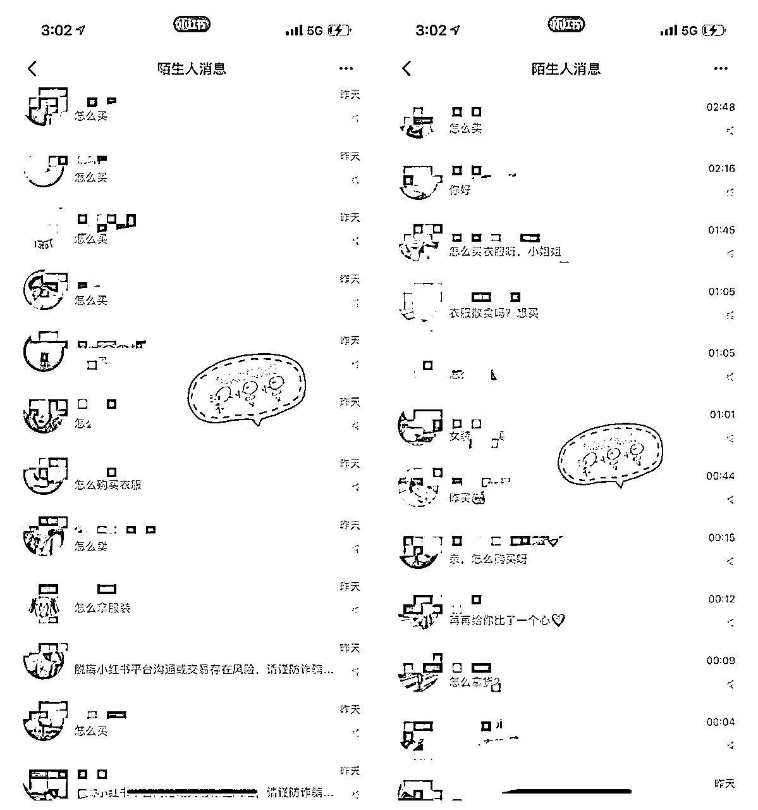
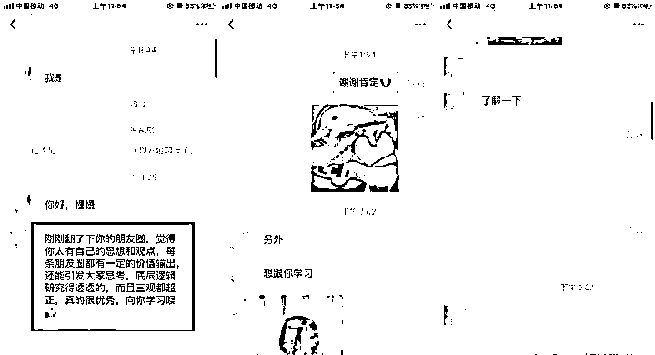
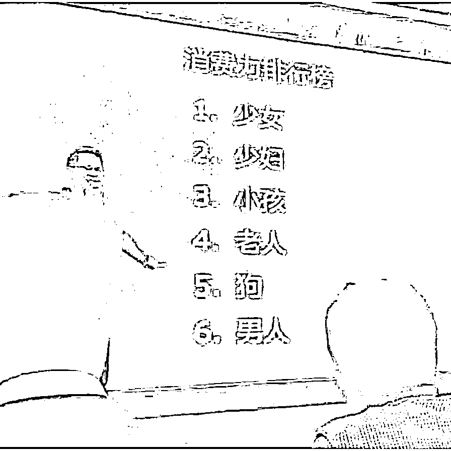
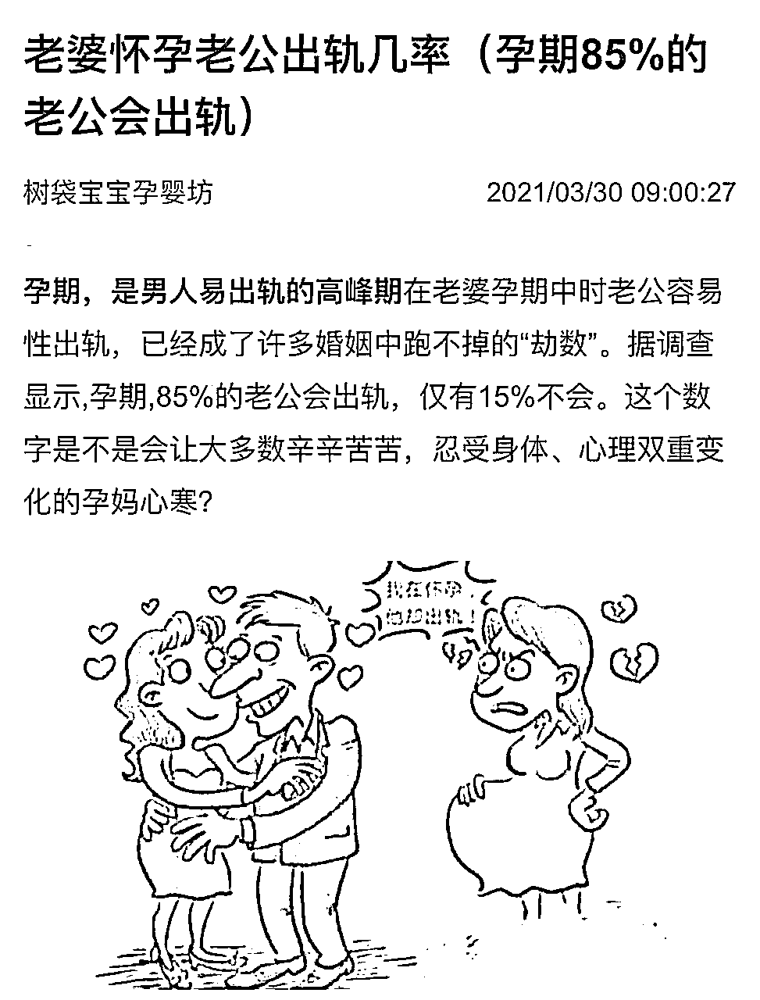
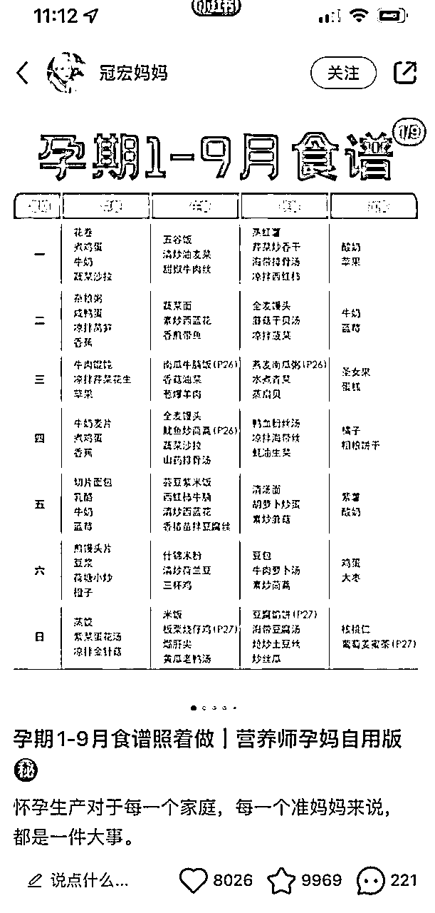

# 成人用品线上引流，别再做无用功了

很多人一提到成人用品引流，第一反应就是“多加点人、多发朋友圈”。但如果你只是冲着涨粉去，那基本等于白忙活。因为这个人加进来，未必想买，甚至根本不是你的目标用户。

引流的核心从来不是“人多”，而是“准”。尤其是成人用品这个赛道，用户的需求极其分化——你引来的粉丝如果没有购买意图，那他们点赞、评论、围观，都只是在消耗你的时间。所有引流的终点，必须落在“成交”上，而不是朋友圈里那个好看的头像数字。真正有效的引流，是让用户冲着“买”来加你，一进来就带着下单的预期。

好比卖衣服，别人评论区清一色“怎么买”，粉丝全是来消费的，这才是精准流量。

但成人用品有个天然的难点：平台限制多，话题敏感，稍不留神就被封号。所以你要换个思路，不要做泛流量，而是锁定某一类特定人群，把引流和她们的痛点捆绑起来做。朋友圈内容只要到位，顾客翻着翻着就自己说服自己下单了，根本不用你追着聊、追着推销。

## 一、引流必须跟着卖点走

成人用品的受众本身就不大，加上很多人受传统观念影响，就算你把人加到微信，天天发消息轰炸，对方也不会买。甚至你白送，人家都觉得尴尬。

所以你引流的时候，就得围绕你的产品卖点来找人，再结合卖点做内容营销。方向对了，效率才会翻倍。

## 二、找准人群，打中痛点

你看很多同行都在拼命引男粉，觉得男人是消费主力。但实际上，真正愿意掏钱的，往往是女人。那句“男人消费力不如狗”真不是玩笑。男人买东西太理性，什么都得想半天；女人就不一样，特别是戳中她担忧的点，下单特别痛快。

那成人用品最容易成交的人群是谁？——孕妇。

为什么是孕妇？你只要在朋友圈晒一组孕期出轨的数据，比如随手一搜就能找到的那种截图，然后再告诉她：买点成人用品给老公用，既能增进夫妻感情，还能防止老公在外面乱来。你猜结果怎样？大部分孕妇直接买单，付款都不带犹豫的。

这一招不仅能避开同行扎堆的男粉战场，成交速度还特别快。背后就是人性里那个最深的恐惧：你跟她说用成人用品很爽，只有一小部分追求快感的人会买；但你要是跟她说，不买，你男人就可能出轨——那她大概率会买。因为人最怕的不是失去快乐，而是承受不起失去的代价。花点小钱就能消除这个巨大的风险，谁都愿意。

## 三、实操：用孕期食谱做诱饵

想引流孕妇，你得先想想她们日常有什么痛点。怀孕期间最头疼的莫过于“什么能吃、什么不能吃”。你就做一个孕期食谱，免费送，让她们加微信领取。

怎么发？小红书。

发一篇笔记，内容是孕期饮食攻略，然后评论区就会有一堆人求“电子版”。你顺势引导她们加微信，把资料发过去，好友就加上了。

你看那些求资料的评论，清一色都是“蹲一个”“求电子版”，这就是精准流量。资料从哪来？某宝三块钱一大把，引流文案直接模仿就行。精准引到孕妇，再结合痛点营销，成交就是水到渠成的事。

## 四、同一个群体，反复成交

孕妇的痛点怎么跟成人用品结合？孕期就卖给她老公用的男性产品，主打“怕老公出轨”；生完孩子就卖避孕产品，主打“产后短期再孕有风险”；还可以卖哑铃之类的，结合产后恢复、紧致锻炼来推。

孩子生完，还能招代理。宝妈没钱？那就让她们帮你卖，赚佣金，自动裂变。同一个人群，前前后后能复购好几个品类，还能帮你转介绍，这就是精准人群的价值。

有个做男性定位的同行就现身说法过：男性用户实在太难裂变了。为啥？男人最大特点是好面子，买情趣用品、精油喷剂都是偷偷摸摸用，生怕被人知道。你让他推荐给朋友？他怕被嘲笑“不行”。所以做男性生意，基本告别转介绍。

但换成女性用户就不一样了。闺蜜之间什么悄悄话都聊，分享欲天生爆棚，用了觉得好，转头就推荐给姐妹。女性群体一旦认可你，转介绍就是顺理成章的事。

总的来说，成人用品引流，不要盲目去加人。想清楚你的产品卖给谁，她的恐慌和需求是什么，然后用一个她无法拒绝的“诱饵”把她引到微信，再通过朋友圈持续戳她的痛点。精准流量+痛点营销，成交就是自然而然的事。