# 年入两亿GMV的隐藏赛道，本地生活正成为新的流量洼地

> 来源：[https://s12is4u3s19.feishu.cn/docx/COVadjtFiothCwxkK3EcgDCpnjc](https://s12is4u3s19.feishu.cn/docx/COVadjtFiothCwxkK3EcgDCpnjc)

## 一、前言

大家好，我是佳兴，专注本地生活综合经营的实战操盘人。2023 年我深度主导了两家常务家政项目，并先后把它们推到家政赛道的头部位置。

同时长期担任多家线下品牌的营销顾问，在美业、餐饮等领域也都打出了不错的成绩。凭借快速变现的能力，我在 2024 年初拿到了百万元融资，正式开启独立创业。

2023 年我不仅帮助合作商家实现了爆发式增长，也带了一大批普通人借助商家服务变现，比如带了几千名宝妈、大学生、副业玩家通过发布团购带券短视频，每月额外多赚几百到几千块的零花钱。下面随便拎几个我们达人的实际数据：

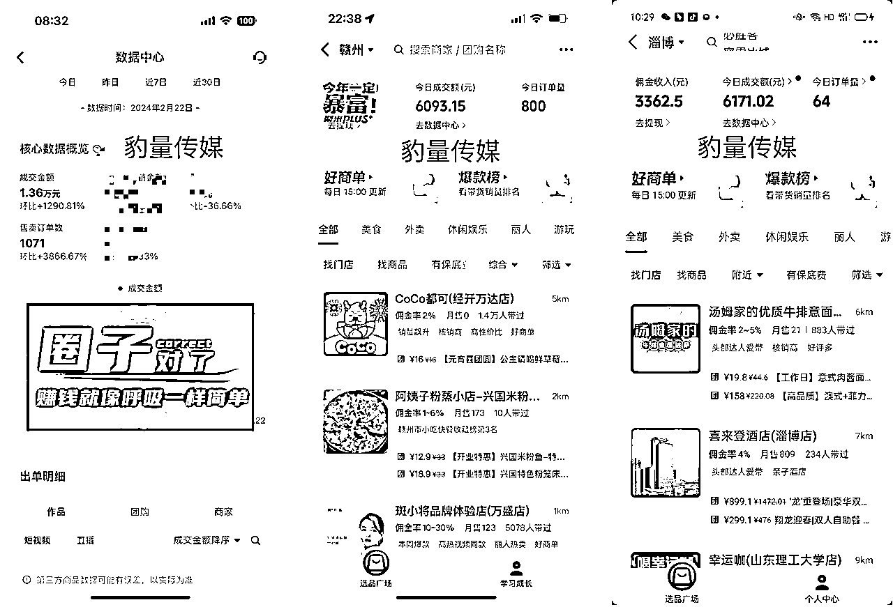

和我合作时间比较长的几个团长达人，现在基本稳定月入两万多，收入已经不输不少白领了。下方是我助理给达人团长们结账的截图，供大家感受下真实流水。

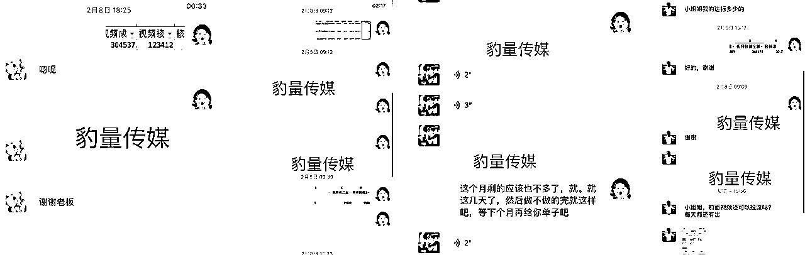

其实 2023 年我试过的项目不少，这一年我可以说把「内容流量」赛道彻底走了一遍，从「视频号直播带货」到「小红书店播一体」，也没赚到大钱，但该踩的坑基本都踩完了。

最终让我真正实现结果的，是「抖音本地生活」这条赛道。

今天我就把我的本地生活方法论底层逻辑拆开讲，结合行业判断、实操案例和决策思路分享给各位。

不管你是被获客困扰的实体商家，还是想抓住赛道红利的学生、上班族，都能从中拿到可用的思路。

## 二、我为何All in本地生活

### 2.1 为什么是现在

1. 大环境：三年疫情重创线下，2022 年底防控政策放开，我判断 2023 年线下消费会迎来报复性反弹；
2. 平台动向：抖音用了三年打通「内容电商」闭环，2023 年把资源明显向「内容团购」倾斜，我相信平台的执行力；
3. 行业现状：大部分实体老板的获客手段还停留在发传单、发朋友圈，发个微信裂变工具就能月入过万...作为老互联网人，我判断线下还有巨大的效率提升空间，创业机会很多。

### 2.2 本地生活和电商的本质差异

本地生活和电商本质都是面向大众的消费生意，都是靠提供有价值的商品或服务来变现。

但在经营逻辑上，电商偏商品属性，用户可以通过快递拿到满足，用户需求可脱离人、场地而存在；

本地生活偏服务属性，用户需求必须依托具体的人、手艺或门店场景才能被满足。

比如面霜、洗发水这类标品适合电商，但美发美甲、按摩理疗这类体验型服务，就必须在线下门店完成。

内容玩法上，本地生活也远比电商丰富，比如一条按摩店的放松视频，就能让人产生身临其境的舒适感，从而立刻产生到店冲动。人对生活体验的追求是无限的，这就是本地生活的价值所在。

竞争维度也完全不同。电商不分地域，全国卖家在同一个池子厮杀，头部垄断，普通人很难有机会。即便你找到蓝海，第二天就会被复制内卷。

本地生活则天然受地域和距离限制，强依赖线下资源沉淀。哪怕是全国性大品牌，也很难快速覆盖所有城市的存量需求，依然是“强龙难压地头蛇”。

反过来，一旦你在某个城市先发占位、跑通模型，后来者追赶成本会指数级升高。

对个人创作者而言，做本地生活达人比做电商达人更容易起量。很多三四线城市几乎没有专业的探店达人，北京的达人也不会去拍衡水的店，这就是普通人的真实机会。

你的对手不是全网，而是同城，成功率自然更高。

## 三、抖音云连锁的底层逻辑

还记得我之前写过的那篇文章么，没看过的建议先补一下。

那篇文章主要讲了两点：

1. 抖音做品牌连锁有三大平台红利：内容可共享、销量可共享、系统智能推荐附近门店；
2. 掌握这三大特性的品牌，可以把「内容团购获客」和「品牌招商加盟」结合起来，用「总部负责运营，门店负责履约」的新模式，快速扩张门店数，大幅提升新店存活率。

如果你是小实体店老板，发现你的赛道正在被云连锁品牌蚕食，别犹豫，挑一个运营最好、扶持最好的头部品牌加入，否则终将被替代：

1. 品牌势能强
2. 运营扶持到位
3. 商务条件优厚

如果你是已有积累、实力不错的老板，就该立刻做云连锁，通过各种方式跑马圈地，抢占优质 POI 资源。

注：POI 是地图行业的专业术语 Point of Interest 的缩写，指兴趣点。每个 POI 至少包含名称、类别、经纬度，可指一栋楼、一家店、一个景点。

在抖音本地生活里，POI 就是线下门店在抖音地图上的位置资产。

抖音云连锁的价值目前依然被严重低估，未来各行各业都会走向连锁化，这是经济规律。

连锁品牌研发成本低、供应链成本低、交付标准化、获客成本低，夫妻老婆店完全没有竞争力。

再分享一个行业内幕：消失的门店与「虚拟 POI」。

有没有人跟着地图导航走进死胡同的经历？POI 是现实世界的线上映射，但程序总有漏洞。

2023 年抖音里突然冒出了大量连锁家政品牌，上门保洁、上门洗护等品牌瞬间开出几百上千家店。

你有没有想过，为什么他们开店速度这么快？

前面提到过，POI 不仅是线下门店的线上化，更是撬动同城流量的营销支点。

对于上门服务业，本质是「劳动者」与「客户需求」的匹配，线下门店价值有限，POI 的作用是覆盖同城用户、放大内容价值。因此对于这类上门服务，有 POI 无门店就成了高性价比打法，这里就不展开了，属于灰色操作。

商家端玩法就先说到这，今天的重点是「抖音团购达人」项目。

## 四、最适合新手的副业 - 团购达人

要说 2024 年最适合新媒体小白切入的项目，非团购达人莫属。抖音、快手的内容团购红利仍在延续，视频号和小红书也在布局，前景可期。

截至 2022 年底，美团本地生活商家约 720 万，到店 GMV 2200 亿。

抖音本地生活已覆盖 370 个城市，合作门店超 200 万家，GMV 770 亿，看起来差距不小。

2023 年抖音生活服务数据显示，平台整体交易额同比增长 256%，算下来已超 2500 亿；门店覆盖 370+ 城市超 450 万家，较 2022 年，短视频交易额增长 83%，直播交易额增长 570%！

这也验证了我 2023 年初的判断。

我 2023 年上半年入局本地生活就开始做「达人运营」，平均每天花 10 小时泡在各大达人圈，从混剪达人到实探达人再到直播达人，从赚佣金到赚车马费再到赚出单奖励。

可以说目前没人比我更懂抖音团购达人的玩法和变现路径。

在这个赛道，找到正确打法，赚钱像喝水一样简单，大钱不敢保证，副业月入几千块完全现实。

很多做团购达人的最后不了了之，主要有两个原因：

1. 太心急，团购达人容易出单，但要稳定变现必须先把账号权重和等级养起来；
2. 只盯着佣金，没有触达更深层的商家投放预算。

直接进入实操。

## 五、抖音团购达人项目拆解

抖音团购达人按内容形态分为两类：「短视频带券」和「直播带券」，能力要求和工作方式完全不同，很少有人能兼顾。

短视频带券，是在发布短视频时挂载 POI 或团购链接，用户刷到就能在左下角直接下单，核销后账号获得 CPS 佣金。

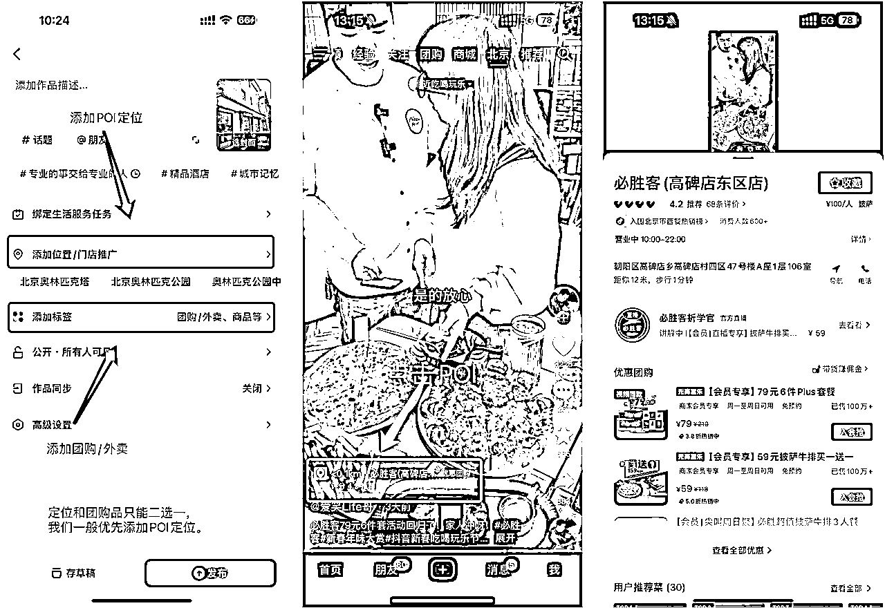

直播带券，是在直播间挂载团购链接，用户可在右下角小房子里下单，核销后直播账号获佣。

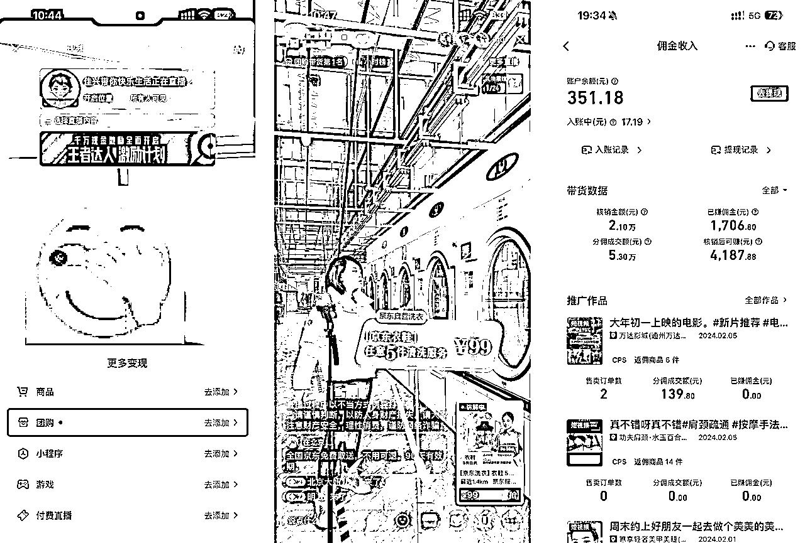

我目前主攻短视频，所以今天重点讲短视频达人的赚钱逻辑。

### 5.1 收入方式一：出单 CPS 佣金

这是绝大多数团购达人的核心收入。靠视频卖券出单赚佣金，常规佣金比例在 5%-20% 之间。想提高佣金收入，选品是关键，需满足三点：

1. 好出单
2. 核销率不低于 40%
3. 佣金高

库迪咖啡就三项全占，成为 2023 年爆品，全网达人都在推。像家政保洁、美容按摩、洗车汽修等品类在抖音团购渠道也迎来爆发，本质也是满足上述三要素。

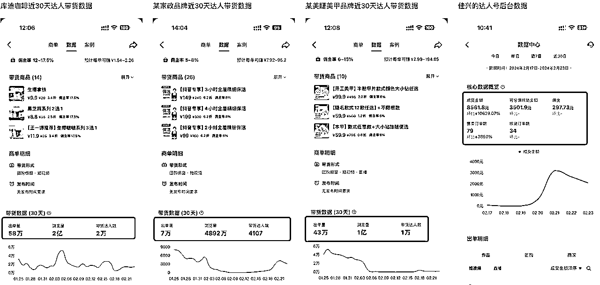

个别餐饮的佣金很低，比如肯德基、必胜客、海底捞只有 1%，但依然有人带，原因在于：

1. 品类极易出单，能快速提升账号权重和带货力；
2. 有推广费，按品牌要求发布视频就能直接结算。

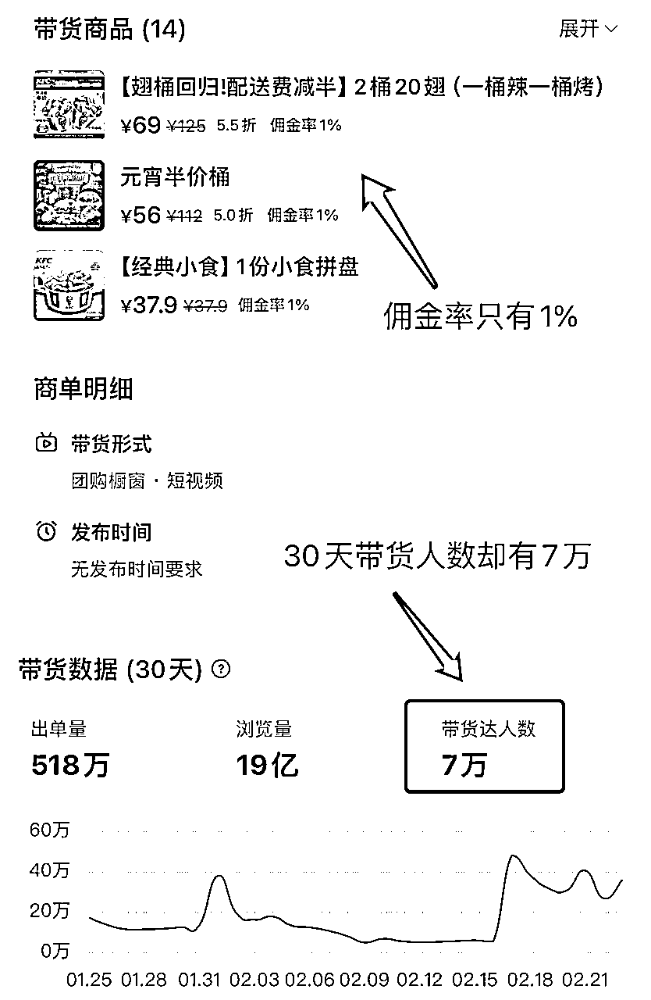

带货力是达人核心评级，从 L0 到 L7，等级越高出单能力越强，也越容易接到有推广费的商单。

### 5.2 收入方式二：商家推广费

账号带货力达到 3 级左右就能开始接到 5-15 元/条的剪辑费，等级越高报价越高。6 级实探账号的探店车马费一般 200 元/条以上，一天拍两条收益可观。

商家推广费又称车马费、剪辑费，是达人老手的稳定收入，除了账号等级权重，还需要商务资源积累。

很多人只赚到 CPS 佣金，赚不到推广费，所以觉得不赚钱。佳兴现在运营本地生活 MCN，服务多个品牌商家，每月有上百万的短视频推广预算投向达人，这也是我们旗下达人和团长能持续赚钱的原因。

下面是我们对部分达人的结算记录：

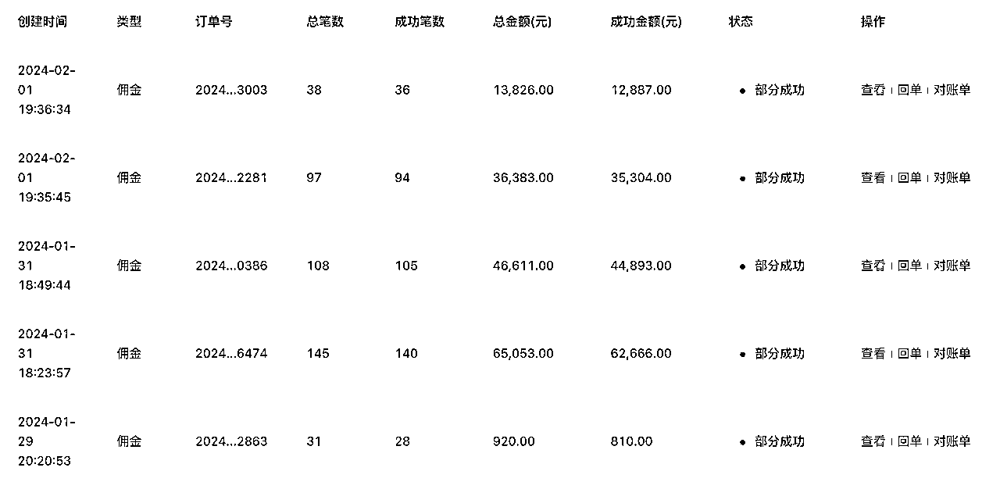

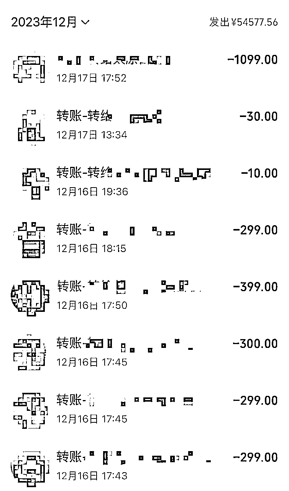

什么样的视频能卖到几十到几百元一条的推广费？

比如一条美甲美睫探店视频，无剧情、无特效、无热点，朴实无华的广告片，根据账号等级差异，单条收益在 100-300 元左右。

### 5.3 收入方式三：品牌官方奖励金

短视频团购达人门槛极低，市场达人质量参差不齐，商家希望把钱花在刀刃上，因此出现了「后置奖励」模式。

按达人业绩产出给予额外激励，比如播放量/出单数达标后商家投放助力，或按销售额给予现金奖励、提高定向佣金。

我们也会帮达人申请品牌方的后置奖励，进一步建立信任。下图是我 12 月份为达人申请的某家政品牌现金奖励，效果极好，品牌方决定长期合作，我们旗下达人收益也随之提升。

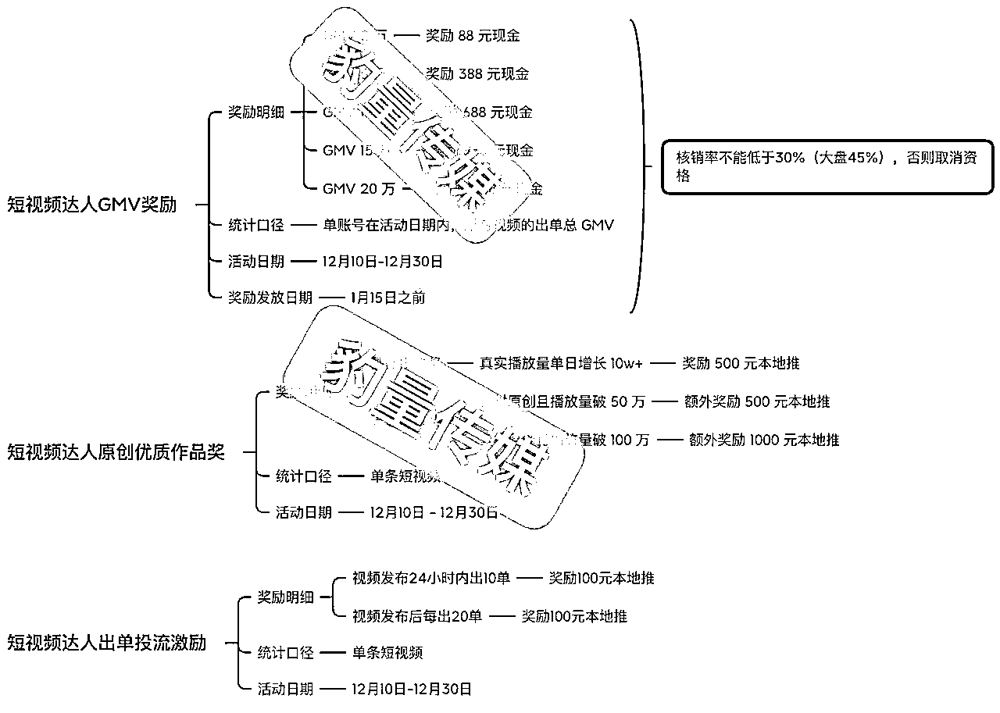

## 六、新人实操指南

### 6.1 开通团购权限

开始带货前需先成为团购达人，即开通带货权限。抖音在 2023 年上半年曾开放 0 粉开通窗口，现在通常要求 1000 粉。星球里有很多快速涨到 1000 粉的方法，这里不再赘述。

Ps. 快手正大力发展本地生活，0 粉可开通团购达人，看到的赶紧去开通，门槛随时可能提高，早开早占优！

下面是我录的开通教程视频，可对照操作。

### 6.2 工具准备

1. 抖音、快手
2. 小红书，用于找混剪或图文素材
3. 去水印小程序，用于下载对标视频和素材
推荐小程序「配音神器」，无广告好用

4. 美图秀秀、剪映，用于素材处理和剪辑

### 6.3 起号流程

#### 6.3.1 养号

1. 每天正常刷抖音 15-30 分钟，多点赞停留团购相关视频
2. 刷十条团购视频，点赞收藏评论 4-5 条即可
3. 可在抖音商城下单，提升账号后台权重
4. 目的：让系统判定你为真实高活跃用户

#### 6.3.2 选品

1. 前期优先选易出单品，哪怕佣金低，先提升账号带货等级
2. 团购达人中心有「选品广场」，可查看近期热卖品

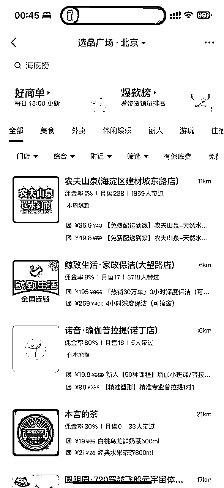

3. 选品需匹配账号人群定位，比如宝妈号就别推洗车加油

#### 6.3.3 剪辑

1. 搜索选定产品/品牌近七天数据最好的视频做对标

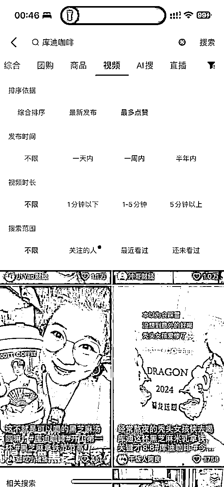

2. 在小红书等渠道下载素材
3. 参照对标视频用素材混剪出新视频

#### 6.3.4 发布

1. 发布时间选用户刷手机高峰，如上班族的通勤、午休、下班、周末
2. 发布定位：单店品挂该店定位，连锁品可向商家或渠道问哪个门店生意好、出单多，跟着挂

### 6.4 坚持复盘

做内容最怕三天打鱼两天晒网，必须坚持剪辑、坚持发布，做到位了离变现就不远了。

## 七、入局建议

团购带券达人已经是我认为对新手最友好的项目，但并非人人适合。

不建议做的人群：

1. 工作繁忙，业余时间不足，无法保证每周至少 5 天更新；
2. 看不上小钱，想快速赚大钱的，本行业需能力、运气和时间积累。

如果你决心入局，这几个建议能帮你少走弯路：

1. 粉丝能刷就刷，1000 粉不影响账号画像，新手最需要的是正反馈；
2. 图文、短视频、直播选其一先做透，有结果再考虑切换；
3. 新手别追求原创，同行是最好的老师，抄是最快的学习路径；
4. 一定要找到有供应链和商单资源的团队带你，只有这样才能赚到 CPS 之外的钱。

关于本地生活团购达人的分享就到这里，感谢阅读。若对抖音本地生活团购达人玩法感兴趣，欢迎交流。

Ps. 本帖点赞过 188，我会更新商家端干货玩法，点赞即是支持～

我是佳兴，本地生活实战派，豹量传媒创始人。

最懂实体商家的团购达人，也是最懂团购达人的商家操盘手。

微信号：jiaxing1801，欢迎联系，备注圈友。