# 从采集到分发：基于影刀RPA搭建heygen数字人全链路实操

大家好，我是钱小鲤。近期用影刀跑了几套自动化机器人，今天把正在线上的部分流程整理出来分享。内容不做噱头也不谈变现，只是把真实跑通的环节摊开讲，希望对同行有参考价值。

整篇文章拆成五块：源数据抓取、二次创作、HeyGen数字人生成、MoviePy与剪映剪辑、跨平台推送。主干全靠影刀RPA串联，关键步骤都已自动化，只有选题方向和内容把控仍需人工。

下面按模块展开说明。

## 第一部分 用影刀做多平台数据采集

主要涵盖抖音、📕、推特等平台的关键词检索、账号主页批量遍历、文章/图片/视频无水印获取及元信息提取。

### 抖音

支持关键词检索采集、主页全量作品拉取、分享链接解析、无水印图文视频下载，并能自动跳过已存在文件。

可提取字段：账号昵称、粉丝量、关注量、历史获赞、用户标签、标题、时长、视频标签、关联词、点赞量、评论量、收藏量、分享量、背景音乐等。

可下载资源：视频文件、封面图、配乐、头像。

#### 演示

#### 源码实现

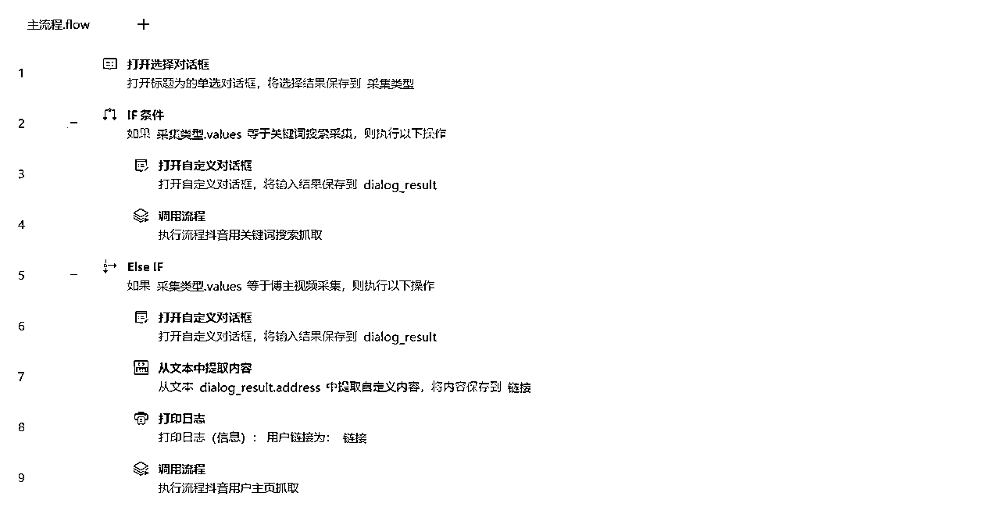

启动主流程后，系统会弹出采集模式选择：按关键词搜索、按主页抓取全部作品、抓取合集、抓取音乐下作品等。选定模式后需补充必填参数，例如搜索需填关键词，主页需填主页链接，同时可额外设置是否下载文件、保存路径等，均可通过影刀对话框完成。

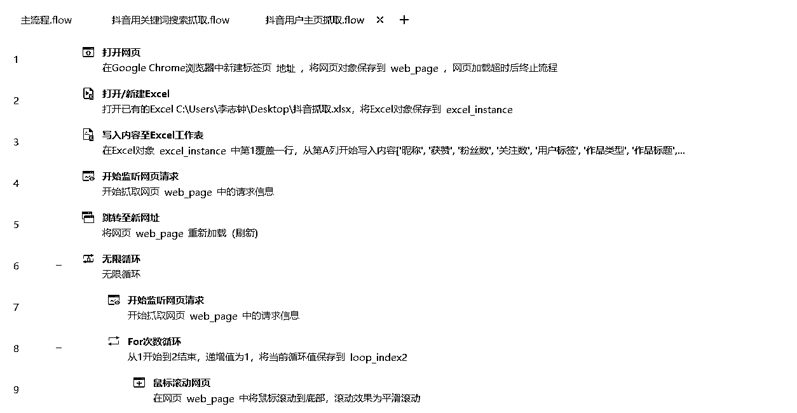

以主页抓取为例，搜索和合集逻辑相近。先打开目标主页，进入网页请求监听阶段。

本次采集中未采用影刀自带的“数据抓取”，而是采用网络监听。监听效率更高，且可拿到更宽的维度，包括视频各明细、用户标签、关联词等一次性获取，更利于后续异常挖掘。

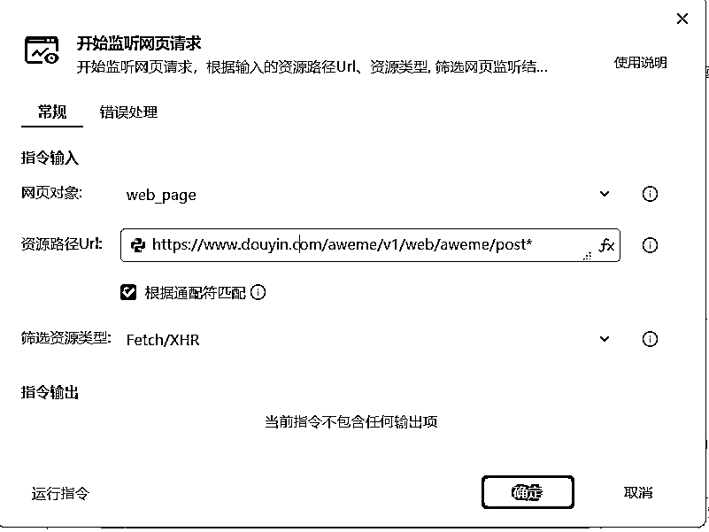

监听到作品内容返回接口后，将返回样例交给GPT-4补全解析规则，再把结果粘贴到影刀调用即可。借助模型后技术门槛大幅下降。

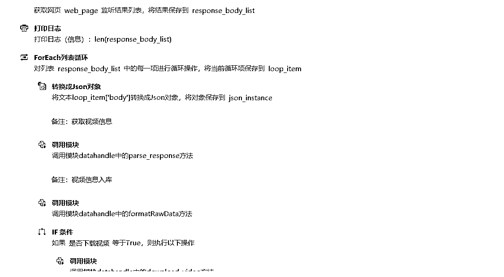

监听就绪后开始滚动，页面正常渲染作品即可被影刀捕获，后续解析入库Excel。

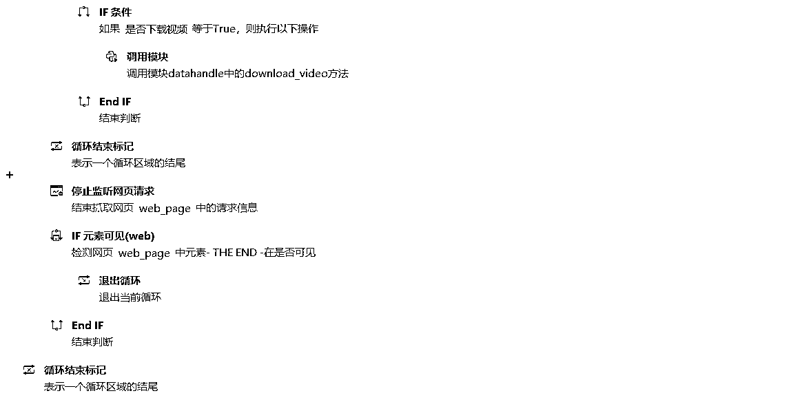

下载环节先判断启动时是否勾选视频下载，因视频下载耗时较长，若仅需基础信息可不勾选。

需要下载时，前面已获取原始链接，可用影刀下载或调用Python模块，后者效率更高。代码可直接向GPT索取，使用即开。

采集效果示例。以董宇辉为例，300余条作品数据在约一分钟内完成采集，不含视频下载。若勾选下载则耗时提升。采集字段含昵称、粉丝、关注、历史获赞、用户标签、标题、时长、视频标签、相关词、点赞/评论/收藏/分享、背景音乐等，更细的视频数据以JSON形式存于下载目录对应文件夹内。

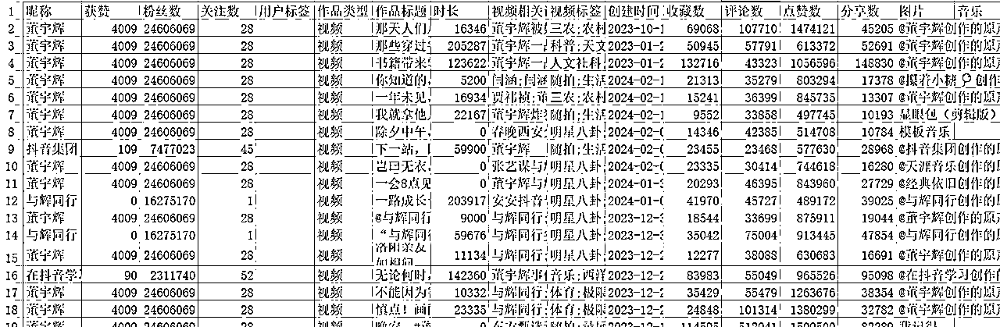

这些信息已足够做对标账号分析，后续可再用GPT-4对点赞评藏异常比率做二次分析。

### 📕

* 按关键词/博主自动抓取笔记
* 按链接或已采集笔记获取详情、点赞评藏、文案及无水印图片/视频

#### 演示

最终数据效果，含笔记信息及无水印素材：

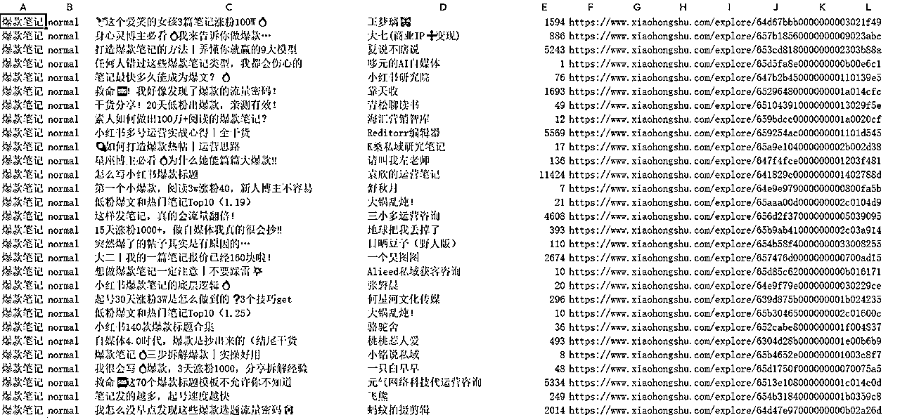

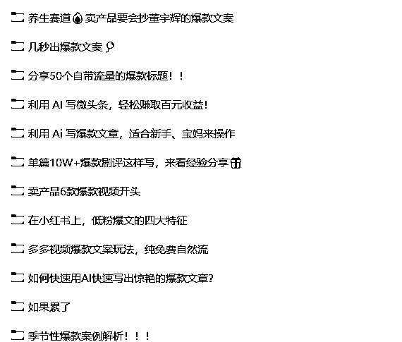

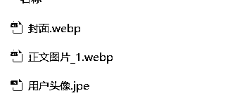

#### 实现思路

整体思路与抖音一致，完整流程见视频末尾。关键词采集未使用数据抓取，原因同上，自带抓取范围有限且较慢，监听可一次性拿到更多信息。涉及Python部分不懂代码也可先用数据抓取，需求描述清楚后代码可由GPT-4生成。

### 推特

* 按关键词/博主/博主点赞抓取推文的阅读、点赞、评论、收藏等明细

#### 演示

采集后数据：

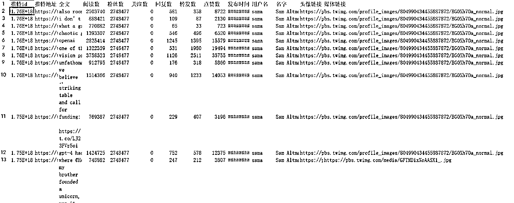

#### 实现说明

同上，演示末尾有主流程参考。推特页面元素变动频繁，定位不稳，RPA采集基本只能走监听方案。

## 第二部分 影刀自动化注册HeyGen

本节讲如何用影刀完成HeyGen的自动化注册。

### 演示

### 流程与源码

#### 绕过地域限制

当前HeyGen存在地域限制，注册登录会提示不支持区域，同时注册时会出现Google验证码。低成本解决思路有两种。

地域限制多基于浏览器指纹判断，服务商会依据浏览器配置、区域、语言推断位置。可手动修改浏览器区域语言，或使用指纹浏览器自定义特征绕过。推荐后者。

影刀如何操作指纹浏览器？

本次使用免费Hubstudio，基于Chromium的指纹浏览器。免费版不支持API，故仅用一个实例注册，实测切换实例后影刀仍可识别操作。

操作步骤：

影刀页面进入设置-自动化插件

点击“添加自定义浏览器自动化”

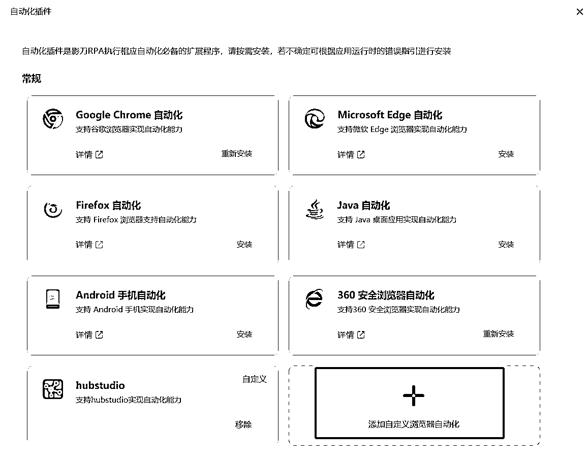

弹框点击“手动选择”

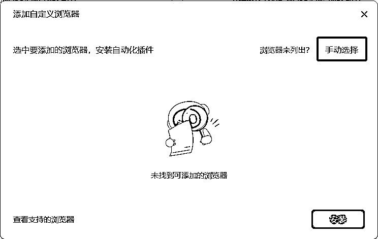

定位到Hubstudio安装目录，例如 D:\Program Files\Hubstudio\Hubstudio.exe，注意选择大写Hubstudio.exe

确认后稍等即添加成功

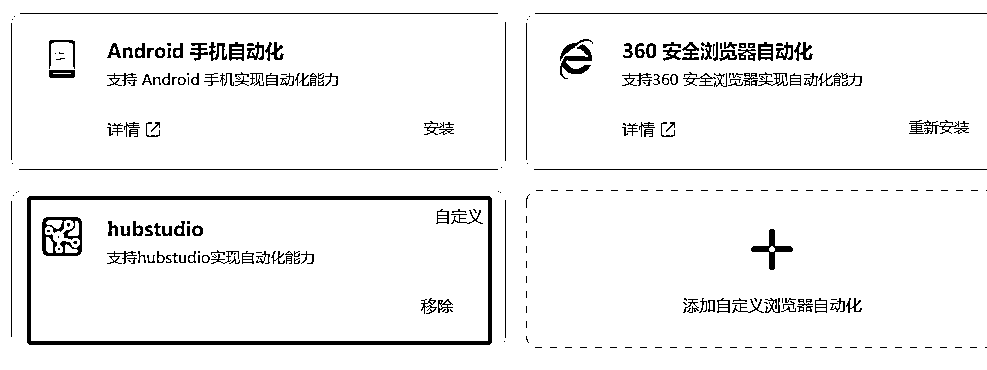

添加后打开Hubstudio，进入资源-扩展中心，添加影刀插件，这是控制浏览器自动化的前提。

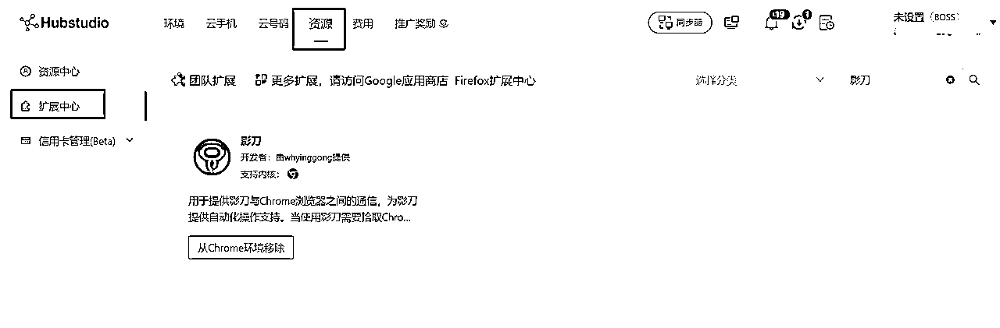

此时登录HeyGen测试，访问已正常，可继续自动化注册。

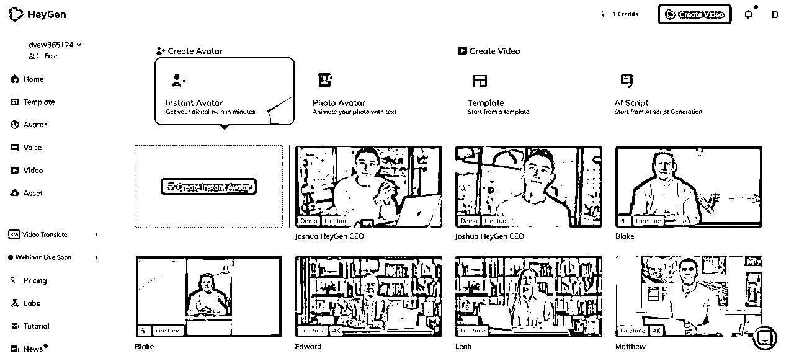

#### 获取无限邮箱

HeyGen需邮箱注册，核心是邮箱数量。淘宝购买或利用Gmail特殊字符均不够便捷，自动化程度低。推荐自购域名，十几元即可，配合Cloudflare开启catch-all，一域即可获得无限邮箱，也方便注册其他服务。

Cloudflare配置步骤：

登录 https://dash.cloudflare.com/

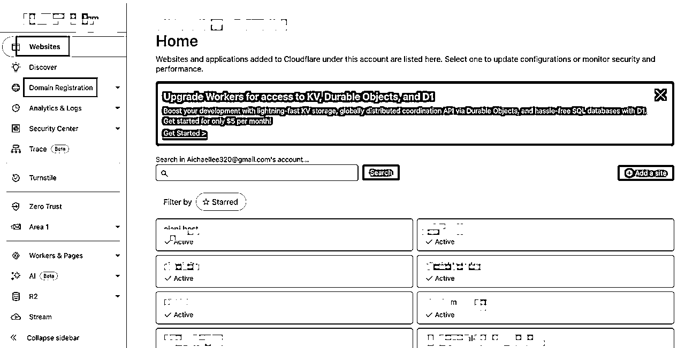

无域名可点菜单“Domain Registration”注册，有域名则点左侧Email

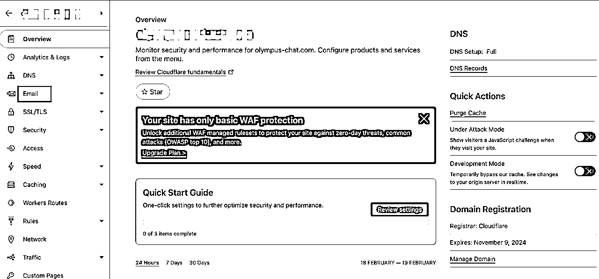

点击开始使用

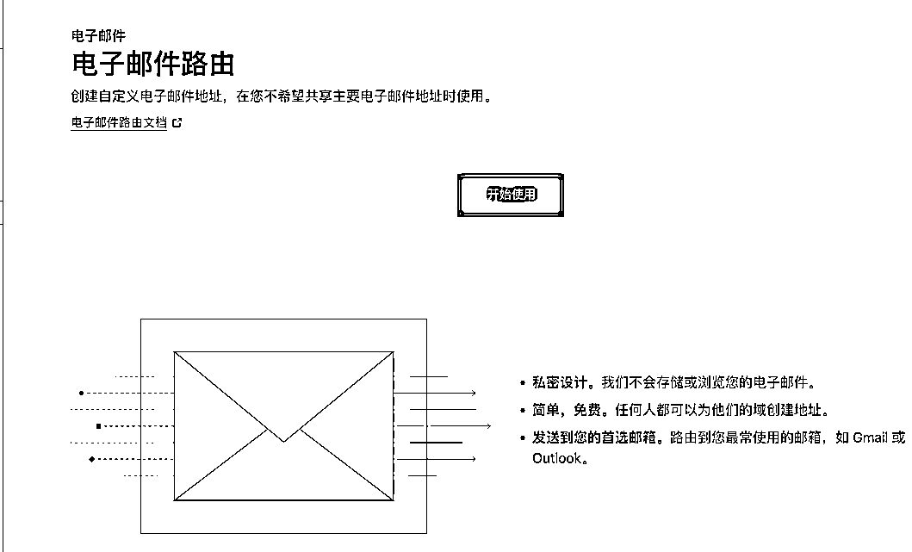

先填写自定义地址，目标邮箱填个人邮箱，建议用163，影刀抓取邮件更稳定。Gmail偶发网络中断易导致流程失败。

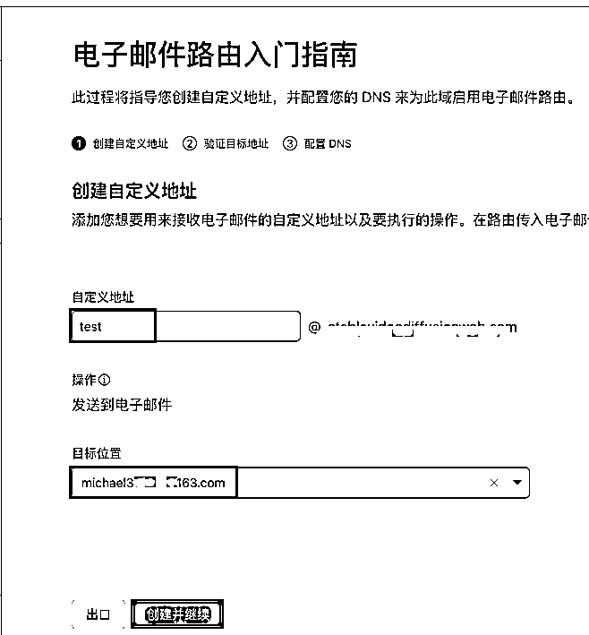

创建并继续，再点继续

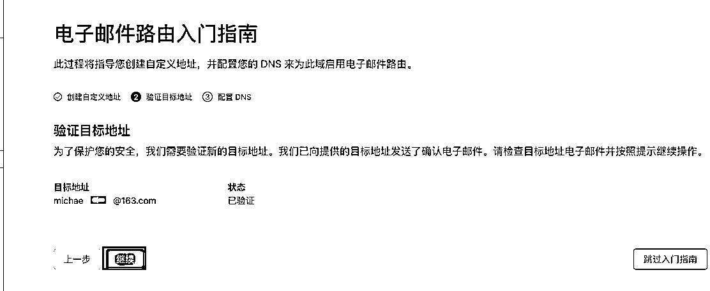

后续配置默认即可，点“添加记录并启用”

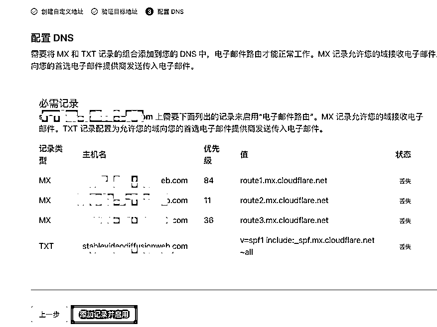

DNS生效后进入“路由规则”

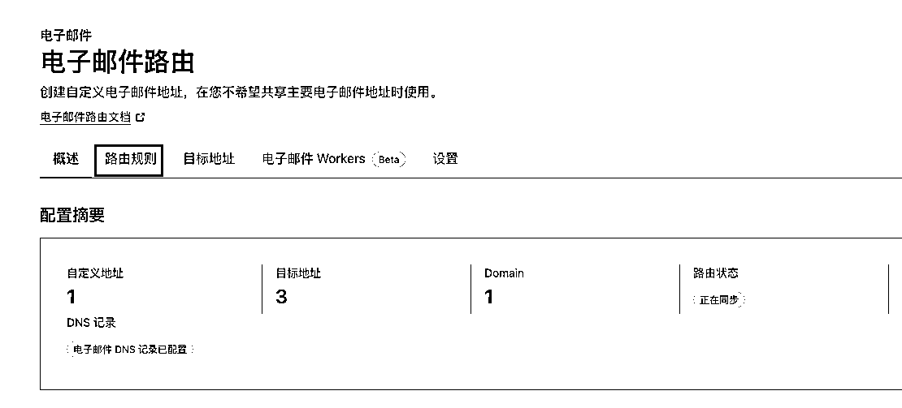

将catch-all切换为开启

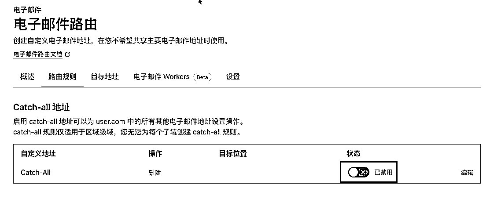

开启后点编辑

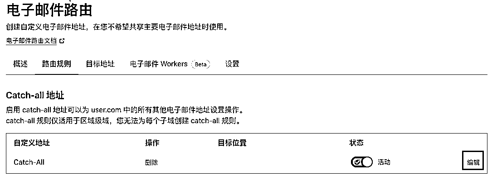

选择刚才设置的邮箱，则所有发到 *@example.com 的邮件都会转发到目标邮箱，可由影刀读取验证码

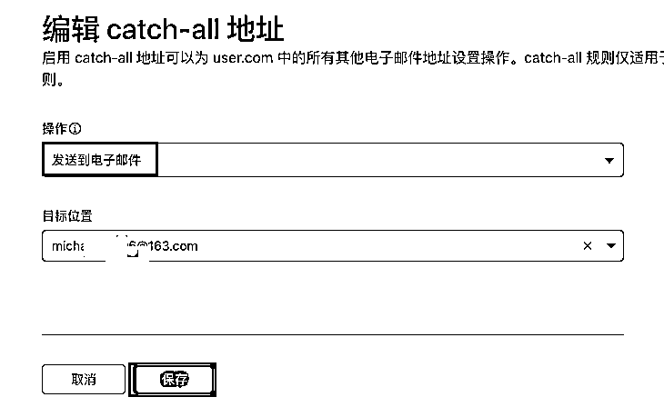

至此无限邮箱就绪，继续注册流程。

完整注册流程：

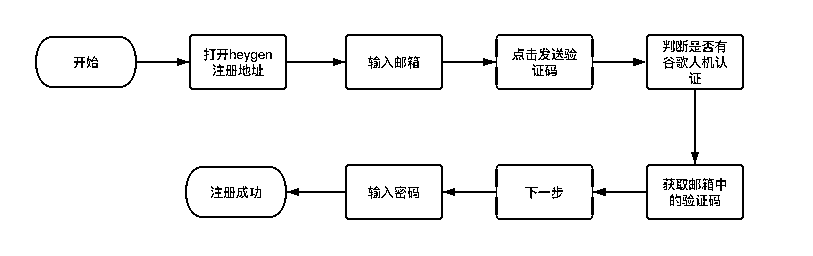

#### 人机验证处理

HeyGen现已加入人机验证，可参考影刀社区帖子：https://www.yingdao.com/community/detaildiscuss?id=bcbf5e50-ffeb-463c-a1f4-248f1b145241&from=detaildiscuss&sort=createTime&tag=软件使用问题&page=1

核心是使用yescaptcha识别。两种做法：一是用影刀平台的“谷歌recaptcha验证码”功能，二是浏览器安装yescaptcha扩展。推荐第二种，地址 https://chromewebstore.google.com/detail/yescaptcha-人机助手/jiofmdifioeejeilfkpegipdjiopiekl?hl=zh-CN

安装后需密钥，新注册送1500积分约100次，付费约1元1000点约60次，均摊不到2分钱。首次识别成功后后续大概率不再触发验证，免费额度已足够。

注册链接：https://yescaptcha.com/i/hEJLBX

密钥填入插件后人机验证自动通过。

#### 邮箱验证码获取

使用影刀自带“获取邮件”功能，在高级设置收件人、发件人信息获取验证码，重试设为3次，每次间隔5秒。

实测约1分钟可完成一次注册，效率可接受。

## 第三部分 AI工具自动化创作

### Coze

字节旗下自动化平台，内建GPT-4 128k免费使用，插件丰富，workflow可自定义。个人体验上比GPTs更灵活。

可将第一部分采集数据喂入Coze做二次创作，生成适合数字人口播的脚本，也可在一个机器人内按不同指令生成文章、标题、配图、资料整理。

也可使用GPTs替代，有不少RPA操作ChatGPT的内容创作教程，此处不再赘述。

先注册 coze.com，需科学上网。

按自身工作流用GPT-128K搭了一个简化workflow结构：

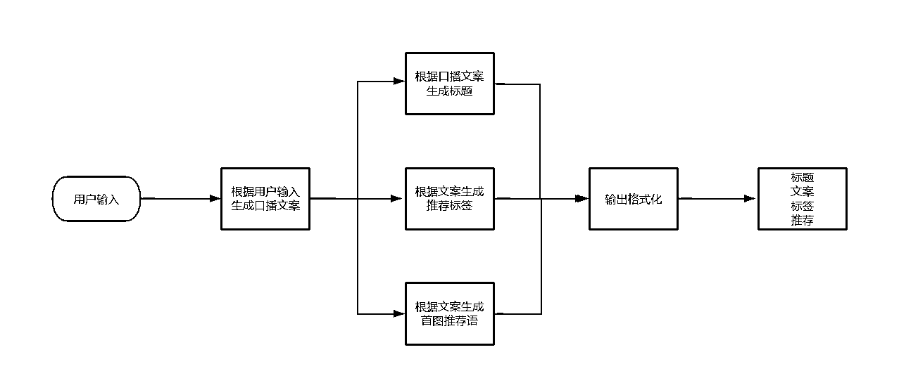

实际可加入知识库、插件、外部接口。

流程图先新增LLM节点，根据输入生成口播文案：

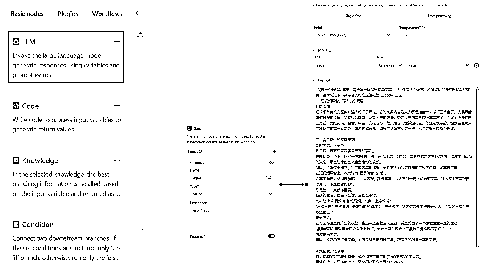

再对文案生成标题、标签、推荐语：

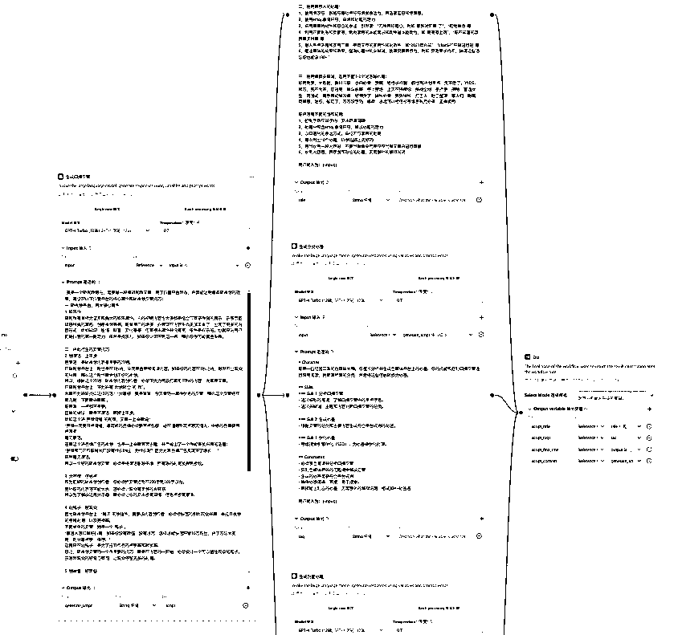

测试输入一段网络摘抄，返回示例：

{
"script_title": "1. 🚀老实人vs聪明人，规则是枷锁还是翅膀？\n 2. 🌟别被规则绑架！聪明人的逆袭秘方大揭秘\n3. 💥规则不是铁板！如何像大佬们一样灵活变通？\n4. 🎯守规矩还是变通？区分高手的关键决策！\n5. 🛡️别让规则束缚你！学会这招，游刃有余\n6. 🧠【建议收藏】老实人如何学会聪明人的大智慧？\n7. 🎲规则是橡皮泥？大佬们的游戏规则揭秘！\n8. 🛫从规则的枷锁中解脱，聪明人的上天秘籍！\n9. 🤫老实人必看！掌握这技巧，规则也能成翅膀\n10. ✨审时度势，老实人的逆流转变攻略！",

"script_tags": "#励志 #人生哲理 #规则意识 #灵活变通 #职场技巧 #社会洞察 #成功心态",

"script_first_title": "《规则是铁板还是橡皮泥？解锁人生高手秘诀！》",

"script_content": "你知道老实人和聪明人最大的区别吗？老实人总觉得规则是铁板一块，一寸不许动。但聪明人？他们知道，规则就像橡皮泥，关键时刻可以灵活变通。而真相是，制定规则的大佬们，可从来没打算把自己套进去。他们设下规则，其实是为了让别人跟着走，自己却能从中受益。那么，我们应该怎样在这个世界上游刃有余呢？关键在于，审时度势，知道何时该守规矩，何时可以巧妙利用规则。别小看这个能力，它可是区分普通人与高手的关键。记住，不要让规则成为束缚你的枷锁，而应是助你翱翔的翅膀！"

}

效果尚可，prompt、知识库、微调仍有优化空间。

后续可用影刀批量对采集到的爆款通过Coze生成口播，导出至Excel第二页，供数字人制作使用。

Coze配合插件和workflow能实现图文并茂文章、批量洗稿等创意玩法，GPT-4加持下质量优于多数市面工具，值得深入探索。

### Notion

重度用户视角，Notion已成日常工作核心。去年集成NotionAI后，在文本创作场景下部分情况下优于GPT。

采集时我会同步所有数据到Notion，包括社媒点赞文章、推文、每日热点、热门项目等，均自动同步。搭配NotionAI，可在任意场景阅读与创作。

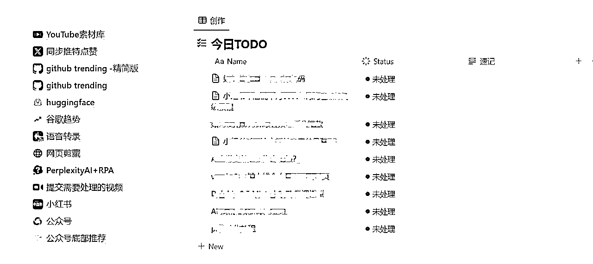

最近把我的内容生产流水线梳理了一遍，发现 Notion 已经从单纯的笔记工具，变成了整个素材采集、整理、分发的一体化中枢。整个运转逻辑其实很简单：先把全网的碎片信息自动拉进来，再用 AI 帮我初步消化，最后一键推发到各平台。

先说素材自动采集这块。最核心的就是 Notion 里的几个数据表。第一个表对应的是 YouTube，我关注的一些频道加上我设定的关键词会实时同步，视频的元数据全都有，连自动转录的文案也会一起进来。NotionAI 的自定义 AI 字段在这儿发挥了很大作用，数据一更新，总结、重写这些 AI 块也会跟着刷新，批量创作变得非常省事。

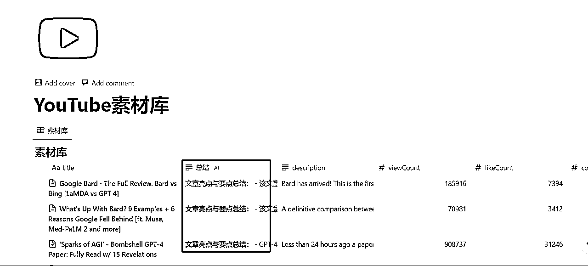

对单篇文章我也会做精修，选中一段文字后换个提示词就能让 Notion AI 再次重写。Property 结合 Notion AI 的总结功能，让我能快速把握大意，整体体验很顺手。

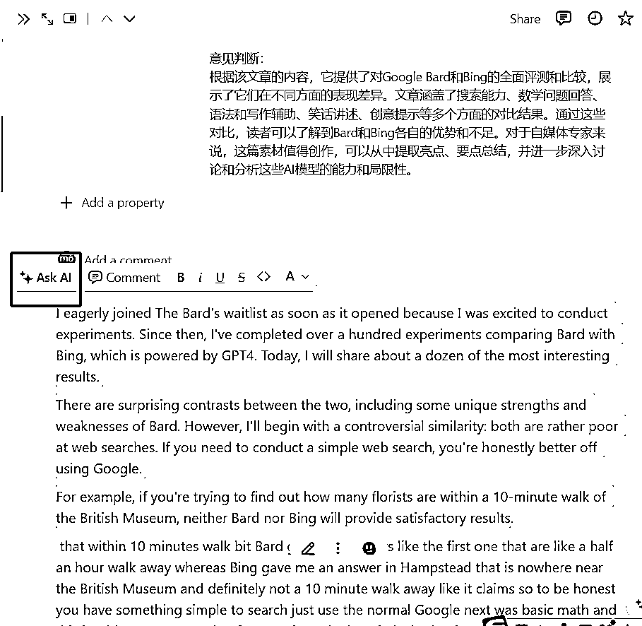

推特这边的同步主要是我每天点赞的推文。在时间不够的时候，我会用 RPA+GPT-4 代替我刷时间线，把我关注账号的原推自动存进 Notion 并生成摘要，留到合适的时间再看。

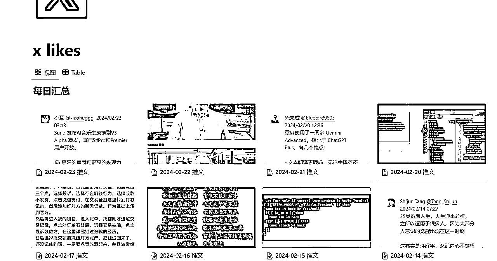

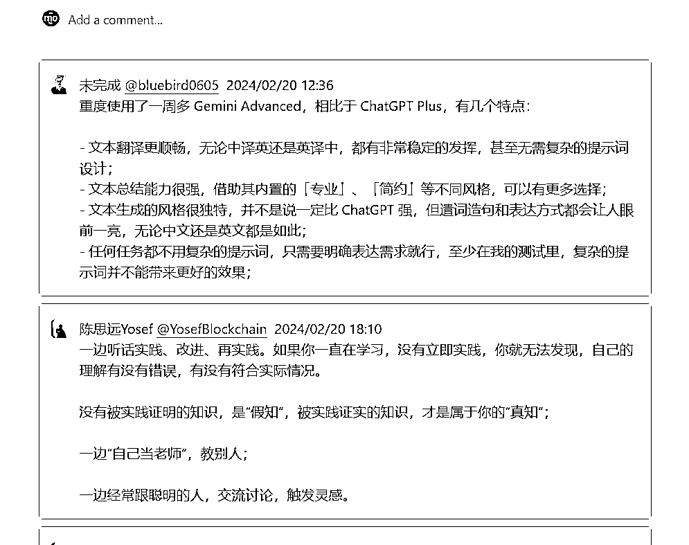

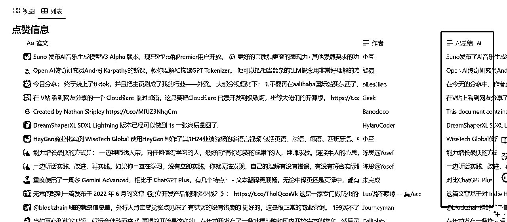

语音备忘录也是常被忽略的一环。我偶尔会用手机录想法，录完会自动转录进 Notion。后续我规划的是，如果 Coze 能开放 API，就让 Coze 接管这条线，对我每天的想法做事实核查，再按指令去网上搜资料、整合信息。比如我丢一句“我要做 X”，它就能按工作流自动搜集资料。

谷歌趋势这块是因为 Google 每天会发 Newsletter，邮件进来后就能自动同步到 Notion。红框里放的是我写的 AI 模板，自定义提示词后可以迅速了解当天的搜索热点。

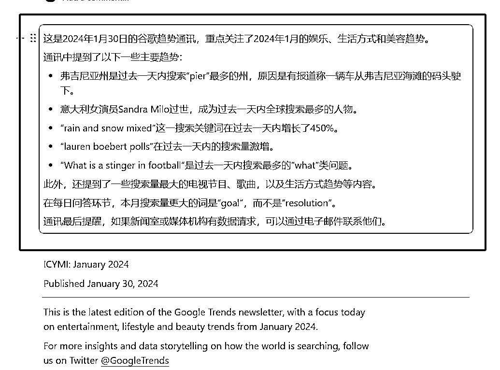

📕的抓取我没走 Excel，直接把笔记和文案一起写进 Notion，阅读和二次创作的效率更高。

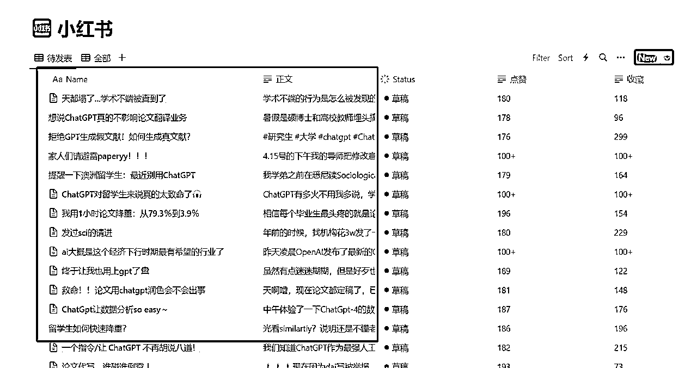

除了以上这些，还有 GitHub 每天的开源榜单、Hugging Face 的模型数据与 Space 动态、苹果语音备忘录的转录、👸号文章抓取等等。把它们都收进 Notion 的好处是 All in One，和我日常笔记无缝衔接。但问题也很明显，现在是分散在多个数据库里，无法真正融合。我试过全塞一个库，结果数据量一大筛选就变慢，Notion 本身对大数据量的支持有限，所以目前只能维持现状。后续有更好的整合思路很欢迎交流。

有了素材库，下一步就是内容创作。我会把重点素材一键关联到创作表里，在这里结合自己的想法用 Notion AI 做融合。整合完后我会标记状态：待发或已选平台，比如👸号草稿箱、知识星球、推特、即刻。发多平台我就不用一个个平台手动点发布了，懒人福音。分发的数据源除了 Notion，还有本地视频文件和 Excel 文案，这部分构成了我的多平台分发体系。

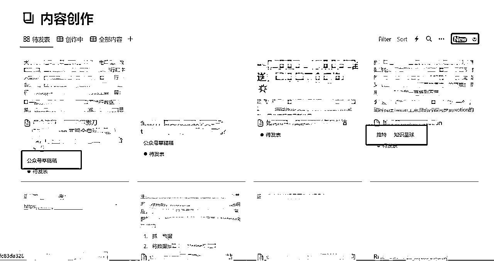

总的来说，Notion 是我除了 Coze 之外最重要的创作平台，也是素材收集与管理的核心。它的全能、灵活以及和 AI 的深度结合，让整个创作链路更高效、更有序。

## 第四部分：用影刀把文案变成数字人视频

这部分是把上面生成的账号和文案交给数字人来演绎。大致流程是：

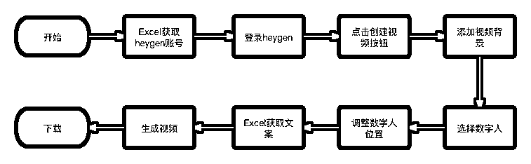

### 演示

先上演示效果

heygen 负责数字人生成，剪映负责剪辑和字幕。

生成的数字人有两个小毛病，第一是右下角的 Logo 需要裁掉，第二是首帧要加标题或封面并生成字幕。

Logo 裁切我一开始想用剪映，后来发现剪映对 Win 元素的识别支持不好，只能靠图像操作，效率低精度也不理想。最后求助了 GPT-4，相关对话记录在这儿：

https://chat.openai.com/share/b9dd4425-b28a-4bfc-832f-cae9061c8b22

https://chat.openai.com/share/40a807c8-a0ed-4fe8-8063-859604cb628d

GPT 给的代码可以直接用，一字不改就把 Logo 裁掉了，还能根据标题文案自动加首帧或生成封面。

剪映还是要用，主要是为了智能字幕，效果如演示那样。生成的数字人视频就放在下面。

## 第五部分：多平台分发

多平台分发部分先留个坑，后续补完。涉及的平台包括抖音、视频号、📕、推特、👸号等。

这段时间我还做过不少 RPA 机器人，比如抓取 YouTube、TikTok、操作 Notion、批量做📕图文等。只是分享需要写文档，作为程序员我写文字比较痛苦，所以一直拖到今天阶段性复盘时才用语音和 GPT 聊出来，这篇文章 AI 参与度很高。如果文中有什么更好的做法欢迎指正。

最后谢谢你看到这里，如果有帮助点个赞鼓励一下，互动多的话我会继续开源更多 RPA + everything 的方案！