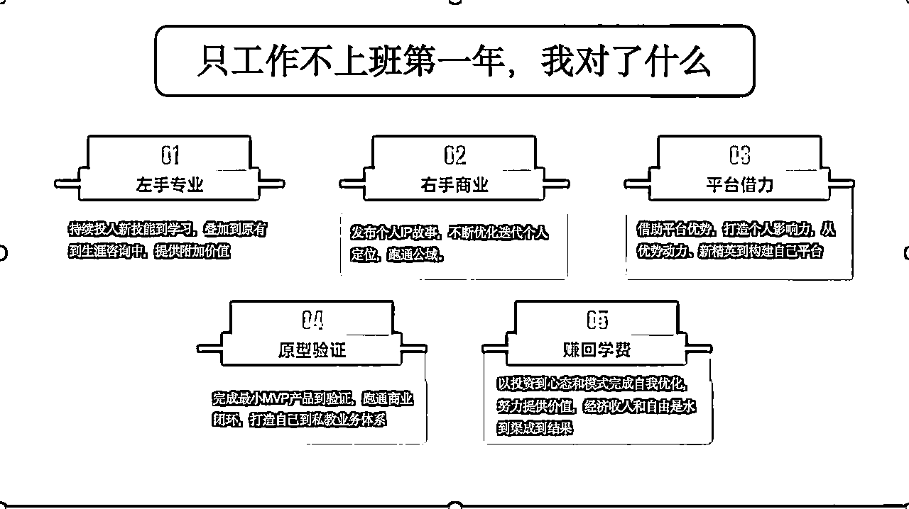
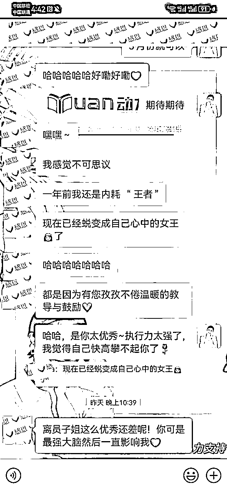
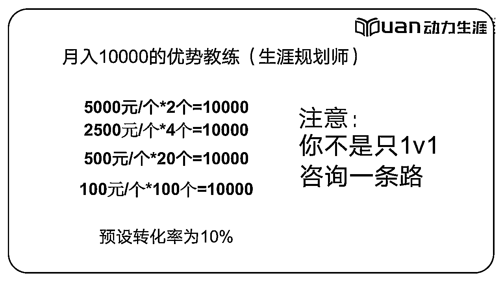
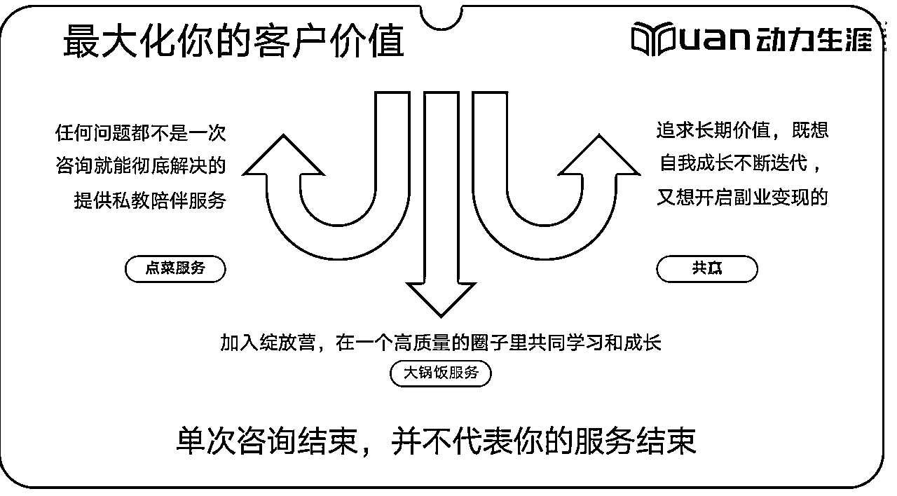
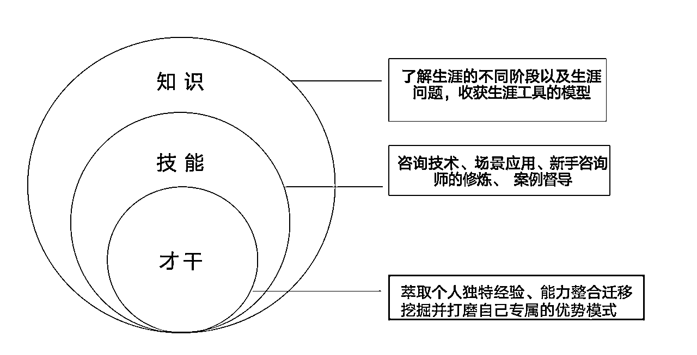
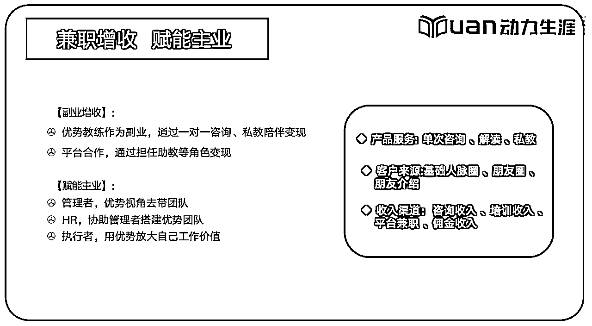
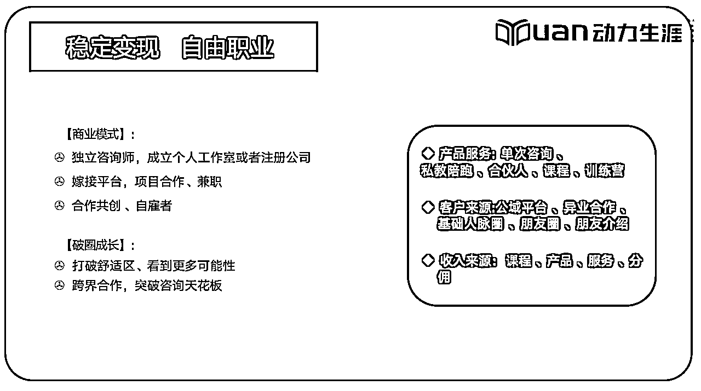

# 生涯规划赛道，从月入1500到年营收50w+， 我做对了什么

曾经月薪只有1500，现在年入50w+，我在职场方向规划这条路上，到底做对了什么？

大家好，我是员子姐。

2023年，是我告别坐班的第一年。那一年，我靠“帮别人找准职业方向”赚到了50多万，同时收了18位共创伙伴，完成了上百场个案辅导。很多人问我凭什么，其实答案很简单——我把自己的天赋，打磨成了别人愿意买单的交付物。

先交代一下我的履历。2018年我撞上职业瓶颈，开始研究职场路径规划，一研究就是7年。这期间拿下了国家认证的职业规划师、盖洛普全球认证优势教练、结构化复盘高级教练等资质。2023年，我受聘成为新精英生涯的基石班促动师、职业突破营签约带教老师，同时也是优势动力创富合伙人、粥左罗顶峰会成员。

13年职场经历，3次零基础跨行换道。教过大学，待过体制，玩过互联网，也组建过高科技公司。现在我专注做的事，是帮上班族、自由职业者、轻创业者找到个人的天赋定位，让你主业有突破、转型有方向、副业有机会。

这些年，我累计辅导过400多位职场人，个案时长超过500小时，还带了100多位新手顾问跑通商业闭环。

我能提供的服务有三类：
- 替职场人规划晋升路线，实现升职加薪、副业增收；
- 帮创业者锁定专属天赋模式，把个人影响力放大十倍；
- 带咨询师梳理发展路径，把商业闭环彻底跑通。

自由职业后的日常，是每天只工作三四个小时，剩下时间全部自己支配。周末陪娃、日常健身、看望爸妈、错峰旅行、约闺蜜下午茶，一样都不落。孩子生病不用再看领导脸色请假，学校活动也不会因为加班而缺席。人生方向盘重新回到自己手里，这种掌控感，千金不换。

很多朋友羡慕我的状态，也好奇我是怎么走过来的。今天就不藏私，把自己这些年踩过的坑、试对的路，一次讲清楚。

先给你看一张图，这是我过去一年沉淀的5个心法。

今天的分享，我挑了4个重点：
1. 如何用复盘思维强化天赋，找准事业坐标；
2. 如何打破一对一咨询的价格上限，让时薪冲到4位数；
3. 从零起步到稳定变现，一名顾问要经历哪几个阶段；
4. 给想进这行的你，几句掏心窝的话。

---

一、定位不清？用复盘思维来排雷

很多人的副业卡在定位。一种是选项太少，压根不知道能干嘛；另一种是选项太多，觉得自己无所不能。

我属于后者，而且病得不轻。

为了“做自己”，我这些年考了一堆证：职业规划师、优势教练、复盘教练、高考志愿填报师、职业发展管理师、讲书教练、人偶心游解读师、数字天赋咨询师……名片都印不下。

可真到自由职业那会儿，我反而慌了：能干的太多，哪样都舍不得丢。纠结到最后，我决定从最熟的领域下手：复盘教练、职业规划、高考志愿填报。

但这几步走得不顺。好在我习惯复盘，每次掉坑都能及时爬出来，再找靠谱求助，快速调整方向。

分享三条定位原则，外加一套公式。

原则一：方向不能只凭个人喜好，市场和用户才是裁判

我因结构化复盘受益，入职互联网公司6个月就升到管理层，所以一直对复盘课有执念。结果现实给了我一记重拳。

2023年1月，我开了一期“高效复盘心法”训练营，勉强招了10个人，课程效果却不达预期。给合作的伙伴分完钱，那个月我账上只剩1500元。

事后我做了深刻复盘，问题出在三处：
1. 没做市场调研，凭感觉开课。大家都喊复盘，但把复盘当刚需的人并没那么多。
2. 用户要的不是复盘技巧，而是复盘带来的好处。我没戳中痛点，纯属自嗨。
3. 没有流量，也不会写营文案。以为产品好就有人来，单纯得可笑。

这次碰壁让我明白：能让人改变的从来不是道理，而是撞过的南墙。

原则二：市场需求再大，也要结合自身天赋，边做边调

高考志愿填报那几年很热，客单价也高，我为了追风口去学了。2023年2月1日，我收到第一位私教学员——给高一学生做选科辅导。早上看到转账消息确实兴奋，可交付过程差点把我榨干。

原因很简单：付钱的是爸妈，面对的是孩子。爸妈总想通过顾问偷看孩子内心，但顾问有保密原则；孩子想打开心扉，又需要足够的安全感和信任。这个分寸极其难拿捏。更别说一小时的辅导背后，还有家长在微信上无休止的追问。

我的盖洛普强项在影响力和战略思维，天生不适合长时间高密度沟通。加上“沟通”和“取悦”两项才干排后，这种模式对我简直是凌迟。

于是，我果断砍掉高客单的全案辅导，只保留单次咨询。单价是降了，但交付轻了，我也不再内耗。

原则三：别迷信旧经验，要顺着市场风向及时调头

因为我有三次跨行经验，来咨询的也多是转型者，我辅导起来得心应手，于是把定位写成“基于优势的职业转型”。

可很快我发现，公域里“职业转型”几乎没有对标账号，获客极难。大家搜的都是“求职辅导”“面试辅导”“简历修改”。我开始怀疑，是方法不对，还是方向天生有问题？

遇到卡点，我的习惯是立马求助专业的人。我打电话给靠谱，她一句话点醒我：“你只盯着自己，没看外部环境。现在企业都在降本增效，中年职场人保住饭碗就不错了，谁还谈转型？都在琢磨怎么搞副业、多赚钱。”

听完我豁然开朗。于是把定位改成：帮职场人、自由职业者、轻创业者找到个人发展突破点——要么主业升职加薪，要么主业副业双轨跑，要么直接用天赋做自由职业。

现在，我把职业规划、优势定位、复盘执行三件事打包，用一套职业测评、一份优势测评、一份报告，帮来访者找准主攻方向，也挖出副业机会。

这里分享一套定位公式（副业同样适用）：

我要帮助（），解决（）问题，创造（）价值，收获（）回报。

调整定位后，我的一位学员案例验证了这套打法。

这位学员做餐饮，最开始因为职场关系紧张，想跳槽到另一家主题餐厅当店长。咨询中，我翻她的盖洛普报告，发现她的内耗来自“和谐+体谅+适应”三件套，但“关系”和“个别”才干让她极擅长察觉客户差异化需求，“沟通”才干则让她的表达很有力量。

我给她定了“稳住主业+探索副业”的路线。主业上，提升学历、学西餐知识，往私人管家方向试探；副业上，开始系统学写作。

5个月后，她接连在“读者”上稿，拿到了稿费，情绪问题也在复盘中逐渐缓解。学历考试顺利通过，录取通知书到手。

前两天她跟我说，一年前还在内耗漩涡里挣扎，没想到现在活成了自己心中的女王。

这件事也让我觉察到，我的天赋被彻底激活了：搜集让我快速获取信息，战略帮我匹配最优成长路径，统率推动客户做决定并持续向前。

所以你看，定位不是找人算一卦，而是在探索、试错、验证中，一点一点浮出水面的。

探索定位时，对内要聚焦，对外要敏锐。

对内聚焦，是看清自己的基本盘：过往经验、知识技能、手头资源。我的基本盘是职业咨询，所以我会一直保持专业状态，死磕帮用户解决问题的能力。

对外敏锐，是紧盯市场变化。靠谱常说，要做离钱近的事。想变现就别闭门造车，市场风向一变，你得跟上。

二、从时薪800到单次8000，我做对了什么

2023年，我陪跑过100多位新手顾问。大家普遍认为，咨询变现就是做单次咨询、案例咨询，顶多再开开课、做做培训。

我也从那个阶段走过。

但在玩赚社群泡久了，看到不少优秀合伙人的产品设计，我慢慢开了窍。我的“战略”才干排第三，天生擅长借鉴别人跑通的模式，快速迁移到自己业务里。

1. 用销冠思维撬动高客单，打穿收入天花板

先来算道数学题。

很多想进职业规划、心理咨询、优势教练、高考志愿填报这行的人，一开始觉得月入过万就知足了。

我们算笔账：客单价在99～499元之间时，想月入过万，每月至少成交20～100单。按10%转化率算，你每个月得谈200～1000人。

可要是客单价提到5000元呢？每月只需成交20单，平均每天不到2个人。

你可能会说，新人哪收得起5000？确实。但如果你在后面接一个高客单产品，这事就变得可行。这个产品可以是自己的，也可以是你认可的大佬的。

我做咨询这些年，见过太多来访者做完一次就消失。为了保持收入，我只能不断找新客、不断做一对一辅导，像永远追着客户跑。

后来，我把销冠思维融进咨询流程：每次咨询结尾，埋几个“钩子”。做过咨询的都知道，结尾通常会让来访者说说下一步行动。这个环节特别适合做转化——推荐社群、私教、共创计划等。

可很多职场人听不懂这些词，我就用吃饭来类比。

- 私教，像请了一位专属大厨。你想吃什么告诉他，买菜、做饭、洗碗、收拾，全不用你管。大厨还给你定制菜单，全程陪伴。
- 社群，像吃食堂。有一定选择，但不能点菜。今天你想吃水煮鱼，食堂偏偏只有水煮肉片。
- 自我探索，像自己买菜回家做。想做什么都行，但买菜、下厨、收拾全得自己来，好不好吃也自己认。

这套类比，放在找天赋、找方向、求职规划等场景，同样好用。

咨询结束时，如果来访者方向已经很清晰，我会直接说：“你想走的这条路，我有资源、有好课，我自己就是受益者，要不要听听？”

比如，线下实体店主想转线上做IP，我推荐玩赚合伙人；想做优势教练的，我推荐苏姐的创富计划；想深耕写作的，我推荐粥左罗的顶峰会。总之，按每个人的诉求和天赋，匹配后端高客单产品。

用这招，我3个月成交了9位高客单合伙人。

同样的60分钟咨询，我从800元卖到了3000、5000，甚至8000元。

2. 乐高式产品组合，让时间更值钱

受玩赚合伙人和靠谱产品体系的启发，我开始用乐高的方式重新拼装服务。

大多数职业规划师，卖的都是自己的时间。产品高度同质化，怎么脱颖而出？答案是把附加值加上去。

举个真实例子：
同样是做职业咨询，价格差不多，但买我的服务，额外送一个陪伴群；
同样是私教，我多送一年玩赚新媒会员，或者一套朋友圈变现课。这个时代谁不想了解自媒体副业？这一招非常抓人。
在分销其他高客单产品时，我也会额外赠送个人优势辅导、职业规划咨询，或者全套职业测评。

做咨询这一行，光有专业能力不够，还得有商业认知。真正拉开收入差距的，恰恰是认知。

三、从零基础到自由变现，成长路径全拆解

第一阶段：学习期——把地基打牢

这个阶段的重点，是学知识和考证书。没有案例积累时，专业认证就是你获取信任的背书。

这个过程大约需要3个月。但学习结束，才是实战的开始。

这个阶段最大的卡点，不是不敢定价，而是不敢开第一单。我带过六期新人班，见过太多人怕技术不够、怕效果不达预期、怕被打低分。

我想澄清一点：职业规划师是引导者，不是答题机器。我们不需要知道所有答案，只需要通过提问，带对方换个角度看问题，让他自己找到突破口。

学习期，这几个动作很关键：

- 学完就实战。课程一结束，马上开启公益咨询，先做50个找手感，同时接受督导。
- 咨询前做足准备。我最早做优势辅导时，每次见客户前都会把优势课、教练课重新过一遍。用实战检验自己吸收了哪些。
- 咨询后收集反馈。客户的评价是最好的磨刀石，还能帮你找到最擅长的细分领域。
- 做好预期管理，敢给承诺。咨询开始前讲清楚，不是马上见效；30分钟内不满意，全额退款。我辅导了400多人，至今没人退过款。

学习期的案源从哪来？

流量，是新手最大的坎。

- 早期案源，主要靠朋友圈激活。特别感谢芷蓝和靠谱。我没灵感时，就去翻她们的朋友圈。芷蓝的朋友圈课讲透了发圈逻辑。每当我犯懒，看到这么厉害的大佬还在勤奋发圈，就不好意思躺平了。
- 起步阶段可以做公益或免费咨询，在付费社群里招募，提供30分钟微咨询体验，或随喜价正式咨询。一石二鸟：攒案例数量，攒好口碑。老客户满意了，自然会为你转介绍。
- 这个阶段的核心不是变现，而是刷存在感。至少要让微信好友一遇到生涯问题，第一时间想到你。我发了15个月朋友圈，有人3月咨询过没付费，5月突然就转钱来了，一句多余的话都没有。这就是持续发圈的价值。

第二阶段：发展期——兼职创收，反哺主业

到了这个阶段，大多数人主业副业并行。前期待遇不稳定，不建议你冲动全职。

可以跟一些平台合作，当班班、助教、带教老师。一来案源稳定，二来提升技能，三来积累案例背书。

发展期的核心，是持续实战打磨手艺。获客仍以私域、社群为主，有余力再碰公域。

咨询这行跟医生、律师很像，经验越丰富越值钱。但手感必须勤练。

我的建议是，每周至少接1个咨询，让自己保持专业状态。

公域平台怎么选？结合你的特长和平台属性，挑一个能长期坚持的。这点我没做好——📕爆了一篇就松懈，好在前尾效应很强，流量一直没断。

所以，无论选哪个平台，持续输出才是王道。

第三阶段：成熟期——稳定变现，自由职业

能走到这一步的顾问，真心不多。

我从2018年开始学，新精英生涯每年培训2000多人，能坚持做咨询的约10%，能稳定变现做成事业的约5%。

很多人开局热血沸腾，后来被案源、收费、技能、效果一道一道坎磨平了心气，最后选择放弃。

所以我常说，自由职业是强者的游戏。

自由职业也是职业，需要更强的技能，更强的自驱力。能走到成熟期的咨询师，专业能力都过硬，变现渠道也更广：

1. 做个人IP，沉淀用户和案源；
2. 跟专业平台合作，项目制、导师制，只负责交付；
3. 跟大佬合作研发产品；
4. 带货、分销。

到了这个阶段，还可以继续做差异化，根据市场变化和自身擅长，找到更细分的领域：

青少年生涯规划、学业规划、高报师、考研辅导
简历修改、求职教练、面试辅导、背景提升
生涯咨询师、生涯培训讲师、高管教练
企业培训师、企业人才发展顾问
家庭教育指导、心理咨询师、情感咨询
商业咨询顾问、个人发展教练
……

四、最后，给想进这行的朋友几句交心话

第一，咨询是一门手艺，不需要你修炼成高手才敢上路。别总想着等100分再开始，你是在奔跑中慢慢变强的。

第二，能变现的咨询师，不仅要有专业能力，更要有商业思维。技术决定你走多稳，认知决定你走多远。

希望我踩过的坑，能成为你的垫脚石。咱们路上见。

做事业这件事，千万别自己闷头走。

员子姐在复盘里给了三条很实在的提醒：

第一，别单打独斗。市场里别人都在做什么、同行在怎么尝试，值得你抽时间去打量。别人的失误可以帮你省下试错成本，别人的打法如果有效，也完全可以拿来拆解、改造成适合自己的版本。

第二，学会做减法。时间精力都是有限的资源，必须敢断舍离，把重心押在自己真正擅长、能拿出手的领域上。尤其是做优势教练的人，如果自己都做不到扬长避短、发挥长处，那又拿什么去帮助客户呢？

第三，稳住自己的内核。清楚自己的优势在哪，有一个笃定的内在坐标系，才能在自己的体系和节奏里持续推进，不被外界的嘈杂和他人的步调带跑。

这就是员子姐这次复盘的核心干货。

如果你对我、以及我的产品和业务方向感兴趣，欢迎来聊聊~