# 做🛰️公号3个多月赚了2.5万：从爆款到违规，我踩过的坑和攒下的经验
作者：龙哥

我是龙哥，本职是软件测试工程师，业余时间做🛰️公号内容。2023年以前，我就是个摸鱼打工人，偶尔学点技术、看看行情，打算跳槽涨薪。后来大环境变了，公司开始缩编减薪，换工作加薪这条路基本堵死。我也试过别的副业，结果全是交学费，没赚到什么。最后自己下场写公号，3个多月收入2.5万余元，其间账号反复进入推荐又失去推荐，积攒了不少一手心得。今天把这些东西全部摊开讲，希望对你有参考价值。

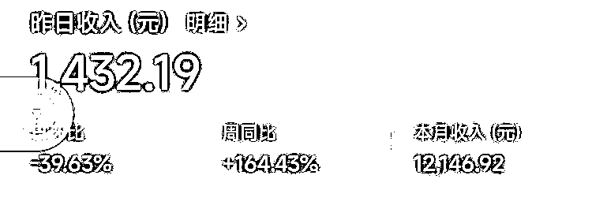
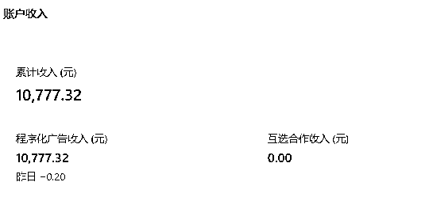

## 4个进过推荐池的号，收入从1000到1.3万不等

我这段时间实际操作过4个被算法选中的号：

第一个号：从开号到被推荐用了16天，在池9天，总计赚了1.3万多。做法是直接用指令让AI模仿热门稿子。缺点是太容易被投诉洗稿、吃原创违规。
```
【】请根据上面的文章模仿出一篇新文章，标题文字不要改变，需要MarkDown格式。1000字左右
```

第二个号：开号14天就进了推荐池，在池15天，累计收入1万多。玩法是整合站外文章做二次创作。麻烦在于找素材特别耗时间。


第三个号：注册后第40天才被捞起来——前10天更新，中间停了30天，恢复日更当天就获得推荐，在池14天，收益只到1000出头。创作方式同样是站外几篇合一篇，外加给AI设定人设、按大纲写。短板是文章质量时好时坏，非常考验提示词功底和调教经验。
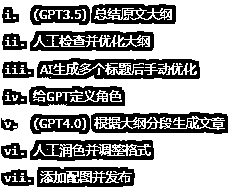

第四个号：也是40天才开始有推荐，前15天日更，停更30天，复更15天进池，在池14天，到手4000多块。

把四个号合起来看：进推荐一般要花11到16天；失去推荐则集中在9到15天；单号收入从1000到1.4万不等。我的结论是：双号一起开，稳更半个月，大多数号能等到推荐机会。详细经历放到后面“心路历程”部分说。

## 从注册到起号，这些环节可以少走弯路

### 用家人或朋友身份注册🛰️公号

手机打开🛰️公众平台管理后台，按提示填写资料，扫码加人脸识别。邮箱必须用没绑定过🛰️或公号的净号，我用的2925无限邮箱。管理员手机号同样要干净，一部手机最多绑5个🛰️号。主体类型选“订阅号”。具体操作可能需要亲戚配合：先在“公众平台安全助手”里解除关注，再把你加为运营人——这步需要亲戚🛰️扫码；然后关掉群发消息保护。结算方式可以选“委托他人结算”，提前打印委托结算单、备好主体身份证正反面照片，签字时左右手换着签、填清日期，再拍照上传，走财务审核。

### 快速把号搭起来

头像直接参考同领域的高粉号来设置；名称尽量跟赛道贴合，比如职场类可以叫“职言不讳”“职场人35”；简介里放满本领域的高频词，像“职场干货”“职场经验”“职场潜规则”。这样号的基础形象很快就能立住。

### 开通流量主

我10月花35元买了机器粉，直接就开了流量主；到1月门槛高了，要花120元买真人粉，还得连更7天才行。审核规则一直在变，整体是越来越严，最新情况最好直接问刷粉商家。

### 怎么选领域？

三个字：热、垂、细。热，是选的那个方向上近期已有好几个新号在30天内做起来；垂，是确定赛道后至少连着发同主题15天；细，是在热门的范围内再切小口子，比如职场细分出“缩编减薪”，民生细分出“养老保障”。我比较推荐：养老、律例、数码、民生政策、职场人情世故这几个赛道。

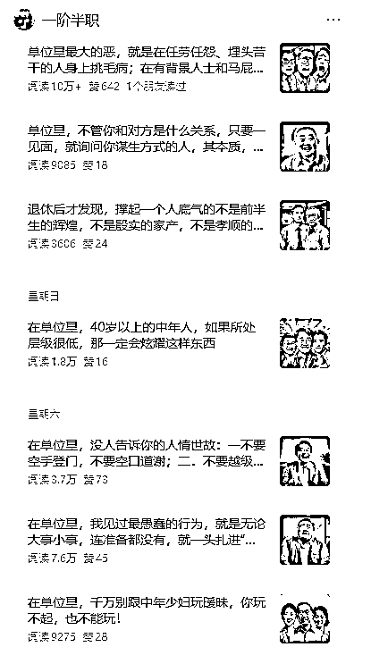
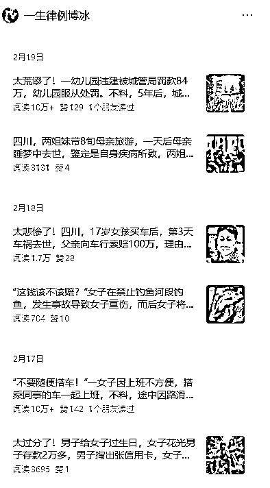
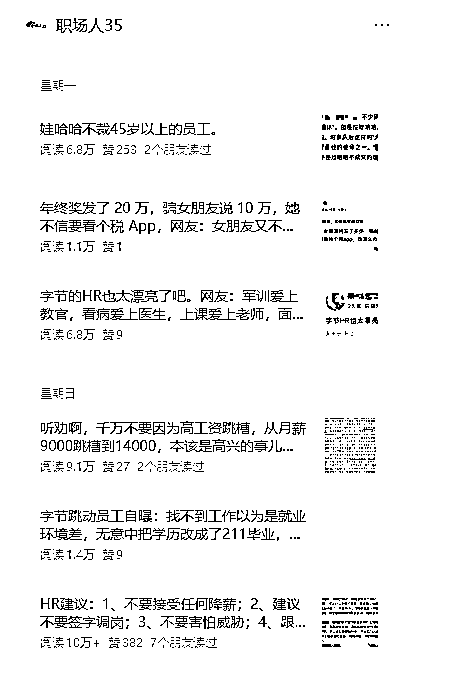
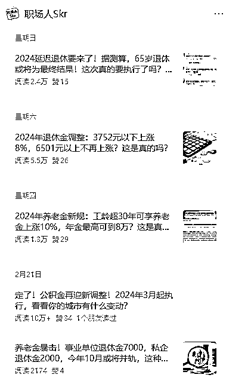

### 去哪找对标内容和对标号

🛰️里就能挖：订阅号消息列表的“看一看”是个入口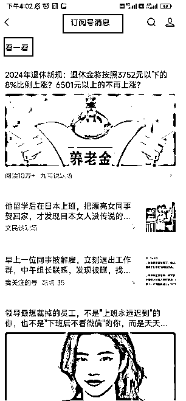；文章底部的相关推荐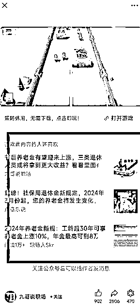；发现页的“看一看-在看”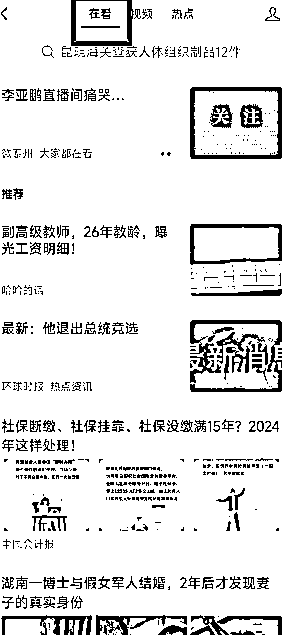和“看一看-热点”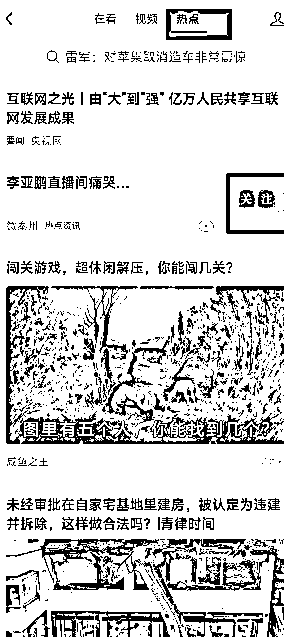。数据工具我推荐次幂数据、极致了、西瓜数据，挑一个就行。其他平台也好用：📕看情感和极简生活，🧣看娱乐八卦、时尚热点，知乎看职场体制和数码科技，今日头条看军事历史和情感故事。

### 用AI产出文章的两条路子

第一条：大纲生成。先用GPT3.5把参考文压成大纲```
【标题：
正文：】标题不变，总结这篇文章输出标题和大纲，详细一点
```，人工检查打磨后，让AI批量产出标题再手动挑```
这是这篇文章的标题<>，现在请你仿照这种风格、字数、并分析其中吸引人阅读的元素，给我三个含义不变但文字内容不一样的标题
```。然后给GPT设定角色```
【背景】
我在运营一个退休和养老金相关政策解读的微信👸号。
【角色】
我希望你扮演一名资深的退休和养老金相关政策解读的资深研究者。作为这个领域的资深研究者，你拥有丰富的知识和经验，擅长解析复杂的政策条款和规定。你在运营一个退休和养老金相关政策解读的微信👸号，每天发布深度解读和实用建议，帮助读者更好地理解和规划他们的退休生活。你的文章经常能够引起广大读者的关注和共鸣，许多爆款文章的阅读量超过了10万。你的目标是传递准确、权威的信息，帮助人们做出明智的决策，确保他们的退休生活质量。
【任务】
请按照以下要求编写一篇1200字的政策解读/辟谣文章，保持文章起承转合的连贯性和吸引力。
【要求】

文章风格
现实关注：文章围绕着当前社会中普遍关心的退休金和政策问题，贴近读者的实际生活。
解疑释惑：通过对网络传言的澄清和政策的解释，文章以解答疑问和消除误解为主要目的。
段落风格
清晰有序：每篇文章的段落都遵循了逻辑清晰、条理有序的结构，便于读者理解和跟进。
信息丰富：段落中包含了丰富的信息，既有对现状的描述，也有对未来可能变化的预测和建议。
特殊要求：重点句子使用markdown格式加粗展示
创作流程
1、任务启动，请你帮我写一篇大纲为【】的文章 
2、文章输出：开头（200字）、发展 （350字）、顶峰（450字）、结尾（200字） 
3、先不要输出文章，等待我的指令
明白请回复我明白了。
```，用GPT4.0按大纲一段段写```
首先撰写<引言>部分
现在撰写<>部分
```，最后人工润色排版、配图发布。

第二条：站外二创。先在公号里锁定一个爆款选题，再去头条、百家号、知乎等平台找2-3篇同主题文章，混编成1000字左右的新稿。同样先给GPT设定角色```
【背景】
我在运营一个退休和养老金相关政策解读的微信👸号。
【角色】
我希望你扮演一名资深的退休和养老金相关政策解读的资深研究者。作为这个领域的资深研究者，你拥有丰富的知识和经验，擅长解析复杂的政策条款和规定。你在运营一个退休和养老金相关政策解读的微信👸号，每天发布深度解读和实用建议，帮助读者更好地理解和规划他们的退休生活。你的文章经常能够引起广大读者的关注和共鸣，许多爆款文章的阅读量超过了10万。你的目标是传递准确、权威的信息，帮助人们做出明智的决策，确保他们的退休生活质量。
【任务】
请按照以下要求编写一篇1200字的政策解读/辟谣文章，保持文章起承转合的连贯性和吸引力。
【要求】

文章风格
现实关注：文章围绕着当前社会中普遍关心的退休金和政策问题，贴近读者的实际生活。
解疑释惑：通过对网络传言的澄清和政策的解释，文章以解答疑问和消除误解为主要目的。
段落风格
清晰有序：每篇文章的段落都遵循了逻辑清晰、条理有序的结构，便于读者理解和跟进。
信息丰富：段落中包含了丰富的信息，既有对现状的描述，也有对未来可能变化的预测和建议。
特殊要求：重点句子使用markdown格式改为红色字体
创作流程
1、任务启动，请你帮我写一篇大纲为【】的文章 
2、文章输出：开头（200字）、发展 （350字）、顶峰（450字）、结尾（200字） 
3、先不要输出文章，等待我的指令
明白请回复我明白了。
```，让它直接生成，要求和原文的重复率控制在30%以内```
【】请根据上面的文章模仿出一篇新文章，标题文字不要改变，重复率低于30%，需要MarkDown格式。1000字左右
```，再人工润色排版、配图发布。

### 推荐机制拆给你看

内容上，垂直度越高推荐人群越准、点开比例越好；原创性越强、新增信息越足，曝光越多；打开率、完读率、点赞率、关注率、停留时间等数据越好，推荐滚得越猛。账号权重上，千万别留违规案底，洗稿、造谣、乱标原创都是雷；更新频率也有讲究，进池前每天一更或两更，进池后提到三更到八更；注册早、活跃久的号权重自然高。

### 怎么冲进推荐池？

先判断进没进：出现多篇阅读三位数且推荐流量过半，或者出现一篇阅读四位数且推荐流量过半，基本就是进了。

想加快速度，可以叠几个土办法：一是请不同城市的朋友关注，从订阅号消息的推荐流里点开文章，像真人一样看完，再点赞、在看、转发；二是用已经进池的号带新号，文章里插入新号的文章链接或👸号名片；三是数量压制算法——单号一天发两三篇，同时开多个号日更。我怀疑近两周的发文频率和篇数会直接影响推荐，这也是很多号拖到半个月后才进池的原因之一；相同操作下，有人连更一个月都没进，有人十天就能成。四是提升内容质量，AI生成时别一口气写完，分段来效果更好；生成后让GPT自己打分、提优化建议，再人工调整；重点句子加粗、高亮，文首文末适当求赞求关注。

### 数据不好，怎么调？

点开率低，就改标题。试试“开门见山抛爆点”，或者让AI多给几个备选标题再混合。完读率低，就优化提示词和调教方式，排版上多分段，重点句加粗高亮，字数控制在1000字出头。点赞、在看、关注比例低，先提升内容质量，文首文末做引导，文中也可以插公号名片。

## 几句掏心窝的话

手里的号不宜太多。新手不建议一上来就铺太多号，我自己反复开过3到6个，最后都精简到2个。发的篇数上，进池前每天1-2篇就够，但要保证不断更；进池后尽量冲到3-8篇。我后面两个号全程没违规，照样被踢出推荐池，所以进池后应该抓紧多发，尽快把收益攥到手里。心态上，前半个月把自己当工具人，只负责更新，不要反复刷数据。掉池或数据难看时别慌。我处理焦虑的办法是：先让自己平静下来，把焦虑的原因一条条写出来，再逐个想解决方案，这么一轮下来，焦虑真的会减轻很多。

## 心路历程：从无人问津到80万阅读，再到跌出池子

刚开始我试过三农、民生、职场、养老等方向，10月12号发出第一篇，同时运营两个号，每天都更新，到10月28日阅读量还是只有个位数或两位数。虽然每天都认真写，却没有阅读，心里非常着急。那段时间我能做的只有坚持复盘，从自己身上找原因。

10.12：第一次拿GPT3.5写文，纠结半天到底做情感还是职场。
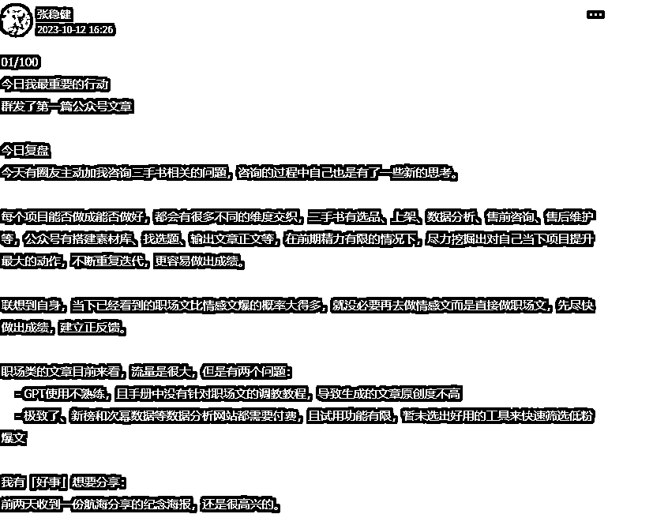
10.13：研究怎么找对标号。
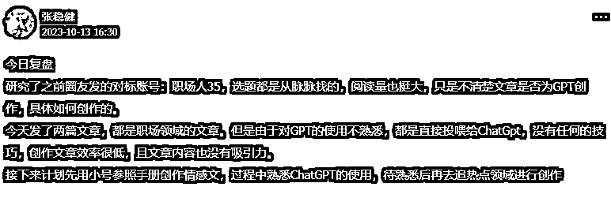
10.16：第一次真正变现，两毛钱。
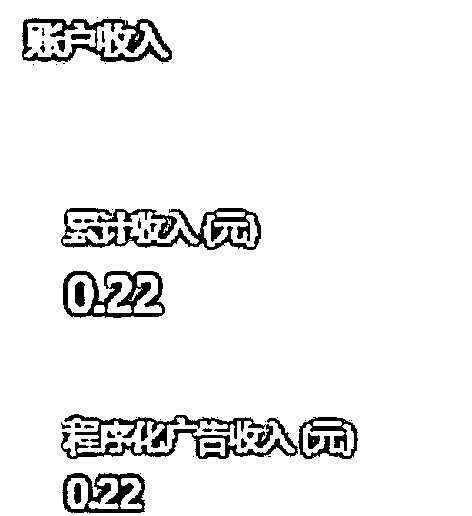
10.17：试着追热点更新。
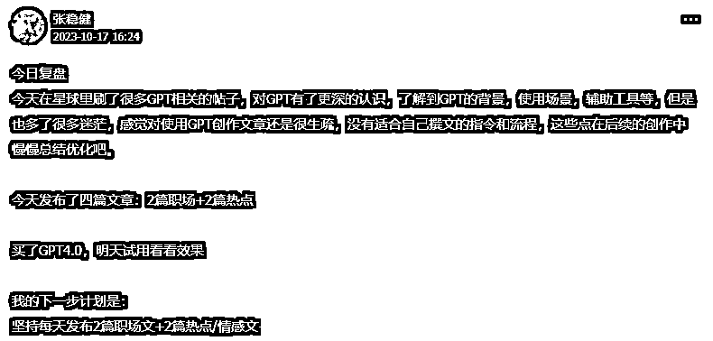
10.18：两篇稿子洗稿没洗干净，被判原创违规。
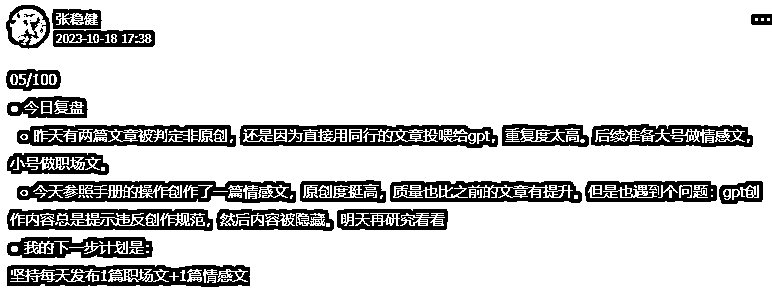
10.19：又一次违规，心态差点崩，但复盘没停；也是这天开始用GPT4.0写文。
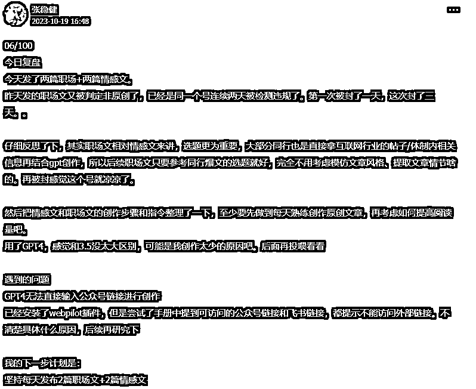
10.20：升级找对标的方法，刷完优秀圈友的航海日志，又花500元报了👸号训练营。
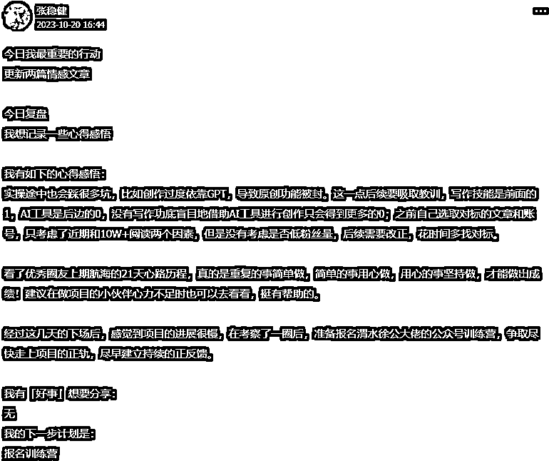
10.29：一篇写教师的文章突然爆了6000多次阅读，后台到账18块，激动得我向全家报喜。创作热情一下子被点燃，顺着这个选题连续扩展，更新频率从3篇加到5篇，最多一天群发8篇。
10.31：觉得自己底子太薄，把星球里关于爆文的心得帖和热门帖全刷了一遍，结合现状总结出一批可用方法。
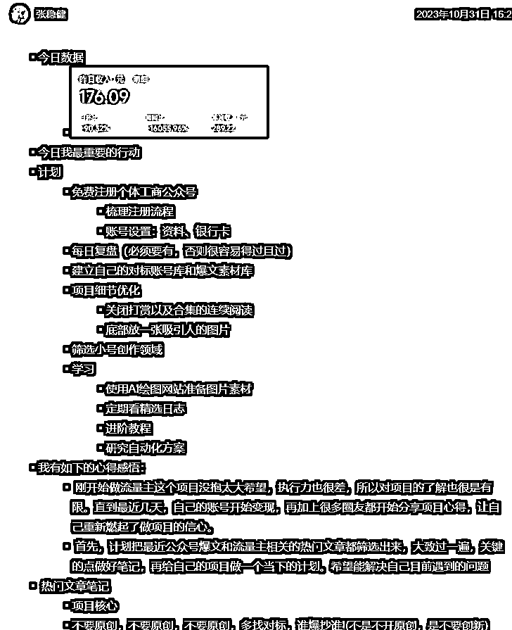
11.01：还沉浸在进池的喜悦里，忍不住想项目以后能有多赚钱。
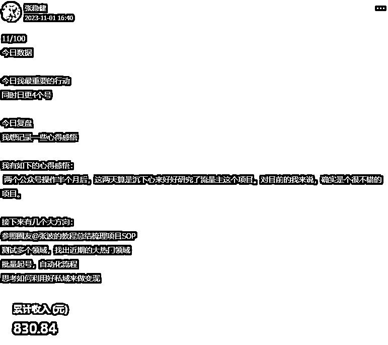
11.02：为了去云南旅游，提前备了20多篇草稿；顺手整理了注册流程，方便以后批量开号。
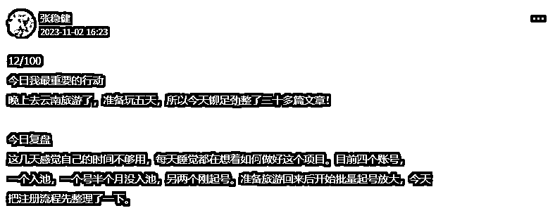
11.06：人在云南，脑子里还是公号那些事。
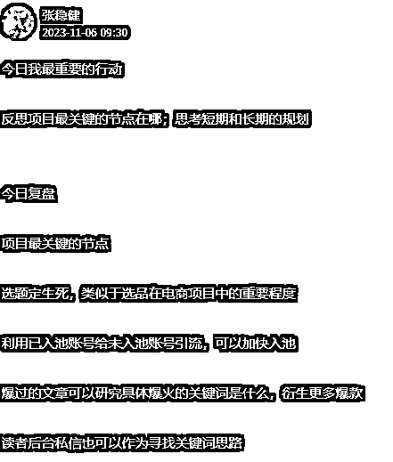
旅行期间还真“大力出奇迹”：最高单日流量80万+，单日收益4000+。可惜福祸相依，那篇80万爆文引来了人工审核，也可能是被人举报，最后被判“造谣、发布不实信息”。这个比原创违规严重得多，推荐被直接关掉，流量直线往下掉。

第一个号出池以后，我心态崩了，真像从天堂掉到地狱，对什么都提不起劲，但仍旧强撑着同时更新4个号（后来减成两个）。

11.07：第一个号正式掉出推荐池——开号16天、在池9天、累计赚了1.3万多。我整个人如同从天上摔到地下，做事全无动力，可还是逼着自己更新4个号，之后才降为2个。
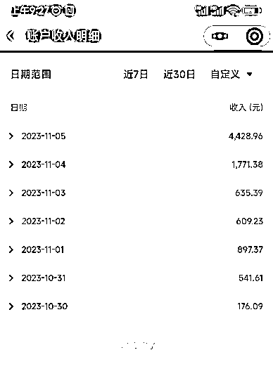
11.08：旅行回来，先调整心态，刷圈友帖子，反思自己的问题。
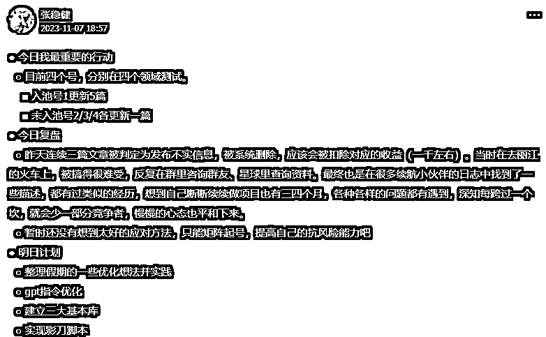
11.09：参考圈友@Jsonchao 的思路，试水自动化发文，想靠数量对抗流量变化。
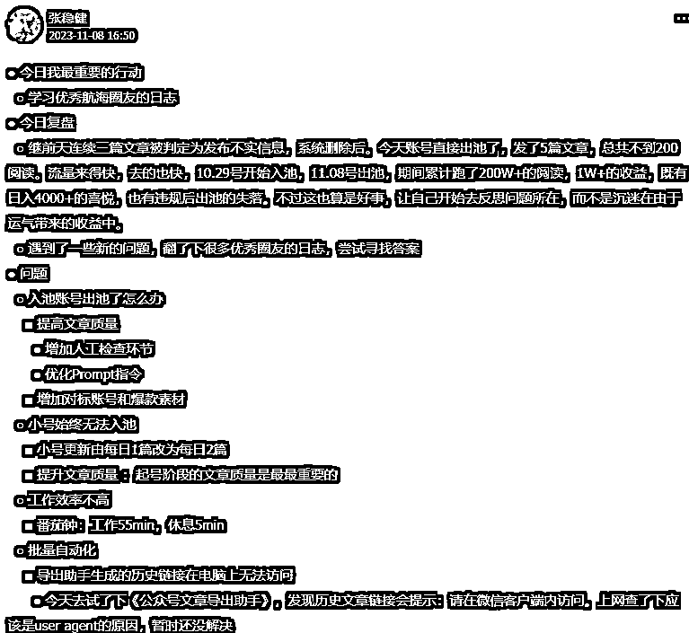
11.10：数据没起色，焦虑又来了，又花300元进入愚公掘金的知识星球，天真地以为付费能买来安心。
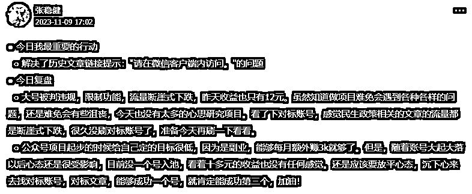
11.14：继续调整心态，把方向重新掰回来。
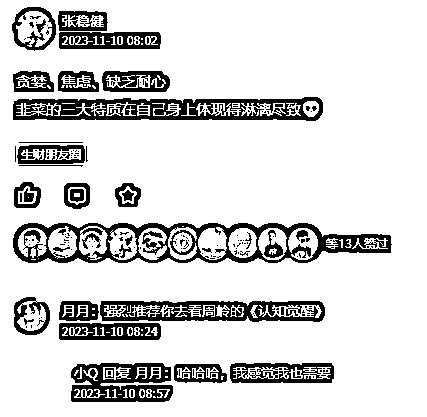
11.20：坚持复盘，每天给自己加油打气。
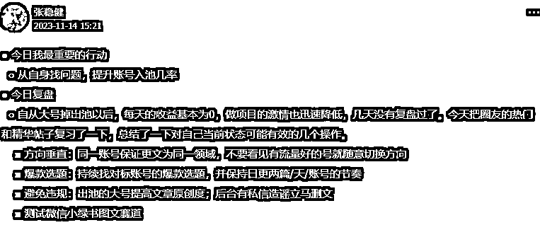
11.28：发现时间管理很重要，入手了滴答清单的年会员，可惜几乎没用，后面得捡起来。
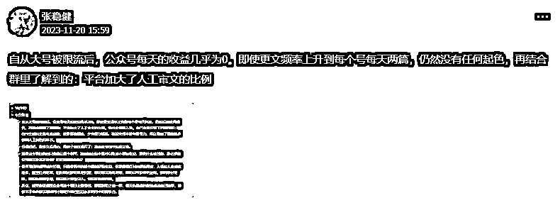
11.29：等了半个月，终于又有号重新获得推荐；我也开始研究公号数据网站。
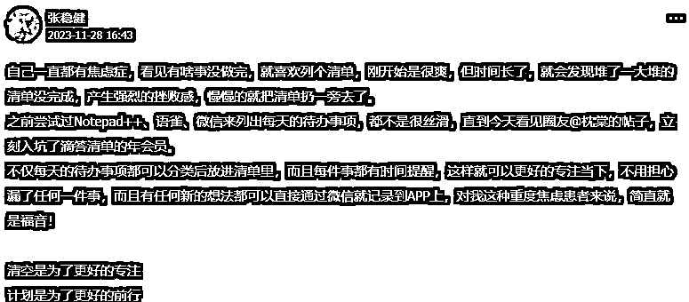
12.04：一口气开了6个号（后来又砍成两个），同时调影刀RPA脚本，想让发文流程自动化。
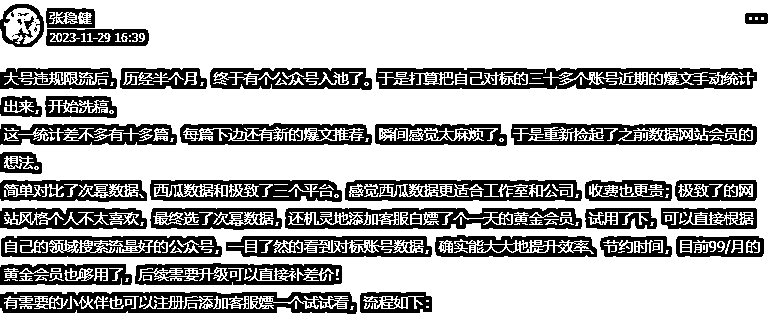
12.05：被一个哥们投诉，刚进池的号连续被封。
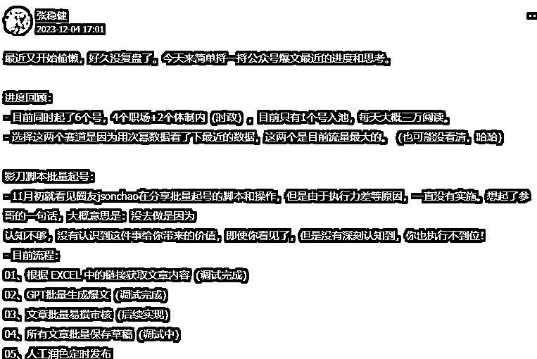
12.18：又从头到尾复盘了一遍。
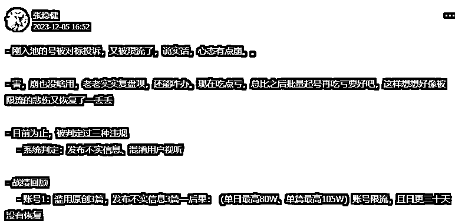
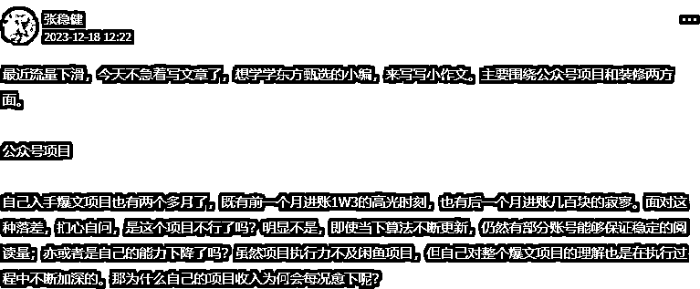
12.19：自动化产出的质量实在太不稳，决定暂时放下RPA更文。
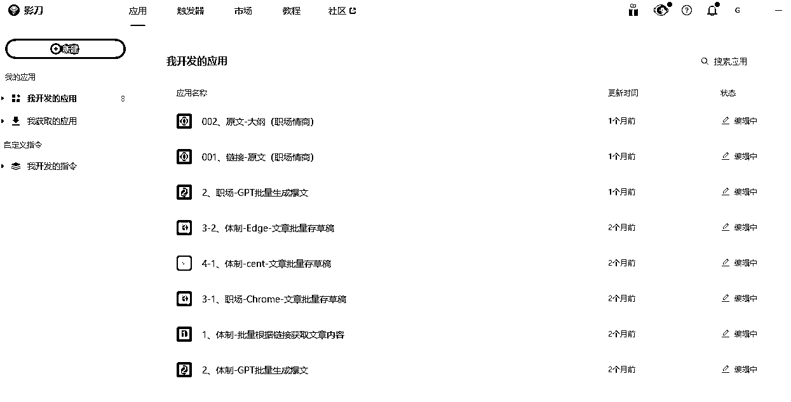

这就是我3个多月做🛰️公号的全部经过：有起号时的高光，有违规被封的教训，也有掉出池子的低谷，最终靠复盘和坚持慢慢走出来。希望这篇复盘能帮你绕开一些坑，少交点学费。

从零到试水的这段副业实操，时间线大概是这样走的。

1. 12.20：先花了一整天做对标研究，把不同领域的头部账号全扒了一遍，看人家怎么讲、怎么留人。

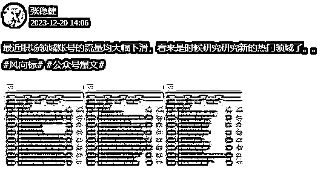

1. 12.21：盘了一天内容打法，各种更文节奏和形式的利弊都在脑子里过了一遍。

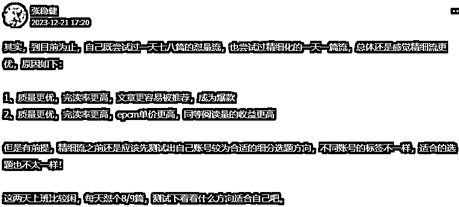

1. 12.29：花了988块钱正式入局闲鱼数码这个赛道。

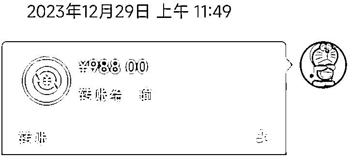

1. 第二个账号顺利出池

1. 01.04：第2个入池号完成出池，起号用了14天，入池后15天，累计收益过万；这一周同步在维护4个号，后面精力原因缩减到2个。

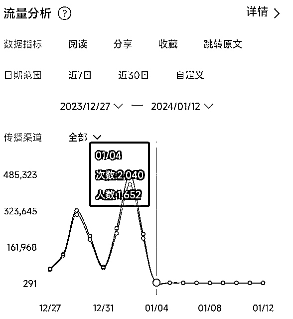

1. 第三个账号进入池子

1. 01.18：第3个账号成功入池，它是12月8日到17日连续更了10天，之后停更到1月18日复更后就直接上池了。

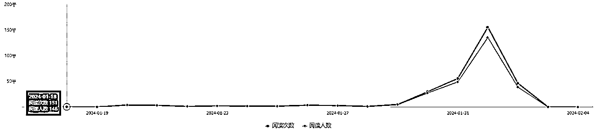

1. 01.23：折腾闲鱼数码刚好3周，累计收益2K+，但投入产出比和精力消耗都不划算，于是直接砍掉不做了。


1. 第三个账号也出池了

1. 02.03：第3个账号出池，起号10天，入池14天，总收益1K+。

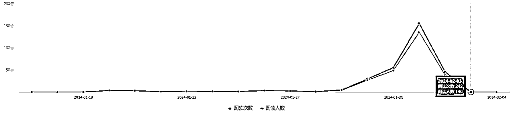

1. 02.04-02.17：出池后的第3个号继续更新了几天，数据一直没起色，只能先放下过年。
1. 02.18-02.20：卡在要不要继续的犹豫里，反复内耗。
1. 02.21：想清楚了，不再分散，决定All in继续深耕爆文项目。

如果你读到这里，有哪怕一句话让你更有底气、更有思路，欢迎在星球里给我一个赞作为鼓励。

最后祝正在摸索副业、尝试创业的每一位朋友，都能在自己的赛道上把钱赚明白！