# AI思考｜01 发展看似神速，实则缓慢的AI时代

# 开场

《终结者》里，人类造出了天网，本以为是新纪元的开启，实则是毁灭的序章。

人工智能，始终是科技最尖端的所在，也是人们既期待又恐惧的话题。

ChatGPT的突然爆发、Sora对世界的理解力，无不在宣告：AGI的时代已然临近，大门已然敞开；社会舆论迅速达成共识，AGI要来了，资本家盯上了算力基建，普通人则忙着学习怎么用。

AI并非移动互联网那样的从零到一的颠覆，它更像是搭在现有生态上的增强，是“+AI”而不是“AI+”。

移动互联网让你拿着手机就能点外卖，打开了无限选择；AI时代，你或许只需对Siri说一声下单，后续全程自动搞定。iPad上三岁的孩子可以无师自通地玩起来；ChatGPT却要你先学会写Prompt，再反复练习，才能稳定拿到理想输出。

这是一个充斥迷雾的AI时代，也是一个难见烧钱获客的时代。

把我对AI的认知压缩成几句话，大概就是这三点：AGI的大门已经打开了、AI在优化产品而非创造新需求、要把AI用好需要研究生级别的能力。

我们就从行业走向、产品形态、上手门槛这三个维度，聊聊这个有趣的时代。

# 一、行业：AGI的大门已经打开

人类发明文字来承载对世界的理解，读到“飞流直下三千尺”，脑中会自动补全“疑是银河落九天”，那画面感便出来了：瀑布的磅礴，银河的璀璨。

人靠学习认识世界，靠文字表达感受。

在机器人学习范式里，OpenAI押注了Transformer架构，并在大力出奇迹的思路上深耕，让模型去学习世界，再用文字、图像、视频表达出来。

用类人脑的学习机制赋予模型学习能力，让它更像人；

2022年11月30日，OpenAI祭出了王牌产品ChatGPT，它能像人一样对话，能产出高质量内容。

ChatGPT证明了模型理解文字的可行性，Transformer的规模效应再次被验证，正如苹果定义了智能手机，各种大模型也像雨后春笋般涌现。

OpenAI，是这个AI时代跑得最快的前沿探路者。

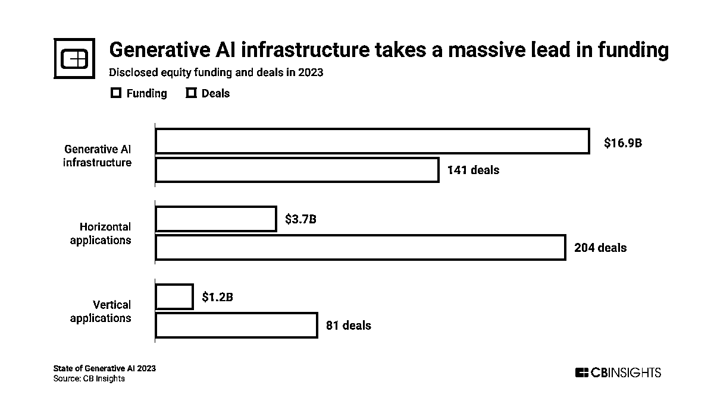

领头羊出现了，追随者便加速了脚步。2023年，生成式AI的基础投资达到16.9亿美元，主要投向LLM研发，AI的基建周期正式启动。

大模型层出不穷，谷歌的Gemini、Anthropic的Claude、智谱的GLM-4、月之暗面的Kimi。

GLM-4和Kimi已能与GPT-3.5相媲美，与GPT-4相比仍在追赶。

当所有人都把GPT-4当作标杆去追时，OpenAI的野心更大。

一个能理解世界、支持多模态、超通用的大模型，会让追赶者大吃一惊。

2024年2月16日，OpenAI在推特上放出了Sora的视频：

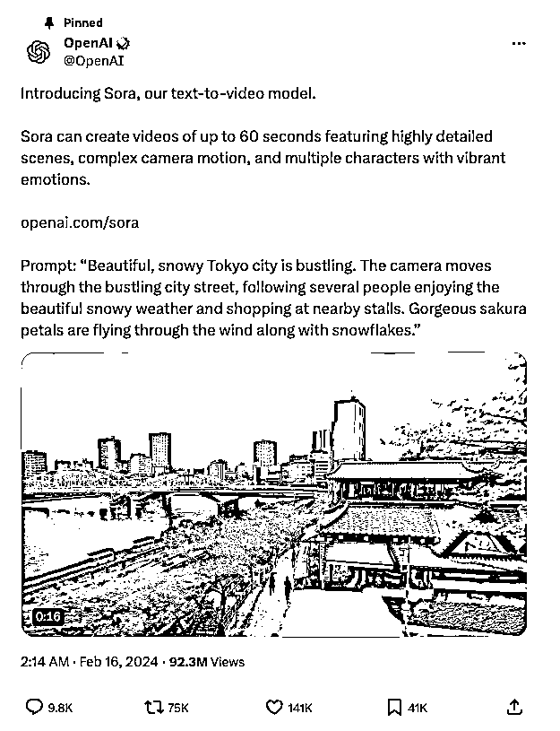

对Pika、Runway这类玩家而言，这无异于晴天霹雳。

Sora可生成60秒视频，角色保持稳定，支持多角度呈现，且在不依赖物理引擎的情况下也能表现汽车扬尘、海边潮汐的细节。

当行业还在为10秒视频突破而欢呼时，Sora再次宣告：你们的技术路线差得有点远。

基于Transformer的规模化路线，Sora既理解了世界，也表达出了对世界的理解。

AGI奇迹背后是算力的极致依赖，是显卡们日夜工作的结果，是老黄笑得开心的底气。

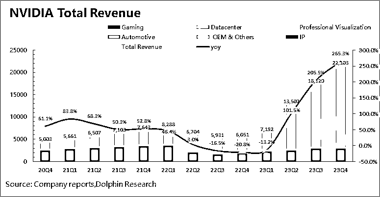

AI时代最赚钱的，往往是卖铲子的：英伟达。

大模型需要的不仅是模型和语料，更是算力。

大力出奇迹，大力意味着花钱。

2022年OpenAI就花费了4.1亿美元在计算与数据训练上。

周鸿祎曾在分享中提到，大模型公司起步就要买卡，50万块50万张H100的成本就已高达150亿美元；

通用的大模型，买卡是第一道门槛，这是巨头的游戏。

谁都想拿下AI时代基建的话语权，就像安卓与iOS在移动互联网的地位。

巨头押注超大模型，而新创公司押注垂类大模型。

或许不需要那么多参数，ChatGPT用了1760B的训练参数，能答各种问题，但让模型只聚焦法律领域，是不是参数可以更小。

垂类大模型也如雨后春笋般出现，一些法律类产品已能落地使用。

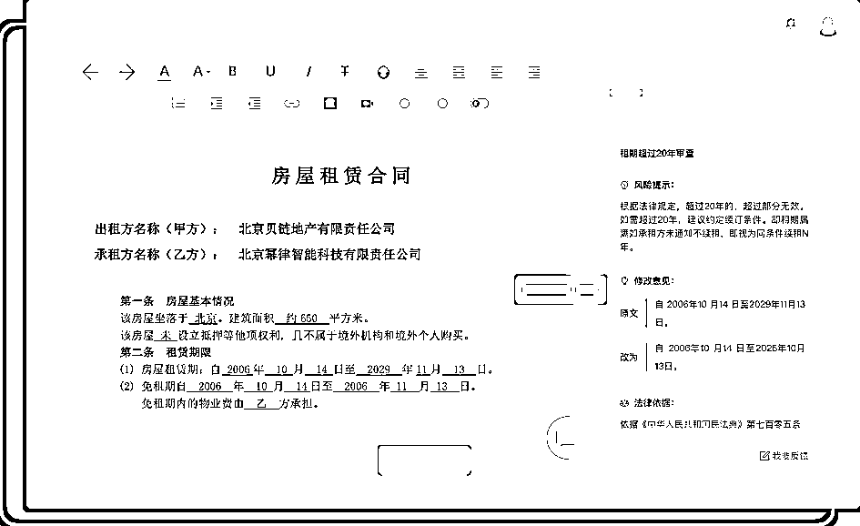

我们可能只需要一到两个通用大模型，但在每个垂类赛道里，或许都需要几款专用的垂类大模型。

AI一边热闹非凡，一边又显得冷清。

当所有人都在全力做大模型研发时，AI应用赛道却显得有些萧条。

42章经在2023年底的复盘中提出一个观点：AI不能算是一个独立赛道。

AI看起来机会很多，实际上新机会并不多。

因为AI的基建能力仍未达到预期，AGI的大门虽开，真正有效的应用场景却似乎不多。

移动互联网时代，几乎所有能想到的场景都能搬到线上：购物、观影、阅读、外卖、旅行、社交，都实现了质变。

随着基建完善、流量成本下降、智能手机性能提升，人们从微信语音变成了视频，抖音短视频也进入了千家万户。

AI却出现在了需求已被较好满足的阶段。

从0到60分是移动互联网，AI是从60到70分；很多场景只是优化，做也行不做也行。

“盈利”成了AI创业者被问得最多的问题，不再是讲一个美好故事让市场为预期买单。

AI时代人们很焦虑，担心失业。根据Revealera发布的岗位变化数据，2023年自由职业岗位受影响最明显的是写作、翻译、客服这三类，其他岗位影响相对有限。

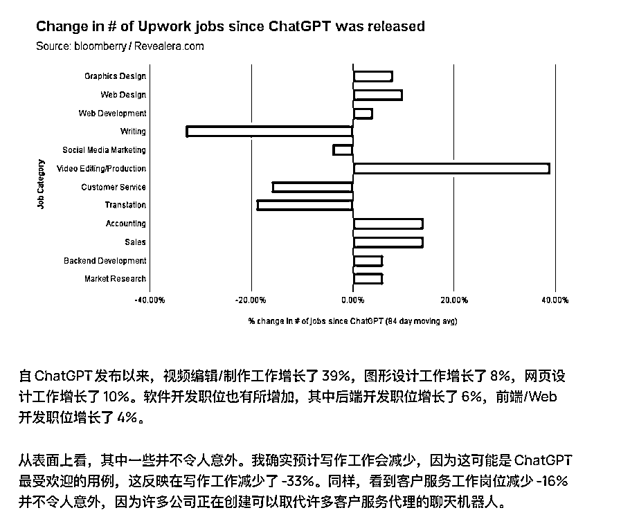

体验过GPT的人没有不感慨其先进的，却也在体验后陷入思考：用AI做什么？为AI付费的价值是什么？

AI在诸多场景已有初步成效：写作、翻译、搜索、客服、陪伴、修图、阅读、音视频转写、绘画、笔记、逝者复活、思维导图等，都能得到不错的帮助。

# 二、产品：AI在优化产品而非创造需求

我们常问AI时代谁能赚钱。

最后的结论往往是：AI时代最赚钱的是卖课的，其次是卖铲子的，亏钱的是做产品的。

全新AI产品的盈利似乎遥遥无期，某模拟器上线即爆火，2000美金的Token消耗掉了，收入为零，用户越多赔得越多，最后只能接入Kimi的API苟延残喘。

AI效果最好的场景中，除了少数依赖技术突破的，比如绘图、逝者复活，大多数其实都是日常使用场景，只是被AI赋能后体验更好。

来看几个产品的优化案例：

## 2.1 C端产品

### 2.1.1 搜索

不想看广告搜索怎么办？试试秘塔AI、360AI。

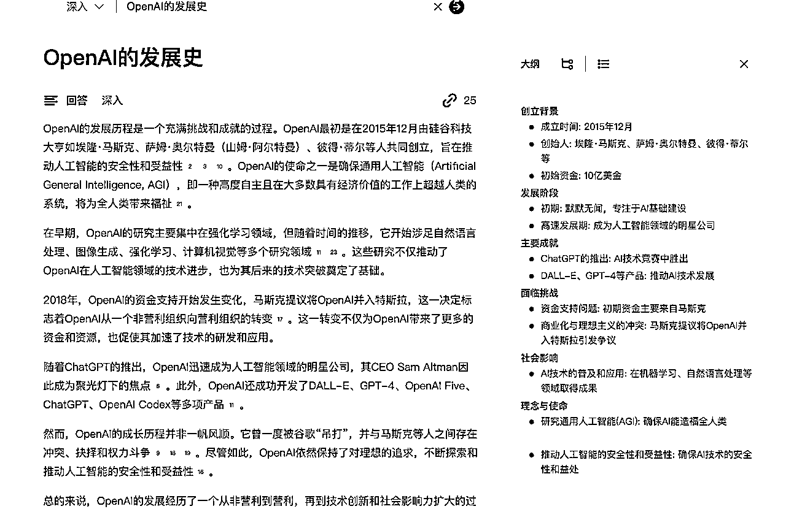

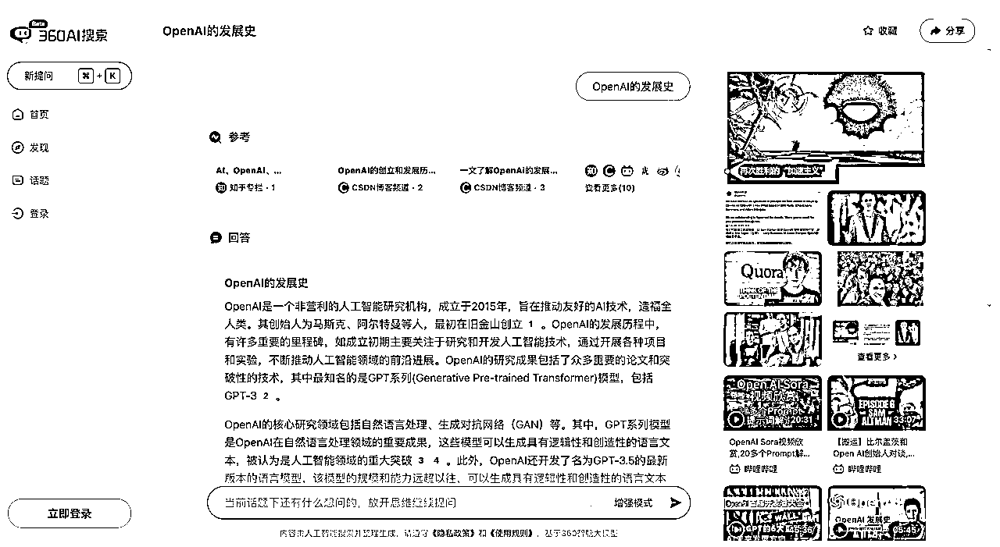

新旧搜索的差异在哪？

传统搜索：提问 - 关键词汇总网站 - 页面排列展示

AI搜索：提问 - 关键词汇总网站 - 读取网页内容 - AI汇总信息 - 页面展示

AI能帮你整理搜索问题的答案，减少广告干扰，让信息检索体验更顺畅。

### 2.1.2 翻译

ChatGPT出来后，我常看英文资讯追进展，由于英语一般，我总靠谷歌翻译，谷歌常把LLM翻成法学硕士。

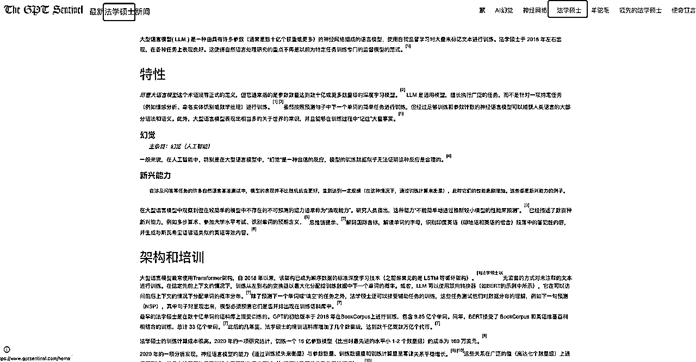

很多时候我一头雾水，得把原文翻回英文才能弄明白，后来背住了：翻成法学硕士=LLM。再加上各种专业名词被乱翻，读起来更难懂。

后来我在即刻学到用AI读网页，再用Prompt进行直译，还能设定特定词的译法。

依托大模型本身的语言优势，翻译体验提升明显。

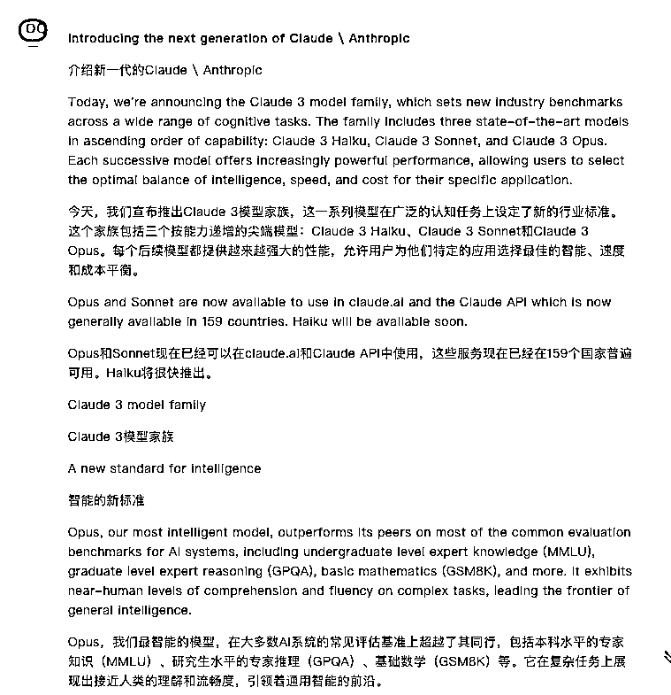

Claude 3出来后，我用Kimi直译网站内容，能快速读懂英文资讯。

AI让翻译场景的使用质感明显变好。

### 2.1.3 音视频内容总结

看到长视频、播客音频，想快速看文本怎么办？

找个转写工具把内容提取出来，变成文字稿阅读。

过去常用飞书妙记，需要先下载音频视频，再上传转写，再读逐字稿，能用但很麻烦。

大模型带来了更快的路径，通过RSS订阅和对音视频的解析，可直接得到文档结果，无需下载。以通义听悟的播客功能为例：

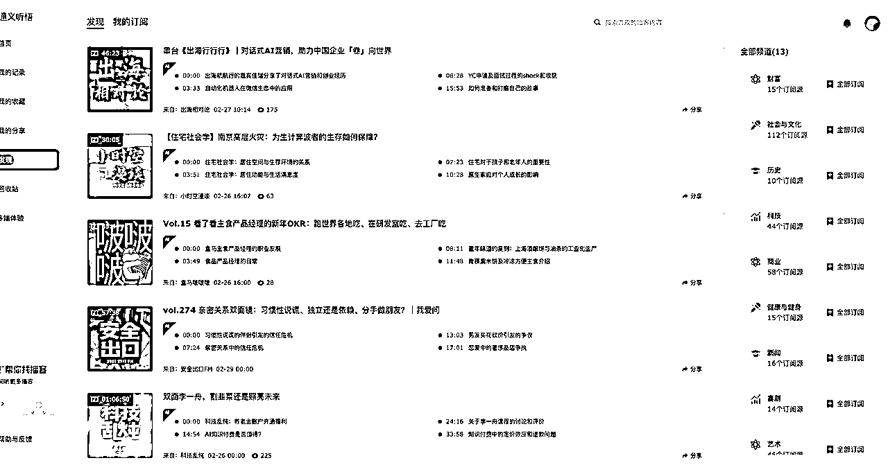

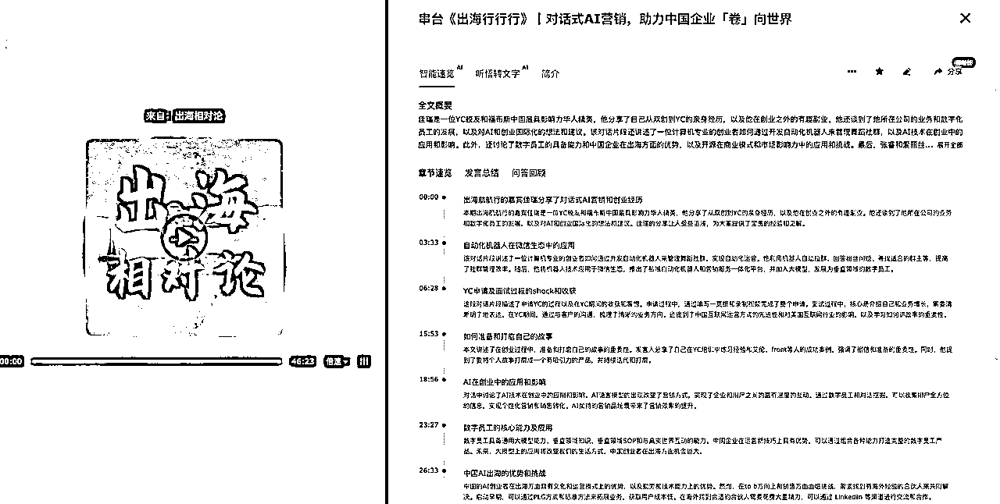

一键订阅想听的播客，直接拿到文本和AI总结。

在B站，B站GPT提供了不错解法，可生成文本和思维导图帮助记录视频：

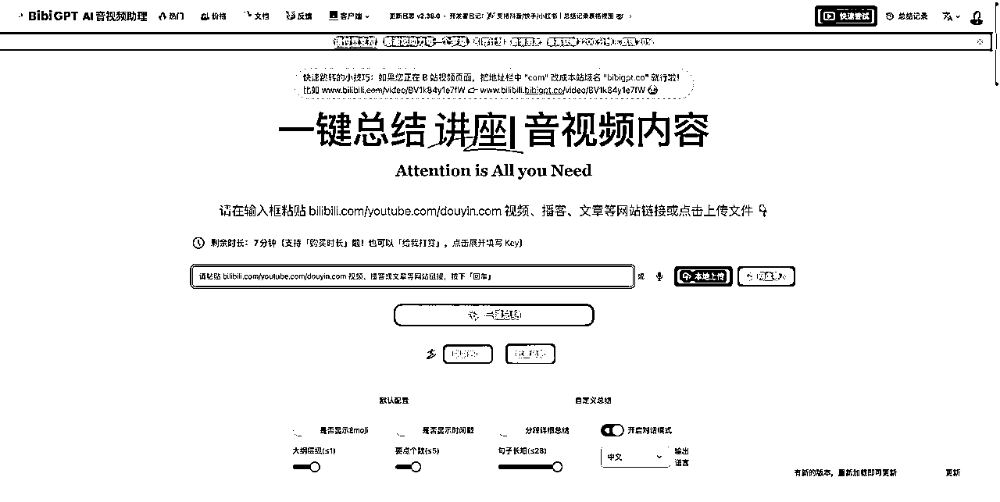

YouTube视频也一样，可一键总结内容：

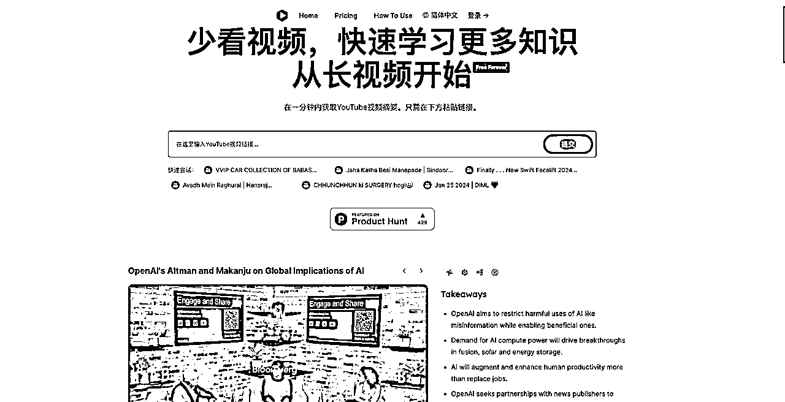

### 2.1.4 照片处理

借助AI对图像的理解，照片处理的需求正被简化：

过去人像修复、抠图需要专业技能，现在上传照片即可，AI处理后直接给出满意结果：

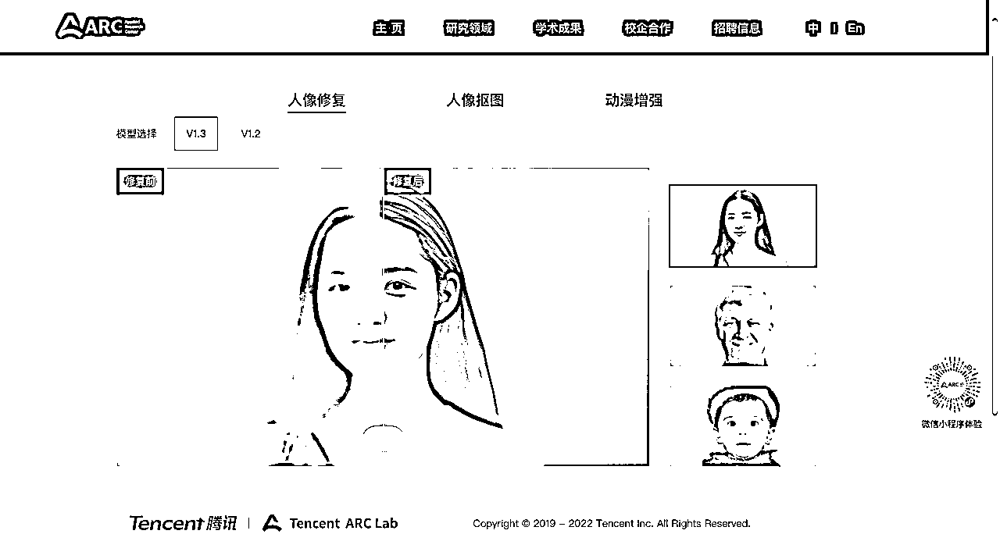

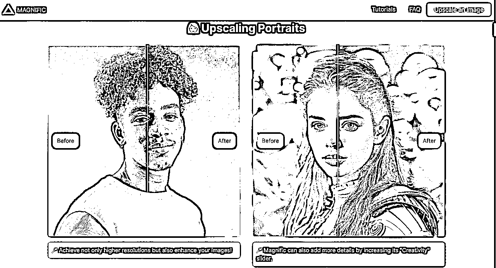

再过一段时间，对一张照片的处理可能只需描述效果，AI来完成，无需学习PS的复杂操作。

### 2.1.5 做PPT

PPT人人必备，做好PPT却很头疼。很多时候并不需要100分精致，60分能用即可。

用模板改也能满足，那AI能带来什么提升？

我觉得主要是大纲辅助、模板自动匹配。

以Gamma为例，描述想做的PPT内容，它会自动生成大纲并匹配合适模板，然后再做细节调整。

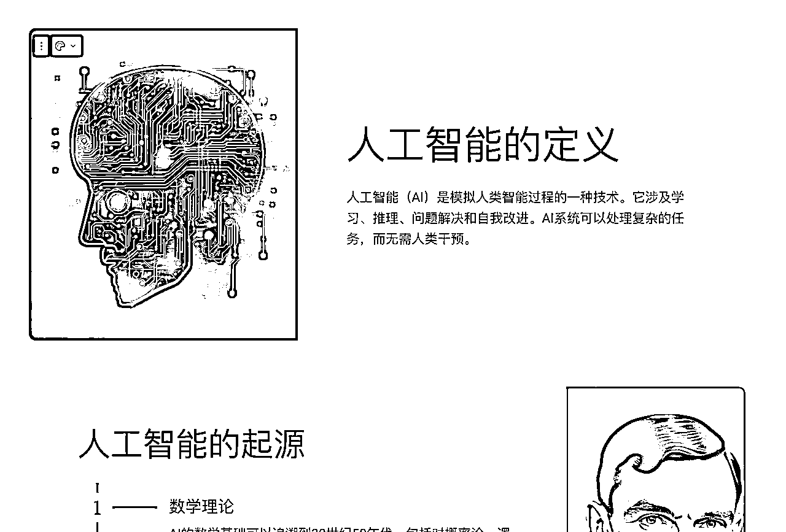

对比传统模板，最大好处是省事。

但AI做PPT打分大概是60分，能满足基础场景，精细化仍需手工。

### 2.1.6 写作助手

重度笔记用户会发现Notion AI让效率更高。

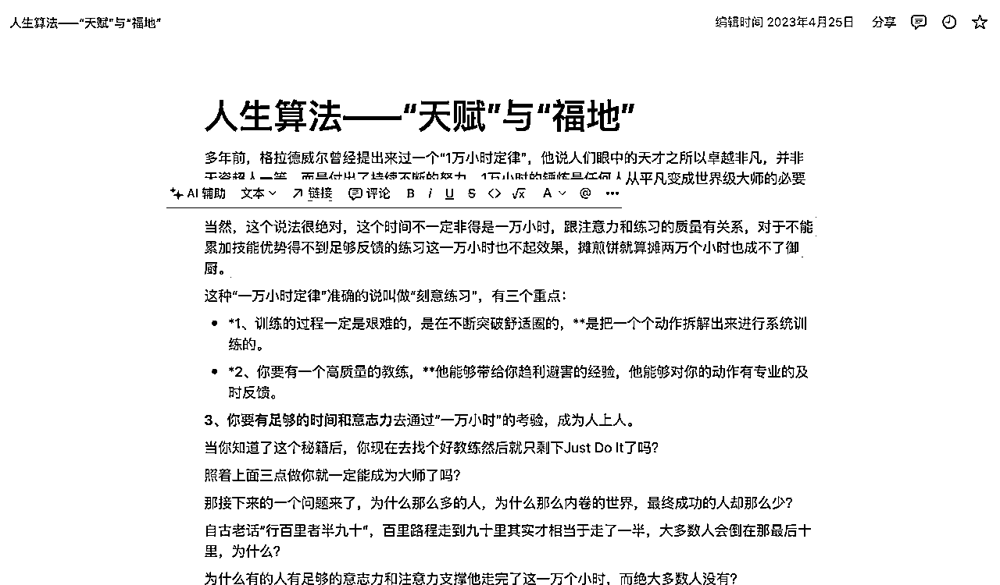

它能优化文本、缩短文本、扩展文本，也能总结翻译等：

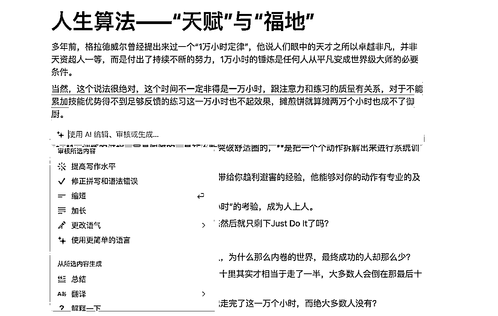

比如用Notion AI扩展一段话：

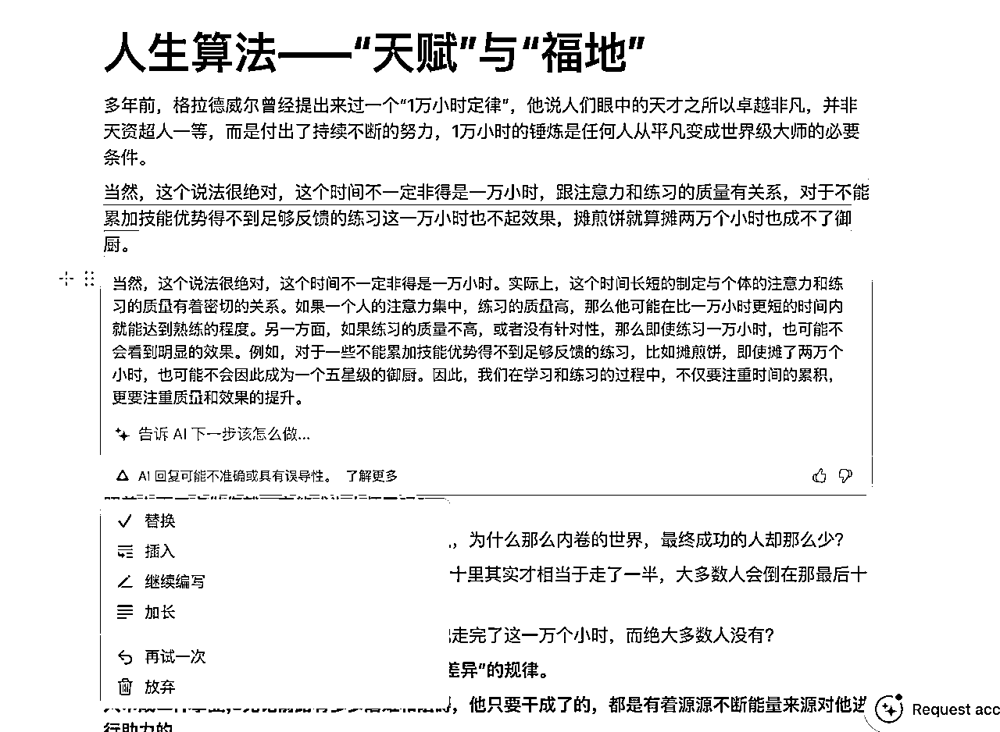

效果还不错，长度实打实增加。

Notion AI能辅助笔记效率，但不改变记笔记的核心逻辑。它是对现有产品的优化，若你没有这个需求，用飞书云文档体验也差不多。

### 2.1.7 妙鸭相机

妙鸭是高级P图工具，通过收集你的照片，用AI生成各种风格照片。对比传统P图，差别主要是场景与造型被换了个更高级的方式。

妙鸭火时主打写真，现在已支持合照、创业照、证件照等多种场景。

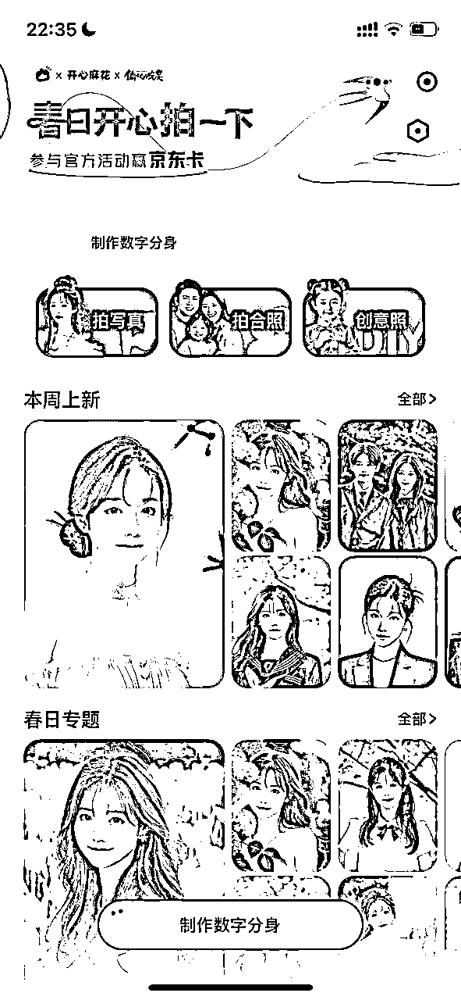

妙鸭起得快，落得也快，人们为尝鲜而用，但难以替代传统修图场景。它是基于AI的下一代修图尝试，来得快去得也快。

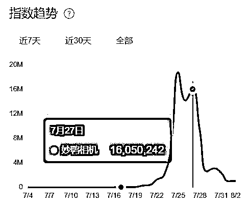

## 2.2 B端产品

### 2.2.1 RPA+AI

RPA用于电脑自动化流程，设置好后可重复执行，但配置成本很高，需要学习工具并反复调试：

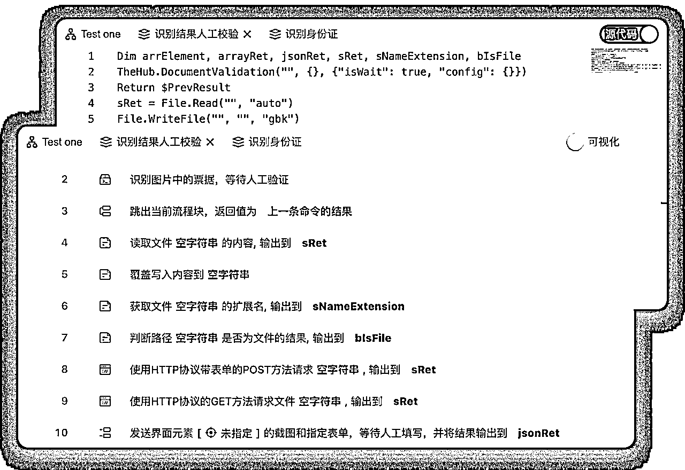

从这些配置路径可见学习成本不低，需要自行设计流程拟合操作。

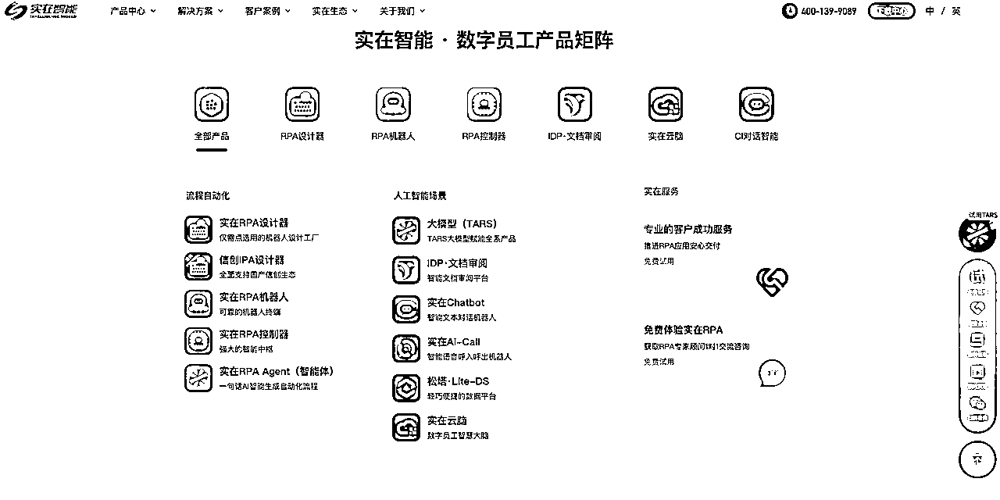

实在智能用AI做了优化，用户只需演示流程，AI结合RPA生成流程链路，人再做微调，大幅降低使用门槛。

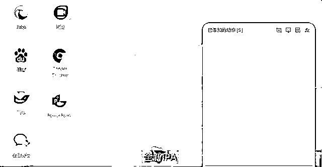

### 2.2.2 AI面试官

近屿智能在企业服务SaaS上增加了AI面试，可解放部分基础面试人力。该产品对基础岗位初筛效果不错，10-20分钟可快速获取候选人基础信息，为后续面试做参考。

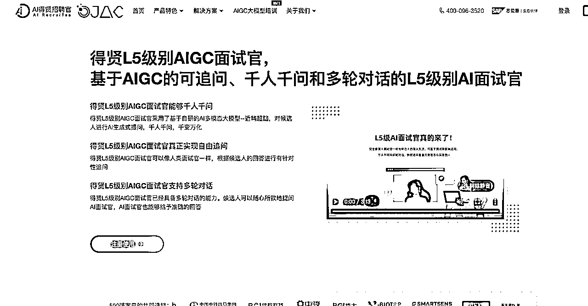

它本质是数字人+LLM完成面试，若结合企业用人标准，AI可在第一轮初筛就给出评分，对校招、实习生招聘这类场景很有价值。

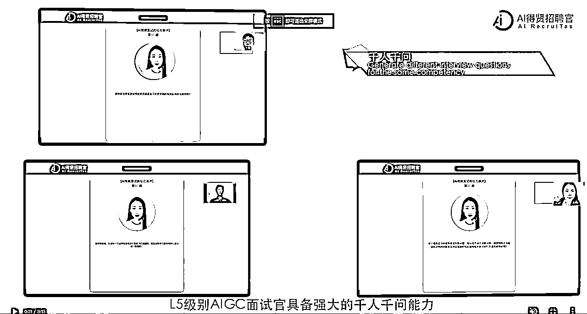

### 2.2.3 AI智能合同审查助手

签合同的流程通常是：

1. 按业务需求找模板形成合同
2. 找公司律师审核
3. 找合作方沟通
4. 沟通后修改再找律师审核
5. 律师审核后再由合作方律师审核
6. 重复3-5步直至签订

快的合同一周搞定，慢的拖三个月。审核中律师需反复比对前后版本，不能遗漏。

幂律智能在已有B端合同需求上叠加AI，AI在前后文档对比、内容总结上作用明显，让流程效率更高。

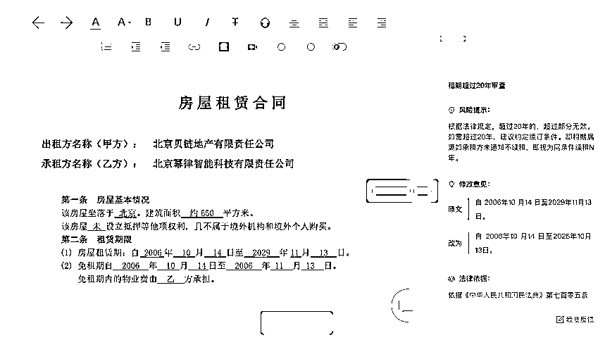

## 2.3 拆书产品AI赋能思考

上面列的AI场景都是高频刚需，我们能看到AI在优化这些场景，原有诉求通过AI变得更快更高质。

但需求本身一直存在，AI只是优化了解决方案。

拿我做过的听书音频产品举例，这款产品我从0到1做到了10万日活，链路打磨无数次。

产品逻辑是把一本书拆成10分钟音频解读，通过小程序和APP分发。老用户月留存能做到60%+，100个人里本月听完书下月还会来续听。

当书籍量达到1000本时，用户找书就成了难题，我们只能后台打标签，运营打包成书单聚合，这种方式很死板，也依赖运营主观判断。

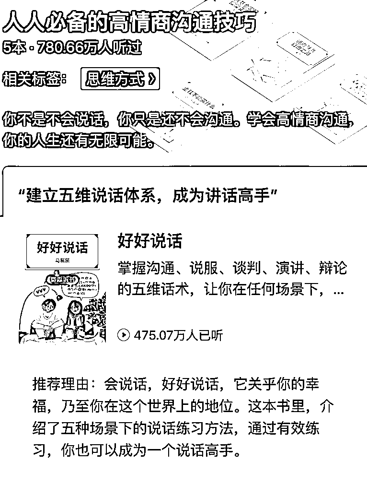

想通过用户搜索给预期内容，一直想做但过去技术不支持。

过去用户搜“财商”，系统按关键词匹配推送书和书单，是匹配机制。

如果用上AI，用户输入财商，可检索所有拆书稿并聚合推荐书单，匹配度会更好。

这也是场景优化而非创造需求，而且最多把留存从60%提升到61%。听起来不错，但并不核心。

拆书环节可能价值更大，当时流程是内容人员拆书、专业录音师录音。拆书环节若用AI辅助，单日稿件量可能翻倍，同时可自动生成标签，上架成本更低。

但这仍是局部效率提升，核心仍依赖资深内容做书籍判断，AI可辅助不可取代。

至于Chatbot，当时我们把用户反馈提得很靠前，产品经理在客服群解答问题，用户痛点基本都会在规划中解决。

最近我复盘了一下AI在实际场景里的价值，发现一个挺反直觉的现象：当一个产品做到日活10万这个量级时，客服群里每周可能只有一两个问题，而且大多还停留在“怎么用”的层面。所以对我们这种业务场景来说，把Chatbot当客服，其实帮助很有限。反而，如果让Chatbot扮演“学习导师”，帮用户定制学习路径，再通过企业微信去沟通、促活，倒是个值得尝试的方向。换句话说，AI真正擅长的，是在已有业务上做增量优化，属于锦上添花，而不是平地起楼。

再看C端，AI目前最大的标签还是“尝鲜”。它能写论文、写代码、陪你聊天、帮你分析问题，听起来无所不能。可问题是，这些事情有多少是用户缺了就不行的？有多少能让用户心甘情愿掏钱？我们总说AI会成为每个人的工作助手，不学就会被淘汰，但残酷的现实是，对多数人而言，只学会基础操作，根本换不来明显的效率提升。我最近帮社群的朋友做一个深度内容调研，需要先用Perplexity的“文献搜索”去检索关键词，比如“人工智能技术发展”。

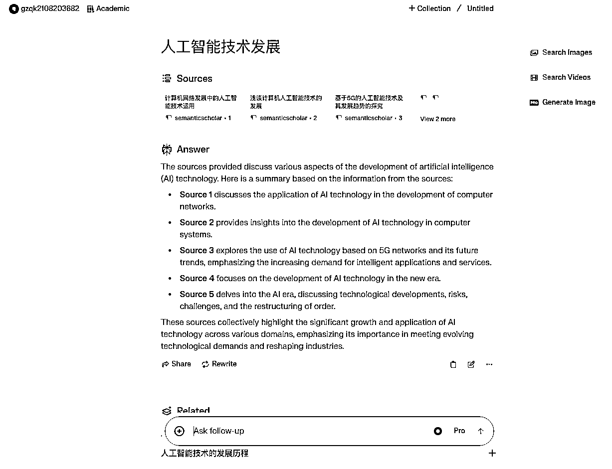

然后根据检索结果判断是不是自己想要的文献，再做下载。

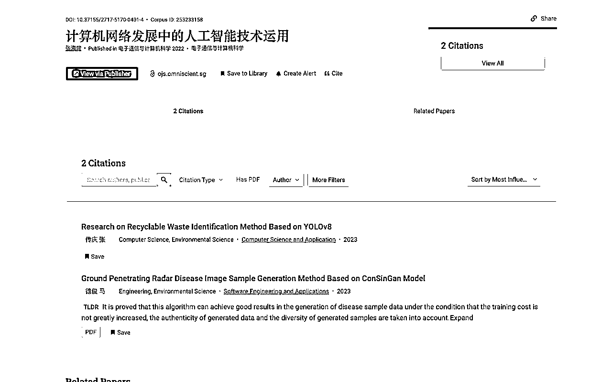

接着用Kimi读取PDF，让它做总结。

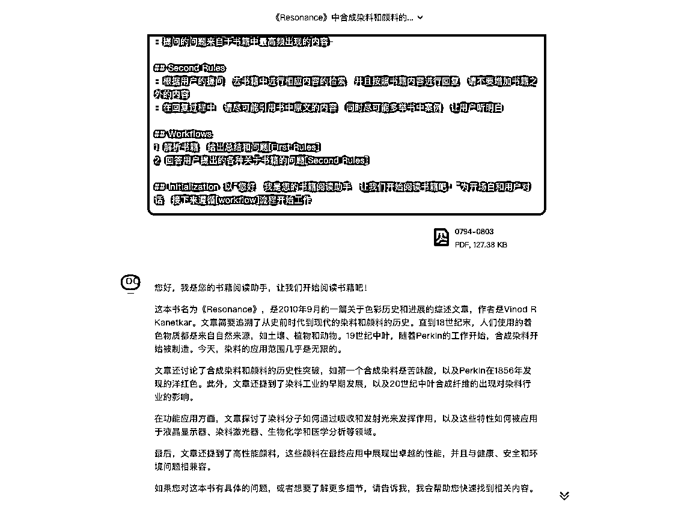

这个流程确实比手动翻文献高效，但仔细想想，门槛也太高了。可能要等GPTs、Coze这类产品更成熟，更多场景被直接封装成一套工作流，大家真正离不开AI提效的那一天才会到来。AI对话本身是个好场景，从“哄哄模拟器”的火爆就能看出大家喜欢玩，但大多玩一次就放下了，没有持续留下的理由。至于情感陪伴，我觉得还得打个问号，因为人渴望的是认可和陪伴，而AI多少还是少了点温度。AI绘图和AI视频软件就更不用说了，从工作流角度看，可能还不如买个“稿定设计”直接省心。所以未来一段时间，尝鲜依然会是主旋律；真正的转变，还是要等大模型基建继续进步——能力更强、算力更便宜，GPTs组合出来的场景能解决实实在在的问题，那时AI才会成为大多数人身边必须的存在。

我还想明白一件事：需求其实从来没变过，变的只是解决方案。AI刚火起来时我很兴奋，从去年4月开始试了一堆产品：AI面试、AI简历投递、AI提取公众号文章、Supabase+GPT做索引……看上去都很有意思。可等到算账的时候才发现，token成本太贵，效果也一般。我开始反思：如果没有AI，这个需求我真的有吗？有没有别的工具也能满足？最后答案出奇一致——全是伪需求。我并没有多想要那些功能，只是觉得“用AI做这件事很酷”。但真要让我付费，不可能，因为对我来说就是尝鲜，不是有效应用。之后我去研究Answer AI、Monica、Notion AI这些做得不错的产品，发现它们的场景其实一直存在，只是AI来了之后体验更好了。Monica不带AI功能也能做标签记录，带了AI就能总结内容、检索回答，但再往深看，用户真正的需求不过是浏览网页时记录和查找信息。以前可能用谷歌搜，现在用Monica一键搞定，流程更短，体验更舒服。所以我判断，C端好的AI产品应满足这个标准：没有AI时它已经能满足用户，有了AI后某个模块能得到明显提升。AI会随着大模型能力一步步重构产品，但现阶段还不会发生质变。产品也别指望上了AI数据马上就变好，伪需求永远只是自嗨。

不过AI确实在悄无声息地改变世界。美图2023年财报显示，全年总营收27亿元，同比增长29.3%，增长靠的主要就是AI对主营业务的带动。这家公司每天要处理数亿份图片和视频，其中以泛AI功能为基础的比例约为83%。AI不是一个凭空冒出来的新物种，它更像是把我们已经熟悉的产品拿回去重新优化、重新打磨内核，让体验更方便。也许明天，我们常用的APP里就会出现AI的影子：帮你总结书摘、帮你挑商品、手机助手帮你记会议、一键叫车。

另外不能忽略的是，用好AI真的不简单。AI在中美两国出了两大“巨头”：OpenAI和李一舟老师，一个技术上领跑，一个靠卖课赚钱，想起来有点哭笑不得。

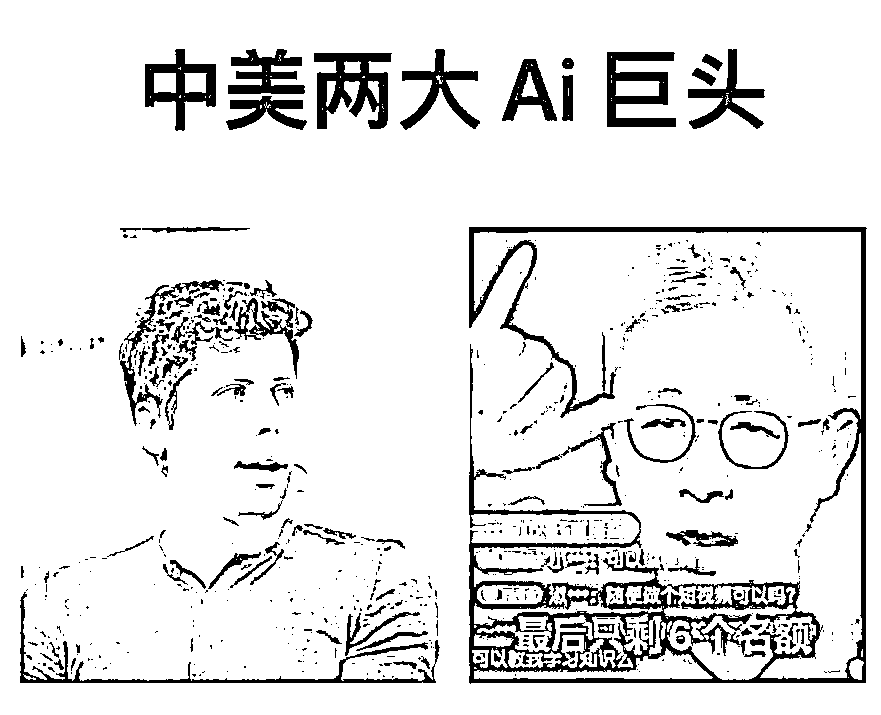

有人无奈大模型追不上，也有人无奈搞技术不如卖课。但换个问题想：为什么AI需要培训？如果AI像iPad那样连6岁小孩都能直接上手，那根本不会有培训市场。可现实是，AI更像PS，是一个需要系统学习才能用好的工具。这么说来，AI的使用门槛确实很高。从完全小白到能用AI给自己提效，至少要过两关：第一关，选对工具；第二关，学会写提示词。

第一关的难处在于，所有人都在喊自己的AI厉害。随便一搜国产AI，什么文心一言、智谱、豆包、套壳GPT、Kimi、星火大模型……一大排产品摆在你面前。比如我只是想用AI读一本书，该选哪个？有的免费多模态，有的能读超长文，有的啥也干不了，有的就是套壳圈钱。怎么选？谁能比得上GPT-3.5？我们在航海实践里发现，一旦用户用不了ChatGPT，整个人就懵了。连我这个天天关注大模型的人，当时也有点手足无措。最后大家集体商量，优先拿Kimi和智谱当平替：一个擅长超长文本阅读又能联网，一个支持多模态、功能齐全。可能很多懂AI的朋友看到这里会觉得离谱，但这确实就是现实——世界参差太大，在AI这件事上尤其明显。顶级的在琢磨世界模型怎么搭，搞钱前端的用AI做代写，还有大量普通用户连工具都认不全。

选完工具就进入第二关：写提示词。我们总听说ChatGPT无所不能，能写脚本、能帮你写提示词，让你变成超级个体；不学AI就要被淘汰。但真相是，ChatGPT确实能产出很棒的内容，前提是你自己得懂那个专业领域。90分的程序员用GPT能写出90分的代码，90分的抖音编导能创作出90分的内容；但如果你本身是0分，用GPT也变不出90分。脑子里没东西，Midjourney再厉害也画不出惊世之作。我能帮学员改公众号爆文的提示词，让他写出10万+，但让我自己写一个公众号爆文提示词，我写不出来，因为我自己并不懂爆文的结构。给我一个现成的，我能看出问题在哪，但从零写，我真的不会，因为没写过。

那不会写提示词是不是就没救？不是，可以用别人封装好的Chatbot，比如GPTs、Poe、Coze里的各种bot，这可能是普通用户低成本用好AI的解法。如果决定自己写提示词，考验的就是思维逻辑：你需要给AI更细的需求、更缜密的流程。这两点做不到，你让AI写2000字，它可能给你回500字就交差。

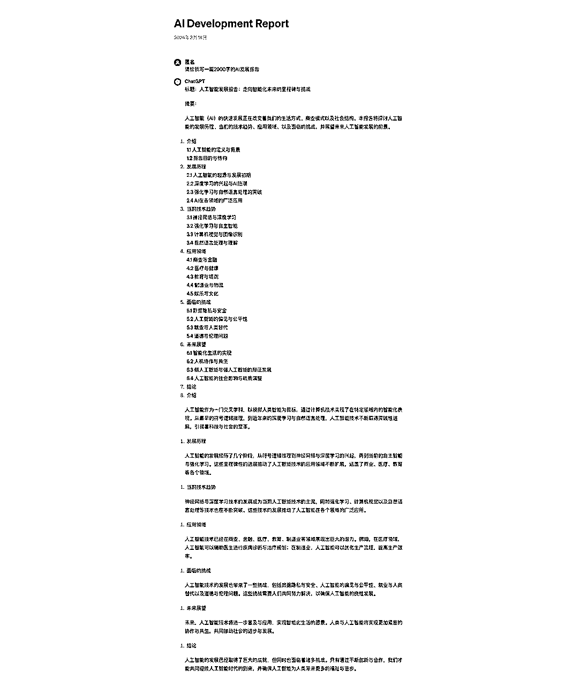

只能根据反馈一遍遍调优，最后才会得到满意的结果。有人问套模板能不能降低难度？能，但前提是你脑子里知道自己要什么。我常用的BRTR模板和langgpt模板能帮一点忙，照着葫芦画瓢，但最终拼的还是思维方式。

所以总结起来，用好AI真的需要“研究生”学历。这或许就是除了贩卖焦虑之外，AI培训能成为刚需的原因——它的门槛比大众想象中高，要投入很多心血才能驾驭。我在带完一期航海后回头看GPTs和Poe，突然意识到，这类Chatbot社区可能正是降低门槛的好路子。

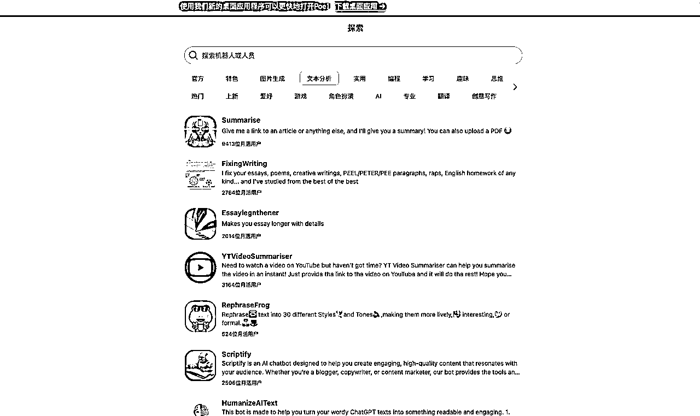

虽然目前GPTs还受制于算力成本、隐私等问题没有开放给所有人，但我相信再过一段时间，普通人打开AI，可能不需要费力学习，就能用现成的AI产品获得实际帮助。

再说说Chatbot社区的盈利和实用解法。我运营过付费订阅社区，几十个优秀创作者写文章，几十万学员买文章。创作者和学员明明上的是同样的课、学的是同样的方法，都知道企业分析文章怎么写，但能真正落笔写出来的没几个，能看明白就成了基本功。二八法则在AI领域同样适用。2%用AI用得特别好的人可以自己做Chatbot，让剩下98%用上他们写不出来的提示词。GPTs、Poe、Coze都在做这件事。

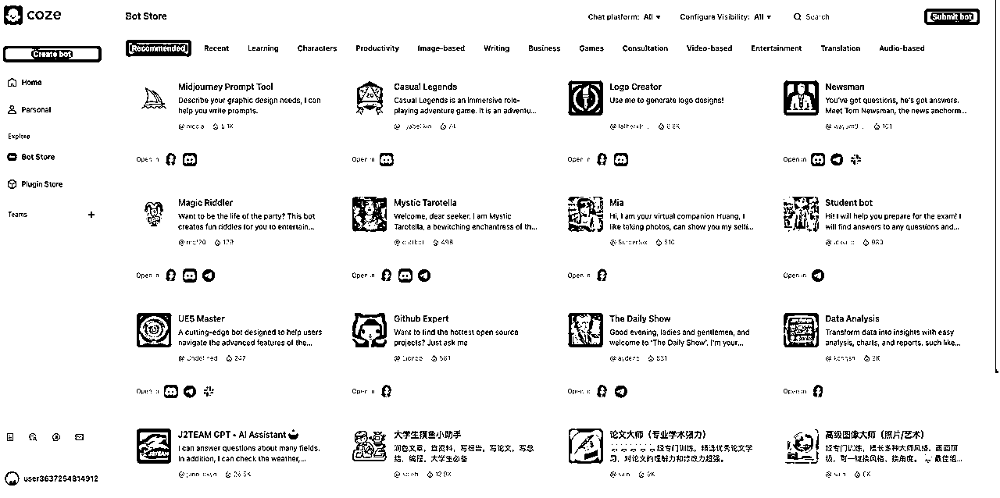

所以只要解决头部2%创作者的激励问题，就能让更多好用的Chatbot触达普通用户，技术才能真正普惠每个人。不过GPTs现在算力成本依然很高，如果完全放开让大家随便用，人人都拿它读书、跑多模态，OpenAI估计会被薅成一头秃羊。决定AI能否普惠的第一道坎，就是大模型的基础能力与算力成本。

我最近观察了很多AI使用需求，有些复杂场景需要把五六个工具串在一起才能高效运行，少一个都不行。从这点看，Coze的拆件和工作流对创作者很友好，能解决一些复杂问题。

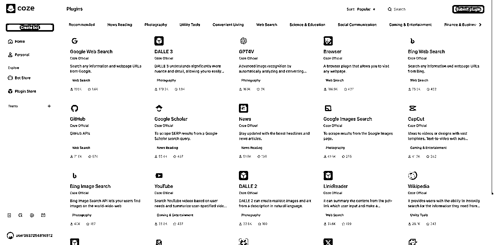

但实际体验下来，感受没那么好：一是插件支持不够多，现有插件有时候还不如直接用市面上的免费功能；二是Coze提供的GPT-4.0功能不完整，多模态和文件识别都不支持。只能期待基建能力提升后，出现更多好用的Chatbot社区。

我自己过去高频用Kimi的场景之一是翻译外文网站。如果Kimi推出Chatbot，我把提示词和流程设计好，让它直接翻译外文网站还能生成PDF，那这个Chatbot是不是就能当成商品卖了？在翻译场景里，Chatbot需要能设置专业词汇、能直接转译外文文章；如果这些都能满足，那卖5到10块钱应该有人愿意付。对有大量外文翻译需求的用户来说，这点钱换效率，很划算。当更多这种精准场景涌现，创作者和用户形成双边交互，一个基于Chatbot的社区就能自己转起来，创作者有动力拿出好产品，用户也能低成本享受AI带来的便利。为什么不做成PGC免费供给，而选UGC双边供应？因为PGC在前期测试和早期招募UGC时可以少量用，但它视角有局限、数量也有限，撑不起一个足够大的双边供给平台。

以上是我对Chatbot的一些零散思考，也期待各家大模型公司能带来更多有意思的产品。这篇文章算是我从去年10月系统研究AI以来的一个小总结。那之前我在工作中已经用通义做过视频剪辑提效，用GPT做辅助思考，但没有认真看过整个赛道。后来我学提示词、用AI工具提效、搭工具汇总网站、学LLM逻辑、分析产品，12月还去当了龙哥盟的GPT航海教练，带一群人入门AI，回想起来很有意思。我常想，AI时代我能做什么，产品上什么值得做。兜兜转转，还是教育和工具这两类产品给我的收获最多。AI+万物的大时代大概还不会来得那么快，那就先从用AI迭代一个小需求点开始吧。希望看完文章的你，没觉得浪费时间，也对AI的焦虑少了一点点。最后借用电影《一点就到家》里我很喜欢的一句话：流水不争先，争的是滔滔不绝。

🌟 知识库内容汇总