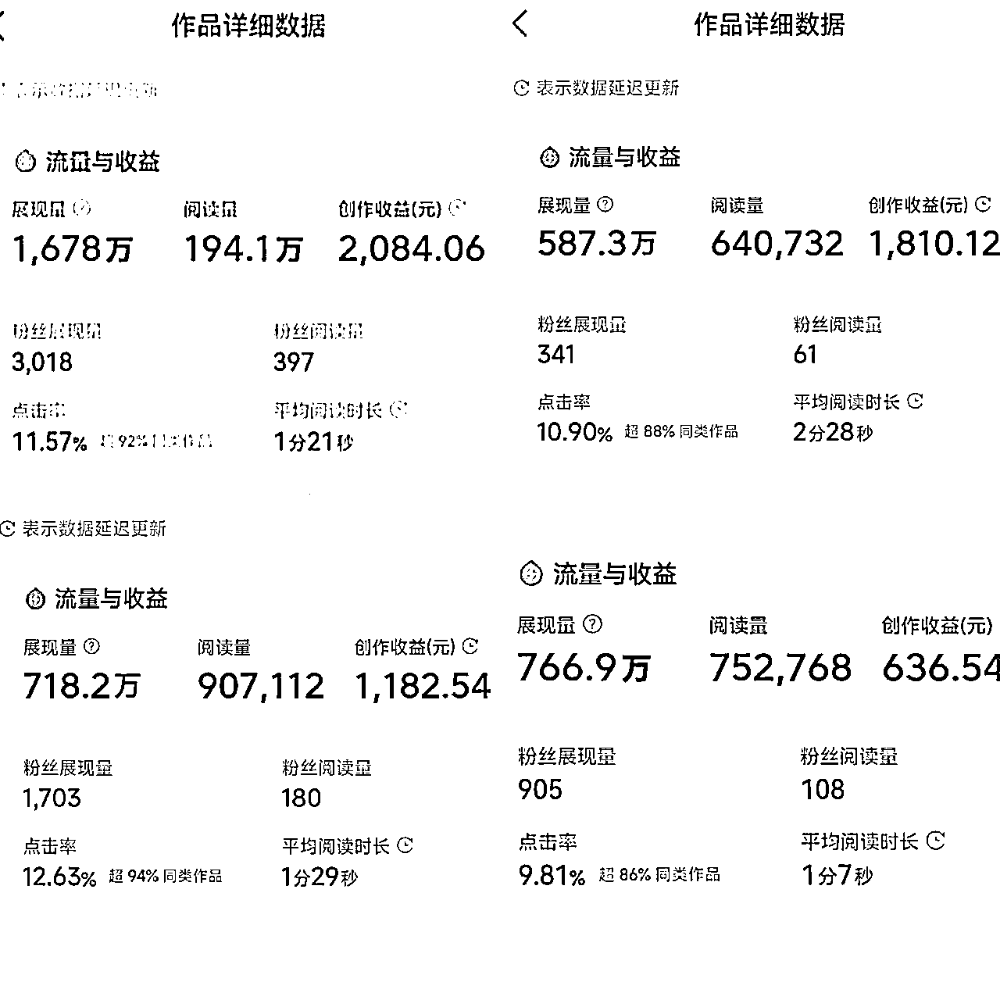
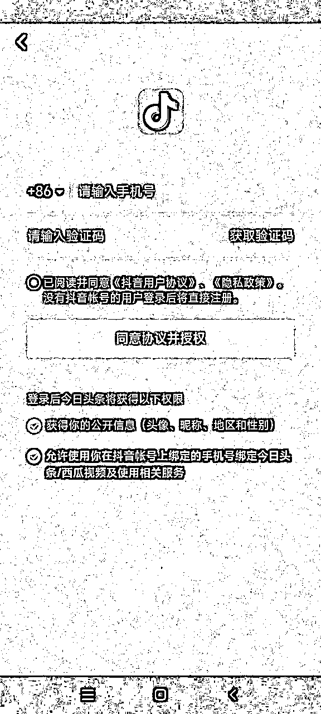
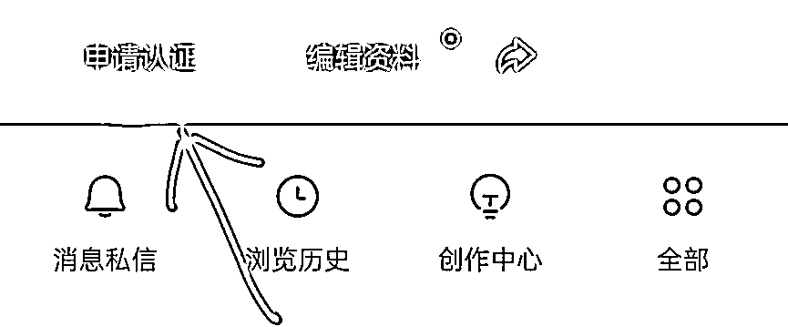
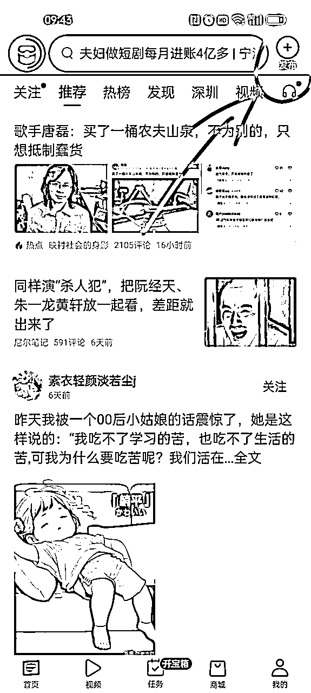
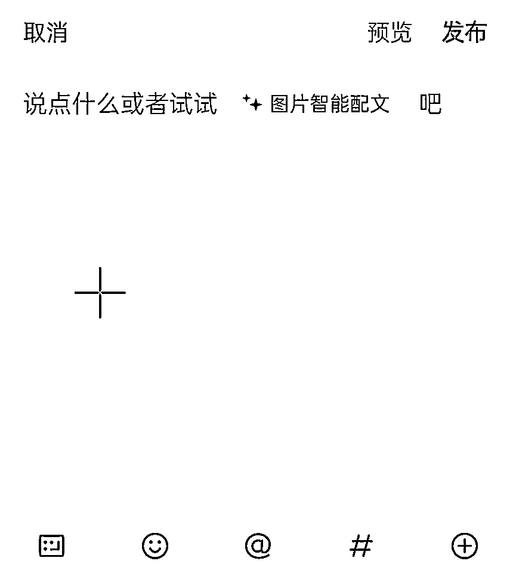
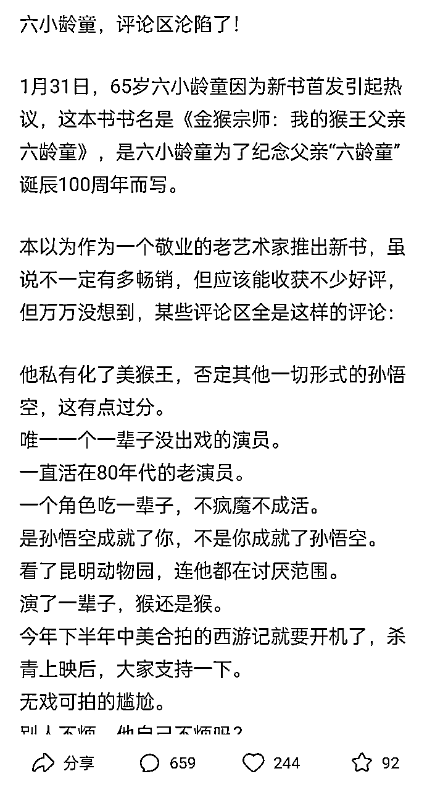
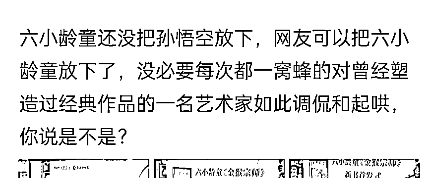

# 零粉丝也能变现！写作小白的微头条日入千元实操全记录

市面上网赚项目铺天盖地，但真正能让新手上手、快速见到钱的项目屈指可数。我的判断标准很简单：门槛要低、回本要快。正反馈这件事，是小白坚持下去的唯一燃料。

今天分享的这个方向，就是今日头条的微头条写作。它不需要粉丝基础就能开收益，写了就有佣金入账。变现天花板有多高？直接上真实收益截图说话。

# 微头条到底是个什么东西？

微头条是今日头条旗下的短图文创作区，最大的特点是零门槛开通收益。0粉丝即可开始赚钱，等粉丝累积到100人还能申请微头条首发创作者身份。通过认证后，作品首发于头条就能享受基础激励的2倍分成，优质账号甚至能拿到4倍收益，回报相当可观。

这个玩法其实不是新鲜事物，算得上是老牌项目。能活这么久的项目，通常抗风险能力更强。最近平台又把资源倾斜回微头条，扶持力度明显加大，现在的单价和流量已经超过很多👸号的广告分成，现在切入正好卡在红利期。

# 具体怎么上手赚钱？

## 一、先把账号搞起来

在手机应用市场下载今日头条APP，注册登录可以直接用抖音账号快捷登录，没有抖音的会跳转到抖音注册页。

登录后进入个人主页就能看到认证入口，可以先不急着实名，等账户开始有收益、确定要长期做再完成实名认证也没问题。

## 二、发文的正确姿势

1、打开首页右上角的发布按钮，就进入了微头条的编辑页。内容写完直接点发布即可。

2、粉丝达到100后，并且累计发布10条以上内容，就能申请微头条首发认证，收益直接翻倍。

3、发布时间也有讲究。建议根据账号粉丝活跃时段来选择，通用高峰时段集中在上午9点-11点、下午14点-17点、晚上19点-22点，这几个窗口期用户空闲度高。文案可以提前写好存草稿，到了点再一键发出。

# 三、微头条内容怎么写才能爆？

微头条是纯图文形式，没有单独标题，所以开头3秒决定生死。把最炸裂的信息放在最前面，能极大提升推荐量和阅读量，阅读量上去了收益自然跟着涨。题材可以选娱乐八卦、历史趣闻、人物轶事、生活感悟等，选自己熟悉的领域发力最稳。

追热点是快速起号的捷径，比如明星绯闻、热播剧话题、网络热议事件。举个例子，标题开头写“六小龄童，评论区炸了！” 瞬间就能勾起好奇：到底发生了什么？评论区怎么了？用户不点开难受。

字数上建议先保证500字以上，后续稳定后拉到800-1000字左右。门槛并不高，通勤路上就能码完。开头和结尾是关键，结尾最好配一句有共鸣的金句或一个反问，引发停留和评论。金句素材可以在🛰️读书、知乎、🧣上搜集，平时多做积累。

开头钩子 + 结尾金句，中间用一个完整的小故事串起来，一篇合格的微头条就成型了。

# 四、发布前必须避的坑

微头条发布后要经过系统审核，里面出现敏感词很容易被限流或直接不通过。建议发文前先把内容复制到句易网做敏感词检测，工具会自动标出风险词，修改或替换掉再发布，稳妥很多。