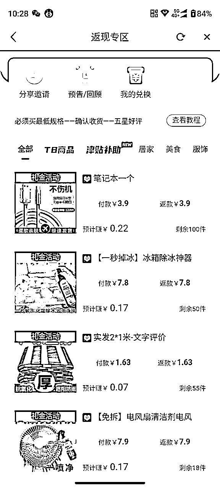
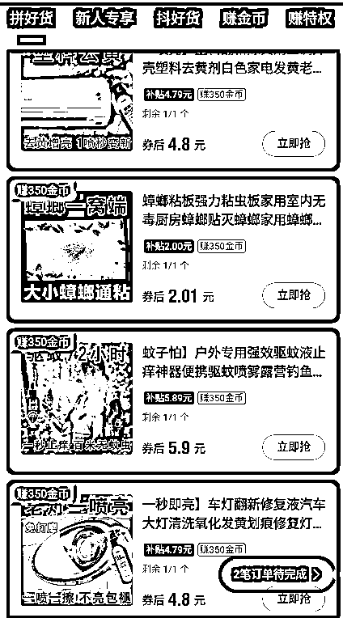
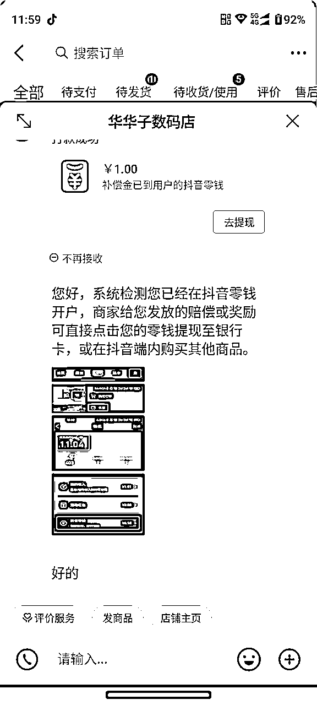
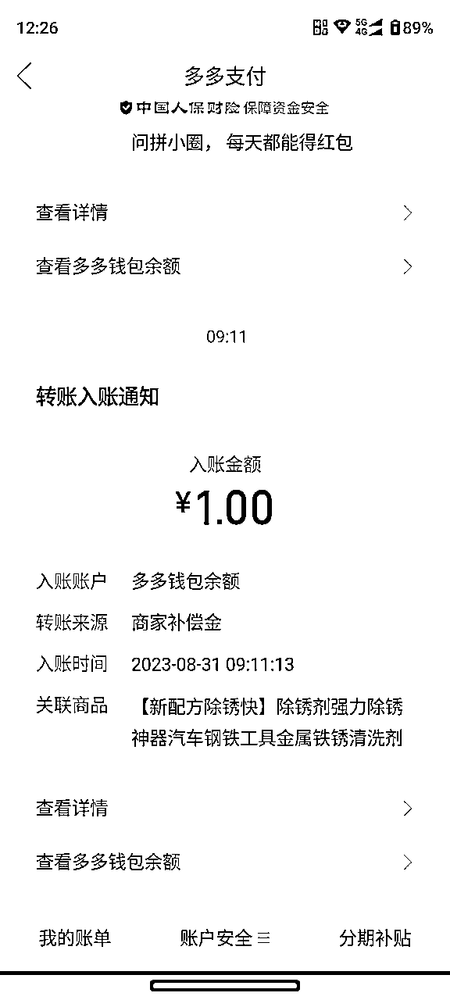
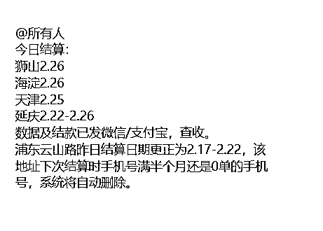

# 快递掘金项目手册
作者：龙哥

别急着划走，今天给你拆一个门槛低、玩法野的“快递掘金”路子。不囤货、不发货，靠的就是日常买买买里藏着的利润差。

先说核心逻辑：你平时在抖音、拼多多、淘宝，还有各种零元购平台上，专门挑那种0.01元到0.3元的超低价商品下单。一个养熟的账号，平均每天能拍下30到50单。一个号不过瘾？那就多开几个号，批量跑起来。这项目本身干干净净，没有灰产套路。

为什么能赚钱？因为咱们团队提前搞定了快递驿站和派送员。你每签收一个包裹，驿站或派送员就能拿到一笔派送费。这笔派费南方北方不一样，结算周期也各有不同。目前团队主攻上海和北京，单价比其他城市更香。

利润来源，我给你掰扯清楚：

第一块，快递派费。咱们对接到的单价是每单0.6元，扣除下单成本，平均一单能净赚3毛左右。举个例子，一个正常活跃的账号一天跑30单，你同时养3个号，一天就是90单，利润差不多30块，一个月下来900多块，稳得很。

第二块，零元购返佣。很多平台有真正的0元购商品，不仅不要钱，还倒贴佣金。收货之后，佣金照样进你口袋。

第三块，好评返现。部分商家为了要好评，收货后只要你动动手指给个好评，就能拿到返现红包。

第四块，团队长抽成。如果你拉起了团队，每单能抽0.1到0.2元。算笔账：手下有1000个活跃用户，每人每天拍30单，你一天的团队流水就是3万单，最低抽成3000块。如果每人每天能干到100单，日利润直接破万。

再提醒下结算周期：快递站点一般一周结一次。比如你3月1号签收的订单，3月8号统一结算。别嫌慢，哪怕一个站点一天三十万件货，人家也不会为几十几百单单独给你日结。合伙人后台会拉明细，一笔一笔对得上。万一出现“吞单”？基本不可能，真遇到了把快递单号和手机号甩给对接人，核对后补发。

具体怎么上手？记住这几步。

第一步，建档报备。把你的下单收货昵称、手机号、支付宝账号和真实姓名发给管理员，用于建档和后期打款，务必填准确。审核会默认帮你过三个地区站点。如果手机号尾号跟别人重了，就换个号。优先用自己手机号，重复了可以选199、162、140、165、167这些虚拟号段，自己编个尾号，但要确认是空号。审核过了，就拉你进两个群：一个交流发单群，每天更新低价链接和零元购平台；一个结算群，每天公布到货量和打款明细。

第二步，添加拍单地址。审核通过后，在拼多多、淘宝、京东、抖音等平台填写收货信息，名字和电话必须用报备过的那个，地址按对接人给的来。号多的话，地址末尾稍微改一改，方便区分。

第三步，关闭号码保护。各平台隐私设置里都有“号码保护”，一定关掉。不然快递单号会变成虚拟号，后台统计不到你的订单，钱就飞了。

第四步，开始下单。核心原则：只要派费减去下单成本还有得赚，就放心拍。要么在发单群里复制低价链接直接拍，要么去零元购平台下单——你付的本金到货后全返，等于快递派费纯赚。具体操作看视频，举一反三就行。

第五步，签收结算。每周统一结一次，比如3月1日物流显示签收，3月9日打款；3月2日签收，3月10日打款，以此类推。有问题直接找群管理员。

最后说团队政策：日单量超过500单，按0.6元/单结算；超过1000单，涨到0.65元；超过5000单，0.7元；超过10000单，0.75元；超过20000单，直接0.8元/单。做起来的伙伴，团队还有专属素材号，朋友圈复制粘贴就行，对接人就是你的推荐人。

这项目适合想搞副业、执行力强的人。毕竟，每天动动手指拍点小东西，顺手把流水变现，何乐而不为？

