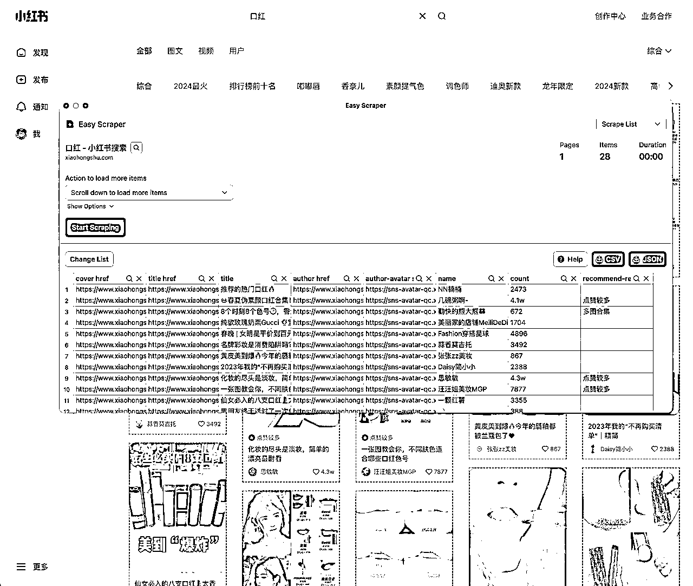
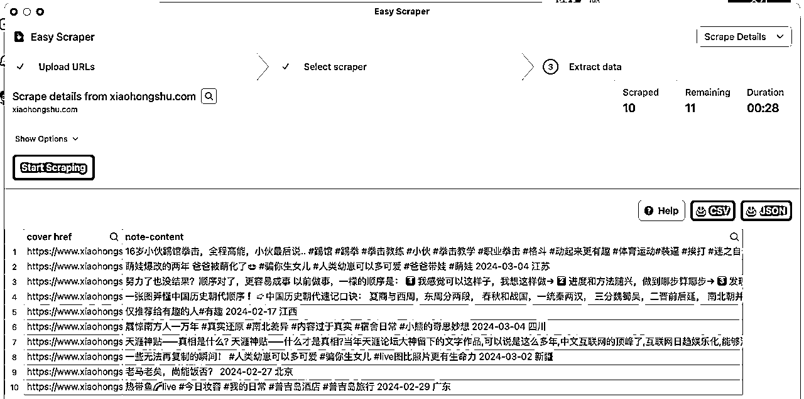
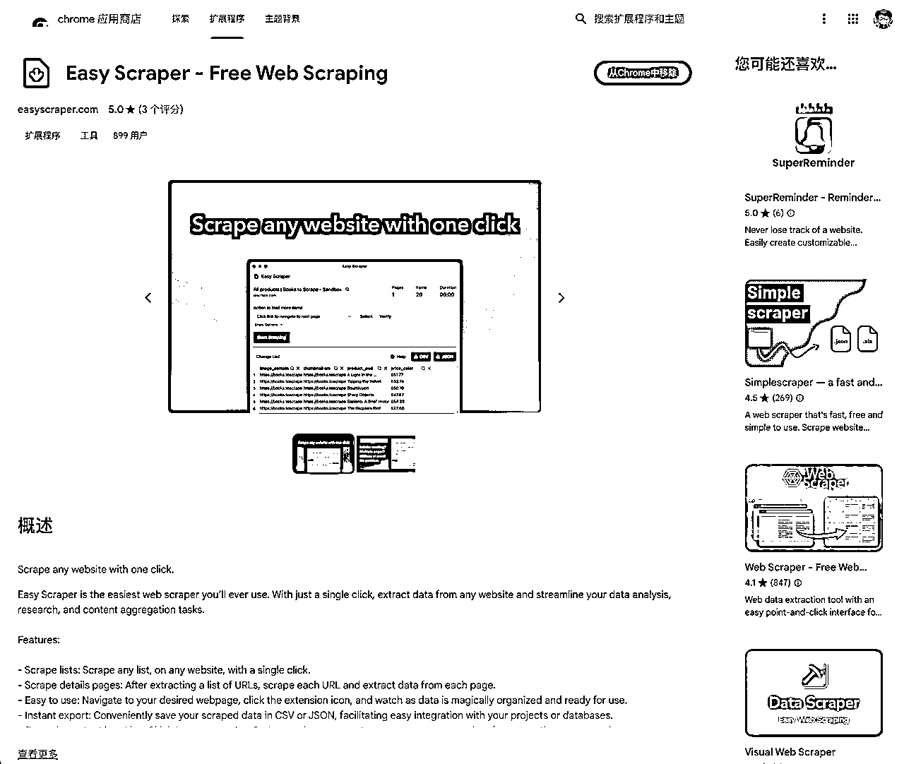
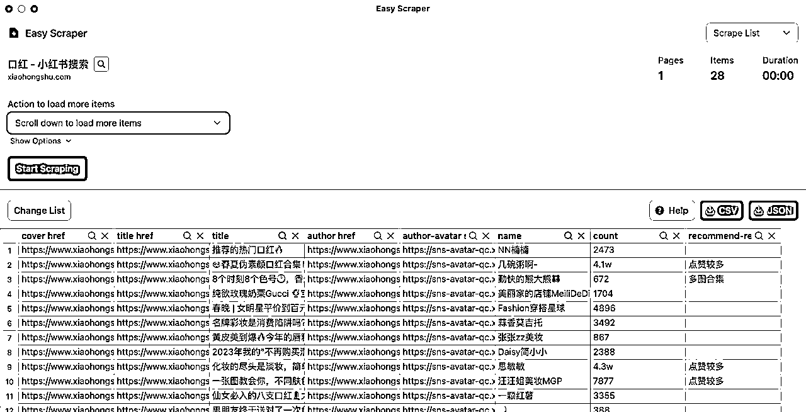
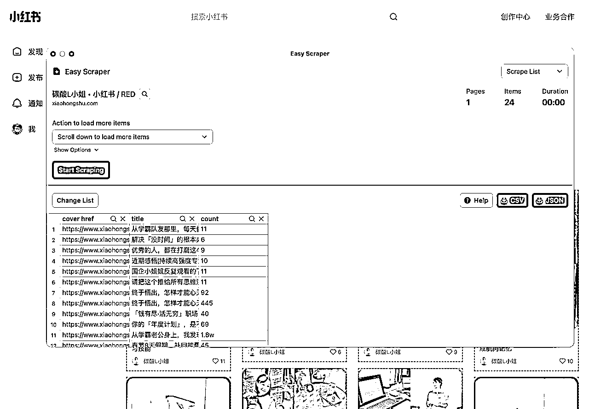
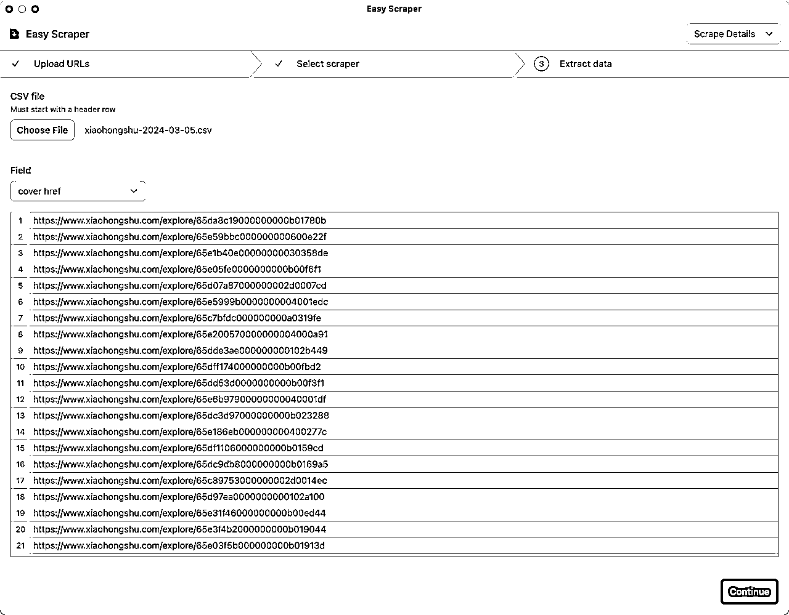
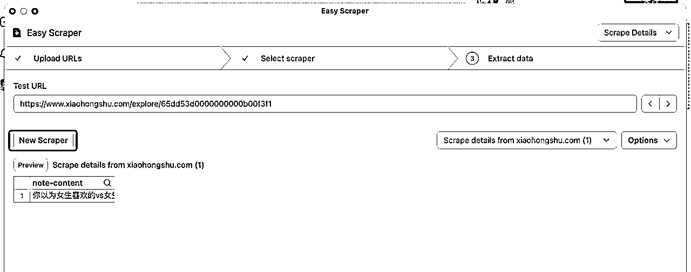
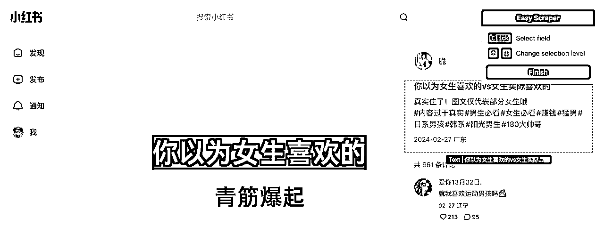
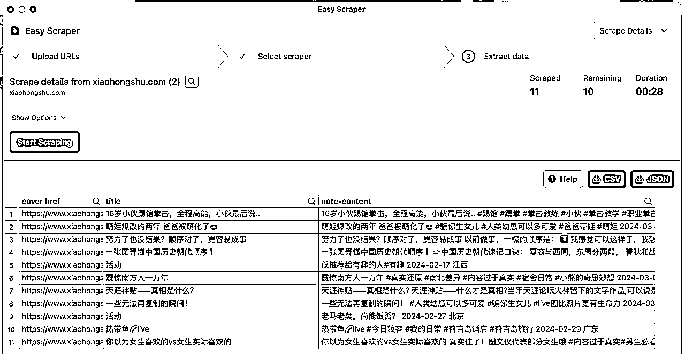

# 零代码 1 秒导出小红书帖子标题和详情

还在为收集小红书笔记数据发愁？看到别人批量导出标题、详情，自己却连爬虫代码都不懂？别急，今天分享一个神器，零基础也能 1 秒搞定小红书帖子标题和详情导出——它就是 Easy Scraper。

先快速认识一下：这是一款 Chrome 浏览器扩展，来自作者姬小光的分享。它的核心卖点就一个字——简。你不需要写一行代码，不用理解什么爬虫逻辑，只要安装好扩展，打开目标网页，点击一下图标，数据就整整齐齐地出现在你面前。效果可以先看下方演示：

它到底能做什么？首先，列表抓取和详情抓取是基本功。你既可以抓取整个页面里的帖子列表，也可以进一步抓取每条帖子的详细内容。操作体验上，它几乎做到了“傻瓜级”：打开网页，点击扩展图标，数据就自动被整理好。而且它很擅长处理那些 JavaScript 动态渲染的页面，哪怕网站再复杂，也能巧妙地把数据捕获下来。隐私方面你尽管放心，Easy Scraper 全程在你的浏览器本地运行，不会把数据通过网络发送出去，私密又安全。

数据导出也很灵活，支持 CSV 和 JSON 两种格式。拿到手的 CSV 文件可以直接丢给 ChatGPT 做简单分析，或者变成 GPTs 的知识库素材。更惊喜的是，这个工具目前完全免费——因为开发者整个三月份要参加沉默冥想闭关，压根没时间设计付费套餐，这羊毛不薅白薅！

下面进入实操环节。

**第一步：导出帖子列表的基础数据**

先从 Chrome 网上应用店或者官网把扩展装上，一键完成：

接着导航到你想要抓取的网站——比如小红书某个搜索结果页或话题页，然后点击 Chrome 右上角的扩展图标激活抓取器，眨眼间帖子基础数据就导出来了：

如果你有特殊需求，还能自定义抓取。比如设置滚动加载更多内容、调整抓取速度、自定义页面等待时间，最后选好想要的格式导出即可：

拿抓取某个博主的帖子标题来试试：

看结果，标题、帖子链接、点赞数全都有。这些标题可以直接交给 GPT，帮你想出类似的爆款标题，或者做简单的数据调查，都很方便。

**第二步：导出帖子详情数据**

列表数据只是第一步。先导出一份列表 CSV 文件，然后在扩展的抓取页右上角选择「Scrape Details」，再把刚才的 CSV 重新传回去：

这时候扩展会自动识别可能包含详情链接的字段。如果识别正确，直接点「Continue」继续；不对的话，你可以从下拉框里手动选择真正的详情链接字段。

接下来设置详情页要抓取的元素。点击「New Scraper」后，详情页会出现一个选择器，你只需要把鼠标悬停在想要抓取的区域上方，选中即可：

选中后点「Finish」完成选择：

然后继续点「Continue」，进入抓取流程。点击「Start Scraping」开始爬取详情页内容：

稍等片刻，你会发现帖子的标题、详情内容都已经顺利抓取到手。最后再导出一份 CSV，大功告成。

总结一下：上面的两种方法其实属于通用技能，凡是人眼能在网页上看到的内容，基本都能用这套方法抓下来。你只需要根据不同的网站变换选择器，或者手动调整一下抓取列表就行。Easy Scraper 最大的魅力就是简单——不用学爬虫、不用写代码、不用额外装什么软件，动动手指，点一点，想要的数据就到手了。还有比这更香的吗？