# 用影刀RPA搞定20台手机抖音批量发片，我是这样做到的
作者：龙哥

## 1、项目背景与机器人能力

*   为什么要做这套自动化

*   公司要做抖音矩阵账号运营，全部走手机端发布。一个运营要同时盯20台安卓机，每台每天发3条，一天就是60条手动发布，体力活太重，只能交给影刀RPA来扛。

*   这套机器人最终能干什么

*   实现多台安卓手机并行、无人值守地自动完成抖音视频发布

*   动手前必须先弄明白的几件事

*   所有手机的屏幕手势要统一调成【全面屏手势】模式
*   影刀RPA目前只兼容安卓设备，iOS暂时无解
*   在做联动测试时，每台手机都要单独跑通一次，确认连接正常
*   App升级后内部控件ID和结构可能变动，机器人上线后建议直接禁止抖音自动更新
*   实际运行效果演示，单机视角拍摄，建议调成1.5-2倍速度观看：

## 2、搭建思路拆解

### 2.1、先在一台手机上跑通核心流程

#### 2.1.1、建立手机与影刀的连接

#### 2.1.2、启动抖音应用

这一步要拿到应用包名。做法是先在影刀里连上手机，再在手机里手动打开抖音，然后点获取包名即可。

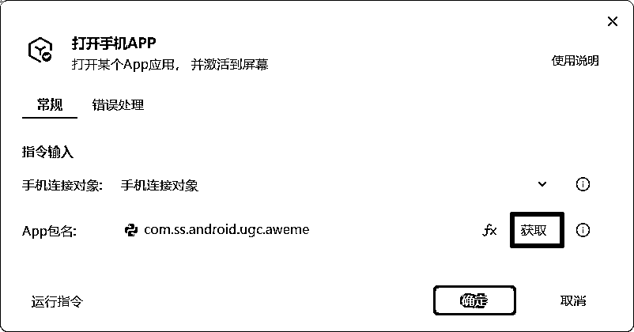

#### 2.1.3、进入首页后完成选片与发布

抖音客户端的控件变化比较频繁，今天能用的定位明天可能就失效，所以我选择用xpath来抓取元素。

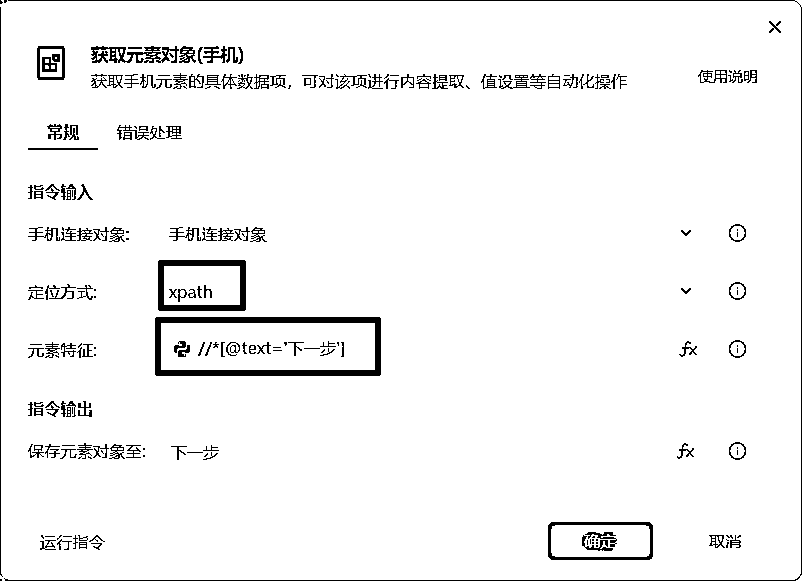

定位元素时优先用 text 属性来找，例如关注按钮可以写成 //*[@text='关注']。如果 text 经常变，就用【获取手机UI树】功能去找一个不易变的属性来替代，比如资源id稳定就可以写成 //*[@id='关注']。

操作示例：

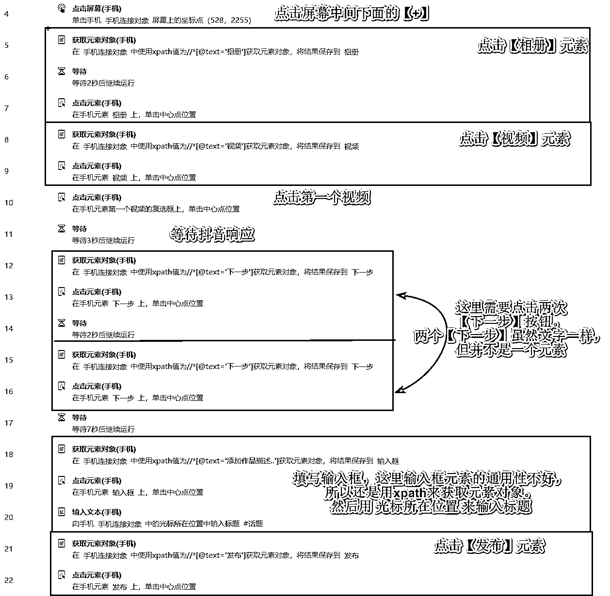

### 2.2、把单机方案扩展到多机并发，提升通用性

#### 2.2.1、在连接环节选择【运行时的所有手机】
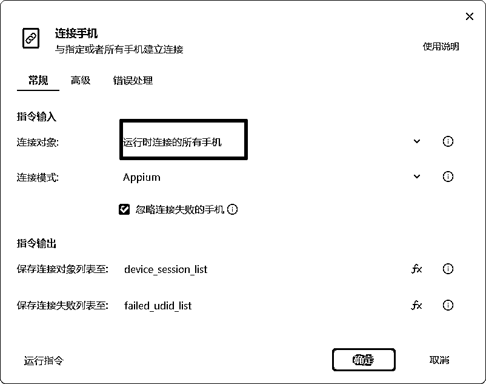

#### 2.2.2、用【For Each列表循环】把设备对象逐个取出来
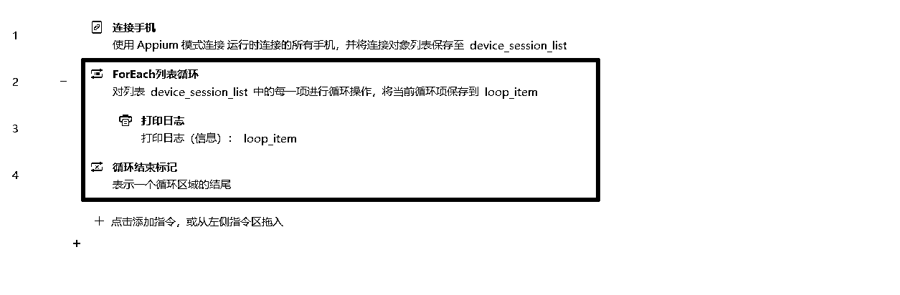

#### 2.2.3、在循环体内调用前面在2.1里写好的单机流程，让设备依次执行
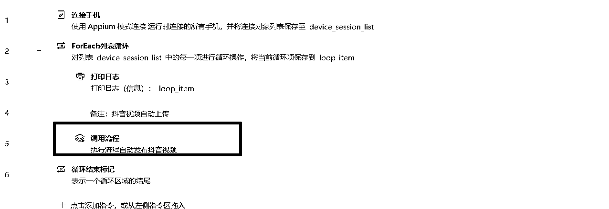

#### 2.2.4、把【调用流程】换成【并发调用子流程】，实现多台手机同时开干
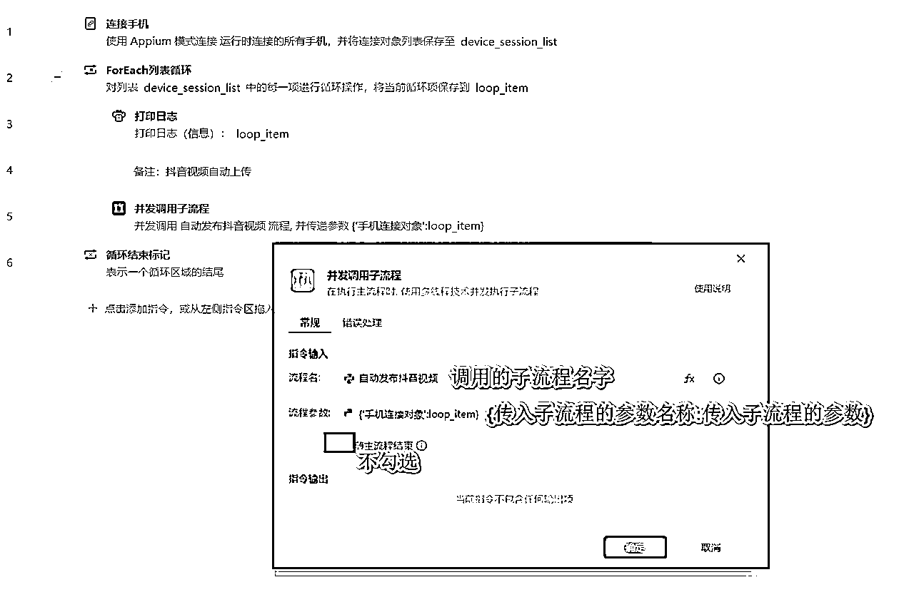

### 2.3、处理可预见的固定性异常，增强稳定性

#### 2.3.1、抖音偶尔会跳出上次未发布的草稿弹窗，需要自动识别并关闭

打开App后，先判断页面是否存在【关闭弹窗】控件，有就点掉它，然后继续进入发布流程。

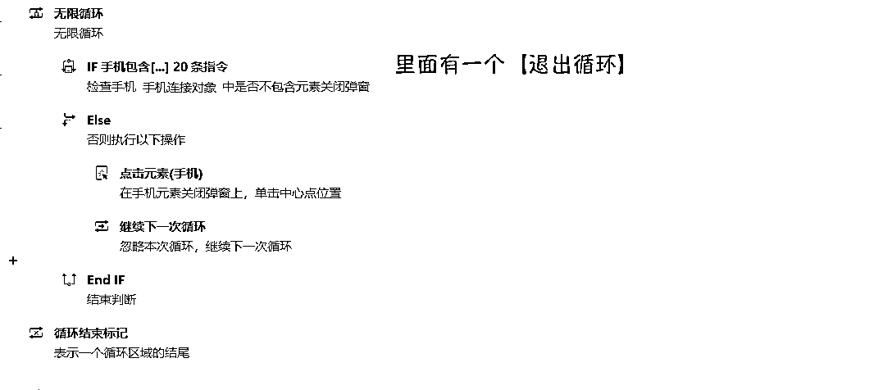

### 2.4、兜底随机性异常，保证流程不中断

实际运行中会碰到网络波动、App闪退、误触等随机问题。需要用 try...catch... 的异常捕获机制来兜底。

遇到异常时流程不会直接崩溃，可以正常运行，就跟没加异常处理时效果一样。

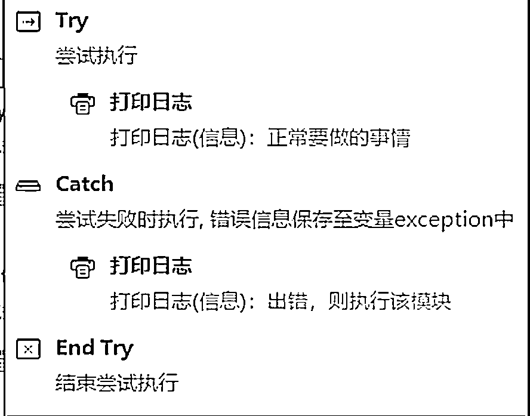

具体配置方式：

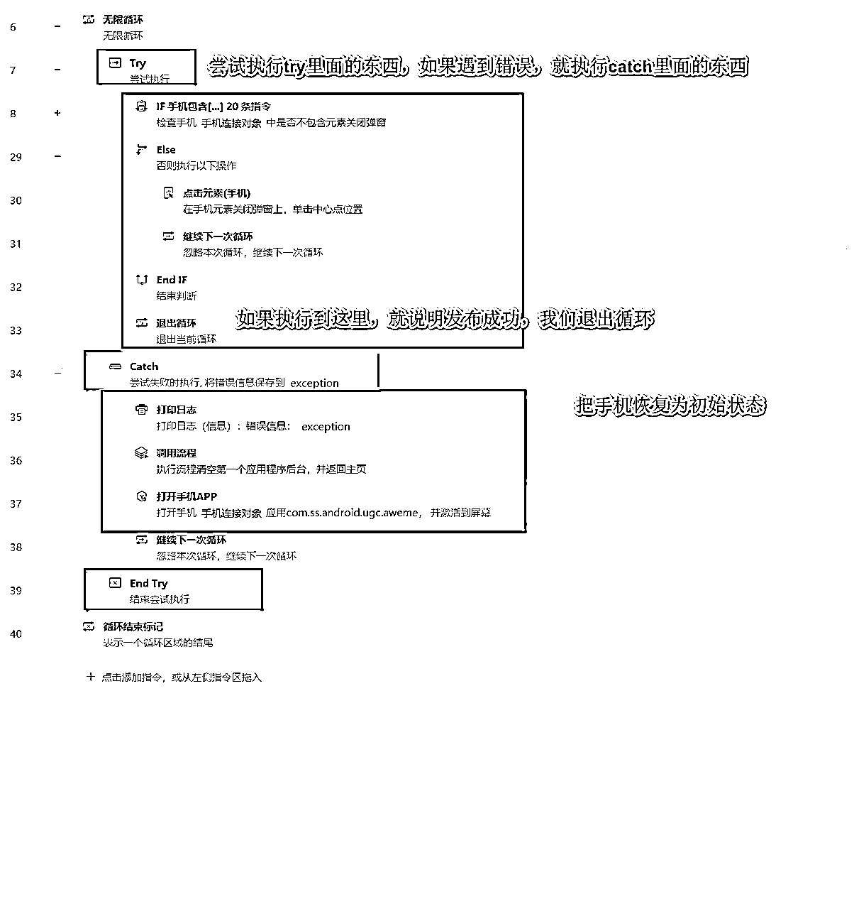

## 3、流程总览

### 3.1、主控流程
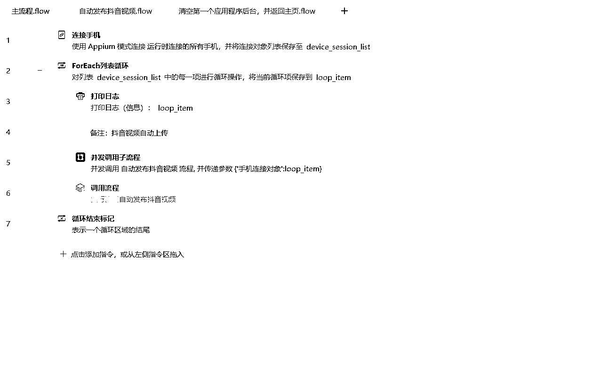

### 3.2、单机自动发布抖音视频子流程
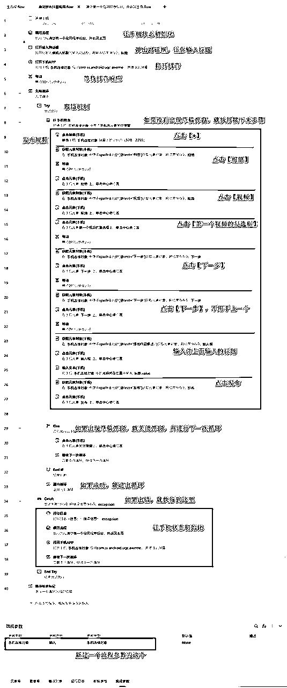

### 3.3、清空前台应用并返回抖音首页
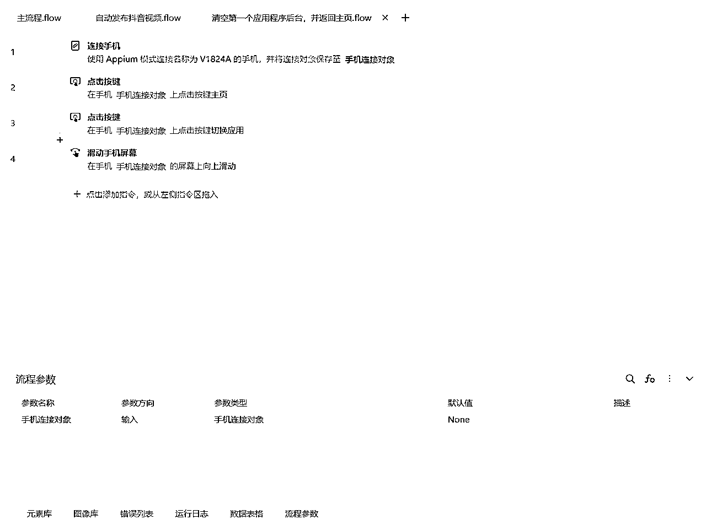