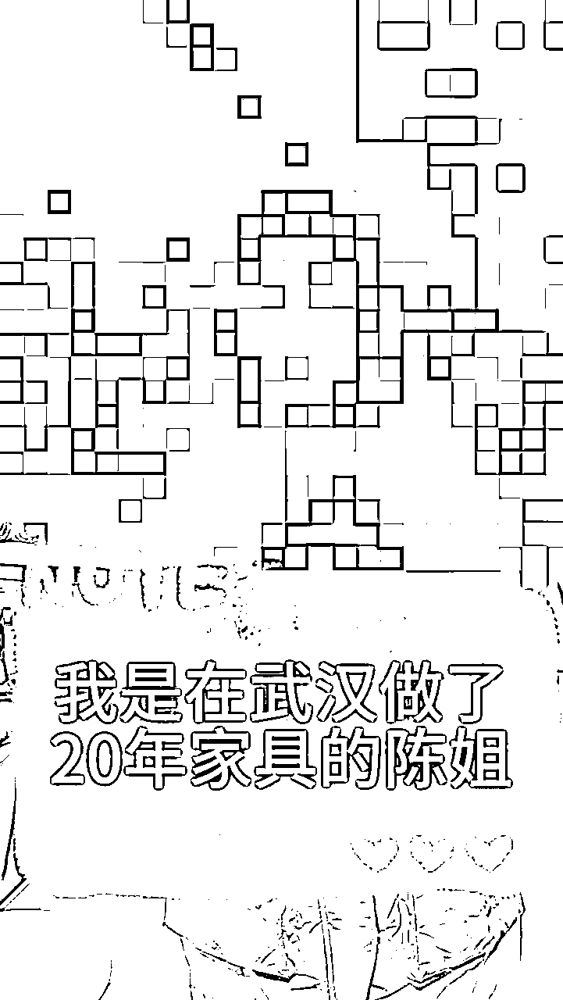
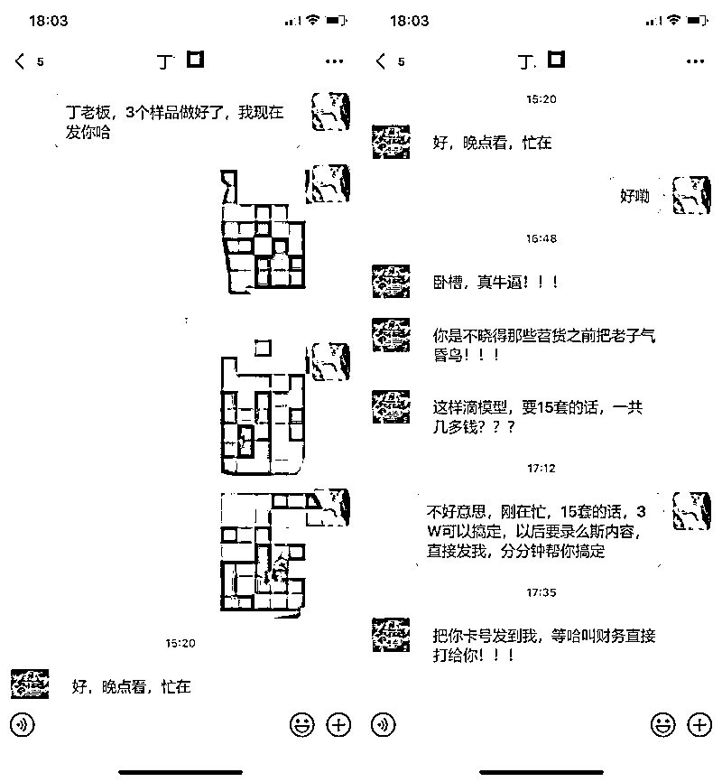

# 数字人商单怎么接？这份百万级成交实战指南，值得你反复读

大家好，我是龙哥。关于数字人变现，很多人都在问：商单到底怎么谈？客户从哪里找？交付要怎么做才能持续赚钱？今天我就把这套《数字人商单成交秘籍》的核心内容一次性讲透，从市场分析、客户筛选到定制流程和后期交付，全是可落地的实操干货。

## 一、为什么线下老板需要数字人？

现在做实体生意的老板，普遍面临同一个转型难题：想把线下业务搬到线上，却不知道从哪下手。抖音、快手这些短视频平台，已经成为他们打广告、拓客源的主要阵地。但问题也随之而来——大多数老板不懂互联网营销，也不会拍视频。花大价钱请人拍，出来的内容却不尽如人意；自己上手拍，又耗时费力，面对镜头还尴尬。最终的结果就是：钱花了，时间耗了，流量却没起来。

短视频消费已经成为主流，实体老板们真正需要的，是一个低成本、高效率、还能保证质量的视频生产方案。数字人商单定制服务，恰好补上了这个缺口。用AI技术生成真人出镜效果，不需要摄影师、演员，也不用复杂后期，成本大幅降低，还能避免真人出镜的不适感，视频质量和交付效率反而更稳定。这正是它能在市场上快速跑通的原因。

## 二、谁才是你的目标客户？

数字人商单的优质客户，是那些经营线下实体生意、想要在互联网上扩大声量，但对AI技术和线上营销了解有限的老板。他们的核心诉求有三个：

第一，要流量。希望通过抖音、快手等平台，把品牌和产品的曝光做起来，吸引更多客户进店。第二，要省事。自己不懂技术，也没时间折腾，最好有人能全包，直接交付可用视频。第三，要回报。他们愿意为能带来明确效果的服务付费，尤其看重长期的投资回报。

这类客户分布在各行各业，而且已经被验证过成功路径。比如家具店老板，用数字人短视频把特色设计和店内环境展示出来，吸引客户主动到店体验和购买；出书的作家，通过数字人讲解书籍内容和创作故事，读者互动和销量都起来了；还有汽车4S店老板，用数字人展示车型细节、试驾实况和促销活动，成功把潜在买家吸引到店咨询。

除了这些，餐饮、零售、美容健身、教育培训、旅游、房地产等行业，也都能用数字人做出不错的效果——展示特色产品、传递服务品质、分享课程亮点、呈现目的地美景、突出房源细节……可以说，线下实体生意越重，数字人的价值空间就越大。

## 三、技术是接单的底气

想靠数字人商单赚钱，技术必须过硬。海外美女数字人、书单数字人、老年数字人、唱歌数字人……这些主流类型的制作流程，你都得熟练掌握。这不只是能不能接单的问题，而是客户看样品时，你能不能拿得出手的问题。技术不过关，样品一展示就被秒拒，后面谈什么都没用。

所以，别急着谈客户，先把基本功练扎实。多做实操练习，遇到技术卡点，可以随时问我，我会帮你解决。只有把技术吃透，才能在客户提出各种需求时，快速给出让ta满意的作品。

## 四、去哪找客户？这招最管用

刚开始接单，不要好高骛远。优先从你身边的实体店老板入手，尤其是这两类人：一类是生意本来就好的老板，他们有动力继续扩大影响，也愿意尝试新玩法；另一类是正在遭遇瓶颈的老板，他们急需新的营销手段来破局。

服务好一个老板，之后一定要维护好关系，让对方愿意把你推荐给他商圈里的其他老板。一旦打入一个老板圈子，后面的客户会源源不断。这里要提醒一句：尽量避开那些生意惨淡、财务状况紧张的老板。他们往往对投资回报有超乎寻常的期待，接单后容易产生不必要的麻烦。

除了线下人脉，线上获客同样重要。在朋友圈、短视频平台展示你的高质量数字人作品，最好再配上线下成交案例，让潜在客户看到你的专业度和真实效果。尤其是高客单价项目，客户初次接触时戒心很重，精细的样品和真实案例就是建立信任的最好方式。

## 五、定制流程和报价策略

接到意向客户后，定制流程是这样的：先让客户提供1分钟左右的视频，内容不用太复杂，参考数字人平台的公共动作即可，但面部要直视镜头；再准备10分钟左右的清晰音频，朗读文章就行，必须只有一个人的声音。然后，你就可以根据这些素材为客户定制专属数字人模型。模型做好后，客户只需要把文字脚本发给你，你就能帮他生成成片。

重点来了：一定不要急着报价。先免费做一个样品给客户看，等他满意了，再谈价格和细节。这样可以极大地降低成交阻力。价格方面，数字人商单定制至少5000元起步，我自己接过10个模型10000元的单子，后续再根据客户提供的文字脚本持续制作视频，赚的是长期服务钱。

还有一点必须牢记：数字人制作技术千万不能外泄。给客户交付终端成品就好，核心工艺绝对不能透露出去。

## 六、后期交付才是持续赚钱的关键

成交只是开始，交付决定你能不能赚到长远的钱。客户定制数字人后，你还需要根据他的需求持续产出视频内容。这个环节做得越好，客户就越信任你，续费、转介绍都会跟着来。如果交付草草了事，客户不满意，负面反馈传出去，你推多少新客都补不回来。

为了提升交付效率，我目前正在研发本地离线部署的数字人制作方案。等这套流程成熟后，可以直接授权客户使用自己的定制模型，客户输文案就能自己生成视频。这样既能解放我们的时间精力，去开拓更多客户，又能让客户获得更大的自主权，实现双赢。

## 七、工具怎么选？省钱又好用

前期给客户做样品，要特别注意成本控制。我推荐用接码平台配合HiFly网站来制作，成本低，还能多版本试错，确保拿出手的样品是最佳效果。等到正式商单落地，尤其是视频超过1分钟的时候，就直接购买HiFly的套餐服务，价格合理，视频质量更稳定，交付更靠谱。

声音克隆方面，很多学员问要不要用elevenlabs。确实，它是国际顶尖的声音克隆平台，但我们的主要客户是国内线下实体老板，他们要的是纯正自然的中文声音，而不是带外国口音的效果。所以，我更推荐使用国内的声音技术平台，既能满足客户对本土化声音的要求，也能在行业里建立更好的口碑。

## 八、真实成交案例拆解

**案例一：家具店老板，1万元拿下**

一个熟人陈姐，看到我朋友圈一直在发数字人相关的内容，主动问我能不能帮她定制一个数字人。陈姐做家具生意，平时在抖音发短视频很痛苦——每次都要请摄影、请人工，还要化妆，耗时又费钱。我给她做了一个样品，试着报了1万元的客单价，定制10个数字人模型，没想到她非常爽快地付了款。

这件事让我更加确定：数字人ToB私人定制的发展前景很大。很多老板不懂AI，但他们非常清楚时间就是金钱，只要能帮他们节省成本、提高效率，他们相当舍得花钱。

**案例二：汽车4S店老板，3万元打开新局面**

一个球友，开汽车4S店，一直对短视频营销头疼。他店里虽然请了形象气质不错的销售员，但一到镜头前，产品展示能力、口头表达都达不到理想效果。每次拍视频都是时间和纯成本的投入，最后还可能白忙一场。

直到他在我朋友圈看到数字人定制服务，立刻产生了兴趣。我给他做了三套数字人样品短视频，效果让他非常意外——数字人不仅表达流畅，车子的亮点也能清晰呈现，而且比真人更稳定、更省心。他当场拍板，今年汽车销售的视频内容全面交给我的数字人来做。最终，我们以3万元的价格，为他定制了15个汽车销售数字人模型，开启了长期合作。

这个案例让我意识到，数字人不仅能解决传统拍视频的痛点，更能在汽车这类高竞争行业里，帮商家用更低的成本拿到更高的营销回报。

## 九、写在最后

从技术打磨到市场洞察，从获客策略到售后交付，这套数字人商单成交体系，已经帮你把整个变现路径都铺好了。你看完以后，只差两步：迈出第一步去实践，然后持续优化、坚持下去。

无论你是通过熟人介绍拿到第一单，还是靠互联网内容吸引客户，都不要怕试错。每一次实战，都是在为你的数字人事业积累经验。记住，持续学习、不断实操、勇于创新，才是你最大的竞争力。

《数字人商单成交秘籍》不是一个结束，而是一个开始。如果你想在数字人制作过程中少走弯路，欢迎随时来和我交流：jingdu2024。

让我们一起，在数字人变现这条赛道上，跑出自己的价值。