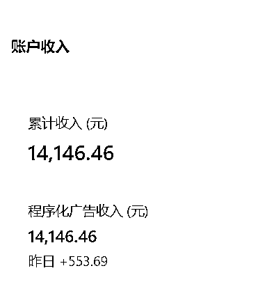
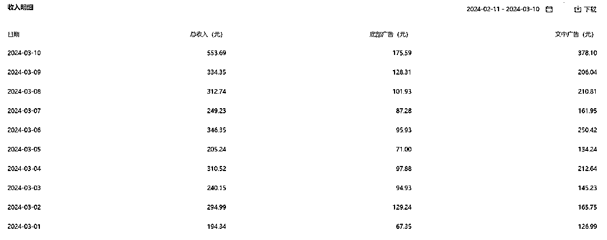

# 35岁强直患者，靠AI改写公众号，3个月8篇10w+，日收300+，我的方法全公开

大家好，我今年35岁，目前靠自媒体代运营养活自己。简单晒一下成绩：跟着菜菜老师的“AI营销100节课”学了公众号爆文改写，前前后后做了10个号，一共出了8篇十万加，最猛的一篇跑到了70多万阅读量，这8篇总共帮我赚了2万左右。流量号这东西确实不稳定，不过还好，眼下有一个号已经稳了3个月，每天阅读量大概5万，一天收益差不多300块。

我的背景可能比大多数人复杂。上学时我就被确诊为强直性脊柱炎，后来身体实在撑不住，就辞了工作，回家边休养边做自媒体。去年12月我才正式开始玩ChatGPT，之前也用过文心一言、讯飞这些工具，但体验一言难尽，说句不好听的，简直就是“人工智障”。后来经一个博主介绍，我认识了菜菜老师，发现她特别擅长教人用AI创作，而且那套100节课里正好就有公众号文章改写的场景，于是果断入手。现在想想还挺搞笑，我当时连命令输入框都找不到，全靠一步步摸索和老师答疑，结果一个月后，第一篇十万加就爆了。

我是怎么操作的呢？说白了就三步：先建矩阵号，再去目标领域找对标账号，把他们跑出数据的爆款文章收集起来，扔进洗稿工具批量生产。你可能会质疑，这样整出来的东西质量能看吗？说实话，靠工具直接洗出来的稿子，原创性是个大问题。但我的策略很简单——账号就是消耗品，先广撒网博概率。一旦有哪个号被流量池选中，我就开始精细化处理：找两篇爆款，用菜菜老师教的ChatGPT改写命令重新写。这个命令在课程里讲得很透彻，不但有方法拆解，还有现成的完整提示词，完全是保姆级服务。用这套命令产出的文章，原创度非常高，从来没出过问题。以前机器洗稿偶尔会被判查重违规，换成老师命令之后，一次违规都没遇到过。

对了，我买课的时候不只买了菜菜老师一家的，前后一共花了4万块，对比了好几套课程。论内容的细致程度，菜菜老师确实更胜一筹，每一步都给你讲得明明白白。

我有个朋友也是做这一行的，主要做中老年赛道，手里握了40多个号。他看到我做得不错，跑来取经，我就把方法和命令都发给了他。不教还好，一教之后，他直接把3个员工开了，团队从6人缩到3人，每个月省下1万多块人工成本。说实话，我听完哭笑不得。

再说个行业天花板级别的例子，我认识一个800万粉丝的大号，每个月光流量主收入就有15万。但人家到现在都没用ChatGPT，全是人工在写，之前也试过AI，但没掌握方法，同样觉得是“人工智障”。而我已经拿下了这套玩法，所以也挺期待自己有一天能冲到这个量级。

最后提醒一下大家：公众号流量主这个赛道，收入波动很大，千万别死磕一个场景。趁着现在，多去学一些其他领域的AI写作技能，时代正在奖励掌握AI的人，多一项能力，就多一条出路。

菜菜老师也借我的经历补充了一句：这位学员虽然AI方面是零基础，但他之前已经做了很多年自媒体，有积累，并不是完完全全从零开始。一个人本身只有40分的实力，别奢望AI能给你抬到90分。能力欠缺时，先老老实实打基础；等你有了一定底子，再想着用AI提效起飞，这才是正路。