# 2024，AI+教育：一线观察与赚钱思路

哈喽，我是胖虎。

这些年我一直在少儿编程和人工智能教育这一行里折腾。之前写过《我把教培机构，开到了社区和小学里》，聊的是我把线下教培扎进社区和学校的事；线下的培训课我也开过两期，专门带小学生玩转ChatGPT和各类AI工具，那段经历后来整理成了《我给小学生，上了一堂 ChatGPT 课》。

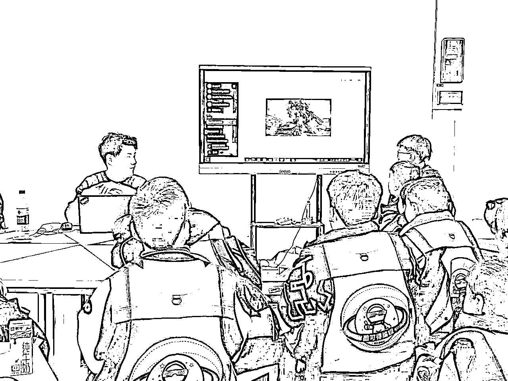

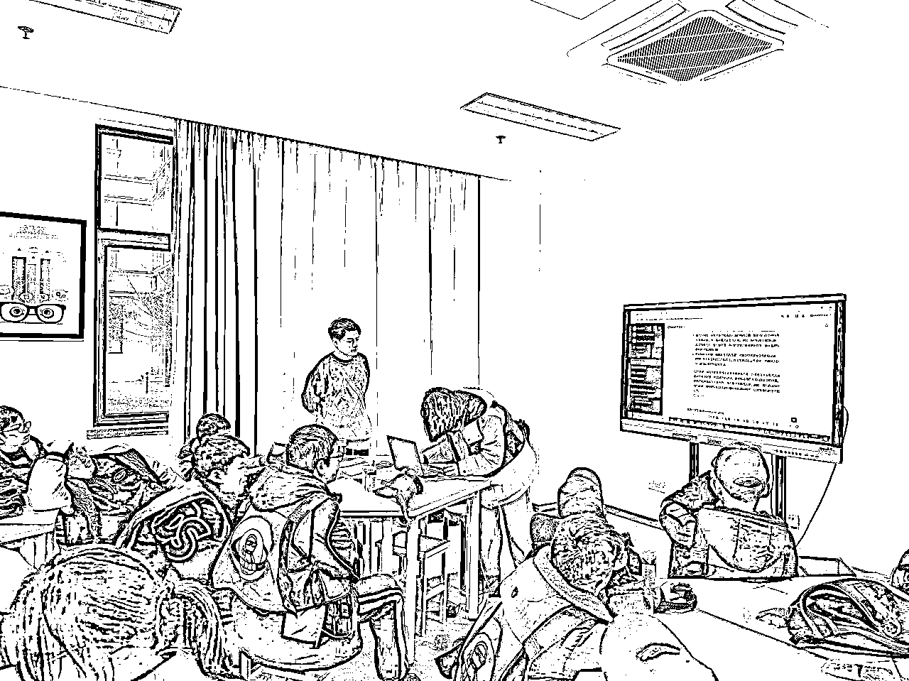

这篇不聊太多大词，聚焦基础教育的AI应用，主要讲讲我在这个赛道上看到的信号、冒出来的想法，以及可能走得通的路子。

先同步几条政策消息。

头一条，来自浙江教育技术中心。内部会议上已经明确：要推动AI等新技术进课堂，研究生成式AI对教育的影响，梳理应用场景，推进技术与教学融合创新，还要有序让移动学习终端走进中学。

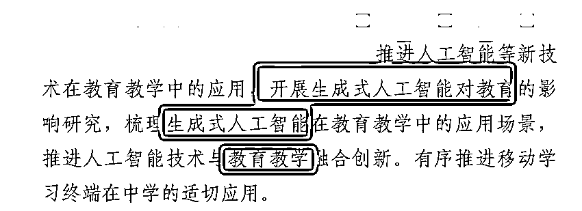

又有一条，是高校层面的。有位浙大教授主攻“元宇宙+AI教育”方向，他参与的科技部“新一代人工智能”重大项目，向上汇报时被省领导点名重视。

再有一条，来自省教育厅。教育厅那边公开鼓励中小学申报AI教育应用试点校，口径很一致：把AI用在教学一线，做深应用实践，把评价数据的采集、处理与呈现整套流程升级一轮，让AI为教育高质量发展真正出力。文件还配套了18个落地场景，基本都围绕大模型和生成式AI展开。

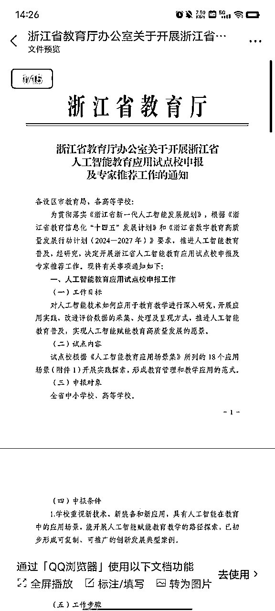

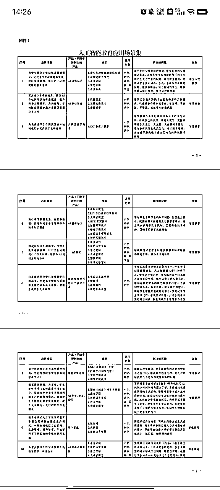

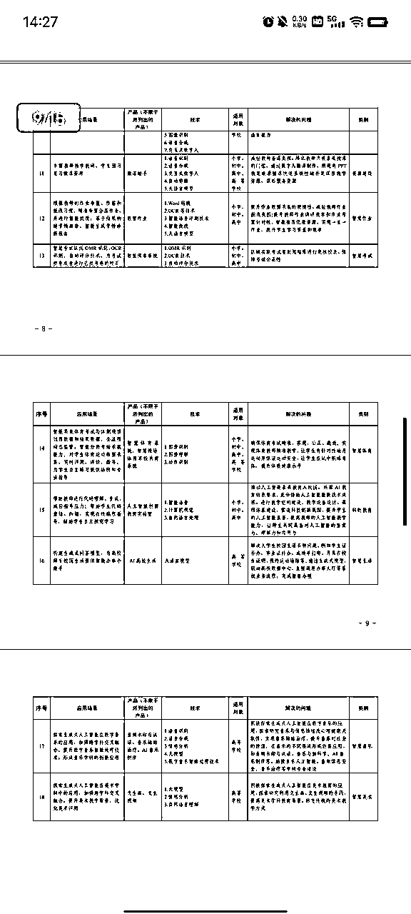

从这些动作能看出，AI这阵风已经刮进教育系统了。教育应用虽然会慢一步，但节奏正在跟上。我自己的业务经常跟当地高校和区县教育局对接，对这条感受特别深：很多负责教育技术的主任和老师，对AI兴趣很浓，但认知还停在刷公众号、看短视频的阶段，真正动手用AI工具的，少之又少。

机会就从老师这个切口说起。

# 老师端：三条变现路径，总有一条适合你

我当年念的是计算机师范专业，同学朋友大多在中小学教书。前段时间我约了三位一线教师深聊，用ChatGPT帮他们解决真实教学中的麻烦事，过程写成了《真实教学场景下，用 GPT 给教师提效》。

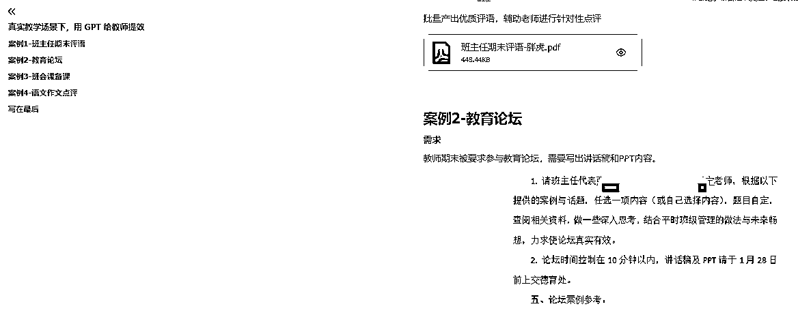

但只帮助老师还不够，商业化才是重点。

## 路径一：给教培机构做AI内训

我的业务里有不少是跟科技类、编程类培训机构打交道的。一些老板知道我搞AI，主动要求我去给他们的老师做内部培训。

去年年底做过两场，算顺手为之，没正式立项。但老师们的反馈非常好，需求也真实存在。内容其实简单，紧扣机构日常工作——让一线老师学会用AI工具备课、做服务和做新媒体宣传。

有意思的是，机构老板最买单的，不是教学质量提升，而是AI怎么帮他们做新媒体营销。

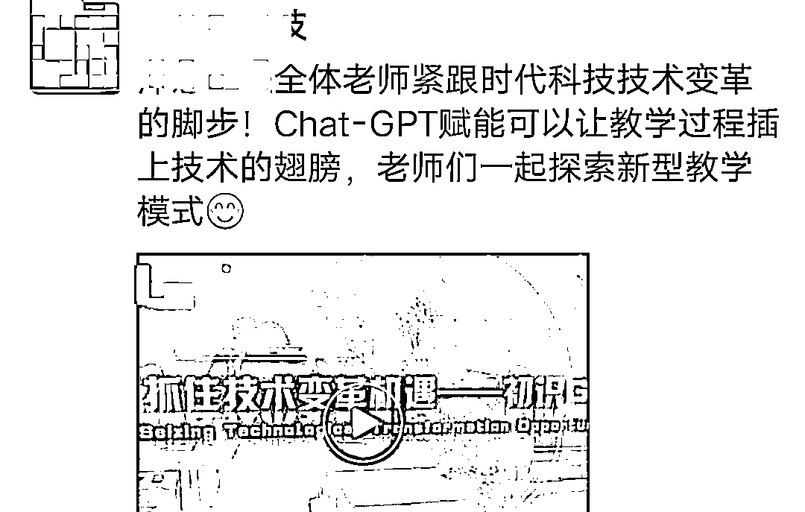

这个需求有持续性，也有市场。我打算把它做成一个小项目，正式塞进业务版图。

## 路径二：体制内教师培训

教师有继续教育学分要求，5年360学分，培训费是财政出，每天约500元。老师按规定选课、上课就行。这类学分课程目前普遍偏理论、略水，很多老教师露个脸签到就闪了。

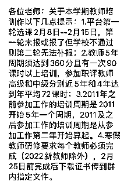

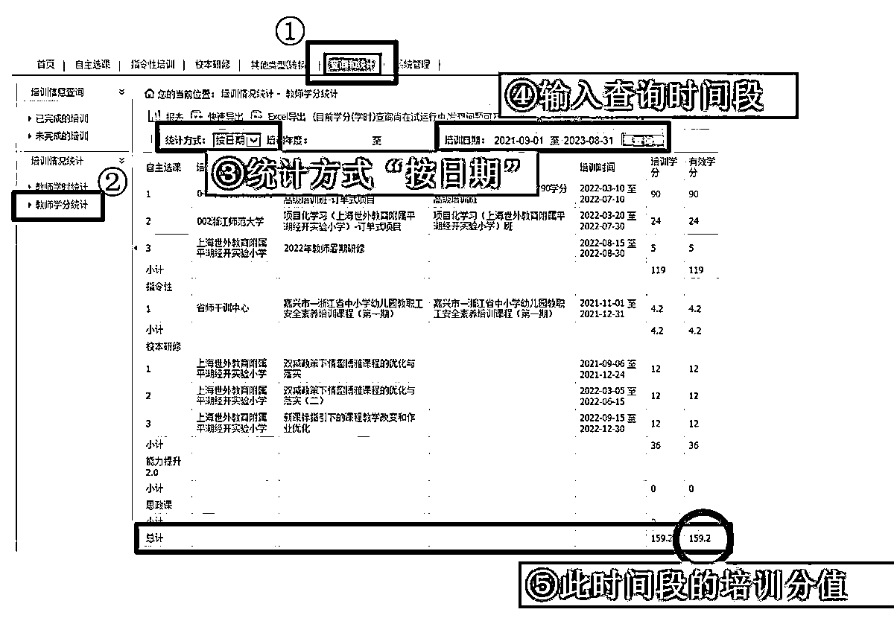

另一类专业培训跟学分无关，通常由教育局、学校或老师自己发起，聚焦专项技能提升。费用由三方共担，因此对课程和讲师要求更高，收费也水涨船高。高校如浙大、杭师大、浙外等有这种资质，一般由继续教育学院承接，但他们忙不过来，大量外包给培训机构，机构负责方案、课程、服务，高校抽成15%~30%。

关键是，市面上的教师AI实操课程几乎是空白。如果有渠道或资质，做AI备课、AI做PPT、AI提效这类课，正是时候。这生意不会一夜暴富，但胜在稳定刚需，还能真正帮到一线老师。我最近正和相关机构谈合作，准备一起搞一套面向老师的AI课。

## 路径三：线上知识付费

就算两样都不占，纯线上的AI教师提效课，照样有得做。知识付费训练营嘛，圈友们都门儿清——针对精准人群出课就行。

老师平时除了上课，还有大量文字活儿，很多人在小红书、闲鱼、淘宝上买教案、课件、班主任评语。AI工具正好把这部分效率拉满。目前已经有一位老师跑通了，训练营做到第三期，值得参考。

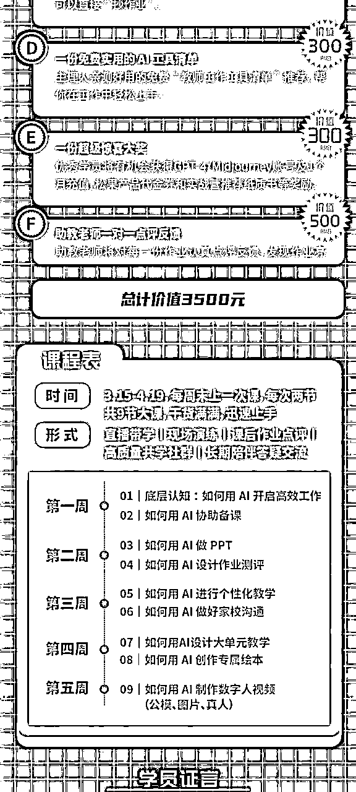

# 孩子端：线下先跑，线上观望

## 线下少儿AI课

我之前做过三年传统AI课程，以少儿编程和机器人为核心。这波AI浪潮让我想起2017年少儿编程刚火的时候：国家重视、政策倾斜、对就业有帮助。

区别也很大。学少儿编程练的是代码真功夫，还能冲科技特长生、对升学有用；少儿AI则没那么刚需，它更多是打开想象力、激发创造力、锻炼提问能力。虽好，却不急迫。

我特别认同刀姐的一段话。她正在做少儿AI游戏化社区，团队讨论时发现，大人和小孩对生成式AI的预期完全不同：

企业主：不能稳定精准产出，直接淘汰。
成年人：一次效果不好，就再也不碰。
小朋友：连错误结果都兴奋，还愿意再来一次“创造”。哪怕文心版本生成的“车水马龙”不太对劲，他们也玩得不亦乐乎。

结论是：小朋友享受混乱、享受意外，所以他们才敢创造。AI原住民就是这样漫无目的地玩出了新东西。因为创造从来不靠“正确”驱动。

我自己办过两期AI科技研学营，把AI工具揉进课程主题。孩子们热情很高，脑洞极大。可惜没有长线带下去，看不到完整的成长曲线。第二期加入了AI绘图、AI视频，效果更炸。文心一言、讯飞星火、豆包这些国产工具，也能降低学习门槛。

下一步，我想做一套项目化课程，覆盖AI通识、AI编程、AI小说、AI绘本、AI视频、AI游戏。这样既能自己招C端学员，也能打包卖给B端机构，师生一起学。市面上已有可参考的样本：圈友曲直老师在做线下课。

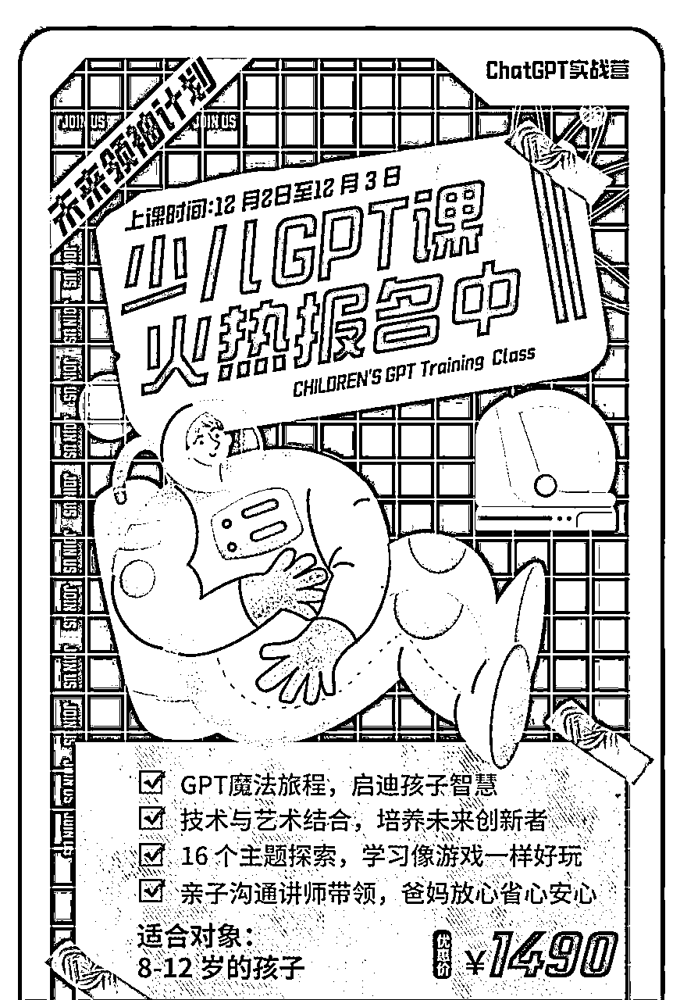

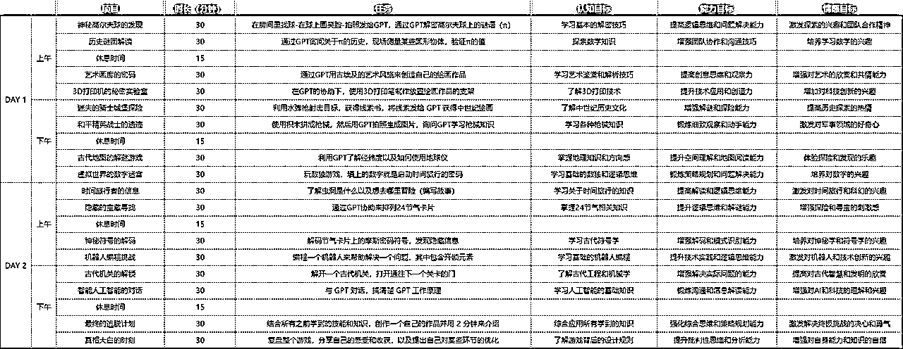

浙大硕博团队有一套AI编程课，我也在洽谈合作。

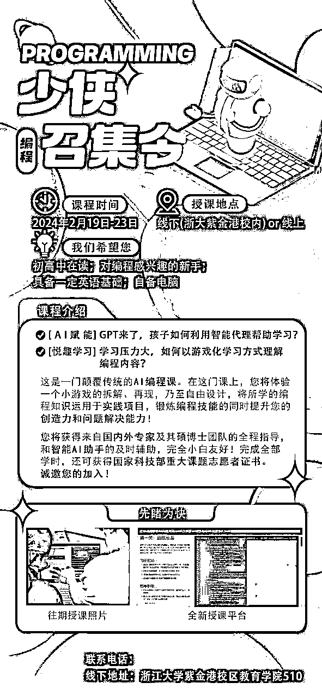

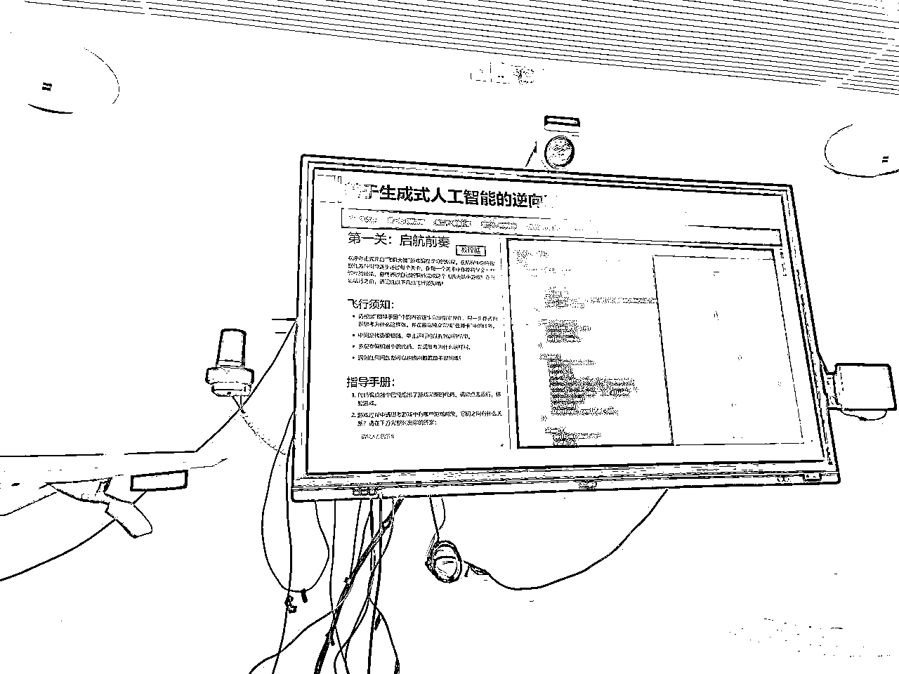

还有线下编程机构的课程，内容跟我的设计很接近。

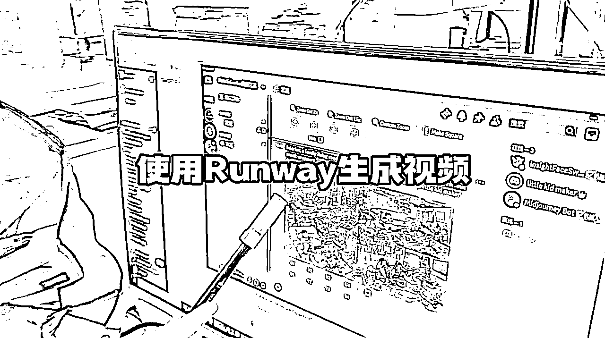

## 线上少儿AI课

线上这块，我一直蠢蠢欲动。早前跟着条形马老师做在线教育，攒过经验。做得好，这块确实能赚到钱。但我迟迟没想清楚：形式怎么做？效果能不能达标？坑在哪儿？所以可能还要再磨一段时间。

# 产品端：几个让我盯着的东西

## 游戏化AI社区

跟刀姐请教了两个小时，得知她在做一款产品：让孩子用生成式AI搭场景、做互动游戏，彼此试玩。有点像蛋仔派对的DIY地图。这个方向我很期待。

## AI编程软件

跟前面的AI编程课是一套组合。游戏化学习工具，由AI助手带孩子逆向拆解游戏代码，快速提升编程和解题能力。目前刚开发出来，准备先在线下课堂收集数据，再迭代打磨。

## 硬件可能是最大的变数

目前市面上还没有真正结合生成式AI的硬件产品。讯飞、学而思、一起学、作业帮已经在AI教育赛道疯狂卡位，大模型学习机应该是重头戏。

如果成本降下来、技术再成熟些，会不会出现这样一款设备：可穿戴的AI眼镜，带视觉识别和语音交互，变成孩子的随身助理。它跟着孩子的目光走，能判断困惑、注意力和思考时间——真到那一天，学习方式会被彻底改写。央视财经也报道过：AI课两个月吸粉15万，企业集体入局，千亿级大市场正在打开。

## 体验了一圈现成的AI学习产品

我还试了河马爱学、海豚AI学、讯飞AI学，整体只能说，一言难尽。河马爱学有几个功能还行，可以下载体验一下。

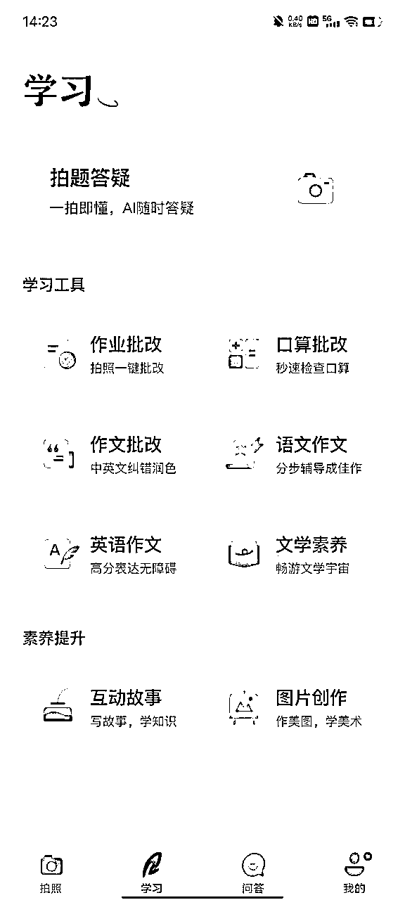

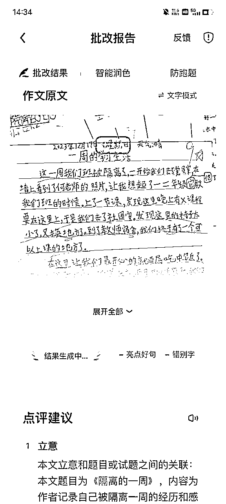

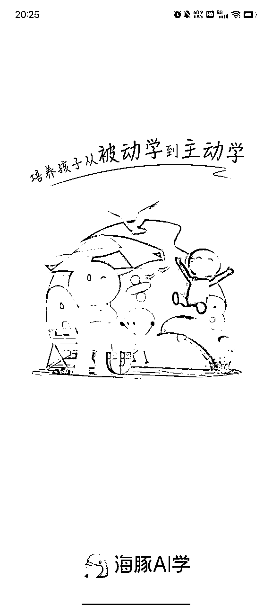

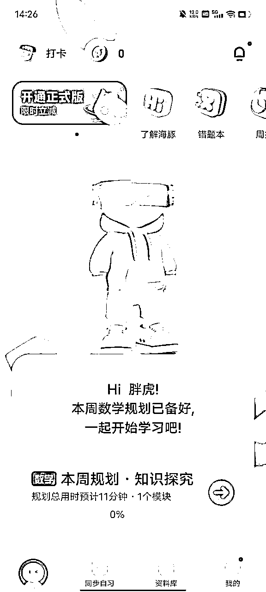

# 写在最后

AI大模型在教育领域只会越扎越深。后面大概率会出现成体系的课程和阶段测评，优质的少儿AI产品、AI名师答疑、校园AI数字化工具也会陆续冒出来。课程、软件、硬件，都会全面更新。

我真心希望这个赛道好好发展，给孩子们带来实际帮助。我们也能找准自己的位置，稳稳地赚钱。

这篇就当抛砖引玉，能给你一点启发，我就很开心了。

谢谢大家！