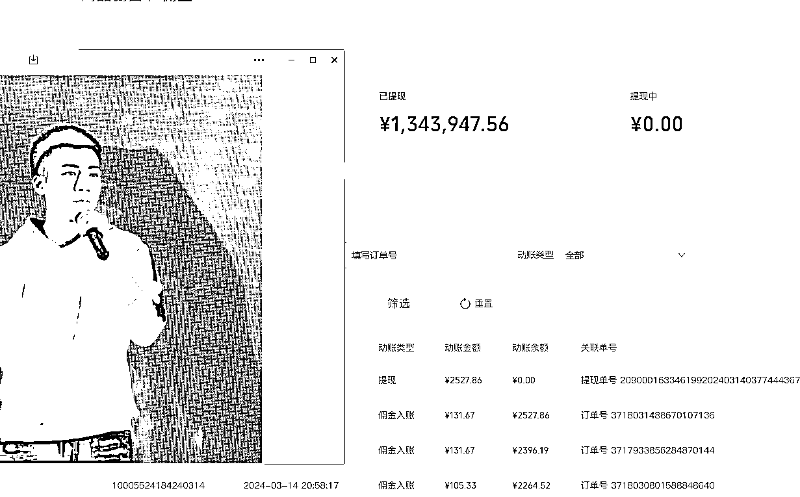
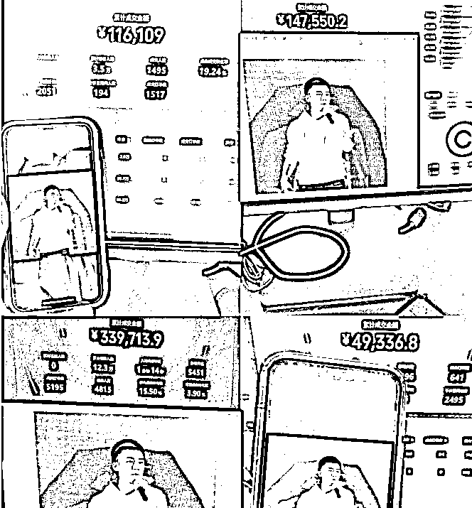
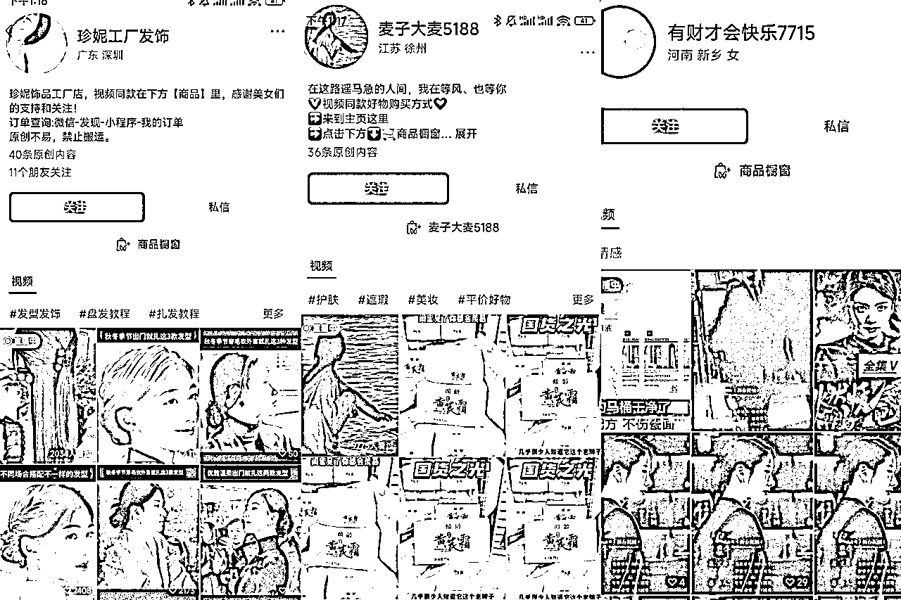
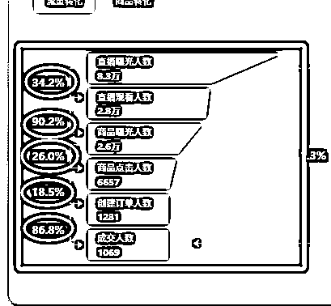
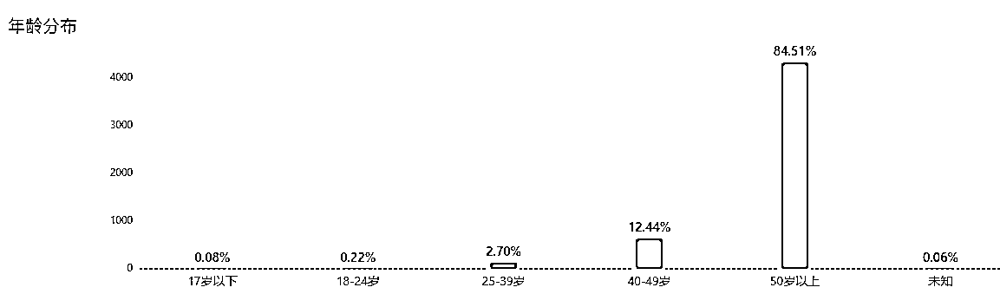
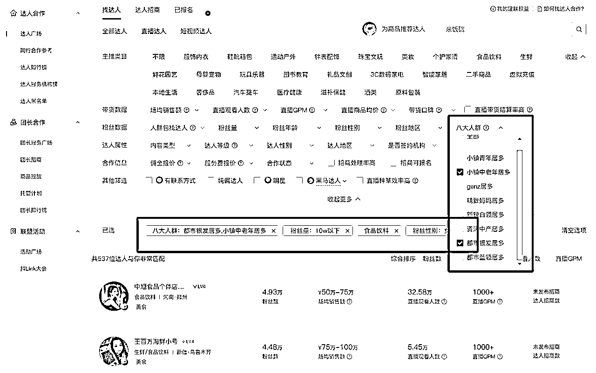
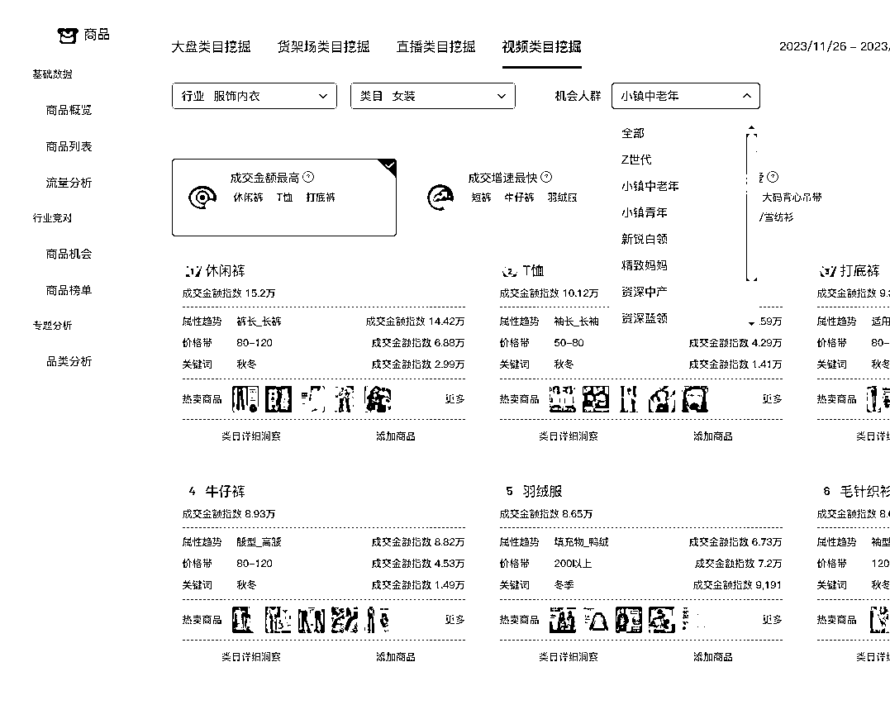
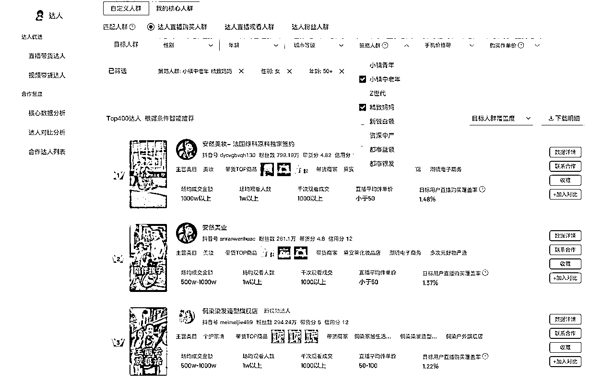
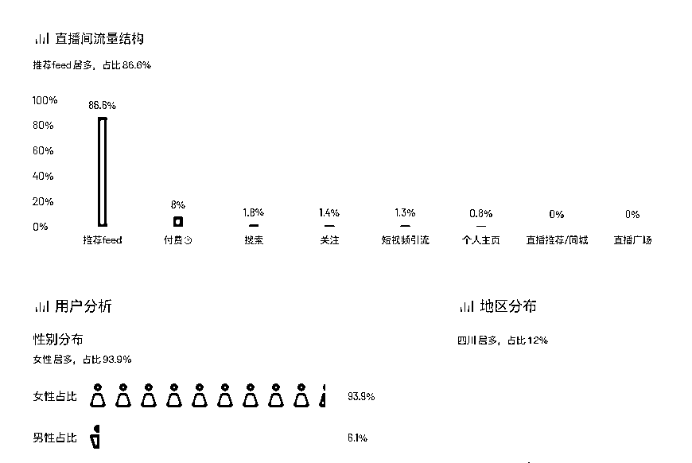

# 单号半年佣金破130万，新手进场视频号该怎么选赛道？
作者：龙哥

大家好，我是龙哥。很久没出来更新了，今天就聊聊视频号当下的机会和打法。如果你也在关注这个赛道，这篇内容会帮你快速理清思路。

## 一、当下业务体感

今年团队操盘了不少号，其中一台账号，5个月时间佣金做到了134万。这个成绩足以说明，视频号依然处在红利期，值得认真布局。

## 二、视频号带货的六种主流打法

视频号迭代很快，玩法也在不断变化。下面把目前常见的带货路径拆开讲清楚，选择大于蛮干。

变现形态很多，但聚焦带货本身，大概能归为下面6种形态。

| 打法 | 是否花钱 | 优劣 | 适合谁 |
| 依托验证过的爆款脚本做混剪/实拍短视频放量，直播承接 | 不花钱，自然流 | 优点：来的人精准、转化效率高 | 刚入场的萌新 |
| 不发片，靠拉广场自然流做直播 | 少量付费 | 优点： | 有直播功底的人 |
| 🛰️豆投放短视频挂车导流直播间，ROI打正后放大 | 重度付费 | 优点：相对稳，规模天花板高 | 有资金的人 |
| 🛰️豆直投直播间，ROI打正后持续加码 | 重度付费 |  |  |
| 🛰️豆投放挂车短视频 | 重度付费 |  |  |
| ADQ投放短视频 | 重度付费 |  |  |

### 第一种：短视频连爆打法

#### 拆解逻辑

这是最普遍也是最容易上手的模式。核心思路是借助平台对新号的扶持，用已经跑通的爆款带货脚本去做成短视频，形式可以是混剪也可以是实拍。脚本既然已被验证，起量的概率就会很高，流量起来后立刻开播，直播间来的用户基本都是被种草过的，成交自然顺滑。

这个套路已经跑了很久。去年年初我们带队做俄罗斯食品，后面转中医书、国学，今年年初又做剧情带货、卡人设卡封面，本质都一样。如今市面上绝大多数培训课讲的都是这套玩法，建议直接省下学费。这模式的核心就是信息差，操作并不复杂，关键是找到同行在爆的脚本一比一复刻。做到位就别创新，谁火抄谁，谁爆抄谁。直播话术也不需要花里胡哨，直播间本质就是收银台，把产品讲明白+适度逼单即可，不会的直接照搬同行的直播话术。

另外提醒一句，市面上各种卡封面、卡特效、AB测黑科技，基本都是噱头。我们测过大量数据，视频能不能爆，核心还是内容本身：完播率稳定在35%以上，互动率稳定在1.5%以上，内容不行，加什么技巧都没用，别被割韭菜。

这套打法的优点是门槛低、好上手，对主播要求不高。缺点也很明显：吃新号红利，号会比较“耗”，过了扶持期流量就会断崖，必须一直起新号。而且爆量有随机性，不可能每条都爆，属于相对不稳定的模式。适合纯新手、小白团队、夫妻档先感受下水温。

#### 视频实操要点

1. 内容尽量避免硬广式表达，比如“10瓶只要9.9”这种明显的营销话术，容易被限流
2. 尽量不要直接搬运，最好实拍或深度混剪，降低搬运风险
3. 完播>35%、评论率>1.5%更有利于起量；播放破500后立刻看数据，达标就马上开播
4. 视频里不要出现明星或网红达人，会被判定违规
5. 不要用抖音的版权音乐，会被识别限流

### 第二种：拉广场自然流打法

你经常会刷到一些直播间，他们几乎不发视频，或者视频数据平平，但场观和成交却很高。做过抖音的都懂这个逻辑：通过人货场搭建，把直播间的浅层数据做好，互动、停留、关注和转化先起来，从而撬动广场自然流量。起号期可能需要少量付费加速，但整体付费占比很低。

这种玩法对运营要求比第一种高很多，第一种可以场景简单话术普通，但拉广场必须有吸引力的人货场配置。也正因门槛更高，天花板更高、更稳定。

要搞懂视频号的推流底层：5分钟高密度互动 + 5分钟高密度成交 + GPM持续升高。

所以要想获得大场观和精准推送，必须做到：

#### 起号关键逻辑

* 场景先抄后超，对标同行拆解元素
* 福利款选品要精，核心是极致性价比而不是绝对便宜
* 按人群选品
* 5分钟内制造高频密集互动
* 5分钟内制造密集成交
* 多SKU测爆品

#### 场观拉动方法

| 密集互动 | AB链起号，用A号链接点对点互动 |
| 密集成交 | 用福利款控制放单节奏，避免成交触底 |

#### 执行动作

| 高密度互动 | 用福利款憋单，用低价品引流炸场，要互动要关注卡灯牌。每分钟互动>10人，起量就不远了 |
| 高密度成交 | 主播憋单时间过长要防成交断层，需人工补单，从广场进，别从私域进 |

#### 全场话术框架

| 话术节点 |  |  |  |  |
| 开场 | 上人 | 塑品 | 逼单 | 二次逼单 |
| 我是谁 | 点对点 | 挖需求 | 痛点强调 | 售后保障 |

每场直播结束必须复盘，把各个节点拆开优化，找到最优人货场组合。

#### 数据优化方向

| 优化点 | 做法 |
| 曝光进入率 | 封面主图决定基础进入率，进入率越高反馈越好 |
| 商品曝光 | 福利信息要写清楚 |
| 商品点击 | 主播话术塑造价值 + 价格 + 主图描述 |
| 订单创建率 | 跟主播逼单话术相关 |
| 成交人数 | 关注创建订单未支付环节 |
| 成交密度 | 用私域预约分批进场，保证成交曲线不触底 |
| 互动权重 | 底层认知 |

如果你没实操过，可能有些点会陌生，但上手一次就能对应上场景，按这个方向优化，数据会有明显提升。

### 第三种：纯付费打法

无论是🛰️豆投短视频挂车、直投直播间，还是ADQ，都不适合单人作战，需要小组团队化运营。门槛更高，但回报也最大。

基础条件：
* 现金流充足。以单间计，单条计划投2万豆，建10条计划就是20万，还只是一个账户。算上回款周期，启动模型至少准备30-50万现金流。
* 客单价和毛利要足够高，否则ROI跑不通

盈利模式大致有三类：
* 靠卖货跑ROI，跑正就放大
* 卖货勉强打平，靠平台赔付盈利
* 纯付费跑线索，后端成交高客单

这类玩法就不展开了，门槛高，有在做的可以交流。

* * *

以上就是视频号带货目前的三大主流方向，门槛和适合人群不同，建议按自身情况选。

## 三、新手如何快速切入

### 一、运营方向怎么选

| 方向 | 模式 |
| 短线打法 | 吃短视频流量，跟爆品测爆品，批量起号 |
| 长线打法 | 前期拉广场，中期叠加短视频，后期付费放大，单品类深耕 |
| 高阶打法 | 做人设立IP，积累势能 |

短线打法就是第一种短视频连爆，比如近期火的老人除味剂、滋补膳食、日用百货，都是赚快钱的游击战，账号当消耗品用。

长线打法是一个账号持续深耕。前面提到的134万佣金号就是这个路数：先把广场流量做起来，直播节奏稳定，再叠加短视频收割，最后用付费放大。更稳更持续，但对运营能力要求高。

最高阶是立人设做IP，这个还在探索中，行业里坤哥做得比较出色，可以去研究。

### 二、选品思路

选品大于运营。用同样的精力，不同品类收益天差地别。视频号卖铁皮石斛可能月体量几十万，卖女装可能一场就几十万。

平台红利期做红海品类，平台微利期做蓝海品类。

选品归根结底是需求洞察。视频号核心用户是50岁以上的姐姐，围绕她们选，基本不会错。

具体筛选方法我常用这几种：

#### 方法一：八大人群筛选
在精选联盟达人列表里按粉丝画像筛选，可筛出中老年、都市银发群体，会出来一批低粉高转化的账号，直接跟他们的爆品。

#### 方法二：抖音罗盘找热点
用抖音罗盘筛选最新市场热点，按人群筛出爆品。

#### 方法三：分类查询
分别查直播达人和视频达人，按人群和年龄卡账号，筛出不容易被发现的爆款号。

#### 方法四：视频号广场跟品
多刷广场，实时跟进热品，最简单直接。

选品方法很多，找到适合自己的即可。

### 三、实战运营拆解

举个例子串一下流程。

比如我选一个白牌洗发水，99元3瓶，毛利60%。

#### 第一步：养号搭建
用一个🛰️老号开视频号，改头像昵称简介，直接抄同行。搭建完别急着发带货，先养2天，发点日常再开始发视频。带货权限开通门槛变高了，具体可自行搜索。

#### 第二步：对标拆解
如果是抖音对标，用第三方工具看流量结构；视频号对标靠人工判断。流量结构不同，人货场搭配就不同，必须对齐。

#### 第三步：广场起号，搭人货场
① 场景搭建
参考同行，核心是OBS+绿幕，突出背书、功效、优惠信息。功效展示注意规避违禁词。画面里不要放视频，会被判低质直播。字号别太大，否则会被判贴图过大。

② 主播话术
把对标直播间的完整话术录下来，按逻辑拆分做成文档，替换关键词、品牌、价格、优惠等，再对照违禁词表清理。

| 话术逻辑 |  |  |  |  |
| 开场 | 上人 | 塑品 | 逼单 | 二次逼单 |
| 我是谁 | 点对点 | 挖需求 | 痛点强调 | 售后保障 |

③ 货盘
上架方式：自建店、挂他人链接、找后端代上。货盘组合：低价引流品2.9元+正价核心品99元3瓶。

#### 第四步：起号节奏
目标3场内场观破5000，完成起号

| 场次 | 策略 |
| 第一场 | 点对点互动，用低价品拉人，核心完成5分钟密集成交，不急转正价，至少播2小时 |
| 第二场 | 根据首场数据优化，钩子品留不住就换，哪怕亏品也要把互动拉起来，开始转正价，看转化率 |
| 第三场 | 形成稳定循环脚本，持续优化人货场，成交转化率>1% |

#### 第五步：短视频增量
分析同行引流脚本，混剪或实拍做原创，测试流量，在开播时段发。至此0-1模型搭建完成，后续就是持续优化迭代，再考虑付费放大。

* * *

以上就是全部分享，希望能帮到你。我是阿豪，目前深耕视频号和抖音，有问题欢迎留言交流。

轻舟已过万重山，前路漫漫亦灿灿，一起加油！