# 五天破百万的理财营发售复盘：快闪群+朋友圈+1v1，如何把积累变成爆发
作者：龙哥

大家好，我是龙哥。上一次在圈子里输出复盘，还是去年的7月27号，https://t.zsxq.com/18iLrX2G0
那次分享的是年收入36万的运营总结。这次要讲的是一个更猛的结果：5天做到百万营收，覆盖高客单和中客单。配图里是先跑出来的高客单群，高客单群发售期间招了近50人，客单2万；中客单群是在一个月后才开，当场发售前50个名额基本是当天秒没。我主打的是培训交付，所以基本等于利润。

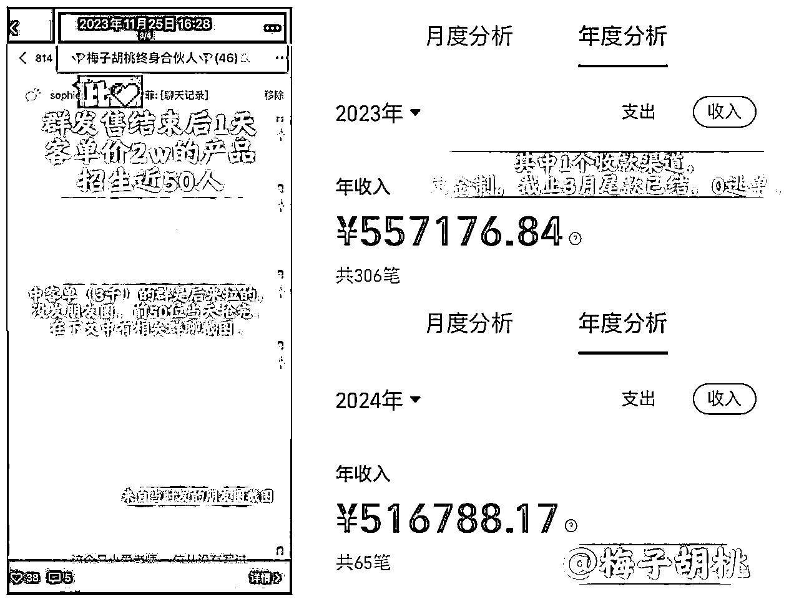

这次发售结束至今已经过去4个月，这篇复盘本该更早写出来，但招满生后一直泡在交付里，也需要时间来消化和沉淀。现在整个系统已经稳定运转，才算兑现了承诺。

我是从2022年8月底开始和赚钱圈友@胡桃 联合做理财营这个产品的。运营超过一年多的一个产品，在一次准备得有点仓促的发售里拿到这样的数据，完全超出了预期。

在赚钱一众优秀圈友和几位贵人老师的熏陶下@芷蓝@梁靠谱@理白先生，我学到的东西太多。他们帮我打开了认知，挖出了我自己都没料到的潜力。今天就把这次发售拆开讲，如果能给各位一点启发，我就很知足了。

冰冻三尺非一日之寒。看着是5天百万，背后站着的是我8年多的理财实操经验和1年多的社群交付经验。这次的爆发，是长期积累到临界点后的一次集中释放。我会把冰山露出水面的那一角，和水面下的主体部分都讲清楚。

整体拆成6个部分：

一、前期准备，关键环节

二、各方布阵，直指成交

三、惊喜与焦虑并存的意外

四、素人IP的长线价值

五、踩坑与避坑

六、师恩与前路

先上思维导图：

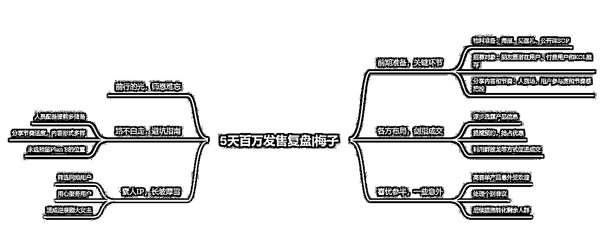

# 一、前期准备，关键环节

最初萌生做一场公开课的想法是在去年9月底。当时3.0版理财营正稳定运转，产品定价都在四位数，对于新来的朋友来说缺少一个低门槛的体验入口。我们意识到这个问题有一段时间了，就去报了几场课，学习更成熟的产品打法，补上了缺失的低客单和顶级客单。

到了9月底，产品升级的大方向和框架基本成型了，正好需要一次公开露面来承接。那就索性做一场免费公开课，一边让陌生人低成本体验，一边官宣新体系。对想尝鲜的和想续费的老用户来说，都是一个很好的抓手。

给到大家做产品的通用建议：一个相对健康的体系，必须有低-中-高的三档价格。

我们3.0期只做中客单，就出现了尴尬：想先试水的人嫌4位数太贵，不敢轻易下手；想深度绑定的老用户又没有高客单的升级通道。两头不靠。

如果从零起步，可以先从低客单起步，再逐步升维到中客单。我们前三期就是这么走的，前两期都是两三位数的低价产品，让用户花最少的钱验证我们的能力。信任起来之后，再铺中高客单。前端一定要有低客单，否则增量会卡壳。

团队小群里第一次提到要做公开课的聊天记录，就是9月底的这个想法：

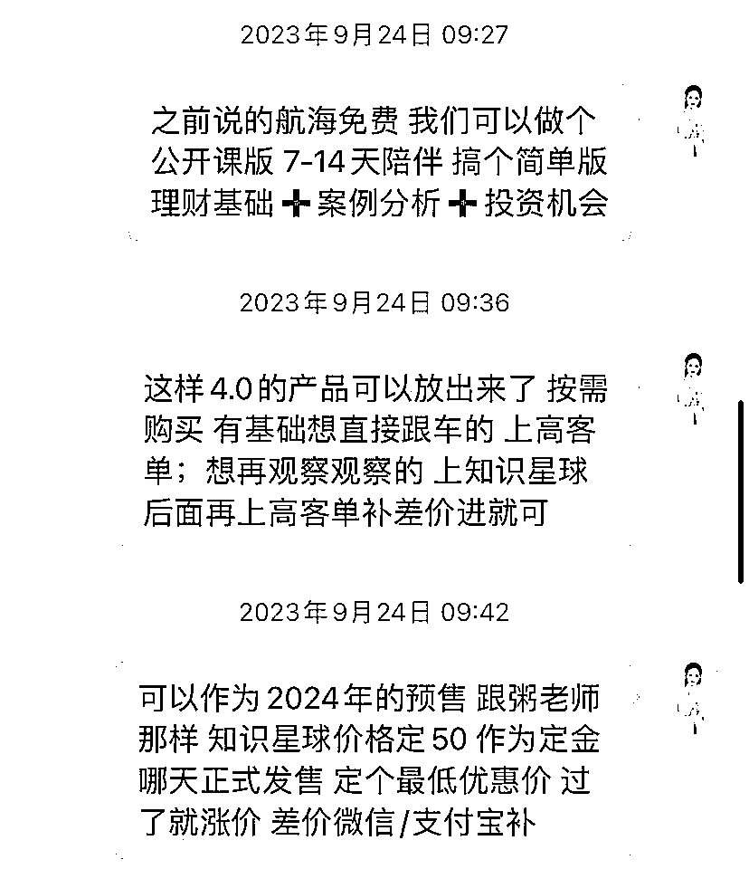

10-11月进入实操筹备，主要做了这几件事：

## 物料准备

1. 海报：公开课主海报1张，产品升级海报3张。海报要吸睛也要把信息说清，标题、目录、排版反复改了好几版，越早启动越好；
2. 见面礼：用来促进入群，也能让新朋友加我私聊；
3. 抽奖和全勤激励：5天课程每天都有课后作业小挑战。内容量大，需要参与感，不然就是我一个人在对着空气讲。设置作业打卡和全勤奖励，问题也能在作业里提前暴露，学-互动-提问-抽奖，体验感拉满；
4. 5天公开课的SOP：开营仪式+自我介绍+规则说明+当天主题分享；第二天起以作业点评开场，承上启下再讲新内容，最后提醒次日作业。群公告也提前写好。

最终定的公开课内容如下：

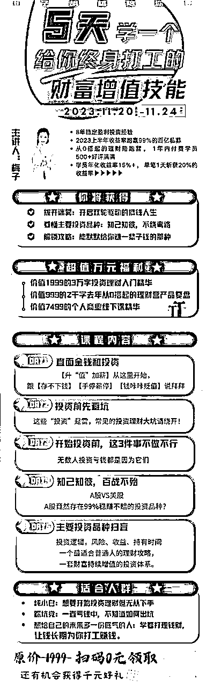

## 招募渠道

1. 朋友圈的存量潜在用户：

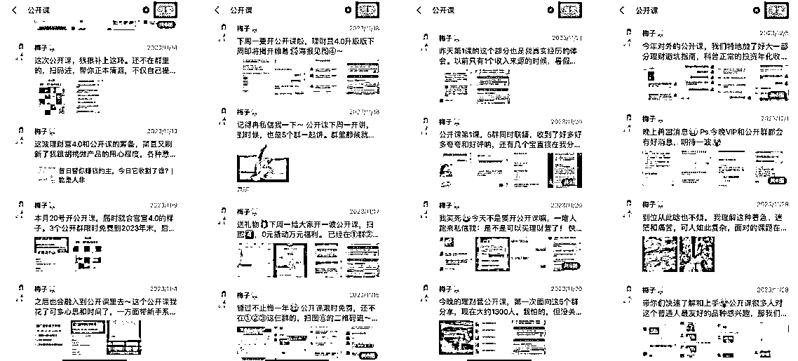

2. 老用户与KOL分发：
老用户了解我们，免费活动一年就一次，他们会自发去推荐身边的朋友。推荐成交有佣金，没成交也是朋友的学习机会，大家都愿意帮忙。这里我们没提前准备好朋友圈文案素材，算是遗憾。理财话题敏感，很多人平时不发广告，临时要他们发，心理门槛很高。提前给一套可选文案和话术，会更有效。

除了老用户自发外，我也请了关系不错的KOL帮忙推。特别感谢理白和梁靠谱，让我亲眼看到个人品牌声量起来后，一句话的威力远超自己吭哧吭哧很久。

## 内容与节奏

内容的主体我很早就备好了，但第一天的开场一直不满意，反复改到20号那天还在昆明酒店的写字台前改。昆明风景美食一大堆，我无心出去，就点了外卖牛肝菌炒饭。怕分享时没精神硬吃了几口，又继续写。结果那盒饭现在还记忆犹新，被我浪费了80%。

第一次做这种大群发售，几个公开群里都是朋友带进来的人，我特别想给个好印象。临场前第一天开场还没定稿，压力大到在酒店哭了一场。哭完清空杂念，只写我想说的话。不想效果，只把拯救过我的东西如实讲出来。

当天反馈不错，印象最深的一句评价是：“这是我见过财富观最正的理财博主了。”

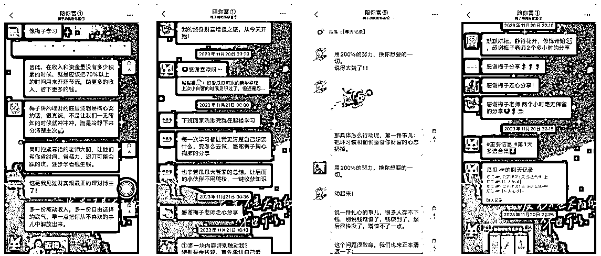

四个核心体会：

1. 人大于货，故事大于干货。在陌生用户面前不能上来就干货。先讲我的起点、被刺痛的点、怎么改变、现在是什么状态。我的起点很低，现在相对自由，这个反差会让人好奇。只有先被我吸引，她才不排斥我讲内容。第一天40%以上都在讲个人成长和经验教训，这是建立信任的地基；
2. 干货里要有互动。设置简单的是非题或数字选择题，让围观的人能一句话回复。既不枯燥，也能初步摸清用户画像；
3. 持续回应。分享中、分享后都要留互动空间，及时点评作业、回答提问。单向输出很快流失，认真反馈是留人的关键。

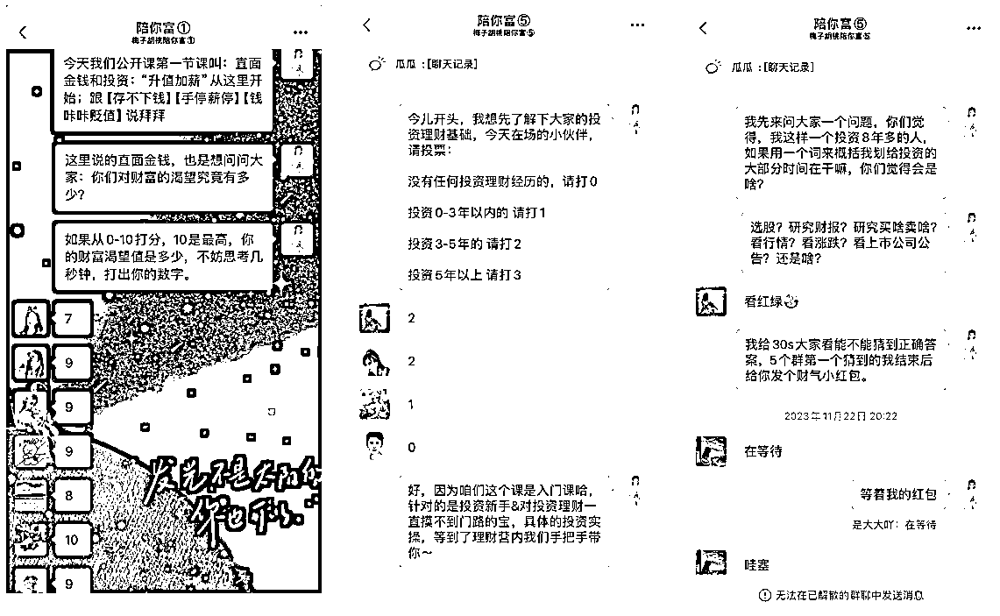

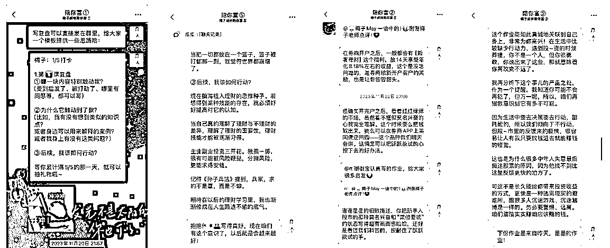

4. 让优秀学员上台。学员的成果是最好的证明，让他们来讲比我自己说更有说服力。

做得不够好的地方：

5天内容太挤，每次分享近2小时，全是文字加少量图片，形式单一视觉疲劳。当时想压缩周期怕用户掉队，结果适得其反。以前我直播过，完全能做直播答疑的，搭配直播会好很多。

理财赛道需要信任沉淀周期，长一点更好。比如分享一天，答疑一天交替进行。时间太短信任没建立起来，没上直播是大失误。

文字分享时长最好控制在1小时内，1.5小时是上限。

# 二、各方布阵，直指成交

成交不能留到最后一天。用户注意力最集中的是第1-2天，第1天直接卖太突兀，第2天我借用户私聊提问在群里公开答疑，顺势埋下产品种子。之后每天都持续种草。

每天揭露一点，然后让感兴趣的人私信我“预约”登记，我好打标签走优惠通道。本来担心太早提产品会吓跑人，后来发现没必要。商业就是商业，发售就是为了转化。把买法、优惠规则讲明白是对用户负责，早说他们早安心。

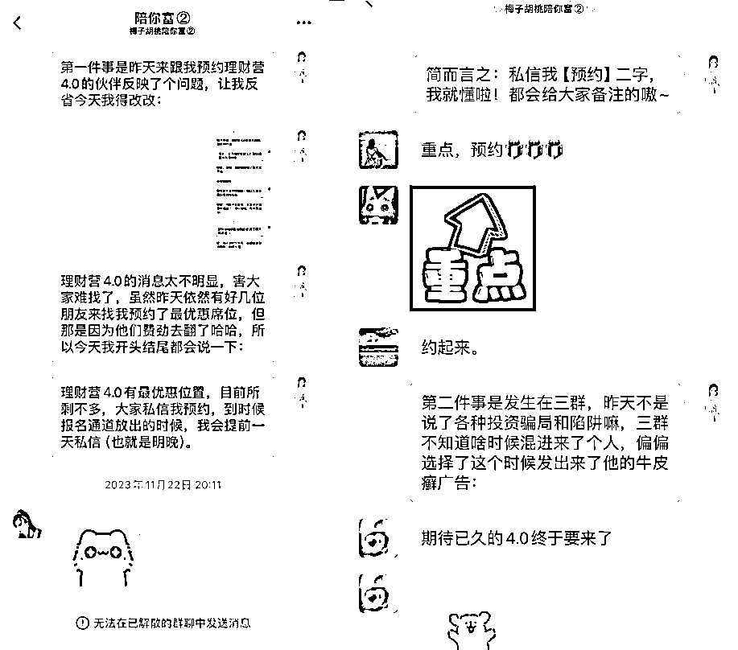

这里有个小疏漏：本可以放一个群接龙来制造从众效应，当时只顾着我私下打标签了。群运营就是细节活，下次应该把这些动作提前做成SOP表格逐项打勾。

群里提前透露产品、强调预约享优惠，一方面让我心里有数，另一方面给最感兴趣的人先发优势，形成紧迫感。朋友圈也会同步提醒，覆盖没看群消息的人。

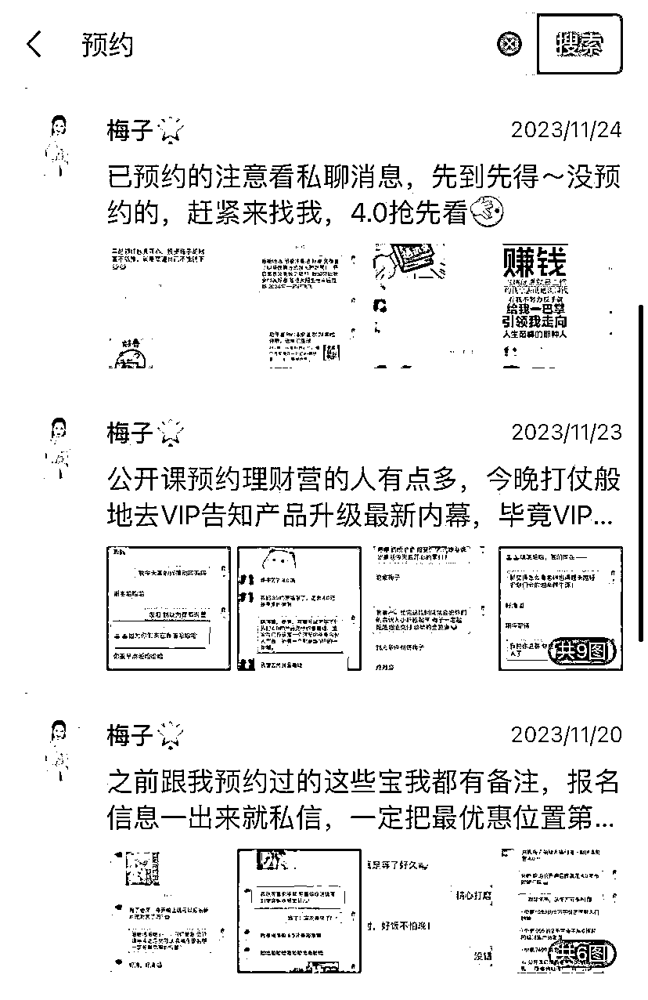

进入成交段落。因为有3个产品，需要时间让用户了解、选择、抢优惠。于是倒数第二天，我挨个通知已预约的人，提前一天可看详情并享受最优价，按付款顺序先后到先得。

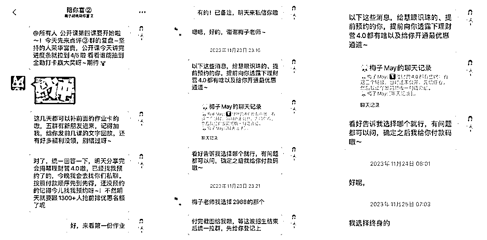

最后一天，分享结束，预热到位，我们启动群接龙同步收钱并倒计时剩余优惠名额：

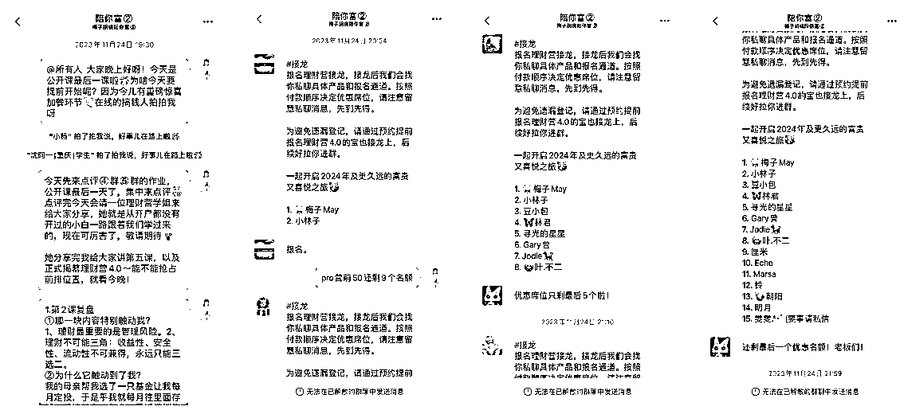

优惠名额抢得很快。

可优化点：后续学习案例后发现，还可以对已预约但未回复私信的人做一次回访，了解顾虑，追回一些单。当时的成交策略偏佛系，下次要更主动。

# 三、惊喜与焦虑并存的意外

最大惊喜来自终身合伙人这个高客单产品。这是我们第一次上高客单，本意只是为了补全产品体系，连我自己都不确定能卖几个。

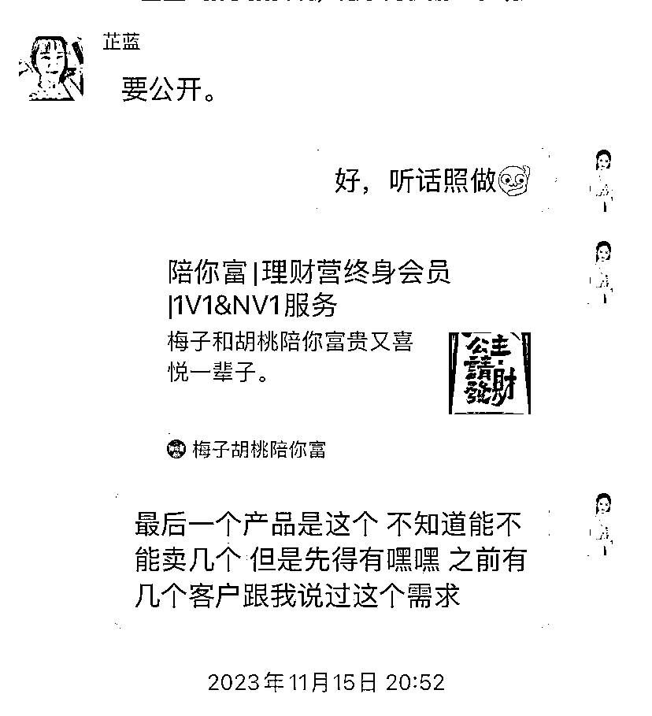

这个产品不面向公开课新人，客单2万，新人基本不会买。我们提前在付费群里告知老用户产品升级，有意向的可以续费或升级。做了接龙，前10位优惠，先到先得，只收1000定金，尾款3个月内补齐。

没想到付费群里对终身合伙人的兴趣远超预期，消息一出大量私信转账预定：

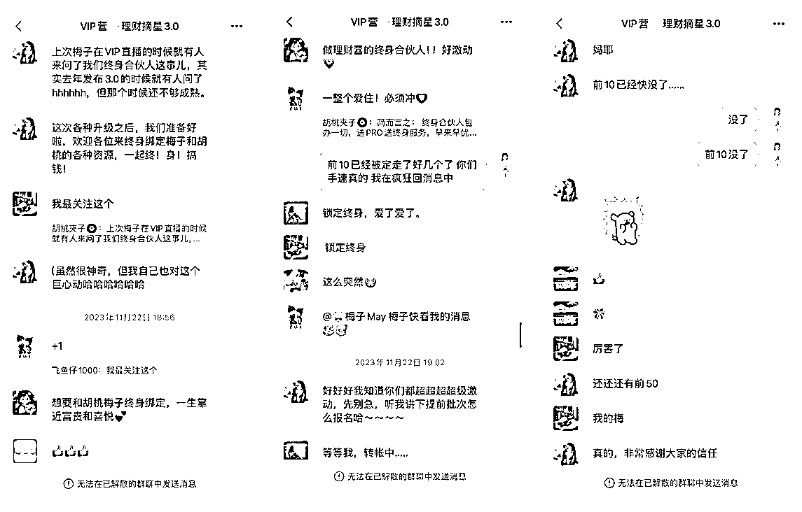

那晚我们又惊又喜，前10个名额几乎瞬间抢完。后面看到消息晚的朋友，我们不忍心加价，临时把当晚所有预定者都按前10价对待。

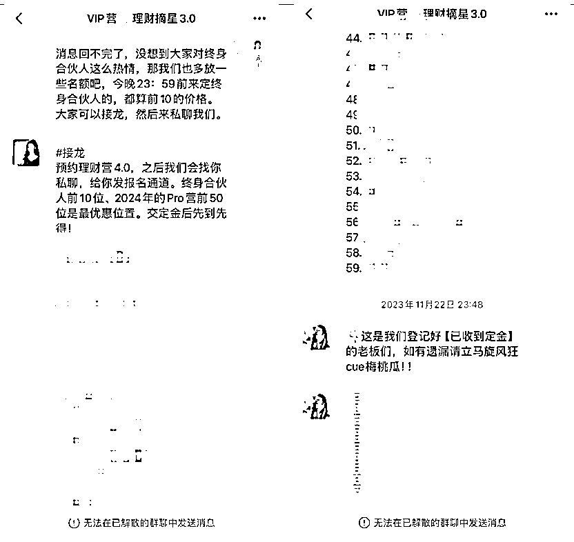

当晚预定终身的接近40人，仓皇建群，连终身群都是临时拉的。情绪上坐了过山车，后来我跟靠谱姐、芷蓝姐交流时还在感慨：

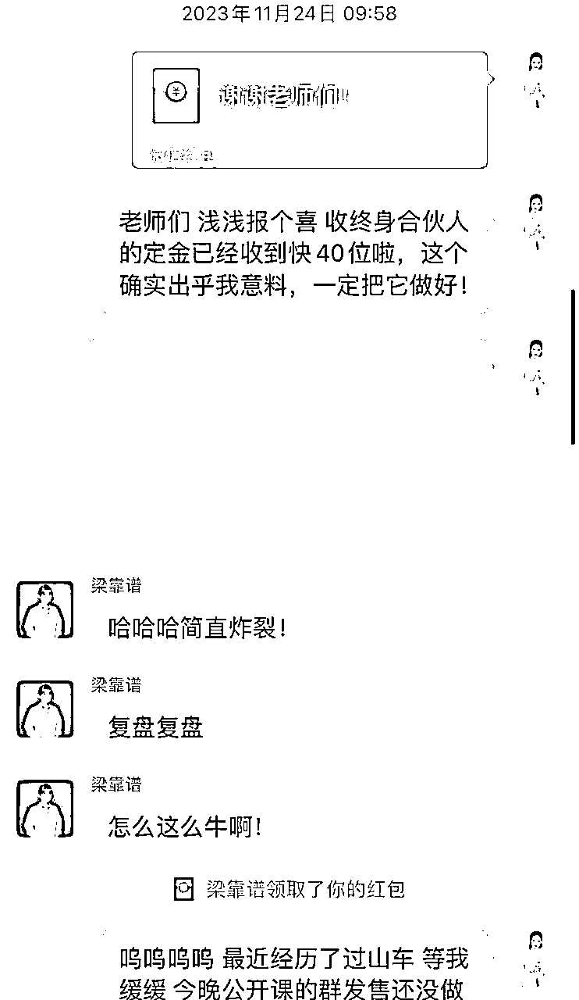

这个成绩是在公开群公布产品前就拿到的。也就是说，公开课开始前4天，终身合伙人收入接近80万，加上已预约并付款的中客单用户约50位，客单约3千，这块已接近百万。

战斗结果在号角吹响前就已显现。但我们根本没空高兴，一堆收尾事压着。当好事和焦虑事同时来，人会放大焦虑。

情绪波动主要来自两点：

1. 个别非议；
2. 公开课大量未转化用户的下一步。

个别非议：

结果一出，朋友圈很快传播。平平无奇的0号人物梅子和胡桃，怎么几天就百万？攻击点自然就落在高客单上。有人说卖终身是割韭菜，还有更难听的，甚至私信发小作文质问我。

我当时还认真解释，现在回头看是把时间浪费在不值得的人身上。对面带着恶意来，你怎么解释都无用。

更怕的是付费群里的人也会产生猜忌，于是我一宿没睡，把设计初衷和我愿意做一辈子的理由写清楚，同步到社群和朋友圈。能做的只有把本意说清。

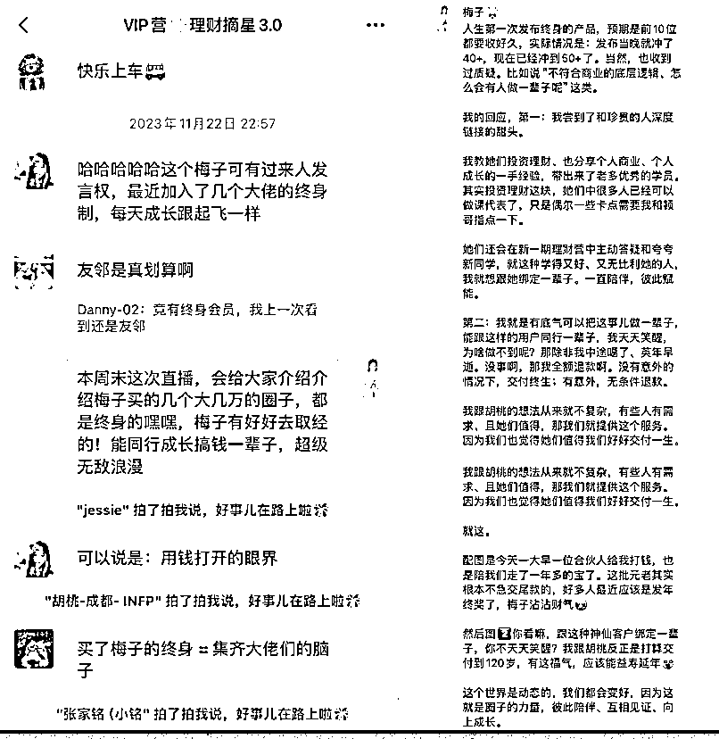

做事图个自己心安。有问题就解决。靠谱姐说过：不要奖惩错逆。对那些不愿付费还挑刺的人，别浪费时间去说服。对那些愿意付费的人，要给足关注。我在招生结束后给第一批合伙人加了很多额外福利：在群里一起定目标督促完成、送生日礼物、随时电话咨询理财问题，任何我会的问题都掏空自己回答，比如1V1盖洛普解读一次2小时。职业、副业路径这些也都认真梳理。心情不好的时候愿意被倾诉，我尽力当那个可以靠的肩膀。

金科玉律：不要奖惩错逆，只对值得的人好。

剩余用户的转化：

公开课结束，3个产品都已发布。交付上，3个营的基础内容是重合的，无法分3个群交付。再者，公开群就这么散了吗？能不能再捞一波。

紧急变通了一个开营前的集训营。作为正式营的开营福利，时间在2024年开营前一个月。如果营外的人感兴趣也可以买，顺势把引流产品也推出了。

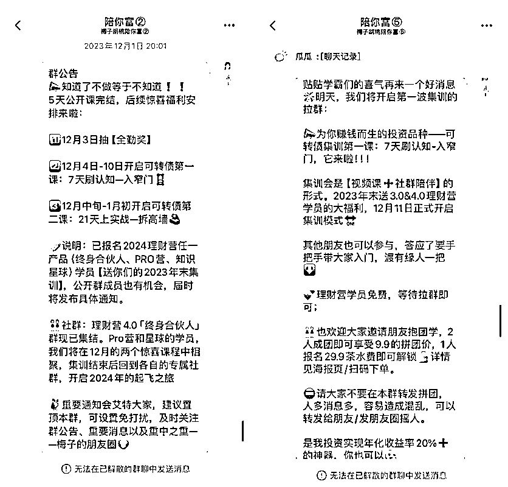

这个低价引流产品还有意外收获，原本只是想转化没买任何产品的用户，结果因为交付质量好，反而吸引新朋友来买终身合伙人。

这轮发售把我对人性的理解再往前推了一步。说实话，过去从未做过长期交付的人，这次也直接买了终身权限。这样的信号不是个例，次数多了我就明白，产品的生命力从来不是主理人单打独斗撑起来的，是每一位参与者在共同赋予它温度。由衷感谢这份托付和善意，每每回想仍觉得难以置信。

于是我们边开战边修补，边推进边迭代。公开课的全流程到这里告一段落。只是我还想把水面之下的东西说开。这次释放给我带来的冲击很大，许多道理已经被刻进骨子里，几乎相当于把自己做了一次系统性升级。有不少体悟想和大家分享，就从当前讨论度很高的IP这个命题开始。

# 四、素人IP，长坡厚雪

IP这个概念我很早就听人提过。2022年9月启动理财营算起，到现在已经走过一年多，我才迟钝地意识到，自己也在不自觉地做IP这件事。我没有资源，没有背景，身上只有八年多的理财实操经验，和一颗真诚、愿意死磕的心。就是这样一路走来。身为一个十八线素人理财创作者，我把自己的几条实践拆开来讲。

1. 筛选重于培养。你对外输出的内容类型，直接决定了会走进来哪类人。用内容去做一道筛子，主动筛出价值观相近的人，后续的沟通成本会低很多。

理财是最贴近金钱的议题，也最容易照见人性的贪嗔惧。你若天天喊日入千元，聚集来的自然是想立刻暴富的人。我自认做不到带人快钱，所以我始终坚持讲长期主义，认知建设和实操锻炼双向进行，重点是避开常见陷阱、修炼在波动中保持心性的能力，踏实学、慢慢富。

我不会夸大理财的神奇。我觉得这件事适合一部分人长期打磨，不适合所有人。比方说现金流已经断裂的人，想着躺赚迅速回本的人，习惯无脑短线、情绪化波动、无法容忍不确定性的人，都不适合。

所以在公开输出时，我会直接点名这些问题，提前把不匹配的人挡在门外。结果留下来的人特别好相处。一年多的交付里，群里不会因为大涨就亢奋，也不会因为回调就哀嚎，大家都很平静，不会因为一天的波动就集体炸锅。

能带出一群头脑清醒、愿意做难而正确的事的同行者，是我这段经历里最大的收获。把自己的价值观主动投射出去，找到一群同频的人一起走，这本身就是件值得感恩的事。

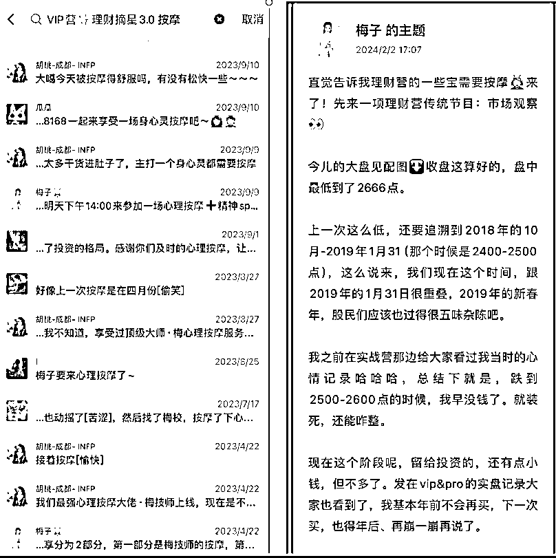

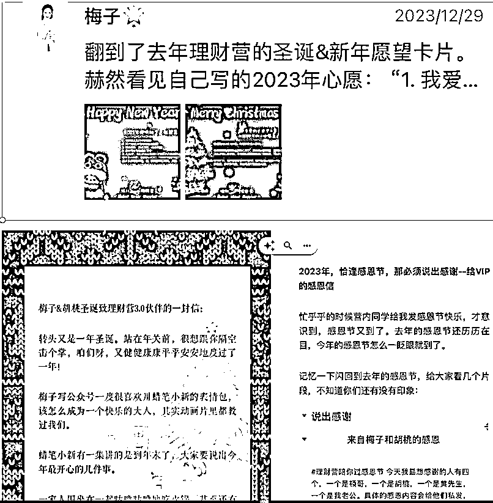

真诚是可以被感知到的，势能是日积月累的，信任也需要时间沉淀。正因一无所有，所以更要用尽全力。

2. 素人做IP，缺资源缺背景，就只能拼用心、拼交付。

我们谁都不是大号，但我们也可以成为自己想成为的人。起步阶段，那些愿意站出来的用户都是天使，必须倾尽全力对他们好，守住交付质量。一方面给专业的解法，另一方面给情绪上的陪伴。

在理财营里，我一边手把手教理论和实操，近乎喂到嘴边；一边做鼓励、表扬、心理按摩。大跌时稳住情绪，大涨时提醒贪念；节日里送走心的祝福，感恩节的致谢、圣诞节的年度复盘、新年的心愿卡，把仪式感做到极致。设想用户在想什么，甚至比他们多想半步，时不时送上一份小惊喜，像礼物一样出现在他们生活里。

毕竟，人与人之间最难忘的，就是一起走过的时光和共同经历的过程。正如《小王子》里说的，你为一朵玫瑰花费的时间，才让这朵玫瑰变得重要。

3. 要做灯塔，一直立在前面顶天立地

做领路人，你也会害怕，会不安，会怀疑自己配不配这束聚光。但所有自我怀疑都得吞下去，坚定地往前走。

我能有今天一点成绩，很大程度上要感谢自己那场自我革命。一个长期隐身的小透明，因为某种使命感站出来分享，勇敢突破边界，一步步前行，挡者披靡，最后拿到了结果。

当这种好莱坞式的人生逆转发生在你认识的人身上，你会不会想要靠近？会不会被这种转变所触动？

蜕变的力量自带磁场。你会想：平凡如她都能做到，我假以时日也行。我们的存在，就是要给身边人这种希望感。一个踏实做事、极致努力的好人，终于多年后实现突破，这件事本身就足够鼓舞人。

这种事不该只存在影视里，它真实地在现实中上演，比电影更震撼。

因此你要一直成为那个人：

勇敢、主动、能量充足、内核稳固、百折不挠、虽败犹荣、屡败屡战、永远保持希望。

做灯塔，不要做观众。

这段自我革命值得走下去，它会像滚雪球一样，长坡厚雪，越滚越大，越滚越值钱。

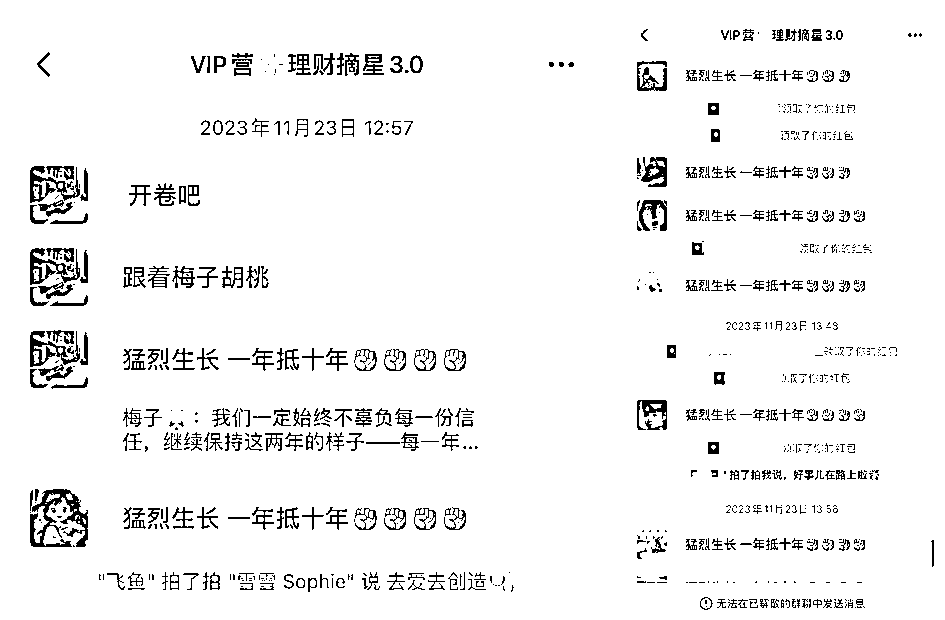

# 五、路不白走，避坑指南

第一次做大规模群发售，踩了三个坑，供大家参考：

1. 人手要提前部署，多备些人。超过两个群的发售，对应急和调度的人力需求非常高，务必提前招募好能互动的小分队。

我们当时完全没准备，临时找了几个人，但社群运营经验不足，也没有提前培训、没有明确什么时间节点该出现。单次分享时长又长，人中途有事去忙别的也很正常，回应就变得断断续续，这块提升空间很大；

2. 分享节奏要提前规划，最好能做一次预演，对时长和节奏做到心里有底。

除了文字分享，配合直播效果会更好。周期可以适当拉长，但节奏不能太拥挤。内容多的话，不要一次性集中输出，要站在用户视角思考怎么让他们更好吸收、更愿意参与。

无论是开直播还是把分享周期拉开，比如分享用一天、消化答疑用一天间隔进行，不要搞填鸭式喂养。参与者的感受和互动很重要，要看得见他们；

3. 提前准备Plan B，为突发情况预留处理时间。

突发状况很正常，留出时间去应对即可。比如这次我们临时做了好几个计划外调整，在不偏离大原则的前提下，以用户利益为中心，结合实际情况灵活应对就好。

说个小插曲：群里混广告很常见，结合场景机智处理，反而为这次分享增添了一道独特的风景线。

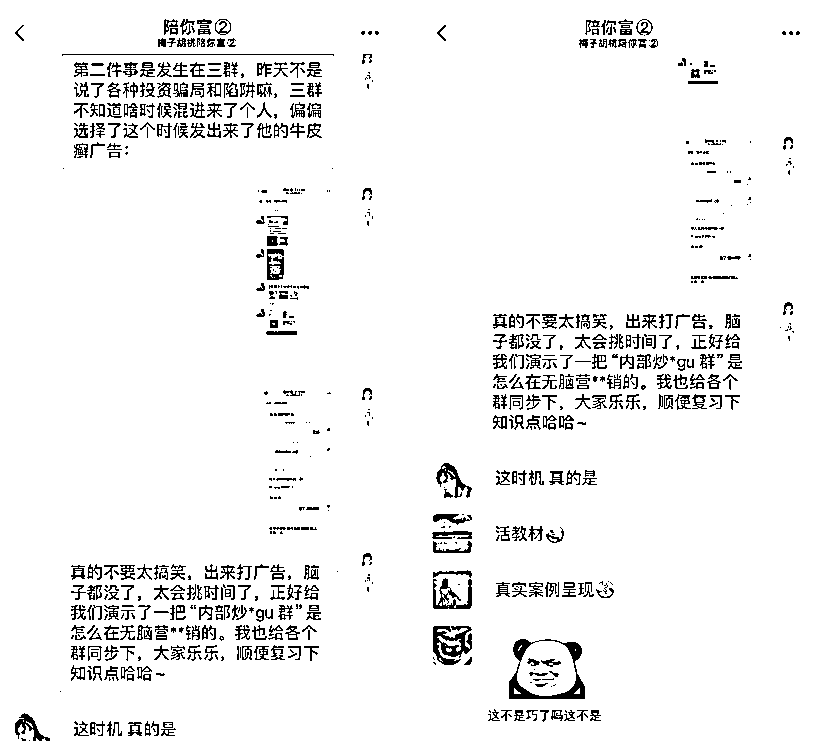

# 六、前行的光，师恩难忘

这篇文章感谢和我一起做理财营的顿哥、胡桃和瓜瓜。没有你们就没有理财营这个产品。你们一路指导、陪我打仗，没有你们就没有现在的梅子。有你们这样的老师和战友，我三生有幸。

感谢芷蓝姐、靠谱姐和理白先生。你们是我前行的光，终身合伙人这个产品的启发也是来自玩赚合伙人。感谢你们打开了我一扇扇新世界的大门，教会了我很多不内耗的原则，愿意做我的靠山，随时为我撑伞。

感谢龙哥盟这个大家庭。我是2023年4月加入的，快一年了。 here认识了太多厉害的人，格局被撑得越来越大。谢谢赚钱教我的一切，带我认识的宝藏，如果没有赚钱这个平台，我的产品不可能迸发出连曾经的我都无法想象的能量。谢谢赚钱赐予平凡如我者的光。

送给你一段我很喜欢的话：

赶路的人一定能遇见同行的人吗？
但铺路的人一定会照耀迷路的人
曾经的我们都做过很野的梦
扑过很多次空
白云苍狗四季枯荣
是谁？
依然赤着脚昂着头 奔跑在烈风中
兵临城下 萤火中的凛冬
三十而悦 平凡而后勇
已经踏过了千层浪却依然挚爱着
像刀锋一样
转眼渡过了万重海 依然骑鲸追梦
请你别担心 请你别放弃
清风拂明月 山海有相逢
--出自《乘风破浪的姐姐》

祝你在成为光的路上，乘风破浪。

以上就是我全部的复盘了，谢谢观看，文末放了一张思维导图。

